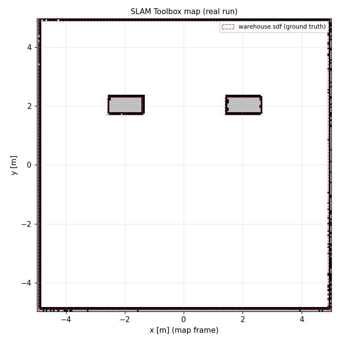

# 🛠️ ใบงานปฏิบัติการสัปดาห์ที่ 12: การสร้างแผนที่ 2 มิติด้วย SLAM Toolbox (Ceres)
**วิชา:** AMR-101 Essential ROS 2 for Autonomous Mobile Robots  
**เวลาปฏิบัติการ:** 3 ชั่วโมง  
**ระดับ:** พื้นฐาน (Beginner)  
**เอกสารประกอบการบรรยาย:** [คู่มือบรรยายสัปดาห์ที่ 12](Readme.md)

---

## 🎯 วัตถุประสงค์การทดลอง (Lab Objectives)
1. เปิดใช้งานระบบสร้างแผนที่แบบออนไลน์ **SLAM Toolbox** (executable `async_slam_toolbox_node`, โหนด `/slam_toolbox` แบบ Lifecycle) ร่วมกับแบบจำลอง Gazebo
2. ขับเคลื่อนหุ่นยนต์สำรวจพื้นที่โกดังสินค้าเพื่อสแกนสิ่งกีดขวางและผนังรอบทิศทาง
3. สังเกตและวิเคราะห์พฤติกรรม **Loop Closure** เมื่อหุ่นยนต์ขับวนกลับมายังจุดเริ่มต้น
4. บันทึกแผนที่ 2 มิติฉบับสมบูรณ์ออกเป็นไฟล์ `.yaml` และ `.pgm` ด้วยคำสั่ง **`map_saver_cli`**

---

## 📋 ข้อกำหนดก่อนเริ่มปฏิบัติการ (Prerequisites & Setup)
- เข้าสู่รูทไดเรกทอรีของ repository (เช่น `cd ~/ros`)
- Build แพ็กเกจ (รวม `amr_week07`, `amr_week10`, `amr_week11` ที่ใช้ร่วม):
  ```bash
  ./docker/run_lab.sh colcon build --base-paths Essential_ROS --packages-up-to amr_week12
  ```

---

## 🧪 ขั้นตอนการทดลอง (Step-by-Step Lab Tasks)

### 🔹 Lab 12.1: การเปิดระบบจำลองและเริ่มต้น SLAM Toolbox
**เป้าหมาย:** สังเกตการเริ่มต้นสร้างโหนดใน Pose Graph ของ SLAM Toolbox

1. เปิด **Terminal 1** แล้วรันระบบจำลอง Gazebo พร้อม Bridge จากสัปดาห์ที่ 11:
   ```bash
   ./docker/run_lab.sh ros2 launch amr_week11 gazebo_world.launch.py            # เพิ่ม headless:=true ถ้าไม่มีจอ
   ```

2. เปิด **Terminal 2** แล้วรัน SLAM Toolbox:
   ```bash
   ./docker/run_lab.sh ros2 launch amr_week12 online_async_slam.launch.py
   ```
   **ผลลัพธ์จริง (จาก log):**
   ```text
   [async_slam_toolbox_node-5] [INFO] [1793243178.409094986] [slam_toolbox]: Configuring
   [async_slam_toolbox_node-5] [INFO] [1793243178.412801892] [slam_toolbox]: Using solver plugin solver_plugins::CeresSolver
   [async_slam_toolbox_node-5] [INFO] [1793243178.412930952] [slam_toolbox]: CeresSolver: Using SCHUR_JACOBI preconditioner.
   [INFO] [launch.user]: [LifecycleLaunch] Slamtoolbox node is activating.
   [async_slam_toolbox_node-5] [INFO] [1793243178.422905473] [slam_toolbox]: Activating
   [async_slam_toolbox_node-5] Registering sensor: [Custom Described Lidar]
   ```
   ตรวจสถานะ Lifecycle และพารามิเตอร์ที่โหนดใช้อยู่จริง:
   ```bash
   ./docker/run_lab.sh ros2 lifecycle get /slam_toolbox                  # active [3]
   ./docker/run_lab.sh ros2 param get /slam_toolbox max_laser_range      # Double value is: 10.0
   ```
   *(`max_laser_range` ถูกประกาศหลังจากโหนดได้รับ scan แรกแล้วเท่านั้น ถ้าถามเร็วเกินไปจะได้ `Parameter not set`)*

3. ตรวจสอบท็อปปิกแผนที่ `/map`:
   ```bash
   ./docker/run_lab.sh ros2 topic hz /map
   ```
   *ตรวจสอบว่ามีท็อปปิก `/map` ถูกเผยแพร่ออกมาอย่างสม่ำเสมอ*

---

### 🔹 Lab 12.2: การขับเคลื่อนหุ่นยนต์เพื่อกวาดสแกนแผนที่ (Exploration)
**เป้าหมาย:** สร้างแผนที่ทางเดินและสิ่งกีดขวางให้ครอบคลุมพื้นที่โกดัง

1. ใน **Terminal 3** เปิดโหนดควบคุมการเคลื่อนที่ด้วยคีย์บอร์ด (ต้องมี TTY จึงรันแบบ interactive):
   ```bash
   ./docker/run_lab.sh ros2 run teleop_twist_keyboard teleop_twist_keyboard
   ```
   **หรือ** ใช้สคริปต์ขับสำรวจอัตโนมัติของแพ็กเกจ (เส้นทางเดียวกับที่ใช้สร้างแผนที่ใน `maps/`):
   ```bash
   ./docker/run_lab.sh ros2 run amr_week12 explore_warehouse --ros-args -p use_sim_time:=true
   ```

2. ควบคุมหุ่นยนต์ขับไปข้างหน้าช้าๆ (แนะนำความเร็วเชิงเส้นไม่เกิน $0.25$ m/s):
   - ขับผ่านช่องทางเดินระหว่างเสา/ชั้นวางสองต้นที่ $(\pm 2, 2)$ และอ้อมไปด้านหลังเสา
   - สำรวจแนวกำแพงด้านทิศเหนือ ทิศใต้ ทิศตะวันออก และทิศตะวันตก
   - *ข้อสังเกตจากการทดสอบจริง:* การหมุนอยู่กับที่เพียงอย่างเดียวแทบไม่เพิ่มเซลล์ว่างในแผนที่ ต้องเคลื่อนที่เชิงเส้นด้วย
3. ตรวจสอบข้อมูลขนาดของแผนที่ที่ขยายตัวขึ้น:
   ```bash
   ./docker/run_lab.sh ros2 topic echo --once /map nav_msgs/msg/OccupancyGrid --field info
   ```
   **คำถาม Checkpoint 12.2:**
   - [ ] ค่า `resolution` ของแผนที่มีค่ากี่เมตรต่อพิกเซล? (ตามไฟล์คอนฟิกคือ $0.05$ m)
   - [ ] ขนาด `width` และ `height` (จำนวนเซลล์) ของแผนที่มีค่าเท่าใด ณ ขณะนี้?

---

### 🔹 Lab 12.3: การทดสอบ Loop Closure และการปรับโครงสร้างแผนที่
**เป้าหมาย:** พิสูจน์ว่าเมื่อเดินครบรอบ Ceres Solver จะดึงผนังที่คลาดเคลื่อนให้ตรงกัน

1. ขับหุ่นยนต์เป็นวงรอบโกดังจนกระทั่งวนกลับมายังจุดเริ่มต้น (Home Position: พิกัด $0, 0$) — สคริปต์ `explore_warehouse` ทำเช่นนี้ (ขั้น 4–8 วนรอบเสาแล้วกลับมาที่ $(0, 3.5)$)
2. เปิด RViz2 แล้วเพิ่ม Display `Map` (`/map`) และ `MarkerArray` (`/slam_toolbox/graph_visualization`) เพื่อดู Pose Graph:
   โหนดของกราฟและเส้นเชื่อม (edge) ระหว่างโหนดที่อยู่ห่างกันตามเวลาแต่ใกล้กันในพื้นที่ คือ constraint จาก loop closure
   *(ในการรันจริงของเรา SLAM Toolbox ไม่ได้พิมพ์ข้อความ loop closure ออกทาง log ระดับ INFO จึงต้องสังเกตจากกราฟ/แผนที่)*
3. สังเกตว่าแนวผนังที่อาจมีความเหลื่อมกันเล็กน้อยจากการลื่นไถลของล้อ จะถูกจัดระเบียบให้ตรงและเป็นสี่เหลี่ยมแนบสนิท

---

### 🔹 Lab 12.4: การบันทึกแผนที่ด้วย `map_saver_cli` (Map Saving)
**เป้าหมาย:** Export แผนที่ออกเป็นไฟล์สำหรับนำไปใช้ในโมดูล Nav2

1. เมื่อสำรวจโกดังจนครบทุกซอกมุมแล้ว ให้เปิดอีก Terminal เพื่อบันทึกแผนที่:
   ```bash
   ./docker/run_lab.sh ros2 run nav2_map_server map_saver_cli -f Essential_ROS/Week_12_SLAM_Mapping_Ceres/maps/my_warehouse_map --ros-args -p use_sim_time:=true -p save_map_timeout:=10.0
   ```
   (อย่าเขียนทับ `maps/warehouse_map.*` ซึ่งเป็นแผนที่อ้างอิงที่สัปดาห์ที่ 13–16 ใช้)
   **ผลลัพธ์จริง (ตัดมา):**
   ```text
   [INFO] [1793243370.974421167] [map_io]: Received a 200 X 199 map @ 0.05 m/pix
   [INFO] [1793243371.013004573] [map_saver]: Map saved successfully
   ```

2. ตรวจสอบไฟล์ที่ถูกสร้างขึ้นในไดเรกทอรี `maps/`:
   ```bash
   ls -lh Essential_ROS/Week_12_SLAM_Mapping_Ceres/maps/my_warehouse_map.*
   ```
   *จะพบ:*
   - `my_warehouse_map.yaml`: ไฟล์เมทาดาตากำหนดขนาดและพิกัด Origin
   - `my_warehouse_map.pgm`: ไฟล์ภาพกราฟิกขาวดำ

3. อ่านเนื้อหาของไฟล์ YAML:
   ```bash
   cat Essential_ROS/Week_12_SLAM_Mapping_Ceres/maps/my_warehouse_map.yaml
   ```
4. วาดแผนที่ของตนเองเทียบกับโลกจริงและดูสถิติความถูกต้อง:
   ```bash
   ./docker/run_lab.sh ros2 run amr_week12 render_map --map Essential_ROS/Week_12_SLAM_Mapping_Ceres/maps/my_warehouse_map.yaml --out my_map.png
   ```
   ค่าอ้างอิงจากแผนที่ของผู้สอน: `precision_tol: 1.0`, `recall_tol: 0.894`, `known_extent_m: (9.95, 9.95)`

---

## 🏆 โจทย์ท้าทายระดับสูง (Challenge Exercises)
1. **Challenge 12.1:** ปรับแต่งค่า `resolution` ใน `slam_toolbox_params.yaml` จาก $0.05$ เป็น $0.02$ เมตร/พิกเซล แล้วเปรียบเทียบขนาดไฟล์ภาพและความคมชัดของขอบกำแพง
2. **Challenge 12.2:** ทดสอบสร้างแผนที่ในโหมด Synchronous Mapping (`online_sync_launch.py` ของ slam_toolbox / executable `sync_slam_toolbox_node`) แล้ววิเคราะห์ความแตกต่างของอัตราการใช้ CPU

---

## 📦 สิ่งที่ต้องส่ง (Deliverables Checklist)
- [ ] ภาพบันทึกหน้าจอแสดงผลการเริ่มทำงานของ SLAM Toolbox พร้อมการโหลด Ceres Solver
- [ ] ภาพบันทึกหน้าจอการขับหุ่นยนต์สำรวจพื้นที่ใน Lab 12.2
- [ ] ภาพ RViz2 ของ Pose Graph (`/slam_toolbox/graph_visualization`) หลังขับครบวงรอบใน Lab 12.3
- [ ] ไฟล์ผลลัพธ์แผนที่: `my_warehouse_map.yaml` และ `my_warehouse_map.pgm`
- [ ] คำตอบ Checkpoint 12.2

---

## 📊 เกณฑ์การประเมินผล (Lab Grading Rubric - 100 คะแนน)
| รายการประเมิน | รายละเอียดการให้คะแนน | คะแนนเต็ม |
| :--- | :--- | :---: |
| **การเปิดและคอนฟิก SLAM Toolbox** | รัน `online_async_slam.launch.py` ผ่าน โหนดอยู่สถานะ `active` และตรวจจับ LaserScan สำเร็จ | 25 |
| **ความสมบูรณ์ของการสแกนพื้นที่** | ขับหุ่นยนต์สำรวจโกดังได้ครอบคลุม เส้นผนังชัดเจน ไม่ขาดตอน | 25 |
| **การเกิด Loop Closure** | ขับวนครบรอบและพิสูจน์การทำงานของ Ceres Solver ได้ถูกต้อง | 20 |
| **การบันทึกแผนที่ด้วย `map_saver_cli`** | Export ไฟล์ `.yaml` และ `.pgm` ได้สมบูรณ์ ค่า Origin และ Resolution ถูกต้อง | 20 |
| **ความเรียบร้อยของรายงานและโจทย์ท้าทาย** | รายงานละเอียด ภาพประกอบชัดเจน แสดงผลการวิเคราะห์ | 10 |
| **รวม** | | **100** |

---

## ⚠️ การแก้ปัญหาที่พบบ่อยในแล็บ (Troubleshooting)
| ปัญหา | สาเหตุ | การแก้ไข |
| :--- | :--- | :--- |
| แผนที่ใน RViz2 ว่างเปล่าหรือมืดดำ | ไม่ได้ Add Display ชนิด `Map` หรือตั้งค่า Topic ไม่ตรงกับ `/map` | กดปุ่ม Add ใน RViz2 เลือก `By topic` -> `/map` -> `Map` |
| `map_saver_cli` แจ้ง `Failed to spin map subscription` | ไม่ได้รับ `/map` ภายใน `save_map_timeout` (ค่าเริ่มต้น 2 s) | ตรวจ `ros2 lifecycle get /slam_toolbox` แล้วสั่งใหม่พร้อม `-p save_map_timeout:=10.0` |
| SLAM แจ้ง `Message Filter dropping message: frame 'lidar_link'` | TF ไปยัง `lidar_link` ขาด หรือ scan มาเร็วกว่า TF | ใช้ launch ของสัปดาห์ที่ 11 (มี `robot_state_publisher`) และตรวจ `tf2_echo odom lidar_link` |
| แผนที่บิดเบี้ยวหลังจากเลี้ยวโค้งเร็วเกินไป | อัตราการหมุนเร็วกว่าความถี่ของการ Match Scan | ชะลอความเร็วเชิงมุมลงมาที่ประมาณ $0.2 - 0.4$ rad/s |


## 📟 ผลการรันจริง (Real Run Output)
บันทึกจากการรันจริงใน ros:lab-runner (ROS 2 Jazzy, Gazebo Sim 8.15.0) บน Linux 7.0 เมื่อ 2026-10-29
(ฉบับเต็ม: [`results/slam_mapping_run.txt`](results/slam_mapping_run.txt))

```console
$ ros2 launch amr_week12 slam_mapping_sim.launch.py headless:=true explore:=true
...
[explore_warehouse-6] [INFO] [1793243350.140552663] [explore_warehouse]: [9/9] (0.0, 0.0)
[explore_warehouse-6] [INFO] [1793243365.785318497] [explore_warehouse]:     reached (-0.00, 0.10)
[explore_warehouse-6] [INFO] [1793243365.895761039] [explore_warehouse]: Exploration finished: 9/9 steps completed in 171.7 s (sim time)
$ ros2 run nav2_map_server map_saver_cli -f warehouse_map --ros-args -p use_sim_time:=true -p save_map_timeout:=10.0
...
[INFO] [1793243370.974421167] [map_io]: Received a 200 X 199 map @ 0.05 m/pix
[INFO] [1793243371.013004573] [map_saver]: Map saved successfully
```



*ภาพ: แผนที่ที่ได้จากการรันข้างต้น (`maps/warehouse_map.pgm`) วาดด้วย `ros2 run amr_week12 render_map` เส้นประสีแดง = กล่อง collision ใน `warehouse.sdf`*

---
