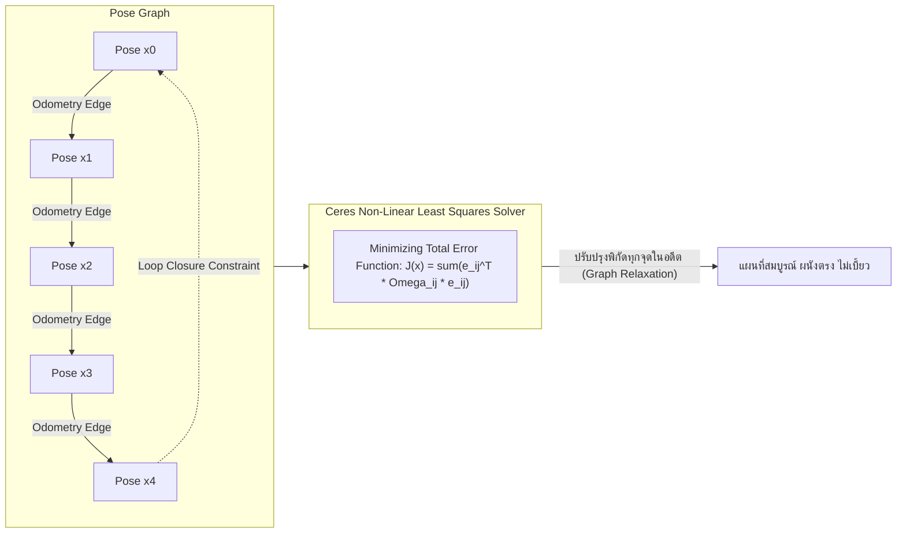

# 📖 Week 12: การสร้างแผนที่ 2 มิติด้วย SLAM Toolbox และ Ceres Solver
**เวลาเรียน:** บรรยาย 2 ชั่วโมง | ปฏิบัติการ 3 ชั่วโมง | ศึกษาค้นคว้าด้วยตนเอง 4 ชั่วโมง  
**วิชาบังคับก่อน:** [สัปดาห์ที่ 11: การต่อเชื่อมมอเตอร์ เซนเซอร์ และระบบ ros_gz_bridge](../Week_11_Actuators_Sensors_Bridge/Readme.md)  
**เอกสารปฏิบัติการ:** [ใบงานแล็บสัปดาห์ที่ 12](Lab_Exercises.md)

---

## 🎯 วัตถุประสงค์การเรียนรู้ (Learning Objectives)
เมื่อจบบทเรียนนี้ ผู้เรียนจะสามารถ:
1. อธิบายหลักการทำงานของ **Simultaneous Localization and Mapping (SLAM)** ในระบบหุ่นยนต์อัตโนมัติ
2. วิเคราะห์แบบจำลองแผนที่แบบกริดความน่าจะเป็น (**2D Occupancy Grid Map**) และสมการปรับปรุงค่า Log-Odds
3. อธิบายกระบวนการ **Pose Graph Optimization** และการแก้ปัญหาระบบสมการไม่เป็นเชิงเส้นด้วย **Ceres Solver**
4. วิเคราะห์การทำงานของ **Loop Closure** ในการกำจัดความคลาดเคลื่อนสะสม (Accumulated Drift) เมื่อเดินครบรอบ
5. ปรับแต่งพารามิเตอร์ของ **SLAM Toolbox (`async_slam_toolbox_node`)** และบันทึกแผนที่ด้วย `nav2_map_server`

---

## ⏱️ แผนการสอน 2 ชั่วโมง (Lecture Outline)
| ช่วงเวลา | หัวข้อ | กิจกรรมการเรียนรู้ |
| :---: | :--- | :--- |
| **00:00 - 00:30** | ปัญหาไก่กับไข่ของ SLAM และ Occupancy Grid Representation | บรรยายเปรียบเทียบ Unknown (-1), Free (0), และ Occupied (100) |
| **00:30 - 01:00** | Scan Matching และโครงสร้าง Pose Graph (Nodes & Edges) | แสดงแผนภาพ Graph: โหนดตำแหน่ง และเส้นเชื่อมข้อจำกัดสัมพัทธ์ |
| **01:00 - 01:30** | การตรวจจับ Loop Closure และการออปติไมซ์กราฟด้วย Ceres Solver | วิเคราะห์สมการ Least Squares และอัลกอริทึม Levenberg-Marquardt |
| **01:30 - 02:00** | Code Walkthrough: คอนฟิก YAML, Launch File, Map Saver และเตรียม Lab | เจาะลึก `slam_toolbox_params.yaml`, การรัน Online SLAM, และคำสั่ง CLI |

---

## 🏛️ สถาปัตยกรรมระบบ (Architectural Deep Dive)

### 1. ปัญหาของ SLAM: ปริศนาไก่กับไข่ (The Chicken-or-Egg Problem)
ในการนำทางหุ่นยนต์:
- **หากต้องการสร้างแผนที่ (Mapping):** เราจำเป็นต้องรู้ตำแหน่งและมุมหันของหุ่นยนต์ ($x, y, \theta$) อย่างแม่นยำตลอดเวลา
- **หากต้องการรู้ตำแหน่งของหุ่นยนต์ (Localization):** เราจำเป็นต้องมีแผนที่อ้างอิงของสิ่งแวดล้อมอยู่ก่อนแล้ว
- **SLAM (Simultaneous Localization and Mapping)** คือ อัลกอริทึมที่ทำทั้งสองอย่างพร้อมกันในสิ่งแวดล้อมที่ไม่เคยรู้จักมาก่อน

---

### 2. แผนที่แบบกริดความน่าจะเป็น (2D Occupancy Grid Map)
แผนที่ 2 มิติถูกแบ่งออกเป็นตารางสี่เหลี่ยมเล็กๆ (Grid Cells) แต่ละช่องมีขนาดความกว้างตามค่า **`resolution`** (เช่น $0.05$ เมตร/พิกเซล):
- แต่ละเซลล์จะเก็บค่าความน่าจะเป็นที่ช่องนั้นจะมีสิ่งกีดขวาง $p(m_i \in [0, 1])$
- ในมาตรฐาน ROS 2 ข้อความ `nav_msgs/msg/OccupancyGrid` แทนค่าด้วยตัวเลขจำนวนเต็ม $0 - 100$:
  - **$-1$ (Unknown):** บริเวณที่เซนเซอร์ยังไม่เคยส่องไปถึง (เช่น นอกกำแพง หรือหลังสิ่งกีดขวาง)
  - **$0$ (Free Space):** ทางเดินโล่งที่ลำแสงเลเซอร์วิ่งผ่านได้โดยไม่สะท้อน
  - **$100$ (Occupied Space):** สิ่งกีดขวางที่ลำแสงเลเซอร์ยิงไปกระทบและสะท้อนกลับ

#### การอัปเดตค่าความน่าจะเป็นด้วย Log-Odds:
เพื่อป้องกันปัญหา Numerical Underflow จากการคูณความน่าจะเป็นทศนิยมหลายๆ ครั้ง SLAM ใช้วิธีแปลงเป็นสเกล Log-Odds:
$$l(m_i) = \log\left(\frac{p(m_i)}{1 - p(m_i)}\right)$$
เมื่อได้รับข้อมูล LaserScan ครั้งใหม่ $z_t$:
$$l_t(m_i) = l_{t-1}(m_i) + \text{inverse\_sensor\_model}(m_i, z_t) - l_0$$
การอัปเดตแบบ Log-Odds ทำได้ด้วยการ **บวกเลขธรรมดา** ทำให้ประมวลผลได้เร็วระดับ Real-Time

---

### 3. โครงสร้างกราฟและตัวแก้สมการ Ceres Solver (Graph-based SLAM)
SLAM Toolbox ใช้สถาปัตยกรรม **Graph-based SLAM (Karto SLAM + Ceres Solver)**:



#### กระบวนการของ Loop Closure:
1. เมื่อหุ่นยนต์ขับวนรอบโกดังแล้วกลับมายังบริเวณเดิมที่เคยผ่านมา
2. อัลกอริทึม Scan Matching ตรวจพบว่า LaserScan ปัจจุบันมีความคล้ายคลึงกับ Scan ณ จุดเริ่มต้น (Scan Correlation $> 0.35$)
3. ระบบจะสร้าง **Loop Closure Edge** เชื่อมระหว่างจุดปัจจุบันกับจุดในอดีต
4. **Ceres Solver** จะทำ **Graph Optimization** โดยกระจายความคลาดเคลื่อนสะสมทั้งหมดเฉลี่ยไปยังโหนดต่างๆ ส่งผลให้แผนที่ที่เคยเบี้ยวบิดหรือผนังซ้อนทับกัน ถูกดึงกลับมาตรงและแนบสนิททันที

---

## 🛠️ การวิเคราะห์ไฟล์ตัวอย่างในโมดูล (Code Walkthrough)

### 1. `slam_toolbox_params.yaml`
- **Solver Parameters:**
  ```yaml
  solver_plugin: solver_plugins::CeresSolver
  ceres_linear_solver: SPARSE_NORMAL_CHOLESKY
  ceres_trust_strategy: LEVENBERG_MARQUARDT
  ```
  กำหนดให้ใช้ Ceres Solver ซึ่งเป็นไลบรารีออปติไมเซชันระดับโลกของ Google ที่มีความเสถียรและทนทานสูง
- **Motion Thresholds:**
  ```yaml
  minimum_travel_distance: 0.15 # เดินหน้าอย่างน้อย 15 cm ถึงจะเพิ่มโหนดในกราฟ
  minimum_travel_heading: 0.15  # หมุนตัวอย่างน้อย 0.15 rad ถึงจะเพิ่มโหนดในกราฟ
  ```
  ช่วยลดภาระการประมวลผล ไม่สร้างโหนดพร่ำเพรื่อเมื่อหุ่นยนต์หยุดนิ่ง
- **Loop Closing:**
  ```yaml
  do_loop_closing: true
  loop_search_maximum_distance: 5.0 # ค้นหาจุดวนซ้ำในรัศมี 5 เมตร
  ```

### 2. `online_async_slam.launch.py`
- เปิดโหนด `async_slam_toolbox_node` จากแพ็กเกจ `slam_toolbox`
- ตั้งค่า `use_sim_time: true` เพื่อซิงค์สัญญาณเวลากับนาฬิกาจำลองของ Gazebo

---

## ⌨️ ตารางคำสั่ง CLI สำคัญ
| คำสั่ง | วัตถุประสงค์ | ตัวอย่างการใช้งาน |
| :--- | :--- | :--- |
| `ros2 launch online_async_slam.launch.py` | เริ่มต้นระบบทำแผนที่แบบ Online Asynchronous | `ros2 launch Essential_ROS/Week_12_SLAM_Mapping_Ceres/launch/online_async_slam.launch.py` |
| `ros2 run nav2_map_server map_saver_cli -f <path>` | บันทึกแผนที่ปัจจุบันออกมาเป็นไฟล์ `.yaml` และ `.pgm` | `ros2 run nav2_map_server map_saver_cli -f Essential_ROS/Week_12_SLAM_Mapping_Ceres/maps/my_map` |
| `ros2 topic echo --once /map --field info` | ตรวจสอบขนาดกว้าง ยาว และ Resolution ของแผนที่ | `ros2 topic echo --once /map --field info` |

---

## ⚠️ ปัญหาที่พบบ่อยและการแก้ไข (Troubleshooting)
| อาการ | สาเหตุที่เป็นไปได้ | วิธีแก้ไข |
| :--- | :--- | :--- |
| แผนที่ผนังซ้อนทับกันเป็นภาพซ้อน (Ghosting / Double Walls) | ข้อมูล Odometry หลุดหรือลื่นไถลรุนแรง ทำให้ Scan Matcher หลงทาง | ขับหุ่นยนต์ช้าลง (ความเร็วไม่เกิน 0.3 m/s) และเพิ่ม `minimum_travel_distance` |
| ข้อความเตือน `Waiting for transform odom -> base_footprint` | ลืมเปิดโหนดจลนศาสตร์หรือปลั๊กอิน DiffDrive ในแบบจำลอง | ตรวจสอบว่ามีข้อมูลส่งใน `/odom` และทรานส์ฟอร์ม `/tf` |
| `map_saver_cli` แจ้ง `Failed to save map: Timed out` | โหนด SLAM ยังสร้างแผนที่ไม่เสร็จ หรือไม่มีข้อมูลส่งออกมาทางท็อปปิก `/map` | ตรวจสอบด้วย `ros2 topic hz /map` ก่อนสั่งบันทึก |

---

## 📝 แบบทดสอบท้ายบท (Self-Assessment Quiz)
1. ในข้อความ `OccupancyGrid` ค่าตัวเลข $-1$, $0$, และ $100$ มีความหมายทางกายภาพอย่างไร?
2. เหตุใดการสร้างแผนที่ SLAM จึงต้องใช้สมการแบบ Log-Odds แทนการคูณค่าความน่าจะเป็นตรงๆ?
3. ในสถาปัตยกรรม Pose Graph โหนด (Nodes) และเส้นเชื่อม (Edges) เป็นตัวแทนของอะไร?
4. ปรากฏการณ์ Loop Closure มีบทบาทสำคัญอย่างไรเมื่อหุ่นยนต์ขับวนรอบพื้นที่ขนาดใหญ่?
5. ไฟล์ผลลัพธ์ของแผนที่ที่บันทึกผ่าน `map_saver_cli` ประกอบด้วยไฟล์ชนิดใดบ้าง และทำหน้าที่อะไร?

<details>
<summary>🔍 ดูเฉลยคำตอบ</summary>

1. **ตอบ:** $-1$ คือพื้นที่ที่ยังไม่ทราบ (Unknown), $0$ คือพื้นที่ว่างไม่มีสิ่งกีดขวาง (Free Space), และ $100$ คือพื้นที่ที่มีสิ่งกีดขวางแน่นอน (Occupied)
2. **ตอบ:** เพื่อป้องกันปัญหาความคลาดเคลื่อนทางคณิตศาสตร์ (Underflow) เมื่อคูณทศนิยมหลายครั้ง และเปลี่ยนการคำนวณจากการคูณเป็นผลบวกซึ่งประมวลผลได้รวดเร็วกว่า
3. **ตอบ:** โหนด (Nodes) แทนตำแหน่งพิกัดและมุมหันของหุ่นยนต์ในแต่ละช่วงเวลา ($x, y, \theta$) ส่วนเส้นเชื่อม (Edges) แทนข้อจำกัดทางเรขาคณิตสัมพัทธ์ระหว่างตำแหน่งที่ได้จาก Odometry และ Scan Matching
4. **ตอบ:** ช่วยกำจัดความคลาดเคลื่อนสะสม (Drift) ที่เกิดขึ้นตามระยะทาง โดยใช้ Ceres Solver ปรับตำแหน่งทุกโหนดในอดีตให้แผนที่กลับมาแนบสนิทกันอย่างถูกต้อง
5. **ตอบ:** ประกอบด้วยไฟล์ `.pgm` (ภาพกราฟิกขาวดำแสดงโครงสร้างแผนที่) และไฟล์ `.yaml` (เมทาดาตากำหนด resolution, พิกัดจุดกำเนิด origin, และเกณฑ์ค่า Threshold)
</details>

---

## 📚 แหล่งอ้างอิงและศึกษาเพิ่มเติม
- [SLAM Toolbox GitHub Repository & Documentation](https://github.com/SteveMacenski/slam_toolbox)
- [Ceres Solver Official Documentation (Google)](http://ceres-solver.org/)
- [Nav2 Map Server Guide](https://docs.nav2.org/configuration/packages/configuring-map-server.html)
