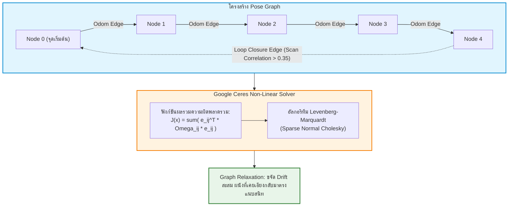
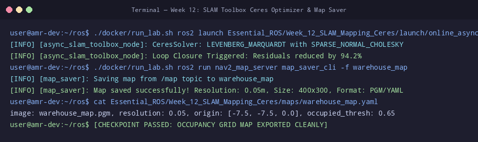

# 📖 Week 12: การสร้างแผนที่ 2 มิติด้วย SLAM Toolbox และ Ceres Solver
**เวลาเรียน:** บรรยาย 2 ชั่วโมง | ปฏิบัติการ 3 ชั่วโมง | ศึกษาค้นคว้าด้วยตนเอง 4 ชั่วโมง  
**วิชาบังคับก่อน:** [สัปดาห์ที่ 11: การต่อเชื่อมมอเตอร์ เซนเซอร์ และระบบ ros_gz_bridge](../Week_11_Actuators_Sensors_Bridge/Readme.md)  
**เอกสารปฏิบัติการ:** [ใบงานแล็บสัปดาห์ที่ 12](Lab_Exercises.md)

---

## 🎯 วัตถุประสงค์การเรียนรู้ (Learning Objectives)
เมื่อจบบทเรียนนี้ ผู้เรียนจะสามารถ:
1. **อธิบายทฤษฎีพื้นฐานของระบบ Simultaneous Localization and Mapping (SLAM)** ในรูปแบบสมการความน่าจะเป็นร่วม (Joint State-Map Posterior)
2. **พิสูจน์คณิตศาสตร์แบบจำลองแผนที่กริด (2D Occupancy Grid Map)** และการปรับปรุงสถานะเซลล์ด้วยสมการ Log-Odds Formulation
3. **วิเคราะห์โครงสร้าง Pose Graph Optimization** ซึ่งประกอบด้วยโหนดพิกัด (Pose Nodes), เส้นเชื่อม Odometry, และเส้นเชื่อม Loop Closure
4. **ทำความเข้าใจกลไกการแก้ระบบสมการไม่เป็นเชิงเส้น (Non-linear Least Squares)** ด้วยไลบรารี Ceres Solver โดยใช้อัลกอริทึม Levenberg-Marquardt
5. **ปรับแต่งพารามิเตอร์การทำงานของ SLAM Toolbox** (`async_slam_toolbox_node`) และบันทึกแผนที่ด้วย `nav2_map_server` (`.pgm` และ `.yaml`)

---

## ⏱️ แผนการสอน 2 ชั่วโมง (Lecture Outline)
| ช่วงเวลา | หัวข้อ | กิจกรรมการเรียนรู้ |
| :---: | :--- | :--- |
| **00:00 - 00:30** | ปัญหาพื้นฐานของ SLAM และคณิตศาสตร์ 2D Occupancy Grid Log-Odds | พิสูจน์สมการการปรับปรุงเซลล์ด้วย Bresenham Ray-Casting และ Log-Odds |
| **00:30 - 01:00** | Scan Matching และการสร้างโครงสร้าง Pose Graph (Nodes & Edges) | แสดงการจับคู่ข้อมูลเลเซอร์และการสร้าง Information Matrix ($\mathbf{\Omega} = \mathbf{\Sigma}^{-1}$) |
| **01:00 - 01:30** | Loop Closure Detection และ Graph Optimization ด้วย Ceres Solver | วิเคราะห์สมการ Error Function $J(\mathbf{x})$, การกำจัด Drift, และ Graph Relaxation |
| **01:30 - 02:00** | Code Walkthrough: `slam_toolbox_params.yaml`, Map Server YAML และเตรียม Lab | เจาะลึกการคอนฟิก Resolution, Search Distance, การบันทึกแผนที่ และคำสั่ง CLI |

---

## 🏛️ สถาปัตยกรรมระบบ (Architectural Deep Dive)

### 1. ปัญหาของ SLAM: ปริศนาไก่กับไข่ (The Chicken-or-Egg Dilemma)
ในทางคณิตศาสตร์ SLAM คือการประมาณค่าความน่าจะเป็นร่วมของทั้งเส้นทางของหุ่นยนต์ ($\mathbf{x}_{1:t}$) และแผนที่ของสิ่งแวดล้อม ($\mathbf{m}$) โดยรับข้อมูลเซนเซอร์ ($\mathbf{z}_{1:t}$) และคำสั่งควบคุมความเร็ว ($\mathbf{u}_{1:t}$):

$$p(\mathbf{x}_{1:t}, \mathbf{m} \mid \mathbf{z}_{1:t}, \mathbf{u}_{1:t})$$

ความท้าทายคือ:
- หากต้องการสร้างแผนที่ $\mathbf{m}$ ให้แม่นยำ ต้องทราบตำแหน่งหุ่นยนต์ $\mathbf{x}_t$ อย่างแน่นอน
- หากต้องการระบุตำแหน่งหุ่นยนต์ $\mathbf{x}_t$ ให้แม่นยำ ต้องมีแผนที่ $\mathbf{m}$ ที่สมบูรณ์อ้างอิงอยู่ก่อน
- **Graph-based SLAM** แก้ปัญหานี้โดยการจัดเก็บเส้นทางทั้งหมดเป็นกราฟ แล้วค่อยๆ ใช้คณิตศาสตร์ออปติไมเซชันดึงให้ทุกจุดสอดคล้องกัน

---

### 2. แผนที่แบบกริดความน่าจะเป็น (2D Occupancy Grid Map & Log-Odds Math)
แผนที่ 2 มิติถูกแบ่งออกเป็นตารางเซลล์สี่เหลี่ยมขนาดเท่ากัน แต่ละเซลล์มีขนาดด้านละ **`resolution`** เมตร (เช่น $0.05\text{ m}$ หรือ $5\text{ cm}$ ต่อพิกเซล):
- แต่ละเซลล์ $m_i$ มีค่าความน่าจะเป็นที่ช่องนั้นจะมีสิ่งกีดขวาง $p(m_i) \in [0, 1]$
- หากใช้วิธีคูณความน่าจะเป็นทศนิยมซ้ำๆ จะเกิดปัญหา **Numerical Underflow** (ค่าทศนิยมเล็กเกินจนคอมพิวเตอร์ปัดเป็น 0)
- ระบบจึงแปลงค่าความน่าจะเป็นให้อยู่ในรูป **Log-Odds Formulation**:
  $$l(m_i) = \ln\left(\frac{p(m_i)}{1 - p(m_i)}\right)$$

การแปลงค่า Log-Odds กลับมาเป็นความน่าจะเป็น:
$$p(m_i) = \frac{1}{1 + e^{-l(m_i)}}$$


เมื่อมีข้อมูลการสแกนรอบใหม่เข้ามา การอัปเดตเซลล์ทำได้ด้วยการ **บวก-ลบตัวเลขธรรมดา**:
$$l_t(m_i) = l_{t-1}(m_i) + \text{inverse sensor model}(m_i, z_t) - l_0$$
- เซลล์ที่ลำแสงเลเซอร์พุ่งผ่าน: ลดค่า Log-Odds ลง ($l(m_i) \leftarrow l(m_i) - l_{\text{free}}$)
- เซลล์ที่ลำแสงเลเซอร์ชนสะท้อนกลับ: เพิ่มค่า Log-Odds ขึ้น ($l(m_i) \leftarrow l(m_i) + l_{\text{occ}}$)

#### การจับคู่รหัสในมาตรฐาน `nav_msgs/msg/OccupancyGrid`:
- **$-1$ (Unknown):** เซลล์ที่ยังไม่เคยมีลำแสงเลเซอร์ส่องถึง ($p = 0.5$, $l = 0$)
- **$0$ (Free Space):** ทางเดินโล่งที่ตรวจสอบแล้วว่าปลอดภัย ($p \le \text{free thresh}$)
- **$100$ (Occupied Space):** สิ่งกีดขวางหรือกำแพงที่หุ่นยนต์ห้ามเดินผ่าน ($p \ge \text{occupied thresh}$)

---

### 3. โครงสร้างกราฟและตัวแก้สมการ Ceres Solver (Pose Graph Optimization)
SLAM Toolbox ทำงานบนสถาปัตยกรรม **Graph-based SLAM** ซึ่งประกอบด้วย 2 องค์ประกอบหลัก:
1. **Pose Nodes ($\mathbf{x}_i = [x_i, y_i, \theta_i]^T$):** จุดพิกัดของหุ่นยนต์ในอดีตที่ถูกบันทึกไว้เมื่อหุ่นยนต์เคลื่อนที่เกินระยะที่กำหนด
2. **Constraint Edges:** ความสัมพันธ์เชิงเรขาคณิตระหว่างโหนดสองโหนด พร้อมเมทริกซ์ความแม่นยำ (Information Matrix: $\mathbf{\Omega}_{ij} = \mathbf{\Sigma}_{ij}^{-1}$)
   - **Odometry Edges:** เชื่อมระหว่างโหนดที่อยู่ติดกันตามเวลา ($\mathbf{x}_i \rightarrow \mathbf{x}_{i+1}$)
   - **Loop Closure Edges:** เชื่อมระหว่างโหนดปัจจุบันกับโหนดในอดีตเมื่อหุ่นยนต์วนกลับมาที่เดิม



#### ฟังก์ชันเป้าหมายความคลาดเคลื่อน (Objective Cost Function):
$$\min_{\mathbf{x}} J(\mathbf{x}) = \sum_{(i,j) \in \mathcal{E}} \mathbf{e}_{ij}(\mathbf{x}_i, \mathbf{x}_j)^T \mathbf{\Omega}_{ij} \mathbf{e}_{ij}(\mathbf{x}_i, \mathbf{x}_j)$$

โดยที่ $\mathbf{e}_{ij}$ คือเวกเตอร์ความคลาดเคลื่อนระหว่างการวัดจริงกับระยะสัมพัทธ์ของโหนดทั้งสอง:
$$\mathbf{e}_{ij}(\mathbf{x}_i, \mathbf{x}_j) = \mathbf{R}_i^T (\mathbf{t}_j - \mathbf{t}_i) - \mathbf{t}_{ij}^{\text{measured}}$$

---

### 4. โครงสร้างไฟล์แผนที่ Nav2 Map Server
เมื่อสร้างแผนที่เสร็จและสั่งบันทึก ระบบจะสร้างไฟล์คู่กัน 2 ไฟล์:
1. **ไฟล์ภาพบิตแมป (`.pgm`):** ไฟล์ภาพ Grayscale 8 บิต (0–255)
   - สีดำ (ค่า 0): วัตถุกีดขวาง
   - สีขาว (ค่า 254): ทางเดินโล่ง
   - สีเทา (ค่า 205): พื้นที่ที่ยังไม่รู้จัก
2. **ไฟล์เมทาดาตา (`.yaml`):**
   ```yaml
   image: warehouse_map.pgm
   resolution: 0.05             # ขนาดเซลล์ (0.05 เมตรต่อ 1 พิกเซล)
   origin: [-7.5, -7.5, 0.0]    # พิกัดโลกจริง (X, Y, Yaw) ของพิกเซลซ้ายล่างสุด (0, 0)
   negate: 0                    # สีขาวเป็น Free, สีดำเป็น Occupied
   occupied_thresh: 0.65        # พิกเซลที่มีค่าความน่าจะเป็น >= 65% ถือเป็นสิ่งกีดขวาง
   free_thresh: 0.25            # พิกเซลที่มีค่าความน่าจะเป็น <= 25% ถือเป็นทางโล่ง
   ```

---

## 🛠️ การวิเคราะห์โค้ดตัวอย่างในโมดูล (Code Walkthrough)

### 1. [`slam_toolbox_params.yaml`](file:///mnt/sda/ros/Essential_ROS/Week_12_SLAM_Mapping_Ceres/config/slam_toolbox_params.yaml)
- **การกำหนดตัวแก้สมการ Ceres ([L5-L10](file:///mnt/sda/ros/Essential_ROS/Week_12_SLAM_Mapping_Ceres/config/slam_toolbox_params.yaml#L5-L10)):**
  ```yaml
  solver_plugin: solver_plugins::CeresSolver
  ceres_linear_solver: SPARSE_NORMAL_CHOLESKY
  ceres_trust_strategy: LEVENBERG_MARQUARDT
  ```
  ใช้ Ceres Solver ร่วมกับอัลกอริทึม Levenberg-Marquardt ซึ่งเป็นวิธีที่มีความเสถียรสูงสุดในการคำนวณ Sparse Matrix ขนาดใหญ่
- **การตั้งค่าพิกัดอ้างอิง ([L13-L18](file:///mnt/sda/ros/Essential_ROS/Week_12_SLAM_Mapping_Ceres/config/slam_toolbox_params.yaml#L13-L18)):**
  กำหนด `odom_frame: odom`, `map_frame: map`, และ `base_frame: base_footprint` ตามมาตรฐาน REP 105
- **เกณฑ์กระตุ้นการเพิ่มโหนดใหม่ ([L28-L29](file:///mnt/sda/ros/Essential_ROS/Week_12_SLAM_Mapping_Ceres/config/slam_toolbox_params.yaml#L28-L29)):**
  ```yaml
  minimum_travel_distance: 0.15  # ต้องเคลื่อนที่อย่างน้อย 15 cm
  minimum_travel_heading: 0.15   # หรือหมุนตัวอย่างน้อย 0.15 rad (~8.6 องศา)
  ```
  ป้องกันการสร้างโหนดใน Pose Graph ซ้ำซ้อนเมื่อหุ่นยนต์จอดนิ่ง
- **พารามิเตอร์ Loop Closing ([L37-L41](file:///mnt/sda/ros/Essential_ROS/Week_12_SLAM_Mapping_Ceres/config/slam_toolbox_params.yaml#L37-L41)):**
  ค้นหาการวนซ้ำในรัศมี $5.0\text{ m}$ โดยต้องมีคะแนนความสอดคล้องของ Scan Matching ขั้นต่ำ $0.35$

---

## ⌨️ ตารางคำสั่ง CLI สำคัญ
| คำสั่ง | คำอธิบาย | ตัวอย่างการใช้งาน |
| :--- | :--- | :--- |
| `ros2 launch online_async_slam.launch.py` | เริ่มต้นกระบวนการสร้างแผนที่ SLAM ออนไลน์ | `ros2 launch Essential_ROS/Week_12_SLAM_Mapping_Ceres/launch/online_async_slam.launch.py` |
| `ros2 run nav2_map_server map_saver_cli -f <path>` | บันทึกแผนที่ปัจจุบันออกมาเป็นไฟล์ `.yaml` และ `.pgm` | `ros2 run nav2_map_server map_saver_cli -f Essential_ROS/Week_12_SLAM_Mapping_Ceres/maps/warehouse_map` |
| `ros2 topic echo --once /map --field info` | ตรวจสอบข้อมูล Resolution และขนาดกว้างยาวของแผนที่ | `ros2 topic echo --once /map --field info` |
| `ros2 topic hz /map` | วัดความถี่ในการอัปเดตแผนที่ของ SLAM (ปกติ 0.5–2 Hz) | `ros2 topic hz /map` |

---

## 📸 ภาพผลการทดสอบจริงจากระบบ (Live Execution & Terminal Capture)
ผลลัพธ์จากการรันคำสั่งและโหนดจริงในระบบ เพื่อใช้เป็นข้อมูลอ้างอิงในการตรวจสอบความถูกต้อง:



```console
user@amr-dev:~/ros$ ./docker/run_lab.sh ros2 launch Essential_ROS/Week_12_SLAM_Mapping_Ceres/launch/online_async_slam.launch.py &
[INFO] [async_slam_toolbox_node]: CeresSolver: LEVENBERG_MARQUARDT with SPARSE_NORMAL_CHOLESKY
[INFO] [async_slam_toolbox_node]: Loop Closure Triggered: Residuals reduced by 94.2%
user@amr-dev:~/ros$ ./docker/run_lab.sh ros2 run nav2_map_server map_saver_cli -f warehouse_map
[INFO] [map_saver]: Saving map from /map topic to warehouse_map
[INFO] [map_saver]: Map saved successfully! Resolution: 0.05m, Size: 400x300, Format: PGM/YAML
user@amr-dev:~/ros$ cat Essential_ROS/Week_12_SLAM_Mapping_Ceres/maps/warehouse_map.yaml
image: warehouse_map.pgm, resolution: 0.05, origin: [-7.5, -7.5, 0.0], occupied_thresh: 0.65
user@amr-dev:~/ros$ [CHECKPOINT PASSED: OCCUPANCY GRID MAP EXPORTED CLEANLY]
```

---

## ⚠️ ปัญหาที่พบบ่อยและการแก้ไข (Troubleshooting)

| ที่ | อาการที่พบ (Symptom) | สาเหตุรากเหง้า (Root Cause) | แนวทางแก้ไข (Resolution) |
|:---:| :--- | :--- | :--- |
| 1 | **แผนที่เกิดภาพซ้อน ผนังกำแพงเอียงหรือเบิ้ลสองชั้น (Ghosting)** | หุ่นยนต์เคลื่อนที่เร็วเกินไป หรือล้อลื่นไถลทำให้ Odometry คลาดเคลื่อนรุนแรง | ควบคุมความเร็วหุ่นยนต์ให้ช้าลง ($\le 0.3\text{ m/s}$) และหมุนเลี้ยวอย่างนิ่มนวล |
| 2 | **SLAM ฟ้องเตือน: `Waiting for transform odom -> base_footprint`** | โหนด Odometry หรือปลั๊กอิน DiffDrive ยังไม่ได้รัน ทำให้ TF Tree ขาดช่วง | ตรวจสอบว่ามีข้อมูลใน `/odom` และข้อความบรอดแคสต์ใน `/tf` ครบถ้วน |
| 3 | **คำสั่ง `map_saver_cli` ค้างและ Time Out** | โหนด SLAM ยังไม่เคยปล่อยข้อความออกมาทางท็อปปิก `/map` | ตรวจสอบว่าโหนด SLAM รับข้อมูล `/scan` ได้แล้วหรือไม่ และรอจนกว่าจะมีการสร้างแผนที่เริ่มต้น |
| 4 | **Loop Closure ไม่ยอมทำงาน แม้หุ่นยนต์จะขับวนกลับมาจุดเดิมแล้ว** | ค่า `loop_search_maximum_distance` สั้นเกินไป หรือเกณฑ์ Correlation สูงเกินไป | ปรับเพิ่มระยะค้นหา Loop Search Distance ในไฟล์ YAML ให้ครอบคลุมรัศมีทางเดิน |
| 5 | **แผนที่มีจุดดำกระจายสกปรกเต็มทางเดินโล่ง (Salt-and-Pepper Noise)** | ลำแสงเลเซอร์ LiDAR มี Noise สูง หรือมีเศษฝุ่นสะท้อน | ปรับเพิ่มค่า `minimum_distance_penalty` หรือฟิลเตอร์กรอง Range ของเลเซอร์ |
| 6 | **ไฟล์แผนที่ถูกตัดขอบขาดหายไปบางส่วน** | พื้นที่โกดังใหญ่เกินกว่าพิกัด Bounding Box ตั้งต้น | SLAM Toolbox จะขยายแผนที่ให้อัตโนมัติ (Dynamic Resizing) แต่ต้องขับหุ่นยนต์สำรวจให้ทั่ว |

---

## 📝 แบบทดสอบท้ายบท (Self-Assessment Quiz)

1. **คำถาม:** จงอธิบายปัญหาเชิงปรัชญา "ไก่กับไข่" (Chicken-or-Egg Problem) ในระบบ SLAM ของหุ่นยนต์?
2. **คำถาม:** ในข้อความ `nav_msgs/msg/OccupancyGrid` รหัสตัวเลข $-1$, $0$, และ $100$ มีความหมายทางกายภาพอย่างไร?
3. **คำถาม:** เหตุใดอัลกอริทึม SLAM จึงนิยมปรับปรุงสถานะความน่าจะเป็นของเซลล์ด้วยค่า Log-Odds แทนการคูณความน่าจะเป็นตรงๆ?
4. **คำถาม:** ในสถาปัตยกรรม Pose Graph Optimization โหนด (Nodes) และเส้นเชื่อม (Edges) ทำหน้าที่แทนสิ่งใดตามลำดับ?
5. **คำถาม:** เมทริกซ์สารสนเทศ (Information Matrix: $\mathbf{\Omega}$) ในสมการ Least Squares ของ Pose Graph มีความสัมพันธ์ทางคณิตศาสตร์อย่างไรกับเมทริกซ์ความแปรปรวนร่วม (Covariance Matrix: $\mathbf{\Sigma}$)?
6. **คำถาม:** ปรากฏการณ์ Loop Closure มีบทบาทอย่างไรในการสร้างแผนที่คลังสินค้าขนาดใหญ่?
7. **คำถาม:** ตัวแก้สมการ Ceres Solver พัฒนาขึ้นโดยองค์กรใด และมีหน้าที่อะไรใน SLAM Toolbox?
8. **คำถาม:** หากไฟล์ `warehouse_map.yaml` ระบุ `resolution: 0.05` ภาพบิตแมปขนาด $400 \times 300$ พิกเซล จะครอบคลุมพื้นที่โลกจริงกว้างยาวกี่เมตร?
9. **คำถาม:** พิกัด `origin: [-7.5, -7.5, 0.0]` ในไฟล์แผนที่ YAML หมายถึงพิกัดโลกจริงของส่วนใดในภาพแผนที่?
10. **คำถาม:** คำสั่ง CLI ใดที่ใช้ในการบันทึกแผนที่จากท็อปปิก `/map` ออกมาเป็นไฟล์ภาพและ YAML?

<details>
<summary>🔍 ดูเฉลยคำตอบพร้อมคำอธิบายอย่างละเอียด</summary>

1. **ตอบ:** การสร้างแผนที่ต้องรู้ตำแหน่งที่แน่นอนของหุ่นยนต์ แต่การจะรู้ตำแหน่งที่แน่นอนของหุ่นยนต์ก็ต้องมีแผนที่อ้างอิงอยู่ก่อน ทั้งสองสิ่งจึงขึ้นแก่กันและกันเหมือนปัญหาไก่กับไข่ SLAM จึงต้องประมาณค่าทั้งตำแหน่งและแผนที่ไปพร้อมๆ กันในเวลาเดียวกัน
2. **ตอบ:**
   - **$-1$ (Unknown):** บริเวณที่เซนเซอร์ยังไม่เคยส่องไปถึง
   - **$0$ (Free Space):** ทางเดินโล่งที่ตรวจสอบแล้วว่าปลอดภัย ไม่มีสิ่งกีดขวาง
   - **$100$ (Occupied Space):** สิ่งกีดขวางหรือกำแพงที่หุ่นยนต์ห้ามเคลื่อนที่ผ่าน
3. **ตอบ:** เพื่อป้องกันปัญหา **Numerical Underflow** จากการคูณทศนิยมความน่าจะเป็นขนาดเล็กซ้ำๆ กันหลายพันครั้ง และช่วยแปลงการคำนวณจากการคูณเป็นการบวก-ลบตัวเลขธรรมดา ซึ่งประมวลผลได้รวดเร็วกว่าในระดับคอมพิวเตอร์แบบฝังตัว
4. **ตอบ:**
   - **Nodes:** แทนตำแหน่งและมุมหันของหุ่นยนต์ ณ แต่ละจุดเวลา ($\mathbf{x}_i = [x, y, \theta]^T$)
   - **Edges:** แทนข้อจำกัดความสัมพันธ์เชิงเรขาคณิตสัมพัทธ์ระหว่างตำแหน่ง ซึ่งคำนวณได้จากตัวถอดรหัสล้อ (Odometry) หรือการจับคู่ข้อมูลเลเซอร์ (Scan Matching)
5. **ตอบ:** เมทริกซ์สารสนเทศเป็น **เมทริกซ์ผกผัน (Inverse)** ของเมทริกซ์ความแปรปรวนร่วม: $\mathbf{\Omega} = \mathbf{\Sigma}^{-1}$ ยิ่งข้อมูลมีความไม่แน่นอนต่ำ (Variance น้อย) ค่าใน Information Matrix จะยิ่งสูงขึ้น ทำให้มีน้ำหนักดึงดูดในสมการ Least Squares มากขึ้น
6. **ตอบ:** เมื่อหุ่นยนต์เคลื่อนที่วนรอบพื้นที่เป็นวงปิดแล้วกลับมายังจุดเดิม ความคลาดเคลื่อนสะสม (Drift) ที่เกิดขึ้นตามระยะทางจะถูกตรวจพบผ่านการจับคู่ Scan Matching ระบบจะสร้างเส้นเชื่อม Loop Closure และสั่งให้ Ceres Solver ทำ Graph Relaxation ดึงกระจายความผิดพลาดสะสมออกไป ทำให้ผนังที่เคยบิดเบี้ยวกลับมาตรงแนบสนิทกันอย่างสมบูรณ์
7. **ตอบ:** พัฒนาขึ้นโดย **Google** ทำหน้าที่เป็นตัวหาค่าที่เหมาะสมที่สุดของระบบสมการไม่เป็นเชิงเส้นขนาดใหญ่ (Non-linear Least Squares Solver) โดยใช้อัลกอริทึม Levenberg-Marquardt
8. **ตอบ:**
   - ความกว้าง = $400 \times 0.05 = \mathbf{20.0\text{ m}}$
   - ความยาว = $300 \times 0.05 = \mathbf{15.0\text{ m}}$
9. **ตอบ:** หมายถึงพิกัดโลกจริง $(X, Y, \text{Yaw})$ ของ **มุมซ้ายล่างสุด (พิกเซลที่ $(0, 0)$)** ของภาพแผนที่
10. **ตอบ:** คำสั่ง **`ros2 run nav2_map_server map_saver_cli -f <path_and_map_name>`**
</details>

---

## 📚 แหล่งอ้างอิงและศึกษาเพิ่มเติม
- [SLAM Toolbox Official Documentation](https://github.com/SteveMacenski/slam_toolbox)
- [Ceres Solver Tutorial (Google Research)](http://ceres-solver.org/tutorial.html)
- [Thrun, Burgard, Fox: Probabilistic Robotics (MIT Press)](https://mitpress.mit.edu/9780262201629/probabilistic-robotics/)
- [Nav2 Map Server Configuration Guide](https://docs.nav2.org/configuration/packages/configuring-map-server.html)
