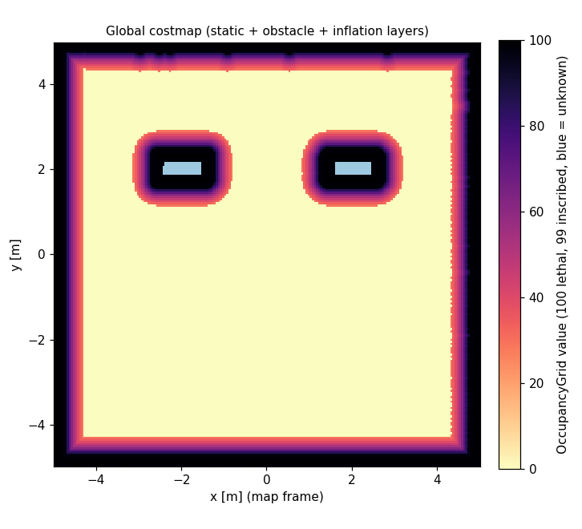

# 🛠️ ใบงานปฏิบัติการสัปดาห์ที่ 13: สถาปัตยกรรม Nav2 Stack และระบบ Costmap 2D
**วิชา:** AMR-101 Essential ROS 2 for Autonomous Mobile Robots  
**เวลาปฏิบัติการ:** 3 ชั่วโมง  
**ระดับ:** พื้นฐาน (Beginner)  
**เอกสารประกอบการบรรยาย:** [คู่มือบรรยายสัปดาห์ที่ 13](Readme.md)

---

## 🎯 วัตถุประสงค์การทดลอง (Lab Objectives)
1. แสดงผลและตรวจสอบ **Global Costmap** และ **Local Costmap** ในโปรแกรม RViz2
2. วิเคราะห์ค่าความเข้มของสีตามรหัสอันตราย (ค่าดิบ Free=0, Inscribed=253, Lethal=254 และค่าที่ถูกแปลงสเกลบน OccupancyGrid: 0, 99, 100)
3. สังเกตและทดสอบพฤติกรรม **Marking** (เพิ่มสิ่งกีดขวางสด) และ **Clearing / Raytracing** (ลบสิ่งกีดขวางที่หายไป)
4. ปรับจูนพารามิเตอร์ **`cost_scaling_factor`** และกำหนดรูปทรง **`footprint`** เพื่อให้หุ่นยนต์วิ่งผ่านทางแคบได้

---

## 📋 ข้อกำหนดก่อนเริ่มปฏิบัติการ (Prerequisites & Setup)
- เข้าสู่รูทไดเรกทอรีของ repository (เช่น `cd ~/ros`)
- Build แพ็กเกจ (รวมสัปดาห์ที่ 7, 10, 11, 12 ที่ใช้ร่วม):
  ```bash
  ./docker/run_lab.sh colcon build --base-paths Essential_ROS --packages-up-to amr_week13
  ```
- ตรวจสอบไฟล์คอนฟิก Costmap:
  ```bash
  cat Essential_ROS/Week_13_Nav2_Costmaps_Layers/config/costmap_params.yaml
  ```

---

## 🧪 ขั้นตอนการทดลอง (Step-by-Step Lab Tasks)

### 🔹 Lab 13.1: การเปิดแสดงผล Costmap ใน RViz2
**เป้าหมาย:** สังเกตความแตกต่างระหว่างเลเยอร์แผนที่คงที่และแผนที่รอบตัวหุ่นยนต์

1. เปิดระบบใน **Terminal 1** — launch นี้เปิด simulation (สัปดาห์ที่ 11, มี `robot_state_publisher` แล้ว), `map_server` พร้อมแผนที่จริงจากสัปดาห์ที่ 12, TF `map → odom` และ costmap ทั้งสองตัว:
   ```bash
   ./docker/run_lab.sh ros2 launch amr_week13 costmap_demo.launch.py rviz:=true        # มีจอ
   ./docker/run_lab.sh ros2 launch amr_week13 costmap_demo.launch.py headless:=true    # ไม่มีจอ
   ```
   **ผลลัพธ์จริง (log ของ lifecycle manager):**
   ```text
   [lifecycle_manager-9] [INFO] [1793244226.780194559] [lifecycle_manager_costmap]: Managed nodes are active
   ```

2. ในหน้าต่าง RViz2 (เปลี่ยน Fixed Frame เป็น `map`):
   - เพิ่ม Display ชนิด `Map` โดยเลือก Topic เป็น `/global_costmap/costmap`
   - กำหนด Color Scheme เป็น `costmap` (สังเกตแถบสี: น้ำเงิน=ปลอดภัย, ม่วง/แดง=อันตราย)
   - เพิ่ม Display อีกตัวชนิด `Map` โดยเลือก Topic เป็น `/local_costmap/costmap`
   - สังเกตกรอบสี่เหลี่ยม $3 \times 3$ เมตร ที่เคลื่อนที่ตามจุดศูนย์กลางของหุ่นยนต์ตลอดเวลา

---

### 🔹 Lab 13.2: การตรวจสอบค่าตัวเลขคอสต์และการกระจายตัว (Cost Values & Gradient)
**เป้าหมาย:** ตรวจสอบค่า Cost ทั้งในข้อความ OccupancyGrid (สเกลแล้ว) และค่าดิบ

1. ดักฟังข้อมูลของ Global Costmap (OccupancyGrid) และค่าดิบ (`costmap_raw`):
   ```bash
   ./docker/run_lab.sh ros2 topic echo --once /global_costmap/costmap nav_msgs/msg/OccupancyGrid --field data
   ./docker/run_lab.sh ros2 topic echo --once /global_costmap/costmap_raw nav2_msgs/msg/Costmap --field data
   ```
   หรือสรุปเป็นจำนวนเซลล์ด้วยเครื่องมือของแพ็กเกจ:
   ```bash
   ./docker/run_lab.sh ros2 run amr_week13 costmap_snapshot
   ```
2. สังเกตตัวเลข — **`/costmap` (OccupancyGrid) ถูกแปลงสเกลเป็น -1..100** ส่วนค่าดิบ 0..255 อยู่บน `/costmap_raw`:

   | ความหมาย | ค่าดิบ (`costmap_raw`) | ค่าใน `/costmap` (OccupancyGrid) |
   | :--- | :---: | :---: |
   | ทางเดินโล่ง | 0 | 0 |
   | inflation ที่ลดหลั่นตามระยะ | 1–252 | 1–98 |
   | รัศมีตัวถัง (Inscribed) | 253 | 99 |
   | สิ่งกีดขวาง (Lethal) | 254 | 100 |
   | ไม่ทราบข้อมูล | 255 | -1 |

   **ผลลัพธ์จริง:**
   ```text
   /global_costmap/costmap: frame=map 200x199 cells @ 0.05 m
     unknown(-1): 208, free(0): 26584, inflated(1..98): 8434, inscribed(99): 2705, lethal(100): 1869
   /global_costmap/costmap_raw: 200x199 cells (raw 0..255)
     free(0): 26603, inflated(1..252): 8436, inscribed(253): 2740, lethal(254): 1813, no_information(255): 208
   ```
   ค่าตามแนว $x = 2.0$ ใต้เสาต้นขวา (ผิวเสาอยู่ที่ $y = 1.70$) จากการรันเดียวกัน:
   ```text
   1.00:0  1.05:0  1.10:0  1.15:29  1.20:34  1.25:40  1.30:46  1.35:53  1.40:62  1.45:72  1.50:84  1.55:97  1.60:99  1.65:99  1.70:100  1.75:100
   ```

   **คำถาม Checkpoint 13.2:**
   - [ ] รัศมี Inscribed Radius ของหุ่นยนต์ตัวนี้มีค่ากี่เมตรเมื่อคำนวณจาก Footprint กว้าง 0.28m และยาว 0.40m?
   - [ ] (แนวคิด: ครึ่งหนึ่งของความกว้าง $= 0.14$ m คือระยะที่สั้นที่สุดจากจุดศูนย์กลางถึงขอบตัวถัง)

---

### 🔹 Lab 13.3: การทดสอบกลไก Marking และ Clearing แบบเรียลไทม์
**เป้าหมาย:** พิสูจน์ว่าเมื่อมีวัตถุตัดหน้า Costmap จะมาร์กจุดสีแดง และเมื่อวัตถุหายไป ระบบจะล้างค่ากลับเป็นสีน้ำเงิน

1. ขับหุ่นยนต์ไปหยุดอยู่หน้ากล่องสินค้าหรือสิ่งกีดขวาง
2. สังเกตใน RViz2 ว่ามีจุดสีม่วง/แดง (Obstacle Cost) ปรากฏขึ้นตรงตำแหน่งที่ LiDAR ยิงไปโดน
3. ทดลองถอยหลังหุ่นยนต์ออกมา หรือเลี้ยวหันหัวไปทางอื่น
4. สังเกตแนวเส้น Raytrace: บริเวณที่แสงเลเซอร์ส่องทะลุผ่านจะถูกล้างค่ากลับเป็น $0$ (Free Space) ทันที
   *(ขับหุ่นยนต์ด้วย `ros2 topic pub -r 10 /cmd_vel geometry_msgs/msg/Twist "{linear: {x: 0.2}}"` หรือ teleop; local costmap มองเห็นสิ่งกีดขวางไม่เกิน `obstacle_max_range: 2.5` m)*

---

### 🔹 Lab 13.4: การปรับจูน `cost_scaling_factor` สำหรับทางแคบ (Hands-on Tuning)
**เป้าหมาย:** แก้ปัญหาหุ่นยนต์ไม่ยอมเดินผ่านช่องทางเดินแคบ (Doorway / Narrow Corridor)

1. ตรวจสอบค่าพารามิเตอร์ปัจจุบัน:
   ```bash
   ./docker/run_lab.sh ros2 param get /local_costmap/local_costmap inflation_layer.cost_scaling_factor
   ```
   ผลจริง: `Double value is: 3.0`

2. ทดลองปรับค่า `cost_scaling_factor` เป็น $7.0$ แบบเรียลไทม์:
   ```bash
   ./docker/run_lab.sh ros2 param set /local_costmap/local_costmap inflation_layer.cost_scaling_factor 7.0
   ```
3. สังเกตการเปลี่ยนแปลงบนหน้าจอ RViz2:
   - รัศมีความชันของสีแดงจะหดตัวแคบลงชิดขอบสิ่งกีดขวางมากขึ้น
   - พื้นที่สีน้ำเงินเข้ม (ปลอดภัย) บริเวณตรงกลางทางเดินจะกว้างขึ้น ทำให้หุ่นยนต์สามารถวางแผนเส้นทางผ่านได้

---

## 🏆 โจทย์ท้าทายระดับสูง (Challenge Exercises)
1. **Challenge 13.1:** เพิ่มเลเยอร์พิเศษ `RangeSensorLayer` เพื่อนำข้อมูลจากเซนเซอร์ Ultrasonic (Sonar) เข้ามาร่วมมาร์กสิ่งกีดขวางใน Costmap
2. **Challenge 13.2:** ปรับแต่ง Footprint ของหุ่นยนต์ในกรณีที่ต้องลากรถพ่วง (Trailer) ยาว 1.2 เมตร และสังเกตการขยายตัวของ Inscribed Cost รอบตัวถัง

---

## 📦 สิ่งที่ต้องส่ง (Deliverables Checklist)
- [ ] ภาพบันทึกหน้าจอ RViz2 (หรือ PNG จาก `costmap_snapshot --png`) แสดง Global Costmap และ Local Costmap
- [ ] ภาพบันทึกหน้าจอการเปลี่ยนแปลงของ Inflation Decay เมื่อปรับค่า `cost_scaling_factor` จาก 3.0 เป็น 7.0
- [ ] ภาพบันทึกหน้าจอแสดงผลการทดสอบ Marking และ Clearing เมื่อมีสิ่งกีดขวางเข้ามาในระยะสายตา
- [ ] คำตอบ Checkpoint 13.2

---

## 📊 เกณฑ์การประเมินผล (Lab Grading Rubric - 100 คะแนน)
| รายการประเมิน | รายละเอียดการให้คะแนน | คะแนนเต็ม |
| :--- | :--- | :---: |
| **การเปิดและตั้งค่าแสดงผล Costmap** | แสดงผล Global และ Local Costmap ใน RViz2 ได้ถูกต้อง | 25 |
| **ความเข้าใจรหัสค่าตัวเลข Cost** | วิเคราะห์และอธิบายค่าดิบ 0, 253, 254, 255 และค่าที่แปลงสเกลแล้ว 0, 99, 100, -1 ได้ถูกต้อง | 20 |
| **การพิสูจน์ Marking & Clearing** | สาธิตและบันทึกภาพกระบวนการเพิ่มและล้างสิ่งกีดขวางได้ชัดเจน | 25 |
| **การปรับจูนพารามิเตอร์ Inflation** | ปรับค่า `cost_scaling_factor` ผ่าน CLI และวิเคราะห์ผลกระทบได้ถูกต้อง | 20 |
| **ความเรียบร้อยของรายงานและโจทย์ท้าทาย** | รายงานละเอียด ภาพประกอบครบถ้วน บทวิเคราะห์เชิงลึก | 10 |
| **รวม** | | **100** |

---

## ⚠️ การแก้ปัญหาที่พบบ่อยในแล็บ (Troubleshooting)
| ปัญหา | สาเหตุ | การแก้ไข |
| :--- | :--- | :--- |
| Local Costmap ไม่ยอมเลื่อนตามหุ่นยนต์ | เฟรม `global_frame` ของ Local Costmap ไม่ได้ตั้งเป็น `odom` | ตรวจสอบว่าในคอนฟิกตั้ง `global_frame: odom` และ `rolling_window: true` |
| หน้าต่าง RViz2 ขึ้น Error สีเหลือง: `No map received` | ท็อปปิก Costmap ยังไม่ถูก Publish | ตรวจ `ros2 lifecycle get /global_costmap/global_costmap` ต้องเป็น `active` |
| Global costmap มีแต่ค่า -1 และ log ว่า `Can't update static costmap layer, no map received` | Static layer ของ costmap ที่อยู่ใน namespace จะ subscribe `map` แบบ relative (`/global_costmap/map`) | ตั้ง `static_layer.map_topic: /map` (ทำไว้แล้วในคอนฟิกนี้) |
| lifecycle manager แจ้ง `... was unable to be reached after 4.00s by bond` | โหนด costmap แบบ standalone ไม่เปิด bond | ตั้ง `bond_timeout: 0.0` ให้ lifecycle manager (ทำไว้แล้วใน launch) |
| หุ่นยนต์ชนมุมกำแพงตอนเลี้ยว | ตั้งค่า `footprint` เล็กกว่าขนาดตัวถังจริง | ขยายมิติตัวเลขในพิกัด Footprint ให้ครอบคลุมรัศมีการสวิงของล้อและมุมตัวถัง |


## 📟 ผลการรันจริง (Real Run Output)
บันทึกจากการรันจริงใน ros:lab-runner (ROS 2 Jazzy, Gazebo Sim 8.15.0) บน Linux 7.0 เมื่อ 2026-10-29
(ฉบับเต็ม: [`results/costmap_demo_run.txt`](results/costmap_demo_run.txt))

```console
$ ros2 launch amr_week13 costmap_demo.launch.py headless:=true   # (terminal 1)
$ ros2 param get /local_costmap/local_costmap footprint
String value is: [ [0.20, 0.14], [0.20, -0.14], [-0.20, -0.14], [-0.20, 0.14] ]
$ ros2 param get /local_costmap/local_costmap inflation_layer.cost_scaling_factor
Double value is: 3.0
$ ros2 param get /global_costmap/global_costmap inflation_layer.inflation_radius
Double value is: 0.55
$ ros2 run amr_week13 costmap_snapshot --png images/global_costmap_real.png
/global_costmap/costmap: frame=map 200x199 cells @ 0.05 m
  unknown(-1): 208, free(0): 26584, inflated(1..98): 8434, inscribed(99): 2705, lethal(100): 1869
/local_costmap/costmap: frame=odom 60x60 cells @ 0.05 m
  unknown(-1): 0, free(0): 3600, inflated(1..98): 0, inscribed(99): 0, lethal(100): 0
/global_costmap/costmap_raw: 200x199 cells (raw 0..255)
  free(0): 26603, inflated(1..252): 8436, inscribed(253): 2740, lethal(254): 1813, no_information(255): 208
wrote images/global_costmap_real.png
```



*ภาพ: `/global_costmap/costmap` จากการรันจริงข้างต้น บันทึกด้วย `costmap_snapshot --png`*

---
