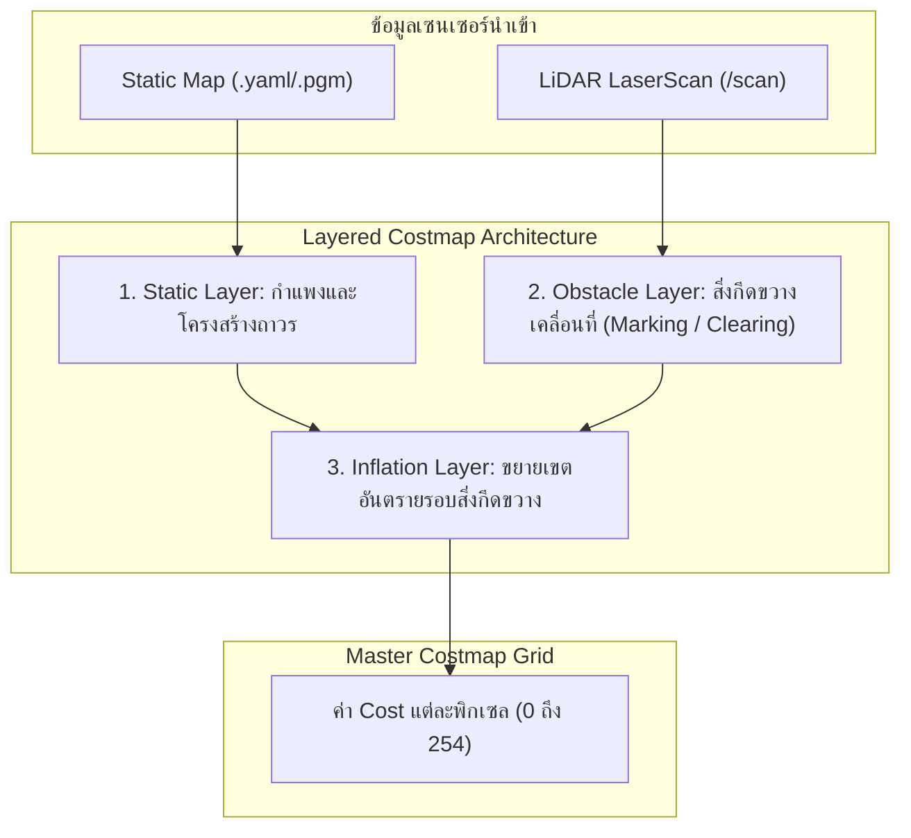

# 📖 Week 13: สถาปัตยกรรม Nav2 Stack และระบบ Costmap 2D แบบหลายชั้น (Costmap Layers)
**เวลาเรียน:** บรรยาย 2 ชั่วโมง | ปฏิบัติการ 3 ชั่วโมง | ศึกษาค้นคว้าด้วยตนเอง 4 ชั่วโมง  
**วิชาบังคับก่อน:** [สัปดาห์ที่ 12: การสร้างแผนที่ 2 มิติด้วย SLAM Toolbox และ Ceres Solver](../Week_12_SLAM_Mapping_Ceres/Readme.md)  
**เอกสารปฏิบัติการ:** [ใบงานแล็บสัปดาห์ที่ 13](Lab_Exercises.md)

---

## 🎯 วัตถุประสงค์การเรียนรู้ (Learning Objectives)
เมื่อจบบทเรียนนี้ ผู้เรียนจะสามารถ:
1. อธิบายสถาปัตยกรรมภาพรวมของ **Navigation 2 (Nav2)** และวงจรชีวิตโหนด (Lifecycle Manager)
2. วิเคราะห์โครงสร้าง **Layered Costmap 2D** ทั้ง 4 เลเยอร์หลัก (Static, Obstacle, Voxel, Inflation)
3. เข้าใจการแจกแจงค่าต้นทุนอันตราย (**Cost Values: 0, 253, 254, 255**) ในการวางแผนเส้นทาง
4. คำนวณความชันของค่าคอสต์ตามระยะทางผ่านสมการ **Inflation Decay Formula**
5. เลือกระหว่างการใช้ **`robot_radius`** (วงกลมสมมาตร) และ **`footprint`** (รูปทรงหลายเหลี่ยมจริง) สำหรับหุ่นยนต์ AMR

---

## ⏱️ แผนการสอน 2 ชั่วโมง (Lecture Outline)
| ช่วงเวลา | หัวข้อ | กิจกรรมการเรียนรู้ |
| :---: | :--- | :--- |
| **00:00 - 00:30** | สถาปัตยกรรม Nav2: Lifecycle Nodes, Action Servers และ Costmap 2D | บรรยายภาพรวมและระบบ State Management (Unconfigured, Inactive, Active) |
| **00:30 - 01:00** | โครงสร้าง Costmap หลายชั้น (Layered Costmap Plugin Architecture) | วิเคราะห์การซ้อนทับกันระหว่าง Static Layer, Obstacle Layer, และ Inflation Layer |
| **01:00 - 01:30** | ค่า Cost Values และสมการการขยายรัศมีความปลอดภัย (Inflation Math) | แสดงการคำนวณสมการ Exponential Decay และการหา Inscribed Radius |
| **01:30 - 02:00** | Code Walkthrough: `costmap_params.yaml`, Local vs Global Costmap และ Lab | เจาะลึกความแตกต่างระหว่าง Rolling Window ใน Local Costmap กับ Map ใน Global |

---

## 🏛️ สถาปัตยกรรมระบบ (Architectural Deep Dive)

### 1. สถาปัตยกรรม Navigation 2 (Nav2 Stack)
Nav2 คือสแตกระบบนำทางอัตโนมัติมาตรฐานอุตสาหกรรมใน ROS 2 ซึ่งถูกออกแบบใหม่หมดให้เป็นแบบ Modular, Plugin-based และควบคุมผ่านวงจรชีวิต **Lifecycle Nodes**:
- ทุกเซิร์ฟเวอร์ใน Nav2 (Planner, Controller, Recoveries, BT Navigator) จะถูกจัดการผ่าน `lifecycle_manager`
- หัวใจสำคัญของการหลบหลีกสิ่งกีดขวางคือ **Costmap 2D**: ตารางกริด 2 มิติที่แปลงสภาพแวดล้อมให้กลายเป็น "ต้นทุนของความเสี่ยง (Cost)" เพื่อให้อัลกอริทึมเลือกเส้นทางที่ปลอดภัยที่สุด

---

### 2. ลำดับชั้นของเลเยอร์ใน Costmap 2D (Costmap Plugins)
1. **Static Layer (`nav2_costmap_2d::StaticLayer`):**
   - โหลดข้อมูลแผนที่โกดังถาวรที่ได้จาก SLAM เข้ามาเป็นฐานราก
2. **Obstacle Layer (`nav2_costmap_2d::ObstacleLayer`):**
   - นำข้อมูลจากเซนเซอร์สด (เช่น `/scan`) มามาร์กสิ่งกีดขวางแบบไดนามิก (กล่องสินค้า คนเดินตัดหน้า):
     - **Marking:** จุดที่เลเซอร์สะท้อนกลับจะถูกตั้งเป็นสิ่งกีดขวาง
     - **Clearing (Raytracing):** แนวเส้นทางที่ลำแสงเลเซอร์ยิงผ่านจะถูกล้างค่าให้กลับเป็นทางเดินโล่ง (Free)
3. **Inflation Layer (`nav2_costmap_2d::InflationLayer`):**
   - ขยายรัศมีความปลอดภัยรอบสิ่งกีดขวาง เพื่อให้หุ่นยนต์ที่มีมิติตัวถังขนาดใหญ่ไม่เฉี่ยวชน

---

### 3. รหัสค่าต้นทุนอันตราย (Cost Values Definition)
ใน Costmap 2D แต่ละพิกเซลจะถูกแทนด้วยตัวเลขจำนวนเต็ม $0 - 255$:

| ค่าตัวเลข (Cost) | สภาพทางกายภาพ | ผลกระทบต่อ Path Planning |
| :---: | :--- | :--- |
| **0** | **Free Space (พื้นที่ว่าง)** | ปลอดภัยสูงสุด หุ่นยนต์วิ่งผ่านได้อย่างอิสระ |
| **1 - 252** | **Inflation Decay Zone (โซนเตือนภัย)** | สามารถวิ่งผ่านได้หากจำเป็น แต่อัลกอริทึมจะพยายามหลีกเลี่ยง |
| **253** | **Inscribed Obstacle (รัศมีตัวถังชน)** | จุดศูนย์กลางหุ่นยนต์ **ห้ามผ่านเด็ดขาด** เพราะตัวถังจะชนสิ่งกีดขวาง |
| **254** | **Lethal Obstacle (ตัวสิ่งกีดขวางจริง)** | กำแพง เสา หรือวัตถุแข็งที่เซนเซอร์ตรวจพบ |
| **255** | **No Information (พื้นที่ยังไม่ทราบ)** | พื้นที่นอกขอบเขตแผนที่ที่เซนเซอร์มองไม่เห็น |

---

### 4. คณิตศาสตร์การกระจายค่าคอสต์ (Inflation Decay Formula)
ในโซนระหว่างรัศมีตัวถังหุ่นยนต์ ($r_{\text{inscribed}}$) ไปจนถึงรัศมีปลอดภัยสูงสุด ($r_{\text{inflation}}$) ค่าคอสต์จะลดลงแบบเอกซ์โพเนนเชียล (Exponential Decay):

$$\text{cost}(d) = 253 \times \exp\left(-\alpha \cdot (d - r_{\text{inscribed}})\right)$$

โดยที่:
- $d$: ระยะห่างจากจุดกึ่งกลางเซลล์ไปยังขอบสิ่งกีดขวาง ($m$)
- $r_{\text{inscribed}}$: รัศมีวงกลมแนบในของหุ่นยนต์ (Inscribed Radius)
- $\alpha$: ค่าตัวคูณปรับสเกลความชัน (`cost_scaling_factor`)
  - หาก $\alpha$ มีค่ามาก: กราฟจะดิ่งลงอย่างรวดเร็ว หุ่นยนต์จะกล้าวิ่งชิดสิ่งกีดขวางมากขึ้น (เหมาะกับทางแคบ)
  - หาก $\alpha$ มีค่าน้อย: กราฟจะแผ่กว้าง หุ่นยนต์จะเว้นระยะห่างจากสิ่งกีดขวางอย่างระมัดระวัง (ทางกว้าง)

---

### 5. การกำหนดขนาดหุ่นยนต์: `robot_radius` vs `footprint`
- **`robot_radius: 0.25` (แบบวงกลม):**
  - คิดว่าหุ่นยนต์เป็นทรงกระบอกรัศมี $0.25$ เมตร
  - ข้อดี: คำนวณรวดเร็วมาก ไม่ขึ้นกับมุมหันของตัวหุ่นยนต์ (Isotropic)
- **`footprint: "[ [0.20, 0.14], [0.20, -0.14], [-0.20, -0.14], [-0.20, 0.14] ]"` (รูปหลายเหลี่ยม):**
  - นิยามพิกัดมุม 4 จุดของสี่เหลี่ยมผืนผ้าจริง (ยาว 0.40 m, กว้าง 0.28 m)
  - ข้อดี: แม่นยำสูงสุด ทำให้หุ่นยนต์สามารถขับลอดช่องทางแคบในโรงงานได้โดยไม่ติดขัด

---

## 🛠️ การวิเคราะห์ไฟล์คอนฟิกในโมดูล (Code Walkthrough)

ในไฟล์ `config/costmap_params.yaml`:
1. **Local Costmap (สำหรับควบคุมระยะใกล้):**
   - `global_frame: odom`: ทำงานบนเฟรม Odometry ที่มีความต่อเนื่องสูง
   - `rolling_window: true`: ขอบเขตแผนที่เลื่อนตามตัวหุ่นยนต์ตลอดเวลา (ขนาด $3 \times 3$ เมตร)
   - `update_frequency: 5.0`: อัปเดตข้อมูลเซนเซอร์ความถี่สูง 5 Hz
   - ใช้ `footprint` แบบหลายเหลี่ยมเพื่อความแม่นยำในการหลบหลีก
2. **Global Costmap (สำหรับวางแผนระยะไกล):**
   - `global_frame: map`: อิงกับแผนที่โลก
   - `rolling_window: false`: ครอบคลุมพื้นที่โกดังทั้งหมด
   - `track_unknown_space: true`: ป้องกันไม่ให้หุ่นยนต์วางเส้นทางผ่านพื้นที่ที่ยังไม่ได้สำรวจ

---

## ⌨️ ตารางคำสั่ง CLI สำคัญ
| คำสั่ง | วัตถุประสงค์ | ตัวอย่างการใช้งาน |
| :--- | :--- | :--- |
| `ros2 lifecycle list` | ตรวจสอบสถานะของโหนด Nav2 ทั้งหมดในระบบ | `ros2 lifecycle list` |
| `ros2 lifecycle get /controller_server` | ดูสถานะวงจรชีวิตปัจจุบันของ Controller Server | `ros2 lifecycle get /controller_server` |
| `ros2 param get /local_costmap/local_costmap inflation_layer.cost_scaling_factor` | อ่านค่าตัวคูณ Inflation ปัจจุบัน | `ros2 param get /local_costmap/local_costmap inflation_layer.cost_scaling_factor` |
| `ros2 topic echo --once /global_costmap/costmap --field data` | ตรวจสอบข้อมูลดิบของ Master Costmap | `ros2 topic echo --once /global_costmap/costmap --field data` |

---

## ⚠️ ปัญหาที่พบบ่อยและการแก้ไข (Troubleshooting)
| อาการ | สาเหตุที่เป็นไปได้ | วิธีแก้ไข |
| :--- | :--- | :--- |
| ข้อความเตือน `Robot is out of bounds of the costmap` | หุ่นยนต์อยู่นอกพื้นที่แผนที่ หรือพิกัดจุดเริ่มต้นกระโดดไปไกล | ตรวจสอบพิกัด Initial Pose ในเฟรม map ให้ตรงกับขอบเขตแผนที่จริง |
| หุ่นยนต์ไม่ยอมเดินผ่านช่องประตูที่กว้างพอ | ค่า `inflation_radius` ใหญ่เกินไป หรือ `cost_scaling_factor` ต่ำเกินไปทำให้คอสต์ทับซ้อนกัน | เพิ่มค่า `cost_scaling_factor` (เช่น ปรับเป็น 5.0) หรือลด `inflation_radius` |
| สิ่งกีดขวางที่เดินผ่านไปแล้วยังค้างอยู่ใน Costmap ไม่ยอมหาย | ปิดพารามิเตอร์ `clearing: true` ใน Obstacle Layer หรือไม่มีลำแสงส่องผ่าน | ตรวจสอบว่าในคอนฟิก scan มีการเปิด `clearing: true` |

---

## 📝 แบบทดสอบท้ายบท (Self-Assessment Quiz)
1. ในสถาปัตยกรรม Costmap 2D การแยกระหว่าง Local Costmap และ Global Costmap มีวัตถุประสงค์ต่างกันอย่างไร?
2. รหัสคอสต์ 253 (Inscribed Obstacle) มีความสำคัญอย่างไรในการป้องกันการชนของหุ่นยนต์?
3. กลไก Clearing (Raytracing) ใน Obstacle Layer ทำหน้าที่อะไรเมื่อสิ่งกีดขวางเคลื่อนที่ออกไป?
4. หากต้องการให้หุ่นยนต์เคลื่อนที่ผ่านช่องทางเดินแคบในโกดังได้ดีขึ้น ควรปรับพารามิเตอร์ `cost_scaling_factor` อย่างไร?
5. เมื่อใดที่วิศวกรควรเปลี่ยนจากการกำหนด `robot_radius` เป็นการกำหนด `footprint` หลายเหลี่ยม?

🔍 ดูเฉลยคำตอบ

1. **ตอบ:** Global Costmap ใช้สำหรับวางแผนเส้นทางระยะไกลระดับภาพรวมโกดัง (อิงเฟรม map), ส่วน Local Costmap เป็นแบบ Rolling Window ขนาดเล็กอัปเดตความถี่สูง (อิงเฟรม odom) เพื่อหลบสิ่งกีดขวางเฉพาะหน้าที่ขวางทาง
2. **ตอบ:** เป็นโซนที่หากจุดกึ่งกลางหุ่นยนต์เข้าไป ขอบตัวถังด้านนอกจะชนกับวัตถุแน่นอน ทำให้อัลกอริทึมตัดเส้นทางนี้ทิ้งโดยสิ้นเชิง
3. **ตอบ:** ทำการล้างค่าคอสต์ตามแนวเส้นทางที่ลำแสงเลเซอร์ยิงผ่านและไม่พบการสะท้อน เพื่อลบสิ่งกีดขวางเดิมที่ขยับหนีไปแล้วออกจากแผนที่
4. **ตอบ:** ควรเพิ่มค่า `cost_scaling_factor` ให้สูงขึ้น เพื่อให้กราฟคอสต์ดิ่งลงอย่างรวดเร็ว ทำให้พื้นที่ตรงกลางทางเดินมีค่าคอสต์ต่ำพอที่หุ่นยนต์จะยอมวิ่งผ่าน
5. **ตอบ:** เมื่อหุ่นยนต์มีรูปทรงที่ไม่เป็นวงกลมสมมาตร (เช่น เป็นสี่เหลี่ยมผืนผ้าที่มีความยาวมากกว่าความกว้างมากๆ) หรือต้องวิ่งผ่านช่องแคบที่การประมาณเป็นวงกลมจะทำให้ติดขัด

---

## 📚 แหล่งอ้างอิงและศึกษาเพิ่มเติม
- [Nav2 Costmap 2D Architecture (Official Nav2 Docs)](https://docs.nav2.org/configuration/packages/configuring-costmaps.html)
- [Nav2 Inflation Layer Math Explanation](https://docs.nav2.org/configuration/packages/costmap-plugins/inflation_layer.html)
- [Understanding ROS 2 Lifecycle Nodes](https://design.ros2.org/articles/node_lifecycle.html)
