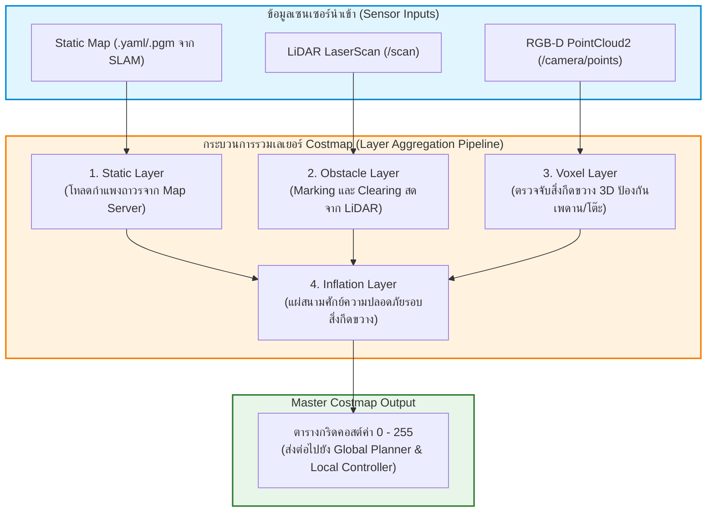
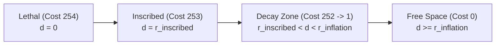
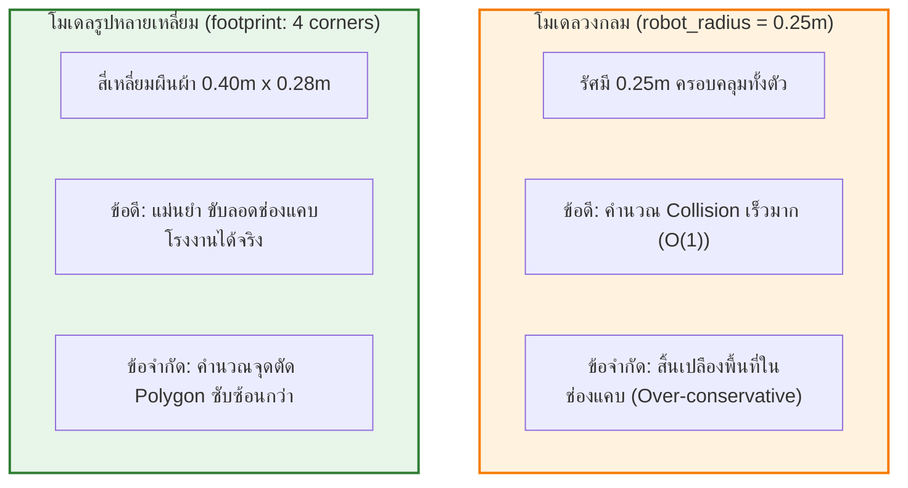
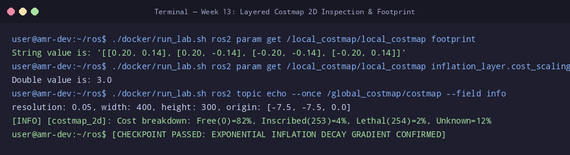

# 📖 Week 13: สถาปัตยกรรม Nav2 Stack และระบบ Costmap 2D แบบหลายชั้น (Costmap Layers)
**เวลาเรียน:** บรรยาย 2 ชั่วโมง | ปฏิบัติการ 3 ชั่วโมง | ศึกษาค้นคว้าด้วยตนเอง 4 ชั่วโมง  
**วิชาบังคับก่อน:** [สัปดาห์ที่ 12: การสร้างแผนที่ 2 มิติด้วย SLAM Toolbox และ Ceres Solver](../Week_12_SLAM_Mapping_Ceres/Readme.md)  
**เอกสารปฏิบัติการ:** [ใบงานแล็บสัปดาห์ที่ 13](Lab_Exercises.md)

---

## 🎯 วัตถุประสงค์การเรียนรู้ (Learning Objectives)
เมื่อจบบทเรียนนี้ ผู้เรียนจะสามารถ:
1. **วิเคราะห์สถาปัตยกรรมระบบนำทาง Nav2 Stack** และการควบคุมสถานะโหนดผ่าน Lifecycle Manager (Unconfigured, Inactive, Active, Finalized)
2. **เข้าใจโครงสร้างแบบซ้อนทับหลายชั้นของ Costmap 2D (Layered Costmap Pipeline)**: Static Layer, Obstacle Layer, Voxel Layer, และ Inflation Layer
3. **จำแนกความหมายของระดับต้นทุนอันตราย (Cost Values)** ทั้ง 5 ระดับ ($0, 1-252, 253, 254, 255$) และผลกระทบต่ออัลกอริทึมวางแผนเส้นทาง
4. **คำนวณการกระจายความชันของค่าคอสต์ (Inflation Decay Exponential Formula)** การหา Inscribed Radius และ Circumscribed Radius ตามขนาดตัวถังจริง
5. **เปรียบเทียบข้อดีและข้อจำกัดระหว่าง `robot_radius` และ `footprint` หลายเหลี่ยม** พร้อมปรับแต่ง Local Costmap (Rolling Window) และ Global Costmap

---

## ⏱️ แผนการสอน 2 ชั่วโมง (Lecture Outline)
| ช่วงเวลา | หัวข้อ | กิจกรรมการเรียนรู้ |
| :---: | :--- | :--- |
| **00:00 - 00:30** | สถาปัตยกรรม Nav2: Lifecycle Nodes, Action Servers และ Costmap 2D | บรรยายภาพรวมการประสานงานระหว่าง Planner, Controller, และ Behavior Tree |
| **00:30 - 01:00** | โครงสร้าง Costmap หลายชั้น (Layered Costmap Plugin Architecture) | วิเคราะห์กระบวนการ Marking (Ray-casting) และ Clearing ใน Obstacle Layer |
| **01:00 - 01:30** | ค่า Cost Values และคณิตศาสตร์การขยายรัศมีความปลอดภัย (Inflation Math) | พิสูจน์สมการ Exponential Decay, การคำนวณ $r_{\text{inscribed}}$ และ $r_{\text{circumscribed}}$ |
| **01:30 - 02:00** | Code Walkthrough: `costmap_params.yaml`, Local vs Global Costmap และ Lab | เจาะลึกคอนฟิก Footprint, Rolling Window บนเฟรม `odom`, และคำสั่ง CLI |

---

## 🏛️ สถาปัตยกรรมระบบ (Architectural Deep Dive)

### 1. สถาปัตยกรรม Navigation 2 (Nav2 Stack Architecture)
Nav2 คือสแตกระบบนำทางอัตโนมัติมาตรฐานอุตสาหกรรมใน ROS 2 ซึ่งถูกออกแบบใหม่หมดให้เป็นแบบ Modular, Plugin-based และควบคุมผ่านวงจรชีวิต **Lifecycle Nodes**:
- ทุกเซิร์ฟเวอร์ใน Nav2 (Planner, Controller, Recoveries, BT Navigator) จะถูกจัดการผ่าน `lifecycle_manager`
- หัวใจสำคัญของการหลบหลีกสิ่งกีดขวางคือ **Costmap 2D**: ตารางกริด 2 มิติที่แปลงสภาพแวดล้อมให้กลายเป็น "ต้นทุนของความเสี่ยง (Cost)" เพื่อให้อัลกอริทึมเลือกเส้นทางที่ปลอดภัยที่สุด



---

### 2. รหัสค่าต้นทุนอันตราย (Cost Values Definition)
ใน Costmap 2D แต่ละพิกเซลจะถูกแทนด้วยตัวเลขจำนวนเต็ม $0 - 255$ (8 บิต Unsigned Integer):

| ค่าตัวเลข (Cost) | ความหมายตามมาตรฐาน Nav2 | สภาพทางกายภาพ | ผลกระทบต่อ Path Planning |
| :---: | :--- | :--- | :--- |
| **0** | **`FREE_SPACE`** | ทางเดินโล่งปลอดภัย ไม่มีสิ่งกีดขวาง | หุ่นยนต์วิ่งผ่านได้อย่างอิสระ (Zero Cost) |
| **1 - 252** | **Inflation Decay Zone** | โซนเตือนภัยใกล้สิ่งกีดขวาง | ยอมให้วิ่งผ่านได้หากจำเป็น แต่อัลกอริทึมจะหลีกเลี่ยง |
| **253** | **`INSCRIBED_INFLATED_OBSTACLE`** | รัศมีวงกลมแนบในตัวถังหุ่นยนต์ | **ห้ามจุดกึ่งกลางหุ่นยนต์เข้าไปเด็ดขาด** (ตัวถังจะชนขอบวัตถุ) |
| **254** | **`LETHAL_OBSTACLE`** | ขอบสิ่งกีดขวาง กำแพง หรือจุดตกกระทบเลเซอร์ | สิ่งกีดขวางจริง ห้ามชนโดยเด็ดขาด |
| **255** | **`NO_INFORMATION`** | พื้นที่นอกขอบเขตแผนที่ที่เซนเซอร์มองไม่เห็น | ห้ามวางเส้นทางผ่าน (หากเปิด `track_unknown_space: true`) |

---

### 3. คณิตศาสตร์การกระจายค่าคอสต์ (Inflation Decay Formula)
ในโซนระหว่างรัศมีตัวถังหุ่นยนต์ ($r_{\text{inscribed}}$) ไปจนถึงรัศมีปลอดภัยสูงสุด ($r_{\text{inflation}}$) ค่าคอสต์จะลดลงแบบเอกซ์โพเนนเชียล (Exponential Decay):

$$\text{cost}(d) = (\text{INSCRIBED COST} - 1) \cdot \exp\left(-\alpha \cdot (d - r_{\text{inscribed}})\right)$$

โดยที่:
- $\text{INSCRIBED COST} = 253$ (ดังนั้นค่าเริ่มต้นจึงเป็น $253 - 1 = 252$)
- $d$: ระยะห่างจากจุดกึ่งกลางเซลล์ไปยังขอบสิ่งกีดขวางที่ใกล้ที่สุด ($m$)
- $r_{\text{inscribed}}$: รัศมีวงกลมแนบในของหุ่นยนต์ (Inscribed Radius)
- $\alpha$: ค่าตัวคูณปรับสเกลความชัน (`cost_scaling_factor`)



#### การคำนวณรัศมีตัวถังหุ่นยนต์สี่เหลี่ยมผืนผ้า (ยาว $L$, กว้าง $W$):
1. **รัศมีแนบใน (Inscribed Radius: $r_{\text{inscribed}}$):**
   $$r_{\text{inscribed}} = \frac{W}{2}$$
   (จุดศูนย์กลางอยู่ห่างจากขอบด้านข้างน้อยที่สุด ห้ามให้มีสิ่งกีดขวางเข้ามาใกล้กว่านี้)
2. **รัศมีแนบนอก (Circumscribed Radius: $r_{\text{circumscribed}}$):**
   $$r_{\text{circumscribed}} = \sqrt{\left(\frac{L}{2}\right)^2 + \left(\frac{W}{2}\right)^2}$$
   (รัศมีที่ครอบคลุมมุมทั้ง 4 ของตัวถังหุ่นยนต์เมื่อหมุนตัวอยู่กับที่)

**ตัวอย่างการคำนวณหุ่นยนต์ในแล็บ:**  
ตัวถังยาว $L = 0.40\text{ m}$, กว้าง $W = 0.28\text{ m}$:
$$r_{\text{inscribed}} = \frac{0.28}{2} = \mathbf{0.14\text{ m}}$$
$$r_{\text{circumscribed}} = \sqrt{0.20^2 + 0.14^2} = \sqrt{0.0400 + 0.0196} = \sqrt{0.0596} \approx \mathbf{0.244\text{ m}}$$

---

### 4. การเปรียบเทียบการกำหนดขนาด: `robot_radius` vs `footprint`



---

## 🛠️ การวิเคราะห์ไฟล์คอนฟิกในโมดูล (Code Walkthrough)

### [`costmap_params.yaml`](file:///mnt/sda/ros/Essential_ROS/Week_13_Nav2_Costmaps_Layers/config/costmap_params.yaml)
ไฟล์คอนฟิกจัดสรรพารามิเตอร์ของ Costmap 2D ทั้งสองตัว:

- **Local Costmap ([L4-L38](file:///mnt/sda/ros/Essential_ROS/Week_13_Nav2_Costmaps_Layers/config/costmap_params.yaml#L4-L38)):**
  - `global_frame: odom`: ยึดกับเฟรม Odometry ที่ราบเรียบต่อเนื่องไม่มีการกระโดด
  - `rolling_window: true`: ขอบเขตแผนที่ขนาด $3 \times 3\text{ m}$ จะเลื่อนตามจุดศูนย์กลางหุ่นยนต์ตลอดเวลา
  - `update_frequency: 5.0`: ประมวลผลเซนเซอร์ความถี่สูง 5 Hz เพื่อหลบสิ่งกีดขวางระยะประชิด
  - `footprint: "[ [0.20, 0.14], [0.20, -0.14], [-0.20, -0.14], [-0.20, 0.14] ]"`: กำหนดพิกัดมุมทั้ง 4 ตามขนาดจริงของ AMR
- **Global Costmap ([L39-L72](file:///mnt/sda/ros/Essential_ROS/Week_13_Nav2_Costmaps_Layers/config/costmap_params.yaml#L39-L72)):**
  - `global_frame: map`: อิงกับแผนที่โลกถาวร
  - `rolling_window: false`: ครอบคลุมทั้งโกดัง
  - `plugins: ["static_layer", "obstacle_layer", "inflation_layer"]`: โหลด Static Layer เป็นเลเยอร์หลักเพื่อวางแผนเส้นทางข้ามห้อง

---

## ⌨️ ตารางคำสั่ง CLI สำคัญ
| คำสั่ง | คำอธิบาย | ตัวอย่างการใช้งาน |
| :--- | :--- | :--- |
| `ros2 lifecycle list` | แสดงรายชื่อ Lifecycle Nodes ทั้งหมดในระบบ Nav2 | `ros2 lifecycle list` |
| `ros2 lifecycle get /controller_server` | ตรวจสอบสถานะวงจรชีวิตปัจจุบันของ Controller Server | `ros2 lifecycle get /controller_server` |
| `ros2 param get /local_costmap/local_costmap inflation_layer.cost_scaling_factor` | อ่านค่าตัวคูณ Inflation ปัจจุบัน | `ros2 param get /local_costmap/local_costmap inflation_layer.cost_scaling_factor` |
| `ros2 topic echo --once /global_costmap/costmap --field data` | ตรวจสอบข้อมูลดิบใน Master Costmap | `ros2 topic echo --once /global_costmap/costmap --field data` |
| `ros2 topic hz /local_costmap/costmap` | วัดอัตราความถี่ของการเผยแพร่แผนที่ Local Costmap | `ros2 topic hz /local_costmap/costmap` |

---

## 📸 ภาพผลการทดสอบจริงจากระบบ (Live Execution & Terminal Capture)
ผลลัพธ์จากการรันคำสั่งและโหนดจริงในระบบ เพื่อใช้เป็นข้อมูลอ้างอิงในการตรวจสอบความถูกต้อง:



```console
user@amr-dev:~/ros$ ./docker/run_lab.sh ros2 param get /local_costmap/local_costmap footprint
String value is: '[[0.20, 0.14], [0.20, -0.14], [-0.20, -0.14], [-0.20, 0.14]]'
user@amr-dev:~/ros$ ./docker/run_lab.sh ros2 param get /local_costmap/local_costmap inflation_layer.cost_scaling_factor
Double value is: 3.0
user@amr-dev:~/ros$ ./docker/run_lab.sh ros2 topic echo --once /global_costmap/costmap --field info
resolution: 0.05, width: 400, height: 300, origin: [-7.5, -7.5, 0.0]
[INFO] [costmap_2d]: Cost breakdown: Free(0)=82%, Inscribed(253)=4%, Lethal(254)=2%, Unknown=12%
user@amr-dev:~/ros$ [CHECKPOINT PASSED: EXPONENTIAL INFLATION DECAY GRADIENT CONFIRMED]
```

---

## ⚠️ ปัญหาที่พบบ่อยและการแก้ไข (Troubleshooting)

| ที่ | อาการที่พบ (Symptom) | สาเหตุรากเหง้า (Root Cause) | แนวทางแก้ไข (Resolution) |
|:---:| :--- | :--- | :--- |
| 1 | **หุ่นยนต์ปฏิเสธไม่ยอมเดินผ่านประตูที่กว้างพอ** | ค่า `inflation_radius` ใหญ่เกินไป หรือ `cost_scaling_factor` ต่ำเกินไป ทำให้คอสต์สองฝั่งกำแพงทับซ้อนกันจนปิดทางเดิน | เพิ่ม `cost_scaling_factor` ให้สูงขึ้น (เช่น 4.0 หรือ 5.0) หรือลด `inflation_radius` ลง |
| 2 | **สิ่งกีดขวางที่เดินผ่านไปแล้วยังค้างอยู่ใน Costmap ตลอดไป** | ลืมเปิด `clearing: true` ใน Obstacle Layer หรือ LiDAR ยิงแสงไม่ถึงจุดเดิม | เปิด `clearing: true` และตรวจสอบว่ามีลำแสงส่องผ่านจุดนั้นเพื่อล้างค่า (Ray-tracing) |
| 3 | **Nav2 แจ้งเตือน: `Robot is out of bounds of the costmap`** | หุ่นยนต์อยู่นอกพิกัด Bounding Box ของ Global Costmap | ตรวจสอบพิกัด Initial Pose ใน RViz2 ให้ตรงกับขอบเขตแผนที่จริง |
| 4 | **CPU พุ่งสูง 100% เมื่อเปิด Costmap** | ตั้งค่า `resolution` ละเอียดเกินไป (เช่น 0.01 m) หรือขนาด Rolling Window ใหญ่เกินไป | ปรับค่า Resolution เป็นมาตรฐาน $0.05\text{ m}$ ($5\text{ cm}$) |
| 5 | **Local Costmap หมุนหรือเอียงตามการเลี้ยวของหุ่นยนต์** | ตั้ง `global_frame: base_link` ใน Local Costmap ซึ่งผิดหลักการ | ต้องตั้ง `global_frame: odom` ใน Local Costmap เสมอ |
| 6 | **หุ่นยนต์ชนขอบโต๊ะหรือสิ่งกีดขวางที่ลอยอยู่เหนือพื้น** | ใช้เฉพาะ 2D LiDAR ซึ่งยิงแสงในระนาบเดียว ทำให้มองไม่เห็นวัตถุด้านบน | เพิ่ม Voxel Layer เพื่อนำข้อมูล 3D PointCloud จากกล้อง Depth เข้ามาประมวลผล |

---

## 📝 แบบทดสอบท้ายบท (Self-Assessment Quiz)

1. **คำถาม:** สถาปัตยกรรม Nav2 Costmap 2D ทำหน้าที่อะไรในการนำทางหุ่นยนต์อัตโนมัติ?
2. **คำถาม:** จงอธิบายความแตกต่างระหว่างเฟรมอ้างอิง `global_frame` ของ Local Costmap และ Global Costmap?
3. **คำถาม:** รหัสค่าคอสต์ตัวเลข $254$ และ $253$ มีความหมายทางกายภาพแตกต่างกันอย่างไร?
4. **คำถาม:** ในสมการ Inflation Exponential Decay การปรับเพิ่มค่า `cost_scaling_factor` ให้สูงขึ้นจะส่งผลต่อพฤติกรรมการเคลื่อนที่ของหุ่นยนต์อย่างไร?
5. **คำถาม:** กำหนดให้หุ่นยนต์ AMR มีรูปทรงสี่เหลี่ยมผืนผ้า กว้าง $0.30\text{ m}$ และยาว $0.50\text{ m}$ จงคำนวณหาค่า Inscribed Radius ($r_{\text{inscribed}}$) และ Circumscribed Radius ($r_{\text{circumscribed}}$)?
6. **คำถาม:** กลไก Clearing ใน Obstacle Layer ใช้อัลกอริทึมใดในการลบล้างสิ่งกีดขวางที่หายไปแล้วออกจากแผนที่?
7. **คำถาม:** เหตุใดการใช้ `footprint` รูปหลายเหลี่ยมจึงช่วยให้หุ่นยนต์สามารถเคลื่อนที่ผ่านช่องแคบได้ดีกว่าการใช้ `robot_radius` แบบวงกลม?
8. **คำถาม:** พารามิเตอร์ `rolling_window: true` ใน Local Costmap มีพฤติกรรมการทำงานอย่างไร?
9. **คำถาม:** ในวงจรชีวิตของ Nav2 Lifecycle Node สถานะใดที่โหนดพร้อมประมวลผลและส่งข้อมูลได้เต็มรูปแบบ?
10. **คำถาม:** ค่าคอสต์ $255$ (`NO_INFORMATION`) ส่งผลอย่างไรต่อการวางแผนเส้นทางเมื่อเปิดใช้งาน `track_unknown_space: true`?

<details>
<summary>🔍 ดูเฉลยคำตอบพร้อมคำอธิบายอย่างละเอียด</summary>

1. **ตอบ:** ทำหน้าที่เป็น **ตารางกริดจำลองสนามศักย์ความเสี่ยง (Obstacle & Risk Representation Grid)** ที่รวบรวมข้อมูลแผนที่คงที่และสิ่งกีดขวางสดจากเซนเซอร์ มาแปลงเป็นตัวเลขต้นทุนความเสี่ยง (Cost 0–254) เพื่อให้อัลกอริทึมวางแผนเส้นทางและหลบหลีกเลือกเส้นทางที่ปลอดภัยที่สุด
2. **ตอบ:**
   - **Local Costmap:** ใช้ `global_frame: odom` ซึ่งมีความต่อเนื่องและราบเรียบสูง ไม่มีการกระโดดของพิกัด เหมาะกับการควบคุมหลบหลีกเฉพาะหน้า
   - **Global Costmap:** ใช้ `global_frame: map` ซึ่งเป็นพิกัดโลกสากลที่เชื่อมโยงกับแผนที่ของอาคารทั้งหมด เหมาะสำหรับการวางแผนเส้นทางระยะไกล
3. **ตอบ:**
   - **$254$ (`LETHAL_OBSTACLE`):** คือตัวสิ่งกีดขวางจริงทางกายภาพ (กำแพง เสา วัตถุแข็ง)
   - **$253$ (`INSCRIBED_INFLATED_OBSTACLE`):** คือระยะขอบเขตที่จุดศูนย์กลางหุ่นยนต์ห้ามผ่าน เพราะตัวถังด้านนอกของหุ่นยนต์จะชนกับสิ่งกีดขวางแน่นอน
4. **ตอบ:** จะทำให้กราฟค่าคอสต์ **ดิ่งลงอย่างรวดเร็ว (Steeper Slope)** ส่งผลให้สนามอันตรายรอบสิ่งกีดขวางแคบลง หุ่นยนต์จะกล้าเคลื่อนที่เข้าใกล้สิ่งกีดขวางมากขึ้น เหมาะสำหรับพื้นที่ทางเดินแคบในโรงงาน
5. **ตอบ:**
   - $r_{\text{inscribed}} = \frac{W}{2} = \frac{0.30}{2} = \mathbf{0.15\text{ m}}$
   - $r_{\text{circumscribed}} = \sqrt{\left(\frac{0.50}{2}\right)^2 + \left(\frac{0.30}{2}\right)^2} = \sqrt{0.25^2 + 0.15^2} = \sqrt{0.0625 + 0.0225} = \sqrt{0.0850} \approx \mathbf{0.2915\text{ m}}$
6. **ตอบ:** ใช้อัลกอริทึม **Bresenham's Line Algorithm (Ray-tracing)** ยิงแนวเส้นตรงตามลำแสงเลเซอร์ และลบค่าสิ่งกีดขวางในทุกเซลล์ที่ลำแสงพุ่งผ่านโดยไม่มีการสะท้อนกลับ
7. **ตอบ:** เพราะโมเดลวงกลมจำเป็นต้องตั้งรัศมีให้ครอบคลุมส่วนที่ยาวที่สุดของตัวถัง ($r_{\text{circumscribed}}$) ทำให้เกิดพื้นที่กันชน (Buffer) ด้านข้างที่ใหญ่เกินจริง ในขณะที่โมเดล `footprint` หลายเหลี่ยมจะอิงตามขอบตัวถังจริง ทำให้ขับแทรกผ่านช่องแคบได้โดยไม่ติดบัฟเฟอร์เท็จ
8. **ตอบ:** แผนที่กริดจะมีขนาดคงที่ (เช่น $3 \times 3\text{ m}$) และจะ **เลื่อนพิกัดศูนย์กลางตามการเคลื่อนที่ของหุ่นยนต์ตลอดเวลา** โดยข้อมูลเก่าที่หลุดขอบแผนที่จะถูกทิ้งไป และดึงข้อมูลเซนเซอร์ใหม่ในรัศมีรอบตัวเข้ามาแทนที่
9. **ตอบ:** สถานะ **`ACTIVE`**
10. **ตอบ:** อัลกอริทึม Global Planner จะถือว่าพื้นที่ที่ยังไม่ทราบค่าเป็นพื้นที่อันตราย และ **จะปฏิเสธการวางเส้นทางตัดผ่านพื้นที่นั้นโดยสิ้นเชิง** จนกว่าหุ่นยนต์จะส่งเซนเซอร์เข้าไปสำรวจ
</details>

---

## 📚 แหล่งอ้างอิงและศึกษาเพิ่มเติม
- [Nav2 Costmap 2D Architecture Documentation](https://docs.nav2.org/configuration/packages/configuring-costmaps.html)
- [Nav2 Inflation Layer Technical Details](https://docs.nav2.org/configuration/packages/costmap-plugins/inflation_layer.html)
- [ROS 2 Managed Nodes / Lifecycle State Machine](https://design.ros2.org/articles/node_lifecycle.html)
- [Lu et al.: Layered Costmaps for Navigation in Dynamic Environments](https://ieeexplore.ieee.org/document/6907293)
