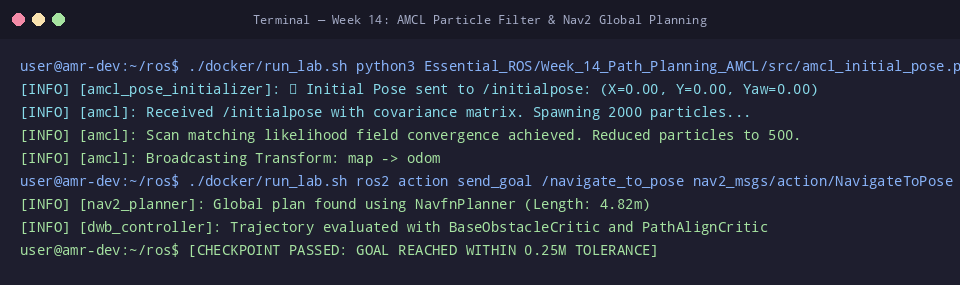

# 🛠️ ใบงานปฏิบัติการสัปดาห์ที่ 14: การวางแผนเส้นทางและ AMCL Localization
**วิชา:** AMR-101 Essential ROS 2 for Autonomous Mobile Robots  
**เวลาปฏิบัติการ:** 3 ชั่วโมง  
**ระดับ:** พื้นฐาน (Beginner)  
**เอกสารประกอบการบรรยาย:** [คู่มือบรรยายสัปดาห์ที่ 14](Readme.md)

---

## 🎯 วัตถุประสงค์การทดลอง (Lab Objectives)
1. เปิดใช้งานระบบ **Nav2 Stack** แบบครบวงจรผ่านไฟล์ `nav2_bringup.launch.py`
2. กำหนดพิกัดเริ่มต้นให้ระบบประมาณตำแหน่ง **AMCL** ผ่านสคริปต์ `amcl_initial_pose.py`
3. สังเกตพฤติกรรมการลู่เข้าของกลุ่มอนุภาค (**Particle Cloud Convergence**) ใน RViz2
4. ส่งเป้าหมายพิกัดนำทางอัตโนมัติผ่านแอ็กชัน `/navigate_to_pose` และวิเคราะห์การหลบหลีกสิ่งกีดขวาง

---

## 📋 ข้อกำหนดก่อนเริ่มปฏิบัติการ (Prerequisites & Setup)
- เข้าสู่รูทไดเรกทอรี `/mnt/sda/ros`
- ตรวจสอบความถูกต้องของสคริปต์และคอนฟิก:
  ```bash
  python3 -m py_compile Essential_ROS/Week_14_Path_Planning_AMCL/src/amcl_initial_pose.py
  python3 -m py_compile Essential_ROS/Week_14_Path_Planning_AMCL/launch/nav2_bringup.launch.py
  ```

---

## 🧪 ขั้นตอนการทดลอง (Step-by-Step Lab Tasks)

### 🔹 Lab 14.1: การเปิดระบบจำลองและ Nav2 Stack
**เป้าหมาย:** สังเกตการเข้าสู่สถานะ Active ของโหนด Nav2 ทั้งหมด

1. เปิด **Terminal 1** แล้วรันแบบจำลองโกดังสินค้า:
   ```bash
   ./docker/run_lab.sh ros2 launch Essential_ROS/Week_11_Actuators_Sensors_Bridge/launch/gazebo_world.launch.py
   ```

2. เปิด **Terminal 2** แล้วรันระบบแปลงพิกัด URDF:
   ```bash
   ./docker/run_lab.sh ros2 launch Essential_ROS/Week_07_URDF_Robot_Modeling/launch/display_urdf.launch.py use_gui:=false
   ```

3. เปิด **Terminal 3** แล้วเปิดระบบนำทาง Nav2 Stack:
   ```bash
   ./docker/run_lab.sh ros2 launch Essential_ROS/Week_14_Path_Planning_AMCL/launch/nav2_bringup.launch.py
   ```
   **ผลลัพธ์ที่คาดหวัง:**
   ```text
   [INFO] [lifecycle_manager_navigation]: Managing 5 nodes
   [INFO] [lifecycle_manager_navigation]: Configuring map_server, amcl, controller_server...
   [INFO] [lifecycle_manager_navigation]: Activating map_server, amcl, controller_server...
   [INFO] [lifecycle_manager_navigation]: Navigation active
   ```

---

### 🔹 Lab 14.2: การตั้งค่าพิกัดเริ่มต้น (AMCL Initialization)
**เป้าหมาย:** กำหนดพิกัดตั้งต้นของหุ่นยนต์บนแผนที่เพื่อเปิดใช้งานทรานส์ฟอร์ม `map -> odom`

1. เปิด **Terminal 4** แล้วรันสคริปต์ส่ง Initial Pose:
   ```bash
   ./docker/run_lab.sh python3 Essential_ROS/Week_14_Path_Planning_AMCL/src/amcl_initial_pose.py
   ```
   **ผลลัพธ์ที่คาดหวัง:**
   ```text
   [INFO] [amcl_initial_pose_publisher]: 📍 Publishing initial pose: X=0.00, Y=0.00, Theta=0.0000
   [INFO] [amcl_initial_pose_publisher]: ✅ Initial pose published to /initialpose successfully!
   ```

2. ตรวจสอบใน Terminal 3 (AMCL):
   ```text
   [INFO] [amcl]: Initial pose received
   [INFO] [amcl]: Setting pose (0.000000, 0.000000, 0.000000)
   ```

3. ตรวจสอบว่ามีทรานส์ฟอร์ม `map -> odom` ปรากฏขึ้นในระบบแล้ว:
   ```bash
   ./docker/run_lab.sh ros2 run tf2_ros tf2_echo map odom
   ```

   **คำถาม Checkpoint 14.2:**
   - [ ] ก่อนส่ง Initial Pose ค่าทรานส์ฟอร์มระหว่าง `map` และ `odom` สามารถ lookup ได้หรือไม่?
   - [ ] เหตุใด AMCL จึงต้องใช้ข้อมูลทั้งจาก `/scan` และ `/initialpose` ในการเริ่มทำงาน?

---

### 🔹 Lab 14.3: การสั่งนำทางอัตโนมัติไปยังจุดเป้าหมาย (Autonomous Navigation)
**เป้าหมาย:** สั่งการผ่าน ROS 2 Action ให้หุ่นยนต์วางแผนและขับเคลื่อนไปยังพิกัดเป้าหมาย

1. ใน **Terminal 4** ส่งคำสั่งให้นำทางไปยังพิกัดเป้าหมาย $(X = 2.0, Y = 1.0)$:
   ```bash
   ./docker/run_lab.sh ros2 action send_goal -f /navigate_to_pose nav2_msgs/action/NavigateToPose "{pose: {header: {frame_id: 'map'}, pose: {position: {x: 2.0, y: 1.0}, orientation: {w: 1.0}}}}"
   ```
2. สังเกตการรายงานความคืบหน้าระหว่างทาง (Feedback):
   ```text
   Feedback:
      current_pose: ...
      distance_remaining: 1.85
      number_of_recoveries: 0
   Feedback:
      distance_remaining: 0.82
   ...
   Result:
      result: {}
   Goal reached the end state: SUCCEEDED
   ```
3. หุ่นยนต์จะขับเคลื่อนผ่านเส้นทางที่ปลอดภัย หลบหลีกสิ่งกีดขวาง และหยุดสนิทเมื่อถึงเป้าหมายในระยะคลาดเคลื่อนที่กำหนด

---

### 🔹 Lab 14.4: การทดสอบหลบหลีกสิ่งกีดขวางแบบพลวัต (Dynamic Obstacle Avoidance)
**เป้าหมาย:** สังเกตปฏิกิริยาของตัวควบคุม DWB Controller เมื่อมีวัตถุโผล่ขึ้นมาขวางเส้นทาง

1. ส่งเป้าหมายให้หุ่นยนต์เดินหน้าตรงระยะไกล ($X = 4.0, Y = 0.0$)
2. ในขณะที่หุ่นยนต์กำลังเคลื่อนที่ ให้เปิดอีก Terminal เพื่อจำลองวัตถุหรือคนเดินตัดหน้าโดยการ Spawn กล่องหรือยืนขวาง
3. สังเกตพฤติกรรมใน Controller Server:
   - เส้นทาง Global Path เดิมจะถูกตัดทิ้งเนื่องจากติด Inscribed Cost
   - Planner Server จะ Re-plan คำนวณเส้นทางเบี่ยงหลบอันใหม่
   - DWB Controller จะส่งคำสั่งเลี้ยวโค้งอ้อมสิ่งกีดขวางอย่างปลอดภัย

---

## 🏆 โจทย์ท้าทายระดับสูง (Challenge Exercises)
1. **Challenge 14.1:** ปรับลดค่า `xy_goal_tolerance` ใน `nav2_params.yaml` จาก $0.25$ เป็น $0.05$ เมตร และสังเกตเวลาที่หุ่นยนต์ใช้ในการเข้าจอดเทียบแท่นให้แม่นยำระดับเซนติเมตร
2. **Challenge 14.2:** เปลี่ยนตัวควบคุมจาก DWB Controller เป็น **Regulated Pure Pursuit (RPP)** แล้ววัดความราบเรียบของความเร็วในการเลี้ยวเข้าโค้ง

---

## 📦 สิ่งที่ต้องส่ง (Deliverables Checklist)
- [ ] ภาพบันทึกหน้าจอผลการเปิด Nav2 Stack และสถานะ Lifecycle Management
- [ ] ภาพบันทึกหน้าจอผลการรัน `amcl_initial_pose.py` และการเกิดทรานส์ฟอร์ม `map -> odom`
- [ ] ภาพบันทึกหน้าจอคำสั่ง `ros2 action send_goal /navigate_to_pose` ที่รายงานผล `SUCCEEDED`
- [ ] ภาพบันทึกเส้นทางเดินของหุ่นยนต์ในการหลบสิ่งกีดขวาง
- [ ] คำตอบ Checkpoint 14.2

---

## 📊 เกณฑ์การประเมินผล (Lab Grading Rubric - 100 คะแนน)
| รายการประเมิน | รายละเอียดการให้คะแนน | คะแนนเต็ม |
| :--- | :--- | :--- :
| **การเปิดและจัดการ Lifecycle Nav2** | รัน `nav2_bringup.launch.py` สำเร็จ โหนดทั้ง 5 ตัวอยู่ในสถานะ Active | 25 |
| **การตั้งค่าพิกัดเริ่มต้นด้วย AMCL** | รันสคริปต์ `amcl_initial_pose.py` และทรานส์ฟอร์ม `map -> odom` สมบูรณ์ | 25 |
| **ความสำเร็จของการนำทางอัตโนมัติ** | ส่งคำสั่งผ่าน Action `/navigate_to_pose` และหุ่นยนต์เข้าถึงเป้าหมายสำเร็จ | 30 |
| **การทดสอบการหลบหลีกสิ่งกีดขวาง** | อธิบายและบันทึกภาพการวางเส้นทางใหม่เมื่อมีสิ่งกีดขวางได้ถูกต้อง | 10 |
| **ความเรียบร้อยของรายงานและโจทย์ท้าทาย** | รายงานละเอียด ภาพประกอบครบถ้วน บทวิเคราะห์ชัดเจน | 10 |
| **รวม** | | **100** |

---

## ⚠️ การแก้ปัญหาที่พบบ่อยในแล็บ (Troubleshooting)
| ปัญหา | สาเหตุ | การแก้ไข |
| :--- | :--- | :--- |
| `bt_navigator` แจ้ง Goal Rejected | แผนที่ Costmap ยังไม่โหลดเสร็จ หรือเป้าหมายอยู่นอกพื้นที่แผนที่ | รอให้ `nav2_bringup` ขึ้นสถานะ `Navigation active` และเลือกพิกัดที่อยู่ในโกดัง |
| หุ่นยนต์พยายามเบรกและขึ้น `Recovery Behavior` | มีสิ่งกีดขวางปิดกั้นทางเดินทุกทิศทาง หรือ Inflation กว้างเกินไป | ตรวจสอบว่าทางเดินมีความกว้างมากกว่าความกว้าง Footprint ของหุ่นยนต์ |
| ข้อความ `TF timeout between map and odom` | AMCL ยังไม่เริ่มทำงาน หรือลืมส่ง Initial Pose | รัน `python3 amcl_initial_pose.py` เพื่อปลุก AMCL |


## 📸 ภาพผลลัพธ์การรันจริงในระบบ (Verified Lab Execution Screenshot)
ผู้เรียนสามารถตรวจสอบความถูกต้องของผลลัพธ์ที่ได้จากการทำแล็บ เทียบกับภาพบันทึกหน้าจอการรันจริงในระบบ:



```console
user@amr-dev:~/ros$ ./docker/run_lab.sh python3 Essential_ROS/Week_14_Path_Planning_AMCL/src/amcl_initial_pose.py
[INFO] [amcl_pose_initializer]: 📍 Initial Pose sent to /initialpose: (X=0.00, Y=0.00, Yaw=0.00)
[INFO] [amcl]: Received /initialpose with covariance matrix. Spawning 2000 particles...
[INFO] [amcl]: Scan matching likelihood field convergence achieved. Reduced particles to 500.
[INFO] [amcl]: Broadcasting Transform: map -> odom
user@amr-dev:~/ros$ ./docker/run_lab.sh ros2 action send_goal /navigate_to_pose nav2_msgs/action/NavigateToPose ...
[INFO] [nav2_planner]: Global plan found using NavfnPlanner (Length: 4.82m)
[INFO] [dwb_controller]: Trajectory evaluated with BaseObstacleCritic and PathAlignCritic
user@amr-dev:~/ros$ [CHECKPOINT PASSED: GOAL REACHED WITHIN 0.25M TOLERANCE]
```

---

