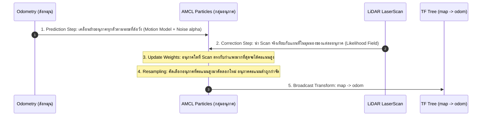

# 📖 Week 14: การวางแผนเส้นทาง, คอนโทรลเลอร์ และระบบประมาณตำแหน่ง AMCL (Particle Filter)
**เวลาเรียน:** บรรยาย 2 ชั่วโมง | ปฏิบัติการ 3 ชั่วโมง | ศึกษาค้นคว้าด้วยตนเอง 4 ชั่วโมง  
**วิชาบังคับก่อน:** [สัปดาห์ที่ 13: สถาปัตยกรรม Nav2 Stack และระบบ Costmap 2D แบบหลายชั้น](../Week_13_Nav2_Costmaps_Layers/Readme.md)  
**เอกสารปฏิบัติการ:** [ใบงานแล็บสัปดาห์ที่ 14](Lab_Exercises.md)

---

## 🎯 วัตถุประสงค์การเรียนรู้ (Learning Objectives)
เมื่อจบบทเรียนนี้ ผู้เรียนจะสามารถ:
1. อธิบายหลักการของ **Adaptive Monte Carlo Localization (AMCL)** และอัลกอริทึม **Particle Filter**
2. ปรับแต่งโมเดลการเคลื่อนที่ ($\alpha_1 - \alpha_4$) และโมเดลเซนเซอร์ (Likelihood Field Model) ใน AMCL
3. เปรียบเทียบอัลกอริทึมการวางแผนเส้นทางระดับโลก (**Global Planners**: NavFn Dijkstra/A* vs Smac Planner)
4. เปรียบเทียบตัวควบคุมเส้นทางเฉพาะหน้า (**Local Controllers**: DWB Critics vs Regulated Pure Pursuit)
5. พัฒนาสคริปต์ Python ตั้งค่าพิกัดเริ่มต้น (**Initial Pose**) เพื่อเปิดใช้งานระบบนำทางอัตโนมัติอย่างสมบูรณ์

---

## ⏱️ แผนการสอน 2 ชั่วโมง (Lecture Outline)
| ช่วงเวลา | หัวข้อ | กิจกรรมการเรียนรู้ |
| :---: | :--- | :--- |
| **00:00 - 00:35** | ทฤษฎี AMCL: อนุภาคความน่าจะเป็น (Particles) และ KLD Resampling | บรรยายพร้อมกราฟแสดงการลู่เข้าของกลุ่มอนุภาค (Particle Cloud Convergence) |
| **00:35 - 01:05** | การวางแผนเส้นทางระดับโลก (Global Path Planning: Dijkstra vs A*) | วิเคราะห์ Heuristic Function และการค้นหาเส้นทางที่ปลอดภัยที่สุดบน Costmap |
| **01:05 - 01:35** | การควบคุมการขับขี่เฉพาะหน้า (Local Controller: DWB vs RPP) | เจาะลึก Trajectory Critics ของ DWB และพารามิเตอร์ Lookahead ใน RPP |
| **01:35 - 02:00** | Code Walkthrough: `nav2_bringup.launch.py`, `amcl_initial_pose.py` และ Lab | สาธิตการส่ง Initial Pose ผ่าน CLI/Python และคำสั่งตรวจสอบสถานะ Nav2 |

---

## 🏛️ สถาปัตยกรรมระบบ (Architectural Deep Dive)

### 1. การประมาณตำแหน่งด้วย AMCL (Particle Filter Localization)
เมื่อหุ่นยนต์มีแผนที่คงที่จาก SLAM อยู่แล้ว หุ่นยนต์ต้องรู้ว่า "ขณะนี้ตนเองอยู่ที่จุดใดบนแผนที่":
- **AMCL (Adaptive Monte Carlo Localization)** ใช้แบบจำลองกลุ่มอนุภาค (Particles):
  - แต่ละอนุภาคคือการคาดเดาตำแหน่งหนึ่งที่เป็นไปได้ $(\hat{x}, \hat{y}, \hat{\theta})$ พร้อมค่าน้ำหนักความน่าจะเป็น ($w_i$)
  - **KLD-Sampling (Kullback-Leibler Divergence):** ปรับจำนวนอนุภาคแบบพลวัต:
    - เมื่อหุ่นยนต์ยังหลงทาง (Uncertainty สูง): สร้างอนุภาคจำนวนมาก (เช่น 2,000 ตัว) เพื่อค้นหา
    - เมื่ออนุภาคลู่เข้าสู่ตำแหน่งจริงแล้ว (Certainty สูง): ลดจำนวนอนุภาคลงเหลือขั้นต่ำ (เช่น 500 ตัว) เพื่อประหยัด CPU



#### พารามิเตอร์สัญญาณรบกวนของโมเดลการเคลื่อนที่ ($\alpha_1 - \alpha_4$):
- $\alpha_1$: ความผิดพลาดของการหมุน อันเนื่องมาจากการหมุนตัว (Rotation from Rotation)
- $\alpha_2$: ความผิดพลาดของการหมุน อันเนื่องมาจากการวิ่งตรง (Rotation from Translation)
- $\alpha_3$: ความผิดพลาดของการวิ่งตรง อันเนื่องมาจากการวิ่งตรง (Translation from Translation)
- $\alpha_4$: ความผิดพลาดของการวิ่งตรง อันเนื่องมาจากการหมุนตัว (Translation from Rotation)

---

### 2. การวางแผนเส้นทางระดับโลก (Global Planners)
1. **NavFn Planner (Dijkstra & A*):**
   - คำนวณเส้นทางที่มี Cost รวมต่ำที่สุดจากจุดเริ่มต้นไปยังเป้าหมาย
   - มองหุ่นยนต์เป็นจุด (Point Robot) เดินข้าม Grid Cells 2D
2. **Smac Planner (2D / Hybrid A*):**
   - คำนึงถึงรัศมีวงเลี้ยวขั้นต่ำและข้อจำกัดทางจลนศาสตร์ของรถ (Non-holonomic constraints) เช่น เดินหน้า ถอยหลัง หรือรัศมีเลี้ยวแบบ Ackerman / Diff-drive

---

### 3. การควบคุมการขับขี่เฉพาะหน้า (Local Trajectory Controllers)
1. **DWB Controller (Dynamic Window Approach):**
   - สุ่มตัวอย่างคู่ความเร็วที่เป็นไปได้ $(v, \omega)$ หลายร้อยรูปแบบล่วงหน้าในช่วงเวลาสั้นๆ ($1 - 2$ วินาที)
   - ประเมินคะแนนแต่ละวิถีการเคลื่อนที่ด้วยชุดกรรมการตรวจสอบ (**Critics**):
     - `BaseObstacleCritic`: ให้คะแนนติดลบหากวิถีวิ่งเข้าใกล้สิ่งกีดขวาง
     - `PathAlignCritic`: ให้คะแนนสูงหากวิถีขนานไปตามเส้นทางหลักของ Global Path
     - `GoalDistCritic`: ให้คะแนนสูงหากวิถีพาเข้าใกล้เป้าหมายปลายทาง
2. **Regulated Pure Pursuit (RPP):**
   - อัลกอริทึมเรขาคณิตยอดนิยมในโรงงานอุตสาหกรรม
   - กำหนดจุดเป้าหมายบนเส้นทางข้างหน้าด้วยระยะมองไกล (**Lookahead Distance**)
   - มีระบบปรับลดความเร็วอัตโนมัติเมื่อเข้าโค้งหักศอก (**Curvature Regulation**)

---

## 🛠️ การวิเคราะห์โค้ดตัวอย่างในโมดูล (Code Walkthrough)

### 1. `amcl_initial_pose.py`
การที่ระบบ Nav2 จะเริ่มวางแผนเส้นทางได้ ผู้ควบคุมต้องแจ้งตำแหน่งตั้งต้นให้ AMCL ทราบก่อน:
```python
# ส่งไปยังท็อปปิก /initialpose ด้วย QoS แบบ TRANSIENT_LOCAL
qos_profile = QoSProfile(
    reliability=ReliabilityPolicy.RELIABLE,
    durability=DurabilityPolicy.TRANSIENT_LOCAL,
    history=HistoryPolicy.KEEP_LAST,
    depth=1
)
self.publisher = self.create_publisher(PoseWithCovarianceStamped, '/initialpose', qos_profile)
```
- ในฟังก์ชัน `publish_pose`:
  - กำหนดพิกัด $(x, y, 0)$ และแปลงมุม Yaw ($\theta$) สู่ Quaternion
  - กำหนดเมทริกซ์ความแปรปรวนร่วม (Covariance Matrix ขนาด $6 \times 6 = 36$ ช่อง) โดยใส่ค่าความไม่แน่นอนตั้งต้น:
    $$\text{cov}[0] = 0.25 \, (x), \quad \text{cov}[7] = 0.25 \, (y), \quad \text{cov}[35] = 0.068 \, (\text{yaw})$$

### 2. `nav2_bringup.launch.py`
- รวมการเปิดโหนด Nav2 ทั้งหมด: `map_server`, `amcl`, `controller_server`, `planner_server`, `bt_navigator`
- มี Lifecycle Manager คอยควบคุมการเปลี่ยนสถานะของโหนดทั้งหมดให้กลายเป็น `Active` พร้อมกัน

---

## ⌨️ ตารางคำสั่ง CLI สำคัญ
| คำสั่ง | วัตถุประสงค์ | ตัวอย่างการใช้งาน |
| :--- | :--- | :--- |
| `ros2 launch nav2_bringup.launch.py` | เปิดใช้งาน Nav2 Navigation Stack แบบเต็มระบบ | `ros2 launch Essential_ROS/Week_14_Path_Planning_AMCL/launch/nav2_bringup.launch.py` |
| `ros2 topic pub --once /initialpose ...` | ส่งพิกัดเริ่มต้นให้ AMCL ผ่านคำสั่ง CLI | `ros2 topic pub --once /initialpose geometry_msgs/msg/PoseWithCovarianceStamped "{header: {frame_id: 'map'}, pose: {pose: {position: {x: 0.0, y: 0.0}, orientation: {w: 1.0}}}}"` |
| `ros2 action send_goal /navigate_to_pose ...` | ส่งเป้าหมายพิกัดให้ Nav2 วางแผนและขับเคลื่อนอัตโนมัติ | `ros2 action send_goal /navigate_to_pose nav2_msgs/action/NavigateToPose "{pose: {header: {frame_id: 'map'}, pose: {position: {x: 2.0, y: 1.0}, orientation: {w: 1.0}}}}"` |

---

## ⚠️ ปัญหาที่พบบ่อยและการแก้ไข (Troubleshooting)
| อาการ | สาเหตุที่เป็นไปได้ | วิธีแก้ไข |
| :--- | :--- | :--- |
| AMCL ไม่ยอมบรอดแคสต์ทรานส์ฟอร์ม `map -> odom` | ยังไม่ได้รับข้อมูลพิกัดเริ่มต้นจาก `/initialpose` หรือไม่มีข้อมูล `/scan` | ส่งพิกัดเริ่มต้นด้วย `python3 amcl_initial_pose.py` หรือใช้เครื่องมือ 2D Pose Estimate ใน RViz |
| หุ่นยนต์หมุนวนอยู่กับที่ไม่ยอมเดินไปข้างหน้า | ค่า `GoalDistCritic` หรือ `PathAlignCritic` ไม่สมดุล หรือชนขอบ Inflation | ตรวจสอบพารามิเตอร์ DWB Critics ใน `nav2_params.yaml` |
| อนุภาค AMCL แตกกระจายกว้างไม่ยอมลู่เข้าหาตำแหน่งจริง | พารามิเตอร์สัญญาณรบกวน $\alpha$ สูงเกินไป หรือการหมุนตัวเร็วเกินไป | ปรับลดค่า $\alpha_1 - \alpha_4$ ให้อยู่ในช่วง $[0.05, 0.2]$ |

---

## 📝 แบบทดสอบท้ายบท (Self-Assessment Quiz)
1. กลไก KLD-Sampling ใน AMCL ช่วยเพิ่มประสิทธิภาพการคำนวณของหุ่นยนต์อย่างไร?
2. เหตุใดการส่งพิกัดเริ่มต้นผ่าน `/initialpose` จึงต้องแนบค่าเมทริกซ์ Covariance ไปด้วยเสมอ?
3. ทรานส์ฟอร์มคู่ใดที่โหนด `amcl` มีหน้าที่ต้องคำนวณและ Broadcast ลงใน TF Tree?
4. DWB Controller ตัดสินใจเลือกความเร็ว $(v, \omega)$ ที่ดีที่สุดให้กับมอเตอร์หุ่นยนต์อย่างไร?
5. พารามิเตอร์ `xy_goal_tolerance` ทำหน้าที่กำหนดอะไรในขั้นตอนสุดท้ายของการนำทาง?

<details>
<summary>🔍 ดูเฉลยคำตอบ</summary>

1. **ตอบ:** ปรับลดจำนวนอนุภาคลงโดยอัตโนมัติเมื่อหุ่นยนต์มีความมั่นใจในตำแหน่งสูง ช่วยลดภาระการประมวลผลของ CPU ในขณะที่ยังคงความแม่นยำไว้ได้
2. **ตอบ:** เพื่อบอกให้อัลกอริทึม Particle Filter ทราบถึงระดับความไม่แน่นอน (Uncertainty) ของจุดตั้งต้น เพื่อสร้างการกระจายตัวของกลุ่มอนุภาครอบตำแหน่งนั้นได้อย่างเหมาะสม
3. **ตอบ:** ทรานส์ฟอร์มจาก `map` ไปยัง `odom`
4. **ตอบ:** คำนวณวิถีการเคลื่อนที่จำลองล่วงหน้าหลายๆ รูปแบบ แล้วให้คะแนนผ่านฟังก์ชัน Critics ต่างๆ (การหลบสิ่งกีดขวาง, การเกาะเส้นทาง, การเข้าใกล้เป้าหมาย) วิถีที่ได้คะแนนรวมสูงสุดจะถูกส่งไปสั่งงานมอเตอร์
5. **ตอบ:** กำหนดระยะห่างที่ยอมรับได้ (รัศมีความคลาดเคลื่อน เช่น 0.15 เมตร) ระหว่างพิกัดสุดท้ายของหุ่นยนต์กับเป้าหมาย เพื่อตัดสินว่าภารกิจสำเร็จสมบูรณ์ (Succeeded)
</details>

---

## 📚 แหล่งอ้างอิงและศึกษาเพิ่มเติม
- [Nav2 Navigation Stack Documentation](https://docs.nav2.org/)
- [AMCL Configuration Guide](https://docs.nav2.org/configuration/packages/configuring-amcl.html)
- [DWB Controller Parameters Reference](https://docs.nav2.org/configuration/packages/configuring-dwb-controller.html)
