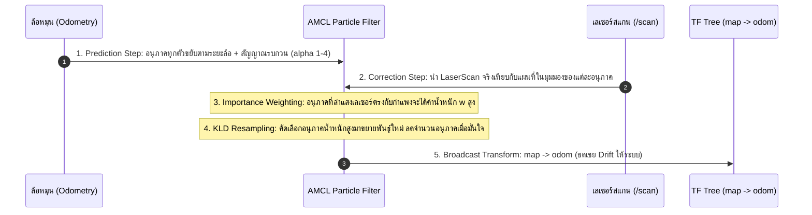
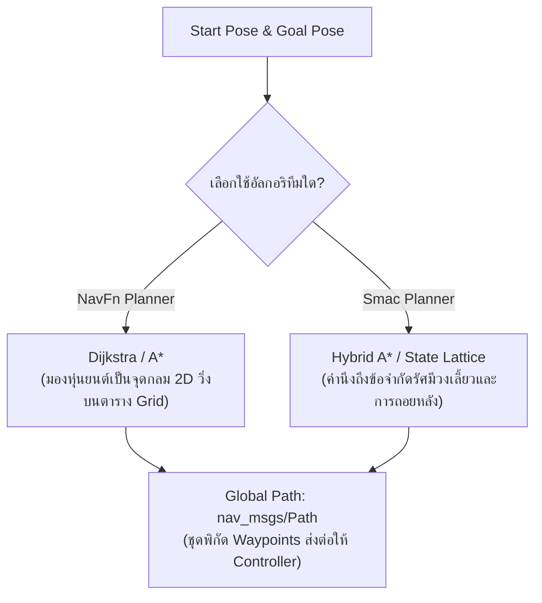

# 📖 Week 14: การวางแผนเส้นทาง, คอนโทรลเลอร์ และระบบประมาณตำแหน่ง AMCL (Particle Filter)
**เวลาเรียน:** บรรยาย 2 ชั่วโมง | ปฏิบัติการ 3 ชั่วโมง | ศึกษาค้นคว้าด้วยตนเอง 4 ชั่วโมง  
**วิชาบังคับก่อน:** [สัปดาห์ที่ 13: สถาปัตยกรรม Nav2 Stack และระบบ Costmap 2D แบบหลายชั้น](../Week_13_Nav2_Costmaps_Layers/Readme.md)  
**เอกสารปฏิบัติการ:** [ใบงานแล็บสัปดาห์ที่ 14](Lab_Exercises.md)

---

## 🎯 วัตถุประสงค์การเรียนรู้ (Learning Objectives)
เมื่อจบบทเรียนนี้ ผู้เรียนจะสามารถ:
1. **พิสูจน์คณิตศาสตร์ของ Adaptive Monte Carlo Localization (AMCL)**: วงรอบการพยากรณ์ด้วยโมเดลการเคลื่อนที่ (Odometry Motion Model), โมเดลเซนเซอร์ (Likelihood Field), และการปรับจำนวนอนุภาคแบบ KLD-Sampling
2. **อธิบายการคำนวณและเผยแพร่ทรานส์ฟอร์ม `map` $\rightarrow$ `odom`** เพื่อชดเชยค่า Drift ของ Odometry โดยรักษาความราบเรียบของระบบควบคุมภายใน
3. **เปรียบเทียบอัลกอริทึมการวางแผนเส้นทางระดับโลก (Global Planners)**: NavFn (Dijkstra vs A*) และ Smac Planner (Hybrid A* สำหรับข้อจำกัดมุมเลี้ยวทางจลนศาสตร์)
4. **วิเคราะห์ตัวควบคุมความเร็วเฉพาะหน้า (Local Controllers)**: DWB Controller (Dynamic Window Approach & Trajectory Critics) และ Regulated Pure Pursuit (RPP)
5. **พัฒนาสคริปต์กำหนดตำแหน่งเริ่มต้น (Initial Pose Setup)** พร้อมเมทริกซ์ความแปรปรวนร่วม (Covariance Matrix) เพื่อสั่งงาน Action `/navigate_to_pose`

---

## ⏱️ แผนการสอน 2 ชั่วโมง (Lecture Outline)
| ช่วงเวลา | หัวข้อ | กิจกรรมการเรียนรู้ |
| :---: | :--- | :--- |
| **00:00 - 00:35** | ทฤษฎี AMCL: Particle Filter, Motion Noise $\alpha_1 - \alpha_4$, KLD Resampling | พิสูจน์สมการคณิตศาสตร์การเคลื่อนที่และสมการทรานส์ฟอร์ม $\mathbf{T}_{\text{odom}}^{\text{map}}$ |
| **00:35 - 01:05** | การวางแผนเส้นทางระดับโลก (Global Planners: Dijkstra, A*, Smac) | เปรียบเทียบฮิวริสติกฟังก์ชัน, กราฟ Cost, และข้อจำกัดทางจลนศาสตร์แบบ Non-holonomic |
| **01:05 - 01:35** | การควบคุมวิถีการเคลื่อนที่เฉพาะหน้า (Local Controllers: DWB vs RPP) | เจาะลึกการให้คะแนน Trajectory Critics ใน DWB และการควบคุมความเร็วตามความโค้งใน RPP |
| **01:35 - 02:00** | Code Walkthrough: `nav2_params.yaml`, `amcl_initial_pose.py` และเตรียม Lab | วิเคราะห์การส่ง Initial Pose ผ่าน Python/CLI และการสั่ง Navigation Goal |

---

## 🏛️ สถาปัตยกรรมระบบ (Architectural Deep Dive)

### 1. การประมาณตำแหน่งด้วย AMCL (Particle Filter Localization)
เมื่อหุ่นยนต์มีแผนที่ที่สร้างเสร็จแล้ว หุ่นยนต์จะต้องแก้ปัญหาการระบุตำแหน่งตนเองเทียบกับแผนที่โลก (Global Localization):



#### ก. โมเดลการเคลื่อนที่เชิงสถิติ (Odometry Motion Model Noise $\alpha_1 - \alpha_4$):
เมื่อหุ่นยนต์เคลื่อนที่จากสถานะ $\mathbf{x} = [x, y, \theta]^T$ ไปยัง $\mathbf{x}' = [x', y', \theta']^T$ คำสั่งจะถูกแบ่งออกเป็น 3 จังหวะ:
1. การหมุนตัวครั้งที่ 1 ($\delta_{\text{rot1}}$)
2. การวิ่งตรงไปข้างหน้า ($\delta_{\text{trans}}$)
3. การหมุนตัวครั้งที่ 2 เพื่อจัดแนวหัวหุ่นยนต์ ($\delta_{\text{rot2}}$)

พารามิเตอร์ความคลาดเคลื่อน $\alpha$ บ่งบอกระดับความไม่แน่นอน:
- $\alpha_1$: ความแปรปรวนของการหมุน จากการหมุนตัว ($\text{rot} \leftarrow \text{rot}$)
- $\alpha_2$: ความแปรปรวนของการหมุน จากการวิ่งตรง ($\text{rot} \leftarrow \text{trans}$)
- $\alpha_3$: ความแปรปรวนของการวิ่งตรง จากการวิ่งตรง ($\text{trans} \leftarrow \text{trans}$)
- $\alpha_4$: ความแปรปรวนของการวิ่งตรง จากการหมุนตัว ($\text{trans} \leftarrow \text{rot}$)

#### ข. การคำนวณและบรอดแคสต์ทรานส์ฟอร์ม $\mathbf{T}_{\text{odom}}^{\text{map}}$:
ตามมาตรฐาน REP 105 โหนด AMCL ไม่ได้บรอดแคสต์ทรานส์ฟอร์ม `map` $\rightarrow$ `base_footprint` โดยตรง เพราะจะทำให้เกิดการกระโดดขัดจังหวะ Local Control Loop แต่ AMCL จะคำนวณหาทรานส์ฟอร์มเสมือนที่เชื่อมระหว่าง `map` และ `odom`:

$$\mathbf{T}_{\text{base}}^{\text{map}} = \mathbf{T}_{\text{odom}}^{\text{map}} \cdot \mathbf{T}_{\text{base}}^{\text{odom}}$$
$$\mathbf{T}_{\text{odom}}^{\text{map}} = \mathbf{T}_{\text{base}}^{\text{map}} \cdot \left(\mathbf{T}_{\text{base}}^{\text{odom}}\right)^{-1}$$

---

### 2. การวางแผนเส้นทางระดับโลก (Global Planners Architecture)
Global Planner มีหน้าที่ค้นหาแนวเส้นทางจากจุดพิกัดปัจจุบันไปยังเป้าหมายบน Global Costmap:



| อัลกอริทึม | ลักษณะการทำงาน | จุดเด่น | กรณีการใช้งานที่เหมาะสม |
| :--- | :--- | :--- | :--- |
| **NavFn (Dijkstra)** | ค้นหาแบบแผ่คลื่นรอบทิศทาง | การันตีว่าพบเส้นทางที่สั้นที่สุดเสมอ | แผนที่ขนาดเล็กถึงปานกลาง |
| **NavFn (A*)** | ใช้ฮิวริสติก Euclidean Distance | ขยายโหนดน้อยกว่า Dijkstra เมื่อมีเส้นทางตรงไปยังเป้าหมาย (อัตราเร่งขึ้นกับแผนที่ ไม่มีตัวเลขคงที่ — ลองวัดเองใน Challenge 14.3) | ทางเดินยาวในโกดังขนาดใหญ่ |
| **Smac Planner (Hybrid A*)** | ค้นหาในปริภูมิสถานะ $(x, y, \theta)$ | สร้างเส้นทางที่เลี้ยวโค้งได้อย่างนิ่มนวลตามกายภาพรถ | หุ่นยนต์เลี้ยวแบบ Ackerman หรือรถลากจูง |

---

### 3. ตัวควบคุมเส้นทางเฉพาะหน้า (Local Trajectory Controllers)
Local Controller มีหน้าที่รับ Global Path มาแปลงเป็นคำสั่งความเร็วจริง $(v, \omega)$ ส่งไปยังท็อปปิก `/cmd_vel` พร้อมหลบหลีกสิ่งกีดขวางสดใน Local Costmap:

#### ก. DWB Controller (Dynamic Window Approach):
1. คำนวณช่วงความเร็วที่เป็นไปได้ของหุ่นยนต์ในรอบเวลาถัดไป (Dynamic Window) ภายใต้ขีดจำกัดความเร่ง ($\text{acc lim}$):
   $$V_d = [v - a_{\text{max}}\Delta t, \; v + a_{\text{max}}\Delta t] \cap [v_{\text{min}}, v_{\text{max}}]$$
2. สุ่มจำลองวิถีการเคลื่อนที่ (Trajectory Rollout) นับร้อยเส้นทาง
3. ให้คะแนนแต่ละเส้นทางผ่านฟังก์ชัน **Critics**:
   $$\text{Total Score} = \sum_{c \in \text{Critics}} w_c \cdot \text{Score}_c(\text{trajectory})$$
   - `BaseObstacleCritic`: ลงโทษอย่างรุนแรงหากวิถีตัดผ่านเซลล์ที่มี Cost สูง
   - `PathAlignCritic`: ให้คะแนนความขนานกับเส้นทาง Global Path
   - `GoalDistCritic`: ให้คะแนนระยะห่างจากเป้าหมายปลายทาง

#### ข. Regulated Pure Pursuit (RPP):
- ใช้วิธีทางเรขาคณิต เล็งจุดเป้าหมายบนเส้นทางข้างหน้าด้วยระยะมองไกล (**Lookahead Distance: $L$**)
- คำนวณรัศมีความโค้งของการเลี้ยว: $\kappa = \frac{2y}{L^2}$
- มีระบบชะลอความเร็วตามความโค้ง (**Curvature Regulation**): เมื่อต้องเลี้ยวโค้งหักศอก หุ่นยนต์จะลดความเร็วลงโดยอัตโนมัติเพื่อป้องกันการหลุดโค้ง

---

## 🛠️ การวิเคราะห์โค้ดตัวอย่างในโมดูล (Code Walkthrough)

### 1. [`config/nav2_params.yaml`](config/nav2_params.yaml)
- **AMCL:**
  ```yaml
  alpha1: 0.2   # ... alpha5: 0.2  (DifferentialMotionModel)
  min_particles: 500
  max_particles: 2000
  laser_min_range: 0.15
  laser_max_range: 10.0      # = ระยะสูงสุดของ LiDAR (เดิมตั้ง 12.0 เกินกว่าที่เซนเซอร์วัดได้)
  set_initial_pose: true     # หุ่นยนต์เกิดที่ (0, 0, 0) ของแผนที่เสมอ
  ```
  กำหนดสัญญาณรบกวนของโมเดลการเคลื่อนที่ และตั้งขอบเขตจำนวนอนุภาค KLD-Sampling ไว้ที่ 500 ถึง 2,000 ตัว
- **DWB Controller (`controller_server` → `FollowPath`):**
  ```yaml
  max_vel_x: 0.3
  max_vel_theta: 1.0
  acc_lim_x: 1.0
  decel_lim_x: -1.0
  critics: ["RotateToGoal", "Oscillation", "BaseObstacle", "GoalAlign",
            "PathAlign", "PathDist", "GoalDist"]
  BaseObstacle.scale: 0.02
  PathAlign.scale: 32.0
  PathDist.scale: 32.0
  GoalAlign.scale: 24.0
  GoalDist.scale: 24.0
  RotateToGoal.scale: 32.0
  ```
  **DWB ต้องมีรายการ `critics` เสมอ** — คอนฟิกเดิมไม่มี ทำให้ `controller_server` configure ไม่ผ่านและ Nav2 ทั้งชุดไม่ active (ค่า scale ข้างบนเป็นค่าเริ่มต้นตามตัวอย่าง DWB ของ Nav2)
- **Progress / Goal checker (schema ของ Jazzy):**
  ```yaml
  progress_checker_plugins: ["progress_checker"]   # Jazzy ใช้ list (คีย์เดิม progress_checker_plugin ไม่ถูกอ่านแล้ว)
  goal_checker_plugins: ["general_goal_checker"]
  general_goal_checker:
    xy_goal_tolerance: 0.25   # ระยะห่างปลายทางยอมรับได้ที่ 25 cm
    yaw_goal_tolerance: 0.25  # มุมหันปลายทางยอมรับได้ที่ ~14 องศา
  ```
- **Costmaps:** เหมือนกับ [`costmap_params.yaml` สัปดาห์ที่ 13](../Week_13_Nav2_Costmaps_Layers/config/costmap_params.yaml) ทุกค่า (footprint 0.40 × 0.28 m, `inflation_radius: 0.55`, `cost_scaling_factor: 3.0`) — `test_nav2_config.py` ตรวจว่าไม่ต่างกัน
- **Velocity chain และความปลอดภัย:** `controller_server`/`behavior_server` → `cmd_vel_nav` → `velocity_smoother` → `cmd_vel_smoothed` → **`collision_monitor`** → `cmd_vel` → bridge (collision monitor คือ safety gate ระดับ production เทียบกับ `emergency_stop_node` ในสัปดาห์ที่ 11)

### 2. [`launch/nav2_bringup.launch.py`](launch/nav2_bringup.launch.py)
เปิด Nav2 ครบชุดด้วย lifecycle manager 2 ตัว:
- `lifecycle_manager_localization`: `map_server` (แผนที่จริงจาก `amr_week12`), `amcl`
- `lifecycle_manager_navigation`: `controller_server`, `smoother_server`, `planner_server`, **`behavior_server`** (Spin/BackUp/Wait ที่ Behavior Tree ค่าเริ่มต้นเรียกใช้ — ถ้าขาด BT จะโหลดไม่ผ่าน), `velocity_smoother`, `collision_monitor`, `bt_navigator`, **`waypoint_follower`** (ให้บริการ `/follow_waypoints` ในสัปดาห์ที่ 15)
- อาร์กิวเมนต์: `map`, `params_file`, `use_sim_time` (ค่าเริ่มต้น true), `nav_to_pose_bt_xml` (สัปดาห์ที่ 15 ส่ง BT ของตัวเองเข้ามา)
- ไม่ใช้ `navigation_launch.py` ของ nav2_bringup โดยตรง เพราะใน Jazzy 1.3.x ไฟล์นั้นเปิด `route_server` และ `docking_server` ด้วย ซึ่งต้องมีคอนฟิกเพิ่ม (กราฟเส้นทาง, แท่นชาร์จ) ที่วิชานี้ยังไม่ใช้

### 3. [`src/amcl_initial_pose.py`](src/amcl_initial_pose.py)
`ros2 run amr_week14 amcl_initial_pose --ros-args -p use_sim_time:=true -p x:=0.0 -p y:=0.0 -p theta:=0.0`
- รอ `/clock` (เวลา stamp ต้องไม่เป็น 0) และรอจนมี subscriber บน `/initialpose`
- ส่ง `PoseWithCovarianceStamped` ซ้ำทุก 1 วินาทีจนกว่า AMCL จะตอบกลับทาง `/amcl_pose` แล้วพิมพ์ตำแหน่งที่ AMCL ประเมินได้ (exit code 0 = สำเร็จ)
- กำหนดค่าเมทริกซ์ความแปรปรวนร่วม (Covariance Matrix $6 \times 6$):
  ```python
  cov[0] = sigma_xy ** 2      # var(x)   0.25 m^2 -> sigma 0.5 m
  cov[7] = sigma_xy ** 2      # var(y)
  cov[35] = sigma_yaw ** 2    # var(yaw) 0.068 rad^2 -> sigma ~15 deg
  ```
  ค่าความแปรปรวนนี้จะถูก AMCL นำไปใช้สุ่มสร้างกลุ่มอนุภาคเริ่มต้นรอบๆ พิกัดนั้น

### 4. การทดสอบอัตโนมัติ
- [`test/test_nav2_config.py`](test/test_nav2_config.py): DWB มี critics, schema `progress_checker_plugins`, `laser_max_range` ≤ 10 m, behavior plugins ครบ, costmap ตรงกับสัปดาห์ที่ 13, launch มีทุก server
- [`test/test_navigation.py`](test/test_navigation.py): Gazebo headless + Nav2 + แผนที่จริง → ตั้ง initial pose → `NavigateToPose` ไป $(2.0, -2.0, -90^\circ)$ ต้อง `SUCCEEDED` ภายใน 90 วินาที และตำแหน่ง **ground truth จาก Gazebo** ต้องห่างเป้า < 0.45 m

---

## ⌨️ ตารางคำสั่ง CLI สำคัญ
| คำสั่ง | คำอธิบาย | ตัวอย่างการใช้งาน |
| :--- | :--- | :--- |
| `ros2 launch amr_week14 nav2_bringup.launch.py` | เปิดใช้งาน Navigation 2 Stack แบบครบวงจร (เปิด simulation ของสัปดาห์ที่ 11 ก่อน) | `ros2 launch amr_week14 nav2_bringup.launch.py` |
| `ros2 run amr_week14 amcl_initial_pose` | ส่ง initial pose และรอคำตอบจาก AMCL | `ros2 run amr_week14 amcl_initial_pose --ros-args -p use_sim_time:=true` |
| `ros2 topic pub --once /initialpose ...` | ส่งพิกัดเริ่มต้นให้ AMCL ผ่านคำสั่ง CLI | `ros2 topic pub --once /initialpose geometry_msgs/msg/PoseWithCovarianceStamped "{header: {frame_id: 'map'}, pose: {pose: {position: {x: 0.0, y: 0.0}, orientation: {w: 1.0}}}}"` |
| `ros2 action send_goal /navigate_to_pose ...` | ส่งเป้าหมายพิกัดให้ Nav2 วางแผนและขับเคลื่อนอัตโนมัติ | `ros2 action send_goal /navigate_to_pose nav2_msgs/action/NavigateToPose "{pose: {header: {frame_id: 'map'}, pose: {position: {x: 2.0, y: -2.0}, orientation: {z: -0.7071, w: 0.7071}}}}"` |
| `ros2 topic echo --once /amcl_pose` | ตรวจสอบตำแหน่งปัจจุบันที่ AMCL คำนวณได้ | `ros2 topic echo --once /amcl_pose geometry_msgs/msg/PoseWithCovarianceStamped` |
| `ros2 run amr_week11 ground_truth_pose` | ตำแหน่งจริงของหุ่นยนต์ใน Gazebo (ใช้ตรวจความแม่นของ AMCL/Nav2) | `ros2 run amr_week11 ground_truth_pose` |

---

## 📟 ผลการรันจริง (Real Run Output)
บันทึกจากการรันจริงใน ros:lab-runner (ROS 2 Jazzy, Gazebo Sim 8.15.0) บน Linux 7.0 เมื่อ 2026-10-29
(ฉบับเต็มพร้อม log ของ Nav2: [`results/nav2_navigate_to_pose_run.txt`](results/nav2_navigate_to_pose_run.txt))

```console
$ ros2 launch amr_week11 gazebo_world.launch.py headless:=true   # terminal 1
$ ros2 launch amr_week14 nav2_bringup.launch.py                   # terminal 2
$ for n in controller_server planner_server ...; do ros2 lifecycle get /$n; done
controller_server: active [3]
planner_server: active [3]
behavior_server: active [3]
bt_navigator: active [3]
waypoint_follower: active [3]
velocity_smoother: active [3]
collision_monitor: active [3]
smoother_server: active [3]
$ ros2 run amr_week14 amcl_initial_pose --ros-args -p use_sim_time:=true
[INFO] [1793245948.890258962] [amcl_initial_pose_publisher]: Publishing initial pose x=0.00 y=0.00 theta=0.000 rad in frame map
[INFO] [1793245948.976965104] [amcl_initial_pose_publisher]: AMCL pose: x=-0.017 y=0.033 yaw=0.007 rad
$ ros2 action send_goal /navigate_to_pose nav2_msgs/action/NavigateToPose {pose: {header: {frame_id: 'map'}, pose: {position: {x: 2.0, y: -2.0}, orientation: {z: -0.7071, w: 0.7071}}}}
Waiting for an action server to become available...
Sending goal:
...

Goal accepted with ID: f58aa5137a8e4aec9e74178de70ef217

Result:
    error_code: 0
error_msg: ''

Goal finished with status: SUCCEEDED
(wall time 14.2 s)
$ ros2 run amr_week11 ground_truth_pose
diff_drive_robot ground truth: x=1.900 y=-1.927 yaw=-1.321 rad (-75.7 deg)
```
ผลวัด: เป้าหมาย $(2.0, -2.0, -90^\circ)$ — `SUCCEEDED` ใน 14.2 วินาที (เวลาจริง), ตำแหน่งจริงจาก Gazebo คลาดจากเป้า 0.125 m / 14.3°
(ชุดทดสอบ `test_navigation.py` สองรอบวัดได้ 0.192 m / 12.2° ใน 11.9 s และ 0.140 m / 14.5° ใน 12.2 s)

---

## ⚠️ ปัญหาที่พบบ่อยและการแก้ไข (Troubleshooting)

| ที่ | อาการที่พบ (Symptom) | สาเหตุรากเหง้า (Root Cause) | แนวทางแก้ไข (Resolution) |
|:---:| :--- | :--- | :--- |
| 1 | **AMCL ไม่ยอมบรอดแคสต์ทรานส์ฟอร์ม `map -> odom`** | ยังไม่ได้รับข้อมูลพิกัดเริ่มต้นจาก `/initialpose` หรือไม่มีข้อมูล `/scan` ส่งเข้ามา | ส่งพิกัดเริ่มต้นด้วย `amcl_initial_pose.py` หรือคลิกปุ่ม 2D Pose Estimate ใน RViz2 |
| 2 | **หุ่นยนต์หมุนวนอยู่กับที่ไม่ยอมเดินหน้า (Spinning in circles)** | ค่าน้ำหนัก `PathAlignCritic` หรือ `GoalDistCritic` ใน DWB ไม่สมดุล หรือล้อติดขอบคอสต์ | ปรับจูนค่าน้ำหนัก Scale ของ Critics ใน `nav2_params.yaml` |
| 3 | **กลุ่มอนุภาค AMCL แตกกระจายกว้างไม่ยอมลู่เข้าหาตำแหน่งจริง** | พารามิเตอร์สัญญาณรบกวน $\alpha_1 - \alpha_4$ สูงเกินไป หรือหุ่นยนต์หมุนตัวเร็วเกินไป | ปรับลดค่า $\alpha$ ลงให้อยู่ในช่วง $[0.05, 0.2]$ — แต่ถ้า odometry ของหุ่นยนต์มี drift จริง (ตรวจด้วย `ground_truth_pose`) ต้อง *เพิ่ม* α ตัวที่เกี่ยวข้องแทน |
| 7 | **Nav2 ไม่ active: `controller_server` configure ล้มเหลว** | DWB ไม่มี `critics` หรือใช้คีย์ `progress_checker_plugin` แบบเก่า | ใช้คอนฟิกของแพ็กเกจนี้ ตรวจด้วย `ros2 lifecycle get /controller_server` |
| 8 | **`bt_navigator` activate ไม่ผ่านเพราะโหลด BT ไม่ได้** | ไม่มี `behavior_server` (BT ค่าเริ่มต้นใช้ Spin/BackUp/Wait) | ใช้ `nav2_bringup.launch.py` ของแพ็กเกจนี้ซึ่งเปิด `behavior_server` แล้ว |
| 4 | **Planner ไม่ยอมวางเส้นทาง แจ้งเตือน: `Failed to create plan`** | จุดเริ่มต้นหรือจุดหมายปลายทางตั้งอยู่ในเขตเซลล์ที่มี Cost 254 (Lethal) หรือ 255 | เลือกจุดเป้าหมายให้อยู่ในพื้นที่ว่างโล่ง (Cost 0) ห่างจากกำแพงอย่างน้อยเท่ากับรัศมีหุ่นยนต์ |
| 5 | **หุ่นยนต์หยุดก่อนถึงเป้าหมายเล็กน้อยแล้วขึ้น Failed** | ค่า `xy_goal_tolerance` ตั้งไว้เข้มงวดเกินไป (เช่น 0.02 m) จนมอเตอร์ไม่สามารถทำได้ | ขยาย `xy_goal_tolerance` เป็น $0.15 - 0.25\text{ m}$ |
| 6 | **Nav2 หลุดเข้าสู่ Recovery Spin ต่อเนื่อง** | Progress Checker ตรวจพบว่าหุ่นยนต์ไม่เคลื่อนที่เกินระยะที่กำหนดภายใน 10 วินาที | ตรวจสอบว่าหุ่นยนต์ติดสิ่งกีดขวางหรือไม่ และเพิ่ม `movement_time_allowance` |

---

## 📝 แบบทดสอบท้ายบท (Self-Assessment Quiz)

1. **คำถาม:** ในอัลกอริทึม AMCL กระบวนการ KLD-Sampling ช่วยเพิ่มประสิทธิภาพการทำงานของหุ่นยนต์ได้อย่างไร?
2. **คำถาม:** โหนด AMCL มีหน้าที่ต้องคำนวณและเผยแพร่ทรานส์ฟอร์มคู่ใดลงบนโครงสร้าง TF Tree?
3. **คำถาม:** เหตุใดการส่งพิกัดเริ่มต้นผ่าน `/initialpose` จึงต้องแนบค่าในเมทริกซ์ Covariance ไปด้วยเสมอ?
4. **คำถาม:** พารามิเตอร์สัญญาณรบกวน $\alpha_1$ และ $\alpha_3$ ในโมเดลการเคลื่อนที่ของ AMCL แสดงถึงความไม่แน่นอนของพฤติกรรมใดตามลำดับ?
5. **คำถาม:** จงอธิบายความแตกต่างระหว่างการทำงานของ Global Planner แบบ NavFn (A*) กับ Smac Planner (Hybrid A*)?
6. **คำถาม:** DWB Local Controller มีเกณฑ์ในการคัดเลือกคำสั่งความเร็ว $(v, \omega)$ ที่ดีที่สุดให้กับมอเตอร์อย่างไร?
7. **คำถาม:** อัลกอริทึม Regulated Pure Pursuit (RPP) มีจุดเด่นด้านความปลอดภัยในการเข้าโค้งอย่างไรเมื่อเทียบกับ Pure Pursuit ทั่วไป?
8. **คำถาม:** หากหุ่นยนต์วิ่งไปถึงพิกัดที่ห่างจากเป้าหมาย $0.18\text{ m}$ แต่ในคอนฟิกตั้ง `xy_goal_tolerance: 0.25` ระบบ Nav2 จะถือว่าภารกิจสำเร็จหรือไม่?
9. **คำถาม:** ทรานส์ฟอร์ม $\mathbf{T}_{\text{odom}}^{\text{map}}$ มีบทบาทอย่างไรในการประสานความต่อเนื่องของการควบคุมหุ่นยนต์?
10. **คำถาม:** คำสั่ง CLI ใดที่ใช้ในการส่งเป้าหมายพิกัดการนำทางไปยัง Action `/navigate_to_pose`?

<details>
<summary>🔍 ดูเฉลยคำตอบพร้อมคำอธิบายอย่างละเอียด</summary>

1. **ตอบ:** **KLD-Sampling (Kullback-Leibler Divergence)** ช่วยปรับลดจำนวนอนุภาคลงโดยอัตโนมัติเมื่อหุ่นยนต์มีความมั่นใจในตำแหน่งสูง (อนุภาคลู่เข้าหากัน) ทำให้ลดภาระการประมวลผล CPU ได้อย่างมหาศาล และจะขยายจำนวนอนุภาคเพิ่มขึ้นเฉพาะเมื่อหุ่นยนต์เริ่มหลงทางหรือมีความไม่แน่นอนสูง
2. **ตอบ:** ทรานส์ฟอร์มระหว่าง **`map` $\rightarrow$ `odom`**
3. **ตอบ:** เพื่อบอกให้อัลกอริทึม Particle Filter ทราบถึง **ระดับความไม่แน่นอน (Uncertainty)** ของจุดเริ่มต้น เพื่อให้ระบบสามารถสุ่มกระจายกลุ่มอนุภาคเริ่มต้นรอบๆ พิกัดนั้นได้อย่างสมจริงตามค่าเบี่ยงเบนมาตรฐาน
4. **ตอบ:**
   - $\alpha_1$: ความคลาดเคลื่อนของการหมุน อันเนื่องมาจากการสั่งหมุนตัว ($\text{rot} \leftarrow \text{rot}$)
   - $\alpha_3$: ความคลาดเคลื่อนของการวิ่งตรง อันเนื่องมาจากการสั่งวิ่งตรง ($\text{trans} \leftarrow \text{trans}$)
5. **ตอบ:**
   - **NavFn (A*):** วางแผนบนตารางกริด 2 มิติโดยมองหุ่นยนต์เป็นจุดกลมอิสระ ไม่คำนึงถึงมุมหันหรือข้อจำกัดการเลี้ยว
   - **Smac Planner (Hybrid A*):** วางแผนในปริภูมิสถานะ $(x, y, \theta)$ โดยคำนึงถึงรัศมีวงเลี้ยวขั้นต่ำ จลนศาสตร์การขับเคลื่อน และการสลับเกียร์เดินหน้า-ถอยหลังตามกายภาพจริงของรถ
6. **ตอบ:** สุ่มจำลองวิถีการเคลื่อนที่ล่วงหน้าหลายร้อยรูปแบบในช่วงเวลาสั้นๆ แล้วนำแต่ละวิถีไปให้คะแนนผ่านชุดกรรมการตรวจสอบ (Critics) เช่น การหลบหลีกสิ่งกีดขวาง, การเกาะเส้นทางหลัก, และการเข้าใกล้เป้าหมาย วิถีที่ได้ผลรวมคะแนนสูงสุดจะถูกเลือกส่งไปสั่งงานมอเตอร์
7. **ตอบ:** มีระบบ **Curvature Regulation** ที่คอยตรวจจับความโค้งของเส้นทาง หากต้องเลี้ยวโค้งหักศอก ระบบจะสั่งปรับลดความเร็วเชิงเส้น ($v$) ลงโดยอัตโนมัติเพื่อป้องกันไม่ให้หุ่นยนต์เกิดการลื่นไถลหรือหลุดออกจากเส้นทาง
8. **ตอบ:** **ถือว่าสำเร็จสมบูรณ์ (Succeeded)** เนื่องจากระยะห่างจริง ($0.18\text{ m}$) น้อยกว่ารัศมีความคลาดเคลื่อนที่ยอมรับได้ ($0.25\text{ m}$)
9. **ตอบ:** ทำหน้าที่ **ชดเชยและดูดซับค่า Drift สะสมของ Odometry** ทำให้หุ่นยนต์สามารถวางตำแหน่งเทียบกับแผนที่โลกได้อย่างแม่นยำ ในขณะที่ความเร็วและการเคลื่อนที่เฉพาะหน้าในระดับย่อยยังคงราบเรียบและต่อเนื่องบนเฟรม `odom` โดยไม่มีการกระตุก
10. **ตอบ:** `ros2 action send_goal /navigate_to_pose nav2_msgs/action/NavigateToPose "{pose: {header: {frame_id: 'map'}, pose: {position: {x: 2.0, y: 1.0}, orientation: {w: 1.0}}}}"`
</details>

---

## 📚 แหล่งอ้างอิงและศึกษาเพิ่มเติม
- [Nav2 Navigation Stack Official Documentation](https://docs.nav2.org/)
- [AMCL Configuration Guide](https://docs.nav2.org/configuration/packages/configuring-amcl.html)
- [DWB Controller Parameters & Critics Reference](https://docs.nav2.org/configuration/packages/configuring-dwb-controller.html)
- [Fox, Burgard, Dellaert, Thrun: Monte Carlo Localization: Efficient Position Estimation for Mobile Robots (AAAI)](https://www.ri.cmu.edu/pub_files/pub1/fox_dieter_1999_1/fox_dieter_1999_1.pdf)
