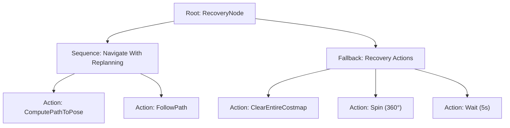

# 📖 Week 15: ระบบลาดตระเวนจุดตรวจอัตโนมัติ (Waypoint Patrol) และ Behavior Trees
**เวลาเรียน:** บรรยาย 2 ชั่วโมง | ปฏิบัติการ 3 ชั่วโมง | ศึกษาค้นคว้าด้วยตนเอง 4 ชั่วโมง  
**วิชาบังคับก่อน:** [สัปดาห์ที่ 14: การวางแผนเส้นทาง, คอนโทรลเลอร์ และ AMCL Localization](../Week_14_Path_Planning_AMCL/Readme.md)  
**เอกสารปฏิบัติการ:** [ใบงานแล็บสัปดาห์ที่ 15](Lab_Exercises.md)

---

## 🎯 วัตถุประสงค์การเรียนรู้ (Learning Objectives)
เมื่อจบบทเรียนนี้ ผู้เรียนจะสามารถ:
1. อธิบายสถาปัตยกรรม **Behavior Trees (BT)** และความเหนือชั้นกว่า Finite State Machines (FSM) ในระบบหุ่นยนต์
2. วิเคราะห์โหนดควบคุมประเภทต่างๆ ใน Behavior Tree (`Sequence`, `Fallback`, `ReactiveSequence`, `RecoveryNode`)
3. ถอดรหัสโครงสร้างไฟล์ XML ต้นไม้พฤติกรรมมาตรฐานของ Nav2 (`navigate_to_pose_w_replanning_and_recovery.xml`)
4. พัฒนาระบบนำทางแบบลาดตระเวนหลายจุด (**Waypoint Patrol Mission**) ด้วยภาษา Python (`waypoint_patrol.py`)
5. ประยุกต์ใช้ไลบรารี **`nav2_simple_commander` API** ในการสั่งการหุ่นยนต์ระดับสูงพร้อมระบบกู้คืนอัตโนมัติ (Recovery Behaviors)

---

## ⏱️ แผนการสอน 2 ชั่วโมง (Lecture Outline)
| ช่วงเวลา | หัวข้อ | กิจกรรมการเรียนรู้ |
| :---: | :--- | :--- |
| **00:00 - 00:35** | วิวัฒนาการจาก Finite State Machines สู่ Behavior Trees (BTs) | เปรียบเทียบข้อจำกัดของ State Explosion ใน FSM กับความยืดหยุ่นของ BTs |
| **00:35 - 01:05** | ไวยากรณ์และกลไกของ Behavior Trees: Control, Decorator, Action Nodes | อธิบายสถานะการคืนค่า 3 แบบ: `SUCCESS`, `FAILURE`, `RUNNING` และการ Tick |
| **01:05 - 01:35** | พฤติกรรมการกู้คืนเมื่อติดขัด (Recovery Behaviors: Spin, BackUp, Wait, Clear) | วิเคราะห์ Recovery Node ในการล้าง Costmap และหมุนตัวกู้สถานการณ์ |
| **01:35 - 02:00** | Code Walkthrough: `waypoint_patrol.py`, Nav2 Simple Commander และเตรียม Lab | เจาะลึกโค้ดภารกิจ 5 สถานี พร้อมการหน่วงเวลาปฏิบัติงาน (Dwell Time) |

---

## 🏛️ สถาปัตยกรรมระบบ (Architectural Deep Dive)

### 1. ทำไมระบบหุ่นยนต์สมัยใหม่จึงเลือกใช้ Behavior Trees แทน FSM?
ในการสร้างระบบนำทางอัจฉริยะ หากใช้เครื่องสถานะจำกัด (Finite State Machines - FSM):
- เมื่อระบบมีความซับซ้อน เช่น การเพิ่มเงื่อนไขการหลบหลีก การกู้คืนเมื่อติดหล่ม การชาร์จแบตเตอรี่ เส้นเชื่อมการเปลี่ยนสถานะ (Transitions) จะเพิ่มขึ้นแบบทวีคูณ จนกลายเป็น **"Spaghetti Code"** ที่แก้ไขและทดสอบได้ยากมาก
- **Behavior Trees (BTs)** แก้ปัญหานี้ด้วยโครงสร้างลำดับชั้นแบบต้นไม้ (Hierarchical Tree):
  - แต่ละโหนดมีหน้าที่อิสระต่อกัน (Modular)
  - ขับเคลื่อนด้วยสัญญาณการกระตุ้นที่เรียกว่า **"Tick"** ส่งลงมาจาก Root จากบนลงล่าง และจากซ้ายไปขวา
  - คืนสถานะกลับมา 3 รูปแบบเสมอ:
    1. `SUCCESS`: งานสำเร็จแล้ว
    2. `FAILURE`: งานล้มเหลว
    3. `RUNNING`: งานกำลังประมวลผลอยู่ (จะถูก Tick ซ้ำในรอบถัดไป)



---

### 2. ชนิดของโหนดใน Behavior Tree
1. **Control Nodes (โหนดควบคุมการไหล):**
   - **`Sequence` ($\rightarrow$):** ประมวลผลลูกทีละตัวจากซ้ายไปขวา จะสำเร็จ (`SUCCESS`) ก็ต่อเมื่อ **ลูกทุกตัวสำเร็จทั้งหมด** หากมีตัวใดตัวหนึ่งล้มเหลว (`FAILURE`) จะหยุดและล้มเหลวทันที
   - **`Fallback` / Selector ($?$):** ประมวลผลลูกทีละตัวจนกว่าจะพบตัวที่สำเร็จ (`SUCCESS`) ตัวแรก หากลูกตัวแรกล้มเหลวจะลองตัวถัดไปทันที (เหมาะสำหรับการทำระบบสำรอง หรือ Recovery Actions)
   - **`ReactiveSequence`:** เหมือน Sequence แต่จะทำการตรวจสอบประเมินเงื่อนไขตั้งต้นใหม่ในทุกๆ รอบ Tick แม้ว่าลูกตัวปัจจุบันกำลังอยู่ในสถานะ `RUNNING` ก็ตาม
   - **`RecoveryNode`:** รับลูก 2 ตัว: ลูกตัวแรกคือ Action หลัก (เช่น เดิน) หากล้มเหลวจะรันลูกตัวที่สองคือ Recovery (เช่น หมุนตัวหรือล้างแผนที่) แล้ววนกลับมารันลูกตัวแรกใหม่ตามจำนวนรอบที่กำหนด
2. **Decorator Nodes (โหนดตกแต่ง):**
   - ดัดแปลงพฤติกรรมของลูกตัวเดียว เช่น `RateController` (จำกัดความถี่การคำนวณเส้นทางใหม่เป็น 1 Hz), `Inverter` (กลับ Success เป็น Failure), `RetryNode` (สั่งลองใหม่ $N$ ครั้ง)
3. **Action & Condition Nodes (โหนดใบไม้ / Leaf Nodes):**
   - สั่งการทำงานจริง เช่น `ComputePathToPose`, `FollowPath`, `Spin`, `BackUp` หรือตรวจสอบเงื่อนไข `IsStuck`, `DistanceTraveled`

---

### 3. สถาปัตยกรรม Waypoint Following & Nav2 Simple Commander
ในการปฏิบัติงานจริงในโกดังหรือโรงงาน หุ่นยนต์ต้องเดินทางเป็นลำดับผ่านจุดตรวจ (Waypoints) หลายจุด:
- **`waypoint_patrol.py`:** สคริปต์ควบคุมภารกิจอัตโนมัติ:
  - วนลูปอ่านรายการพิกัดจากตารางภารกิจ `PATROL_WAYPOINTS`
  - ส่งเป้าหมายผ่าน Action `/navigate_to_pose`
  - เมื่อหุ่นยนต์รายงานสถานะ `SUCCEEDED` จะเริ่มจับเวลาจำลองการขนถ่ายสินค้า (**Dwell Time**) เช่น 3 วินาที ก่อนจะเดินทางสู่สถานีถัดไป
- **`nav2_simple_commander` API:** คลาส wrapper ภาษา Python ระดับสูงที่ช่วยให้วิศวกรสามารถสั่งการ Nav2 ได้อย่างง่ายดาย:
  - `navigator.goToPose(target_pose)`: สั่งเดินไปยังจุดหมายเดียว
  - `navigator.followWaypoints(poses_list)`: ส่งชุดจุดตรวจหลายจุดพร้อมกัน
  - `navigator.isTaskComplete()`: ตรวจสอบสถานะการทำงาน
  - `navigator.getFeedback()`: อ่านระยะทางที่เหลืออยู่แบบเรียลไทม์

---

## 🛠️ การวิเคราะห์โค้ดตัวอย่างในโมดูล (Code Walkthrough)

ในไฟล์ `src/waypoint_patrol.py`:
1. **การกำหนดรายการสถานีลาดตระเวน (Mission Table):**
   ```python
   PATROL_WAYPOINTS = [
       {'name': 'Station 1: Receiving Dock', 'x': 2.0, 'y': 2.0, 'yaw': 0.0, 'dwell': 3.0},
       {'name': 'Station 2: Storage Aisle B', 'x': 2.0, 'y': -2.0, 'yaw': -1.57, 'dwell': 3.0},
       {'name': 'Station 3: Quality Check', 'x': -2.0, 'y': -2.0, 'yaw': 3.14, 'dwell': 3.0},
       {'name': 'Station 4: Shipping Dock', 'x': -2.0, 'y': 2.0, 'yaw': 1.57, 'dwell': 3.0},
       {'name': 'Station 5: Charging Base', 'x': 0.0, 'y': 0.0, 'yaw': 0.0, 'dwell': 2.0}
   ]
   ```
2. **การแปลงมุมหันสู่ Quaternion:**
   ```python
   half = wp['yaw'] * 0.5
   goal_msg.pose.pose.orientation.z = math.sin(half)
   goal_msg.pose.pose.orientation.w = math.cos(half)
   ```
3. **การวนลูปภารกิจแบบ Synchronous ผ่าน Action Futures:**
   - ส่งเป้าหมายด้วย `self._action_client.send_goal_async(goal_msg)`
   - รอคำตอบและรอผลลัพธ์ด้วย `rclpy.spin_until_future_complete(self, ...)`
   - สั่งหน่วงเวลาด้วย `time.sleep(wp['dwell'])` เพื่อจำลองการโหลดสัมภาระ

---

## ⌨️ ตารางคำสั่ง CLI สำคัญ
| คำสั่ง | วัตถุประสงค์ | ตัวอย่างการใช้งาน |
| :--- | :--- | :--- |
| `python3 waypoint_patrol.py` | เริ่มต้นภารกิจลาดตระเวน 5 สถานี | `python3 Essential_ROS/Week_15_Waypoint_Patrol_BT/src/waypoint_patrol.py` |
| `ros2 action send_goal /follow_waypoints ...` | ส่งรายการจุดตรวจหลายจุดพร้อมกันผ่าน Nav2 Action CLI | `ros2 action send_goal /follow_waypoints nav2_msgs/action/FollowWaypoints "{poses: [...]}"` |
| `ros2 param get /bt_navigator default_nav_to_pose_bt_xml` | ดูพาธไฟล์ XML ของ Behavior Tree ที่กำลังใช้งาน | `ros2 param get /bt_navigator default_nav_to_pose_bt_xml` |

---

## ⚠️ ปัญหาที่พบบ่อยและการแก้ไข (Troubleshooting)
| อาการ | สาเหตุที่เป็นไปได้ | วิธีแก้ไข |
| :--- | :--- | :--- |
| หุ่นยนต์ไม่ยอมเคลื่อนที่ไปยังสถานีที่ 2 หลังจบสถานีแรก | ลืมรอให้ Action Result แรกจบสมบูรณ์ก่อนส่ง Goal ใหม่ | ตรวจสอบว่ามีคำสั่งรอ `get_result_future` ก่อนเริ่มรอบถัดไป |
| หุ่นยนต์หมุนติ้วอยู่กับที่เมื่อถึงจุดหมาย | พารามิเตอร์ `yaw_goal_tolerance` เล็กเกินไป ทำให้พยายามหมุนปรับองศาละเอียดเกินความสามารถมอเตอร์ | ขยายค่า `yaw_goal_tolerance` ในคอนฟิกเป็น $0.15 - 0.25$ เรเดียน |
| การเรียก `spin_until_future_complete` ค้าง | โหนดถูก spin ซ้ำซ้อนใน Thread อื่น | ตรวจสอบว่าในสคริปต์ไม่มีลูป spin อื่นทำงานทับซ้อน |

---

## 📝 แบบทดสอบท้ายบท (Self-Assessment Quiz)
1. การคืนค่า 3 รูปแบบของโหนดใน Behavior Tree ได้แก่อะไรบ้าง?
2. โหนดควบคุมประเภท `Sequence` และ `Fallback` มีตรรกะในการประมวลผลลูกแตกต่างกันอย่างไร?
3. ใน Nav2 เมื่อหุ่นยนต์ขับไปเจอกล่องขวางทางและไม่สามารถคำนวณเส้นทางต่อได้ ระบบ Recovery Node จะทำอะไรเป็นลำดับแรก?
4. ประโยชน์ของการใส่เวลาหน่วง (Dwell Time) ในภารกิจลาดตระเวนคืออะไรในทางวิศวกรรมหุ่นยนต์โรงงาน?
5. ฟังก์ชันใดใน `nav2_simple_commander` ที่ใช้สำหรับส่งรายการเป้าหมายหลายจุดพร้อมกันในคำสั่งเดียว?

<details>
<summary>🔍 ดูเฉลยคำตอบ</summary>

1. **ตอบ:** `SUCCESS` (สำเร็จ), `FAILURE` (ล้มเหลว), และ `RUNNING` (กำลังทำงานอยู่)
2. **ตอบ:** `Sequence` จะประมวลผลลูกต่อไปเรื่อยๆ หากลูกก่อนหน้าคืนค่า Success (ต้องการให้สำเร็จทุกตัว) ส่วน `Fallback` จะประมวลผลลูกถัดไปก็ต่อเมื่อลูกก่อนหน้าล้มเหลว (ต้องการให้สำเร็จเพียงตัวใดตัวหนึ่ง)
3. **ตอบ:** สั่งรันพฤติกรรมกู้คืนตามลำดับ เช่น ล้างค่าแผนที่ความเสี่ยง (`ClearEntireCostmap`), หมุนตัวสำรวจรอบทิศ (`Spin`), หรือถอยหลังตั้งหลัก (`BackUp`)
4. **ตอบ:** จำลองช่วงเวลาที่หุ่นยนต์ต้องหยุดนิ่งเพื่อปฏิบัติงานจริง ณ สถานีนั้นๆ เช่น การรอให้แขนกลยกกล่องสินค้าขึ้น การเปิดประตูลิฟต์ หรือการชาร์จแบตเตอรี่
5. **ตอบ:** `navigator.followWaypoints(poses)`
</details>

---

## 📚 แหล่งอ้างอิงและศึกษาเพิ่มเติม
- [Behavior Trees in Robotics (Official BehaviorTree.CPP Documentation)](https://www.behaviortree.dev/)
- [Nav2 Behavior Trees Concepts & Architecture](https://docs.nav2.org/concepts/index.html#behavior-trees)
- [Nav2 Simple Commander Python API](https://docs.nav2.org/commander_api/index.html)
