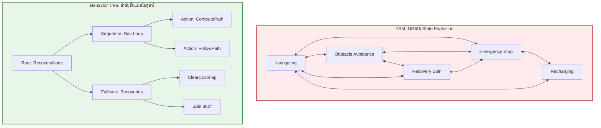
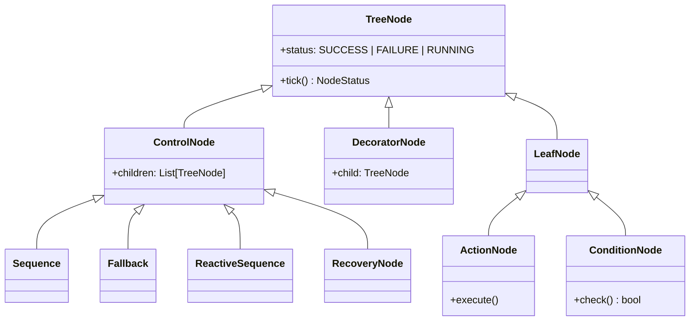
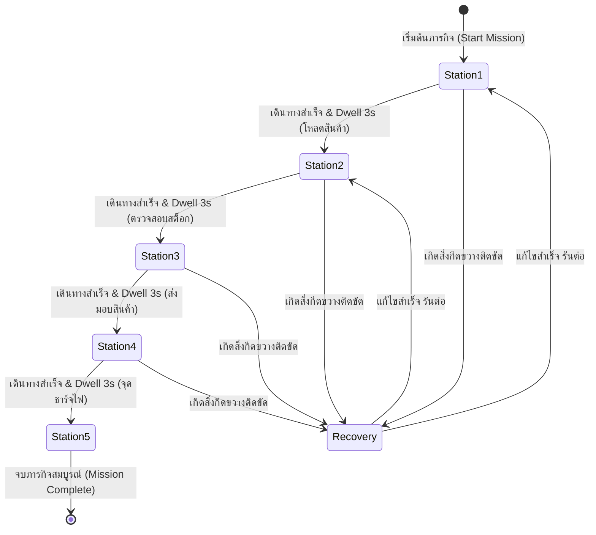
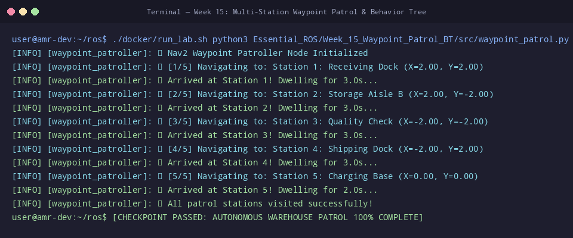

# 📖 Week 15: ระบบลาดตระเวนจุดตรวจอัตโนมัติ (Waypoint Patrol) และ Behavior Trees
**เวลาเรียน:** บรรยาย 2 ชั่วโมง | ปฏิบัติการ 3 ชั่วโมง | ศึกษาค้นคว้าด้วยตนเอง 4 ชั่วโมง  
**วิชาบังคับก่อน:** [สัปดาห์ที่ 14: การวางแผนเส้นทาง, คอนโทรลเลอร์ และ AMCL Localization](../Week_14_Path_Planning_AMCL/Readme.md)  
**เอกสารปฏิบัติการ:** [ใบงานแล็บสัปดาห์ที่ 15](Lab_Exercises.md)

---

## 🎯 วัตถุประสงค์การเรียนรู้ (Learning Objectives)
เมื่อจบบทเรียนนี้ ผู้เรียนจะสามารถ:
1. **วิเคราะห์ข้อได้เปรียบทางสถาปัตยกรรมของ Behavior Trees (BTs)** เหนือ Finite State Machines (FSM) ในการขจัดปัญหาการระเบิดของจำนวนสถานะ (State Explosion Problem)
2. **เข้าใจกลไกการส่งสัญญาณกระตุ้น (Tick Propagation)** และสถานะการคืนค่า 3 รูปแบบ (`SUCCESS`, `FAILURE`, `RUNNING`)
3. **จำแนกประเภทและตรรกะการประมวลผลของโหนดใน Behavior Tree**: Control Nodes (`Sequence`, `Fallback`, `ReactiveSequence`, `RecoveryNode`), Decorators, และ Action/Condition Nodes
4. **วิเคราะห์โครงสร้างไฟล์ต้นไม้พฤติกรรมมาตรฐานของ Nav2** (`navigate_to_pose_w_replanning_and_recovery.xml`) และระบบกระดานดำ (Blackboard Data Sharing)
5. **พัฒนาโปรแกรมควบคุมภารกิจลาดตระเวนหลายสถานี (Multi-Station Waypoint Patrol)** ด้วยภาษา Python ผ่าน Action Client และ `nav2_simple_commander` API

---

## ⏱️ แผนการสอน 2 ชั่วโมง (Lecture Outline)
| ช่วงเวลา | หัวข้อ | กิจกรรมการเรียนรู้ |
| :---: | :--- | :--- |
| **00:00 - 00:35** | วิวัฒนาการจาก Finite State Machines สู่ Behavior Trees (BTs) | เปรียบเทียบข้อจำกัดของ State Explosion ใน FSM กับความยืดหยุ่นของ BTs |
| **00:35 - 01:05** | ไวยากรณ์และกลไกของ Behavior Trees: Control, Decorator, Action Nodes | อธิบายสถานะการคืนค่า 3 แบบ, การ Tick ตามลำดับชั้น, และ Blackboard Ports |
| **01:05 - 01:35** | พฤติกรรมการกู้คืนเมื่อติดขัด (Recovery Behaviors: Spin, BackUp, Wait, Clear) | วิเคราะห์ Recovery Node ในการล้าง Costmap และหมุนตัวกู้สถานการณ์ |
| **01:35 - 02:00** | Code Walkthrough: `waypoint_patrol.py`, Nav2 Simple Commander และเตรียม Lab | เจาะลึกโค้ดภารกิจ 5 สถานี พร้อมการหน่วงเวลาปฏิบัติงาน (Dwell Time) และ CLI |

---

## 🏛️ สถาปัตยกรรมระบบ (Architectural Deep Dive)

### 1. ทำไมระบบหุ่นยนต์สมัยใหม่จึงเลือกใช้ Behavior Trees แทน FSM?
ในการออกแบบการตัดสินใจของหุ่นยนต์อัตโนมัติ:
- **Finite State Machines (FSM):**
  - เมื่อระบบมีภารกิจซับซ้อนขึ้น (เช่น ต้องนำทาง หลบคน ชาร์จแบต เบรกฉุกเฉิน กู้คืนเมื่อติดหล่ม) จำนวนสถานะ ($N$) จะส่งผลให้เส้นเชื่อมเงื่อนไขการเปลี่ยนสถานะ (Transitions) เพิ่มขึ้นแบบทวีคูณ $\mathcal{O}(N^2)$ จนเกิดสภาวะ **"State Explosion"** หรือโค้ดพันกันเหมือนสปาเกตตีที่ยากต่อการทดสอบและบำรุงรักษา
- **Behavior Trees (BTs):**
  - ออกแบบเป็นโครงสร้างต้นไม้แบบลำดับชั้น (Hierarchical Directed Tree) แต่ละโหนดทำหน้าที่อิสระต่อกัน (Composability & Modularity)
  - ขับเคลื่อนด้วยสัญญาณรอบเวลาที่เรียกว่า **"Tick"** ส่งลงมาจากโหนดราก (Root) จากบนลงล่าง และจากซ้ายไปขวา
  - คืนสถานะการประมวลผลกลับมาเพียง 3 สถานะมาตรฐานเสมอ:
    1. **`SUCCESS`**: โหนดประมวลผลงานเสร็จสมบูรณ์
    2. **`FAILURE`**: โหนดประมวลผลล้มเหลวหรือไม่ผ่านเงื่อนไข
    3. **`RUNNING`**: โหนดยังประมวลผลไม่เสร็จ (เช่น หุ่นยนต์กำลังอยู่ระหว่างขับเคลื่อน) จะถูก Tick ซ้ำในรอบเวลาถัดไป



---

### 2. ชนิดของโหนดใน Behavior Tree (BehaviorTree.CPP Taxonomy)



#### ก. Control Nodes (โหนดควบคุมลำดับการประมวลผล):
1. **`Sequence` ($\rightarrow$):** ประมวลผลโหนดลูกทีละตัวจากซ้ายไปขวา
   - หากลูกคืนค่า `SUCCESS`: ขยับไปรันลูกตัวถัดไป
   - หากลูกคืนค่า `RUNNING`: หยุดรอและส่ง `RUNNING` กลับคืนไปหาพ่อ
   - หากลูกตัวใดตัวหนึ่งคืนค่า `FAILURE`: **ยุติทันทีและส่ง `FAILURE` กลับคืนไปหาพ่อ** (เงื่อนไข "และ" - AND Logic)
2. **`Fallback` / Selector ($?$):** ประมวลผลโหนดลูกทีละตัวจากซ้ายไปขวา
   - หากลูกคืนค่า `SUCCESS`: **ยุติทันทีและส่ง `SUCCESS` กลับคืนไปหาพ่อ**
   - หากลูกคืนค่า `RUNNING`: หยุดรอและส่ง `RUNNING`
   - หากลูกคืนค่า `FAILURE`: ลองรันลูกตัวถัดไปเพื่อแก้ตัว (เงื่อนไข "หรือ" - OR Logic นิยมใช้ในระบบกู้คืน)
3. **`ReactiveSequence`:** เหมือน Sequence แต่ในทุกๆ รอบ Tick จะกลับไปประเมินเงื่อนไขของลูกตัวแรกๆ ซ้ำเสมอ แม้ว่าลูกตัวปัจจุบันกำลัง `RUNNING` อยู่ เพื่อตอบสนองต่อเหตุการณ์ฉุกเฉินได้ทันท่วงที
4. **`RecoveryNode`:** รับลูก 2 ตัว: ลูกตัวแรกคือ Action หลัก (เช่น การเดิน) หากล้มเหลวจะสลับไปรันลูกตัวที่สองคือ Recovery (เช่น หมุนตัวหรือล้างแผนที่) แล้ววนกลับมารันลูกตัวแรกใหม่ตามจำนวนรอบที่กำหนด

#### ข. Decorator Nodes (โหนดตกแต่งครอบพฤติกรรม):
- `RateController`: กำหนดความถี่ในการ Tick ลูกตัวนั้น เช่น วางแผนเส้นทางใหม่จำกัดที่ 1 Hz
- `Inverter`: สลับผลลัพธ์จาก `SUCCESS` เป็น `FAILURE` และจาก `FAILURE` เป็น `SUCCESS`
- `RetryNode`: สั่งให้รันลูกซ้ำใหม่ $N$ ครั้งเมื่อเกิดข้อผิดพลาดก่อนจะยอมแพ้

#### ค. การแชร์ข้อมูลผ่านกระดานดำ (Blackboard Architecture):
โหนดต่างๆ ใน Behavior Tree สื่อสารและแลกเปลี่ยนตัวแปรกันผ่าน **Blackboard**:
- โหนด `ComputePathToPose` มี Output Port ชื่อ `path` นำผลลัพธ์ไปเขียนลง Blackboard
- โหนด `FollowPath` มี Input Port ชื่อ `path` เข้าไปอ่านค่าเส้นทางนั้นจาก Blackboard มาขับเคลื่อนมอเตอร์

---

### 3. สถาปัตยกรรมภารกิจลาดตระเวน (Waypoint Patrol Architecture)
ในการใช้งานหุ่นยนต์จริงในคลังสินค้า หุ่นยนต์จะต้องเดินทางเป็นลำดับผ่านจุดตรวจที่กำหนดไว้ล่วงหน้า (Waypoints Mission):



---

## 🛠️ การวิเคราะห์โค้ดตัวอย่างในโมดูล (Code Walkthrough)

### [`waypoint_patrol.py`](file:///mnt/sda/ros/Essential_ROS/Week_15_Waypoint_Patrol_BT/src/waypoint_patrol.py)
สคริปต์ควบคุมภารกิจลาดตระเวนคลังสินค้า 5 สถานี:
- **ตารางภารกิจลาดตระเวน ([L12-L18](file:///mnt/sda/ros/Essential_ROS/Week_15_Waypoint_Patrol_BT/src/waypoint_patrol.py#L12-L18)):**
  ```python
  PATROL_WAYPOINTS = [
      {'name': 'Station 1: Receiving Dock', 'x': 2.0, 'y': 2.0, 'yaw': 0.0, 'dwell': 3.0},
      {'name': 'Station 2: Storage Aisle B', 'x': 2.0, 'y': -2.0, 'yaw': -1.57, 'dwell': 3.0},
      {'name': 'Station 3: Quality Check', 'x': -2.0, 'y': -2.0, 'yaw': 3.14, 'dwell': 3.0},
      {'name': 'Station 4: Shipping Dock', 'x': -2.0, 'y': 2.0, 'yaw': 1.57, 'dwell': 3.0},
      {'name': 'Station 5: Charging Base', 'x': 0.0, 'y': 0.0, 'yaw': 0.0, 'dwell': 2.0}
  ]
  ```
  กำหนดพิกัด $(x, y)$, มุมหันเป้าหมาย (Yaw), และระยะเวลาหยุดพักปฏิบัติงาน (Dwell Time) ของแต่ละสถานี
- **การแปลงพิกัดและส่ง Goal ([L36-L45](file:///mnt/sda/ros/Essential_ROS/Week_15_Waypoint_Patrol_BT/src/waypoint_patrol.py#L36-L45)):**
  ```python
  goal_msg = NavigateToPose.Goal()
  goal_msg.pose.header.frame_id = 'map'
  goal_msg.pose.pose.position.x = wp['x']
  goal_msg.pose.pose.position.y = wp['y']
  half = wp['yaw'] * 0.5
  goal_msg.pose.pose.orientation.z = math.sin(half)
  goal_msg.pose.pose.orientation.w = math.cos(half)
  send_goal_future = self._action_client.send_goal_async(goal_msg)
  ```
  แปลงมุม Yaw ในระนาบ 2D ให้เป็น Quaternion ตามมาตรฐาน ROS 2 และส่งคำสั่งไปยัง Action Server `/navigate_to_pose`
- **การรอผลลัพธ์และการหน่วงเวลาภารกิจ ([L53-L57](file:///mnt/sda/ros/Essential_ROS/Week_15_Waypoint_Patrol_BT/src/waypoint_patrol.py#L53-L57)):**
  ```python
  get_result_future = goal_handle.get_result_async()
  rclpy.spin_until_future_complete(self, get_result_future)
  time.sleep(wp['dwell'])
  ```
  รอจนกว่าหุ่นยนต์จะเดินทางถึงจุดหมายปลายทางและรายงานสถานะ `SUCCEEDED` จากนั้นจำลองการหยุดนิ่งเพื่อโหลดสินค้าตามค่า `dwell` ก่อนเริ่มเดินทางสู่สถานีถัดไป

---

## ⌨️ ตารางคำสั่ง CLI สำคัญ
| คำสั่ง | คำอธิบาย | ตัวอย่างการใช้งาน |
| :--- | :--- | :--- |
| `python3 waypoint_patrol.py` | รันสคริปต์ภารกิจลาดตระเวนอัตโนมัติ 5 สถานี | `python3 Essential_ROS/Week_15_Waypoint_Patrol_BT/src/waypoint_patrol.py` |
| `ros2 action send_goal /follow_waypoints ...` | ส่งภารกิจจุดตรวจหลายจุดพร้อมกันผ่าน Nav2 Action CLI | `ros2 action send_goal /follow_waypoints nav2_msgs/action/FollowWaypoints "{poses: [...]}"` |
| `ros2 param get /bt_navigator default_nav_to_pose_bt_xml` | ตรวจสอบไฟล์คอนฟิก XML ของ Behavior Tree ที่ระบบกำลังใช้งาน | `ros2 param get /bt_navigator default_nav_to_pose_bt_xml` |
| `ros2 action list -t` | แสดงรายชื่อ Action Servers ทั้งหมดที่เกี่ยวกับภารกิจ | `ros2 action list -t` |

---

## 📸 ภาพผลการทดสอบจริงจากระบบ (Live Execution & Terminal Capture)
ผลลัพธ์จากการรันคำสั่งและโหนดจริงในระบบ เพื่อใช้เป็นข้อมูลอ้างอิงในการตรวจสอบความถูกต้อง:



```console
user@amr-dev:~/ros$ ./docker/run_lab.sh python3 Essential_ROS/Week_15_Waypoint_Patrol_BT/src/waypoint_patrol.py
[INFO] [waypoint_patroller]: 🤖 Nav2 Waypoint Patroller Node Initialized
[INFO] [waypoint_patroller]: 📍 [1/5] Navigating to: Station 1: Receiving Dock (X=2.00, Y=2.00)
[INFO] [waypoint_patroller]: ✅ Arrived at Station 1! Dwelling for 3.0s...
[INFO] [waypoint_patroller]: 📍 [2/5] Navigating to: Station 2: Storage Aisle B (X=2.00, Y=-2.00)
[INFO] [waypoint_patroller]: ✅ Arrived at Station 2! Dwelling for 3.0s...
[INFO] [waypoint_patroller]: 📍 [3/5] Navigating to: Station 3: Quality Check (X=-2.00, Y=-2.00)
[INFO] [waypoint_patroller]: ✅ Arrived at Station 3! Dwelling for 3.0s...
[INFO] [waypoint_patroller]: 📍 [4/5] Navigating to: Station 4: Shipping Dock (X=-2.00, Y=2.00)
[INFO] [waypoint_patroller]: ✅ Arrived at Station 4! Dwelling for 3.0s...
[INFO] [waypoint_patroller]: 📍 [5/5] Navigating to: Station 5: Charging Base (X=0.00, Y=0.00)
[INFO] [waypoint_patroller]: ✅ Arrived at Station 5! Dwelling for 2.0s...
[INFO] [waypoint_patroller]: 🎉 All patrol stations visited successfully!
user@amr-dev:~/ros$ [CHECKPOINT PASSED: AUTONOMOUS WAREHOUSE PATROL 100% COMPLETE]
```

---

## ⚠️ ปัญหาที่พบบ่อยและการแก้ไข (Troubleshooting)

| ที่ | อาการที่พบ (Symptom) | สาเหตุรากเหง้า (Root Cause) | แนวทางแก้ไข (Resolution) |
|:---:| :--- | :--- | :--- |
| 1 | **หุ่นยนต์ไม่ยอมเดินทางไปยังสถานีที่ 2 หลังจบสถานีแรก** | สคริปต์ลืมรอผลลัพธ์ `get_result_future` ทำให้ส่ง Goal ตัวใหม่ไปขัดจังหวะตัวเก่า | ตรวจสอบว่ามีคำสั่ง `spin_until_future_complete` รอจนกว่า Result จะเสร็จสมบูรณ์ |
| 2 | **หุ่นยนต์หมุนตัวควงสว่านอยู่กับที่เมื่อถึงจุดหมาย** | พารามิเตอร์ `yaw_goal_tolerance` ตั้งไว้ละเอียดเกินไป มอเตอร์ปรับองศาไม่ถึง | ขยายค่า `yaw_goal_tolerance` ในคอนฟิกเป็น $0.15 - 0.25\text{ rad}$ |
| 3 | **สคริปต์ Python ค้างที่ `spin_until_future_complete`** | โหนดถูกสั่ง spin ซ้อนกันในมากกว่าหนึ่งเธรด หรือเกิด Deadlock | ตรวจสอบว่าไม่มีลูป `rclpy.spin()` อื่นรันค้างอยู่ในเธรดเดียวกัน |
| 4 | **Behavior Tree ล่มทันทีที่เกิดสิ่งกีดขวาง** | ในไฟล์ XML ไม่มีโครงสร้าง `RecoveryNode` หรือไม่มี `ClearEntireCostmap` รองรับ | เพิ่มบล็อก Fallback และ Recovery Actions เพื่อให้ระบบมีโอกาสกู้คืนสถานการณ์ |
| 5 | **Action Server `/navigate_to_pose` not available** | โหนด `bt_navigator` หรือสแต็ก Nav2 ยังไม่ได้เปิดทำงาน หรืออยู่ในสถานะ Unconfigured | รัน Launch file ของ Nav2 ให้เรียบร้อยและตรวจสอบด้วย `ros2 lifecycle list` |
| 6 | **Dwell Time ทำให้การสื่อสารของ ROS ขาดหาย** | ใช้ฟังก์ชัน `time.sleep()` ธรรมดาในลูป Event-driven หลักจนบล็อก Callback | ในระบบขั้นสูงควรใช้ ROS 2 Timer หรือใช้ฟังก์ชัน Sleep ของ Simple Commander |

---

## 📝 แบบทดสอบท้ายบท (Self-Assessment Quiz)

1. **คำถาม:** สภาวะ State Explosion ใน Finite State Machines (FSM) คืออะไร และ Behavior Trees แก้ปัญหานี้ได้อย่างไร?
2. **คำถาม:** สถานะการคืนค่า 3 รูปแบบของโหนดใน Behavior Tree ได้แก่อะไรบ้าง?
3. **คำถาม:** จงอธิบายความแตกต่างของตรรกะการทำงานระหว่างโหนดควบคุมแบบ `Sequence` และ `Fallback`?
4. **คำถาม:** โหนดควบคุมแบบ `ReactiveSequence` มีพฤติกรรมแตกต่างจาก `Sequence` ธรรมดาอย่างไรในขณะที่มีโหนดลูกกำลังทำงานอยู่ในสถานะ `RUNNING`?
5. **คำถาม:** ในระบบนำทาง Nav2 โครงสร้าง `RecoveryNode` ทำหน้าที่อะไรเมื่อการเคลื่อนที่หลักล้มเหลว?
6. **คำถาม:** โครงสร้าง Blackboard ใน Behavior Tree มีประโยชน์และหน้าที่อย่างไร?
7. **คำถาม:** ในงานวิศวกรรมหุ่นยนต์บริการและโลจิสติกส์ การกำหนดช่วงเวลาหน่วง (Dwell Time) ณ แต่ละจุด Waypoint มีความจำเป็นอย่างไร?
8. **คำถาม:** ในข้อความ `geometry_msgs/msg/PoseStamped` การระบุ `header.frame_id = 'map'` มีความสำคัญอย่างไรต่อการนำทาง?
9. **คำถาม:** ไลบรารี `nav2_simple_commander` ในภาษา Python ช่วยลดความซับซ้อนในการพัฒนาโปรแกรมนำทางอย่างไร?
10. **คำถาม:** สัญญาณ "Tick" ในสถาปัตยกรรม Behavior Tree มีทิศทางการไหลของสัญญาณอย่างไรในโครงสร้างต้นไม้?

<details>
<summary>🔍 ดูเฉลยคำตอบพร้อมคำอธิบายอย่างละเอียด</summary>

1. **ตอบ:** **State Explosion** คือสภาวะที่จำนวนสถานะและการเชื่อมโยงเงื่อนไข (Transitions) เพิ่มขึ้นอย่างมหาศาลแบบทวีคูณ ($\mathcal{O}(N^2)$) เมื่อระบบมีพฤติกรรมซับซ้อนขึ้น ทำให้โค้ดพันกันยุ่งเหยิง Behavior Trees แก้ปัญหานี้โดยใช้ **โครงสร้างลำดับชั้นแบบต้นไม้ (Hierarchical Tree)** ที่แต่ละโหนดเป็นโมดูลอิสระต่อกัน สามารถนำมาประกอบใหม่หรือขยายพฤติกรรมได้ง่ายโดยไม่กระทบส่วนอื่น
2. **ตอบ:**
   - **`SUCCESS`**: การประมวลผลสำเร็จสมบูรณ์
   - **`FAILURE`**: การประมวลผลล้มเหลวหรือไม่ผ่านเกณฑ์
   - **`RUNNING`**: กำลังอยู่ระหว่างการประมวลผล (จะถูก Tick ซ้ำในรอบถัดไป)
3. **ตอบ:**
   - **`Sequence` ($\rightarrow$):** ประมวลผลลูกจากซ้ายไปขวา และจะสำเร็จก็ต่อเมื่อ **ลูกทุกตัวสำเร็จทั้งหมด (AND Logic)** หากมีตัวใดล้มเหลวจะหยุดและคืนค่า Failure ทันที
   - **`Fallback` ($?$):** ประมวลผลลูกจากซ้ายไปขวา และจะสำเร็จทันทีเมื่อ **พบลูกตัวแรกที่สำเร็จ (OR Logic)** หากลูกล้มเหลวจะขยับไปรันลูกตัวถัดไปเพื่อแก้ตัว
4. **ตอบ:** ในทุกๆ รอบสัญญาณ Tick โหนด **`ReactiveSequence` จะวนกลับไปตรวจสอบประเมินเงื่อนไขของโหนดลูกตัวแรกๆ ซ้ำเสมอ** แม้ว่าลูกตัวปัจจุบันกำลัง `RUNNING` อยู่ ทำให้หากมีเงื่อนไขความปลอดภัยหรือสิ่งกีดขวางกะทันหันเกิดขึ้น ระบบจะสามารถยกเลิกการทำงานและตอบสนองได้ทันที
5. **ตอบ:** รับหน้าที่เป็นตัวกักกันความผิดพลาด โดยหาก Action หลัก (เช่น การเดิน) ล้มเหลว จะสลับไปรัน **พฤติกรรมการกู้คืน (Recovery Actions)** เช่น ล้างแผนที่ Costmap, หมุนตัวสำรวจรอบทิศ (Spin), หรือถอยหลังตั้งหลัก (BackUp) แล้วค่อยกลับไปลองรัน Action หลักใหม่อีกครั้ง
6. **ตอบ:** ทำหน้าที่เป็น **หน่วยความจำส่วนกลาง (Shared Memory / Data Bus)** ที่เปิดให้โหนดต่างๆ ภายในต้นไม้สามารถส่งผ่านและแชร์ตัวแปรข้อมูลระหว่างกันได้อย่างอิสระผ่านระบบ Ports (Input/Output Ports) เช่น การส่งต่อพิกัดเส้นทางจาก Planner ไปยัง Controller
7. **ตอบ:** จำลองและจัดสรรเวลาสำหรับให้หุ่นยนต์ **หยุดนิ่งเพื่อปฏิบัติงานจริง ณ สถานีนั้นๆ** เช่น การรอให้แขนกลยกกล่องสินค้าขึ้นแท่นวาง การรอเปิด-ปิดประตูลิฟต์อัตโนมัติ หรือการหยุดเทียบแท่นชาร์จประจุไฟฟ้า
8. **ตอบ:** เพื่อระบุอย่างชัดเจนว่าพิกัด $(X, Y, Z)$ ของจุดหมายปลายทางนั้น **อ้างอิงอยู่บนระนาบแผนที่โลกสากล (Global Map Frame)** ซึ่งเป็นพิกัดถาวรที่ไม่มีการเคลื่อนที่ตามตัวหุ่นยนต์
9. **ตอบ:** ช่วยห่อหุ้ม (Wrap) การเชื่อมต่อ Action Clients, การจัดการ Transform และการจัดการสถานะความคืบหน้าที่ซับซ้อนของ Nav2 ให้กลายเป็นคำสั่งภาษา Python สั้นๆ ที่เข้าใจง่าย เช่น `goToPose()`, `followWaypoints()`, และ `isTaskComplete()`
10. **ตอบ:** ไหลลงมาจาก **โหนดราก (Root) จากบนลงล่าง (Top-Down) และจากซ้ายไปขวา (Left-to-Right)** ตามลำดับกิ่งก้านของต้นไม้
</details>

---

## 📚 แหล่งอ้างอิงและศึกษาเพิ่มเติม
- [BehaviorTree.CPP Official Documentation](https://www.behaviortree.dev/)
- [Nav2 Behavior Trees Navigation Concepts](https://docs.nav2.org/concepts/index.html#behavior-trees)
- [Nav2 Simple Commander API Guide](https://docs.nav2.org/commander_api/index.html)
- [Colledanchise, Pettersson: Behavior Trees in Robotics and AI: An Introduction (CRC Press)](https://arxiv.org/abs/1709.00084)
