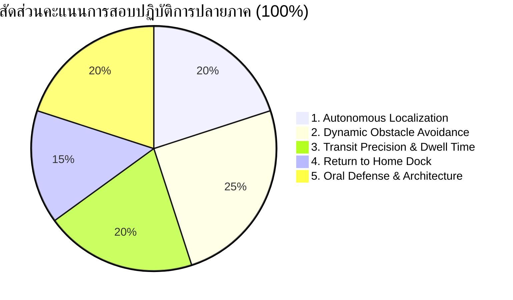

# 📊 เกณฑ์การประเมินการสอบปฏิบัติการปลายภาค (Final Examination Rubric)
**วิชา:** AMR-101 Essential ROS 2 for Autonomous Mobile Robots  
**คะแนนเต็ม:** 100 คะแนน (คิดเป็น 30% ของเกรดรวมทั้งภาคการศึกษา)  
**รูปแบบการสอบ:** การสาธิตสดในสภาพแวดล้อมจำลอง (Live Demonstration) และการสอบสัมภาษณ์ปากเปล่า (Oral Defense)

---

## 📋 มิติการประเมินผล 5 ด้านหลัก (Assessment Dimensions)



---

## 🔍 ตารางเกณฑ์การให้คะแนนอย่างละเอียด (Detailed Scoring Rubric)

### 🔹 มิติที่ 1: การกำหนดพิกัดและประมาณตำแหน่งเริ่มต้น (Autonomous Localization) - 20 คะแนน
| ระดับคะแนน | เกณฑ์การพิจารณา | คะแนนที่ได้ |
| :--- | :--- | :---: |
| **ดีเยี่ยม (Excellent)** | ส่ง Initial Pose สำเร็จผ่านสคริปต์อัตโนมัติ อนุภาค AMCL ลู่เข้าสู่ตำแหน่งจริงอย่างรวดเร็ว ความคลาดเคลื่อนตำแหน่ง $< 0.05$ เมตร และมุมเอียง $< 2^\circ$ | 18 - 20 |
| **ดี (Good)** | ส่ง Initial Pose สำเร็จ อนุภาคลู่เข้าได้ดี แต่อาจต้องใช้เวลาขับเคลื่อนเล็กน้อยเพื่อให้อนุภาคแนบสนิท ความคลาดเคลื่อน $< 0.15$ เมตร | 15 - 17 |
| **ผ่านเกณฑ์ (Pass)** | ส่ง Initial Pose ผ่าน RViz หรือสคริปต์ได้ แต่มีอาการสะบัดของอนุภาคในช่วงแรก ความคลาดเคลื่อน $< 0.30$ เมตร | 12 - 14 |
| **ต้องปรับปรุง (Fail)** | ไม่สามารถส่ง Initial Pose ได้ หรือพิกัดหลุดจากแผนที่จนระบบ Nav2 ไม่สามารถทำงานได้ | 0 - 11 |

---

### 🔹 มิติที่ 2: การหลบหลีกสิ่งกีดขวางแบบพลวัต (Dynamic Obstacle Avoidance) - 25 คะแนน
*(การทดสอบ: กรรมการจะสั่งวางสิ่งกีดขวางตัดหน้าหุ่นยนต์ในระหว่างการเดินทาง)*
| ระดับคะแนน | เกณฑ์การพิจารณา | คะแนนที่ได้ |
| :--- | :--- | :---: |
| **ดีเยี่ยม (Excellent)** | เซนเซอร์ตรวจพบสิ่งกีดขวางได้ทันที หุ่นยนต์ชะลอความเร็วและคำนวณเส้นทางเบี่ยงหลบอย่างนุ่มนวล โดยไม่ชนสิ่งกีดขวางและไม่ชนกำแพงโกดัง (Zero Collision) | 23 - 25 |
| **ดี (Good)** | หุ่นยนต์หยุดก่อนชน และมีพฤติกรรม Recovery (เช่น หมุนตัวหรือล้าง Costmap) ก่อนจะหาทางอ้อมไปต่อได้สำเร็จ | 19 - 22 |
| **ผ่านเกณฑ์ (Pass)** | หุ่นยนต์หยุดชะงักนาน และต้องใช้เวลาในการหลบหลีกมากกว่า 30 วินาที แต่ไม่มีการชนปะทะรุนแรง | 15 - 18 |
| **ต้องปรับปรุง (Fail)** | หุ่นยนต์พุ่งชนสิ่งกีดขวางหรือกำแพงจนระบบล้มเหลว (Crash) หรือติดหล่มไม่สามารถไปต่อได้ | 0 - 14 |

---

### 🔹 มิติที่ 3: ความแม่นยำในการจอดเทียบและหน่วงเวลา (Transit Precision & Dwell Time) - 20 คะแนน
| ระดับคะแนน | เกณฑ์การพิจารณา | คะแนนที่ได้ |
| :--- | :--- | :---: |
| **ดีเยี่ยม (Excellent)** | จอดเทียบจุด Pickup Bay และ Dropoff Station ตรงตำแหน่งเป้าหมาย ($\text{Error} \le 0.10$ m) มุมหันถูกต้อง และมีการหน่วงเวลาโหลดสัมภาระตามเวลาที่กำหนดครบถ้วน | 18 - 20 |
| **ดี (Good)** | จอดเทียบเป้าหมายสำเร็จ ($\text{Error} \le 0.20$ m) และมีการหยุดรอตามสเปก | 15 - 17 |
| **ผ่านเกณฑ์ (Pass)** | จอดเทียบเป้าหมายได้ในเกณฑ์พิกัดที่ Nav2 ยอมรับ ($\text{Error} \le 0.30$ m) แต่เวลาหน่วงคลาดเคลื่อน | 12 - 14 |
| **ต้องปรับปรุง (Fail)** | ไม่สามารถนำทางเข้าจอดที่สถานีได้สำเร็จ หรือข้ามสถานีโดยไม่ปฏิบัติตามลำดับภารกิจ | 0 - 11 |

---

### 🔹 มิติที่ 4: การเดินทางกลับจุดตั้งต้น (Return to Home Dock) - 15 คะแนน
| ระดับคะแนน | เกณฑ์การพิจารณา | คะแนนที่ได้ |
| :--- | :--- | :---: |
| **ดีเยี่ยม (Excellent)** | หุ่นยนต์สามารถเดินทางกลับมายังจุดเริ่มต้น Home Charging Base $(0.0, 0.0)$ และหันหน้าตรง $0^\circ$ พร้อมปิดรอบภารกิจได้อย่างสมบูรณ์แบบ | 14 - 15 |
| **ดี (Good)** | เดินทางกลับมาถึงบริเวณแท่นชาร์จได้ แต่ความคลาดเคลื่อนของมุมหันหรือระยะห่างเกิน $0.15$ เมตร | 12 - 13 |
| **ผ่านเกณฑ์ (Pass)** | เดินทางกลับมาใกล้จุดเริ่มต้นได้ แต่ระบบหยุดก่อนถึงจุดจอดจริงเล็กน้อย | 9 - 11 |
| **ต้องปรับปรุง (Fail)** | ไม่สามารถเดินทางกลับแท่นชาร์จได้ หรือระบบหลุดการเชื่อมต่อระหว่างทางกลับ | 0 - 8 |

---

### 🔹 มิติที่ 5: การสอบปากเปล่าและสถาปัตยกรรมระบบ (Oral Defense) - 20 คะแนน
| ระดับคะแนน | เกณฑ์การพิจารณา | คะแนนที่ได้ |
| :--- | :--- | :---: |
| **ดีเยี่ยม (Excellent)** | ตอบคำถามเชิงลึกเกี่ยวกับ TF Tree, DDS, QoS, Deadlock, Costmap Tuning และ Behavior Trees ได้อย่างถูกต้อง แม่นยำ ชัดเจน และเชื่อมโยงกับการทำงานจริง | 18 - 20 |
| **ดี (Good)** | ตอบคำถามหลักได้ถูกต้อง แต่อาจมีข้อผิดพลาดเล็กน้อยในรายละเอียดเชิงตัวเลขหรือพารามิเตอร์ | 15 - 17 |
| **ผ่านเกณฑ์ (Pass)** | ตอบคำถามพื้นฐานได้ แต่ไม่สามารถอธิบายกลไกเชิงลึกทางสถาปัตยกรรมได้อย่างชัดเจน | 12 - 14 |
| **ต้องปรับปรุง (Fail)** | ไม่สามารถตอบคำถามหลักได้ หรือมีความเข้าใจที่ผิดพลาดในแนวคิดพื้นฐานของ ROS 2 | 0 - 11 |

---

## ⚠️ กฎการตัดคะแนนข้อผิดพลาดร้ายแรง (Penalty Deductions)
- **การชนปะทะ (Collision Penalty):** หุ่นยนต์ชนกำแพงหรือสิ่งกีดขวางระหว่างการสาธิต: **ตัด 10 คะแนนต่อครั้ง**
- **การเข้าแทรกแซงทางกายภาพ (Manual Intervention):** ผู้สอบต้องใช้คำสั่ง Teleop บังคับมือ หรือรีเซ็ตโมเดลใหม่กลางคัน: **ตัด 15 คะแนนต่อครั้ง**
- **ระบบค้างเกินเวลา (System Hang):** หุ่นยนต์หยุดนิ่งไม่ขยับและไม่เกิด Recovery นานเกิน 60 วินาที: **ตัด 10 คะแนน**

---

## 📝 ใบบันทึกคะแนนสำหรับกรรมการ (Examiner Evaluation Sheet)

```text
ชื่อ-นามสกุล ผู้สอบ: ________________________________ รหัสนักศึกษา: __________________
วันที่สอบ: ________________________ กรรมการผู้ประเมิน: ______________________________

มิติที่ 1: Autonomous Localization (เต็ม 20)           ได้คะแนน: _______ / 20
มิติที่ 2: Dynamic Obstacle Avoidance (เต็ม 25)        ได้คะแนน: _______ / 25
มิติที่ 3: Transit Precision & Dwell Time (เต็ม 20)     ได้คะแนน: _______ / 20
มิติที่ 4: Return to Home Dock (เต็ม 15)               ได้คะแนน: _______ / 15
มิติที่ 5: Oral Defense & Architecture (เต็ม 20)       ได้คะแนน: _______ / 20
หักคะแนนข้อผิดพลาด (Penalty Deductions)                หักคะแนน: _______ คะแนน

คะแนนสุทธิรวม (Total Score):                          ________ / 100 คะแนน
ผลการประเมิน (Result):    [  ] PASS (>= 60)          [  ] FAIL (< 60)

ข้อเสนอแนะเพิ่มเติมจากกรรมการ:
__________________________________________________________________________________________
__________________________________________________________________________________________
```
