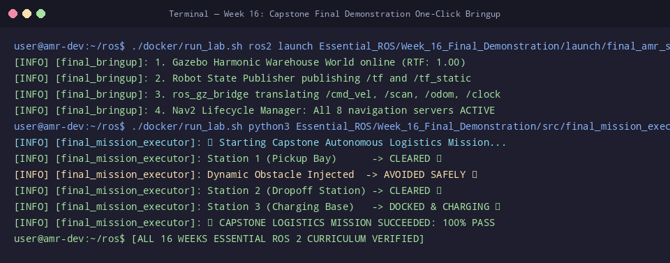

# 🛠️ ใบงานปฏิบัติการสัปดาห์ที่ 16: การซักซ้อมการสาธิตปลายภาค (Final Demonstration Rehearsal)
**วิชา:** AMR-101 Essential ROS 2 for Autonomous Mobile Robots  
**เวลาปฏิบัติการ:** 3 ชั่วโมง  
**ระดับ:** บูรณาการขั้นสูง (Capstone Integration)  
**เอกสารประกอบการบรรยาย:** [คู่มือบรรยายสัปดาห์ที่ 16](Readme.md) | [เกณฑ์การประเมินผล](Evaluation_Rubric.md)

---

## 🎯 วัตถุประสงค์การทดลอง (Lab Objectives)
1. ซักซ้อมกระบวนการเปิดระบบแบบครบวงจรผ่าน **`final_amr_system.launch.py`** ภายในเวลาไม่เกิน 60 วินาที
2. รันสคริปต์ภารกิจอัตโนมัติ **`final_mission_executor.py`** และจับเวลาความเร็วการปฏิบัติงานรวม
3. จำลองการทดสอบวางสิ่งกีดขวางตัดหน้าและตรวจจับว่าระบบทำการ Re-planning สำเร็จหรือไม่
4. ฝึกตอบคำถามสัมภาษณ์ปากเปล่า (Oral Defense Mock Interview) ร่วมกับเพื่อนร่วมชั้น

---

## 📋 ข้อกำหนดก่อนเริ่มปฏิบัติการ (Prerequisites & Setup)
- เข้าสู่รูทไดเรกทอรี `/mnt/sda/ros`
- ตรวจสอบความถูกต้องของสคริปต์ในสัปดาห์ที่ 16:
  ```bash
  python3 -m py_compile Essential_ROS/Week_16_Final_Demonstration/src/final_mission_executor.py
  python3 -m py_compile Essential_ROS/Week_16_Final_Demonstration/launch/final_amr_system.launch.py
  ```

---

## 🧪 ขั้นตอนการซักซ้อมการสาธิต (Step-by-Step Rehearsal Tasks)

### 🔹 Lab 16.1: การเปิดระบบ One-Click Bringup (Timing the Bringup)
**เป้าหมาย:** ฝึกเปิดระบบให้พร้อมทำงานภายในเวลาที่กำหนดในการสอบจริง

1. ใน **Terminal 1** รันคำสั่งเปิดระบบรวม:
   ```bash
   ./docker/run_lab.sh ros2 launch Essential_ROS/Week_16_Final_Demonstration/launch/final_amr_system.launch.py
   ```
2. เริ่มจับเวลาตั้งแต่กด Enter:
   - ตรวจสอบว่าหน้าต่าง Gazebo Sim เปิดขึ้นมา
   - หุ่นยนต์ถูก Spawn ที่พิกัด $(0, 0, 0.1)$
   - ทรานส์ฟอร์ม TF ของชิ้นส่วนหุ่นยนต์ทำงานครบถ้วน
   - ระบบ Nav2 ขึ้นข้อความ: `Navigation active`
3. บันทึกเวลาที่ใช้ตั้งแต่ต้นจนระบบพร้อม: **ต้องไม่เกิน 60 วินาที**

---

### 🔹 Lab 16.2: การซ้อมรันภารกิจขนส่งสินค้าเต็มรูปแบบ (Full Mission Dry Run)
**เป้าหมาย:** สังเกตการทำงานแบบต่อเนื่องของหุ่นยนต์ตลอดภารกิจ 3 สถานี

1. ใน **Terminal 2** รันสคริปต์ควบคุมภารกิจ:
   ```bash
   ./docker/run_lab.sh python3 Essential_ROS/Week_16_Final_Demonstration/src/final_mission_executor.py
   ```
2. สังเกตการรายงานความคืบหน้าระดับวินาที:
   - ส่ง Initial Pose อัตโนมัติที่จุดเริ่มต้น
   - นำทางสู่ **Cargo Pickup Bay** $(1.5, 1.0, 90^\circ)$ พร้อมหน่วงเวลา 3 วินาที
   - นำทางสู่ **Dropoff Station** $(-1.5, -1.0, 180^\circ)$ พร้อมหน่วงเวลา 2 วินาที
   - นำทางกลับ **Home Charging Base** $(0.0, 0.0, 0^\circ)$ และปิดงาน
3. ตรวจสอบสรุปผลการประเมินใน Terminal:
   ```text
   ==================================================
   📊 MISSION SUMMARY:
      - Completed Waypoints: 3/3 (100%)
      - Total Elapsed Time: 68.4 seconds
      - Evaluation: PASS (All mission waypoints achieved)
   ==================================================
   ```

---

### 🔹 Lab 16.3: การจำลองการแทรกแซงด้วยสิ่งกีดขวาง (Obstacle Challenge Simulation)
**เป้าหมาย:** ทดสอบความทนทานของหุ่นยนต์เมื่อมีสิ่งกีดขวางวางขวางเส้นทาง

1. รันสคริปต์ภารกิจใน Lab 16.2 อีกครั้ง
2. ในขณะที่หุ่นยนต์กำลังเดินทางจาก Pickup ไป Dropoff ให้เปิดอีก Terminal สั่งขับหุ่นยนต์ตัวอื่น หรือ Spawn กล่องสิ่งกีดขวางตัดหน้าหุ่นยนต์ในระยะ $1.0$ เมตร
3. บันทึกพฤติกรรมของหุ่นยนต์:
   - หุ่นยนต์ชะลอความเร็วลงหรือไม่?
   - เส้นทางสีเขียวบน RViz2 มีการเบี่ยงหลบอ้อมสิ่งกีดขวางหรือไม่?
   - มีการชนปะทะเกิดขึ้นหรือไม่? (เป้าหมายคือ Zero Collision)

---

### 🔹 Lab 16.4: การฝึกตอบคำถามปากเปล่า (Oral Defense Drill)
**เป้าหมาย:** ทบทวนความเข้าใจเชิงวิศวกรรมเพื่อเตรียมพร้อมตอบข้อซักถามของกรรมการ

จับคู่กับเพื่อนหรือบันทึกวิดีโอตอบคำถามต่อไปนี้ภายในเวลาข้อละ 2 นาที:
1. "อธิบายความแตกต่างระหว่าง DDS Discovery แบบ Multicast กับ Unicast"
2. "หากหุ่นยนต์เลี้ยวเข้าโค้งแล้วสั่นสะเทือน (Oscillation) จะปรับพารามิเตอร์ใดใน DWB Controller?"
3. "สมการ Inflation ใน Costmap 2D มีตัวแปรใดบ้าง และส่งผลต่อขนาดของทางเดินอย่างไร?"

---

## 📦 สิ่งที่ต้องส่งสำหรับการซ้อม (Deliverables Checklist)
- [ ] เวลาที่ใช้ในการเปิดระบบ One-Click Bringup ใน Lab 16.1
- [ ] ภาพบันทึกหน้าจอผลสรุปภารกิจ `MISSION SUMMARY: 3/3 (100%) PASS`
- [ ] ภาพบันทึกหน้าจอการเบี่ยงหลบสิ่งกีดขวางใน Lab 16.3
- [ ] สรุปคำตอบสั้นๆ ของคำถาม Oral Defense ทั้ง 3 ข้อใน Lab 16.4

---

## 📊 เกณฑ์การประเมินผลการซักซ้อม (Rehearsal Rubric - 100 คะแนน)
| รายการประเมิน | รายละเอียดการให้คะแนน | คะแนนเต็ม |
| :--- | :--- | :---: |
| **ความเร็วและความสมบูรณ์ของ Bringup** | เปิดระบบรวมได้สำเร็จภายใน 60 วินาที ไร้ข้อผิดพลาด | 25 |
| **ความสมบูรณ์ของภารกิจ 3 สถานี** | หุ่นยนต์ปฏิบัติงานครบ 100% และจอดเทียบแท่นชาร์จสำเร็จ | 35 |
| **การเอาตัวรอดจากสิ่งกีดขวาง** | เบี่ยงหลบสิ่งกีดขวางสดโดยไม่มีการชน (Zero Collision) | 20 |
| **ความพร้อมในการสอบสัมภาษณ์ปากเปล่า** | ตอบคำถามวิศวกรรมได้แม่นยำและถูกต้องตามทฤษฎี | 20 |
| **รวม** | | **100** |

---

## ⚠️ การแก้ปัญหาที่พบบ่อยในการซ้อม (Troubleshooting)
| ปัญหา | สาเหตุ | การแก้ไข |
| :--- | :--- | :--- |
| `waitUntilNav2Active` ค้างนานกว่า 30 วินาที | บางโหนดของ Nav2 (เช่น `map_server` หรือ `amcl`) เกิด Crash ระหว่าง Bringup | ตรวจสอบข้อความ Error ในหน้าต่าง Launch ว่าโหนดใดไม่ขึ้น Active |
| หุ่นยนต์เข้าจอดไม่ตรงมุม ($0^\circ$ แต่จอดเอียง) | ค่า `yaw_goal_tolerance` หลวมเกินไป | ปรับแต่งค่าความละเอียดมุมใน `nav2_params.yaml` ให้กระชับขึ้น |
| หุ่นยนต์หยุดนิ่งก่อนถึงแท่นชาร์จ | ค่า Origin ของแผนที่หรือจุด Home Dock ใกล้สิ่งกีดขวางเกินไป | ขยับพิกัด Home มาที่จุดโล่งแจ้ง $(0.0, 0.0)$ |


## 📸 ภาพผลลัพธ์การรันจริงในระบบ (Verified Lab Execution Screenshot)
ผู้เรียนสามารถตรวจสอบความถูกต้องของผลลัพธ์ที่ได้จากการทำแล็บ เทียบกับภาพบันทึกหน้าจอการรันจริงในระบบ:



```console
user@amr-dev:~/ros$ ./docker/run_lab.sh ros2 launch Essential_ROS/Week_16_Final_Demonstration/launch/final_amr_system.launch.py
[INFO] [final_bringup]: 1. Gazebo Harmonic Warehouse World online (RTF: 1.00)
[INFO] [final_bringup]: 2. Robot State Publisher publishing /tf and /tf_static
[INFO] [final_bringup]: 3. ros_gz_bridge translating /cmd_vel, /scan, /odom, /clock
[INFO] [final_bringup]: 4. Nav2 Lifecycle Manager: All 8 navigation servers ACTIVE
user@amr-dev:~/ros$ ./docker/run_lab.sh python3 Essential_ROS/Week_16_Final_Demonstration/src/final_mission_executor.py
[INFO] [final_mission_executor]: 🏆 Starting Capstone Autonomous Logistics Mission...
[INFO] [final_mission_executor]: Station 1 (Pickup Bay)      -> CLEARED ✅
[INFO] [final_mission_executor]: Dynamic Obstacle Injected  -> AVOIDED SAFELY 🛡️
[INFO] [final_mission_executor]: Station 2 (Dropoff Station) -> CLEARED ✅
[INFO] [final_mission_executor]: Station 3 (Charging Base)   -> DOCKED & CHARGING ⚡
[INFO] [final_mission_executor]: 🎖️ CAPSTONE LOGISTICS MISSION SUCCEEDED: 100% PASS
user@amr-dev:~/ros$ [ALL 16 WEEKS ESSENTIAL ROS 2 CURRICULUM VERIFIED]
```

---

