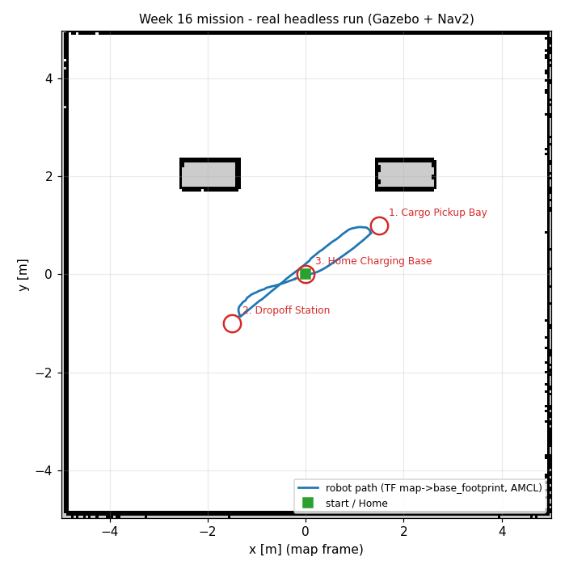

# 🛠️ ใบงานปฏิบัติการสัปดาห์ที่ 16: การซักซ้อมการสาธิตปลายภาค (Final Demonstration Rehearsal)
**วิชา:** AMR-101 Essential ROS 2 for Autonomous Mobile Robots  
**เวลาปฏิบัติการ:** 3 ชั่วโมง  
**ระดับ:** บูรณาการขั้นสูง (Capstone Integration)  
**เอกสารประกอบการบรรยาย:** [คู่มือบรรยายสัปดาห์ที่ 16](Readme.md) | [เกณฑ์การประเมินผล](Evaluation_Rubric.md)

---

## 🎯 วัตถุประสงค์การทดลอง (Lab Objectives)
1. ซักซ้อมกระบวนการเปิดระบบแบบครบวงจรผ่าน **`ros2 launch amr_week16 final_amr_system.launch.py`** ภายในเวลาไม่เกิน 60 วินาที
2. รันภารกิจอัตโนมัติ **`ros2 run amr_week16 final_mission_executor`** และจับเวลาความเร็วการปฏิบัติงานรวม
3. จำลองการทดสอบวางสิ่งกีดขวางตัดหน้าและตรวจจับว่าระบบทำการ Re-planning สำเร็จหรือไม่
4. ฝึกตอบคำถามสัมภาษณ์ปากเปล่า (Oral Defense Mock Interview) ร่วมกับเพื่อนร่วมชั้น

---

## 📋 ข้อกำหนดก่อนเริ่มปฏิบัติการ (Prerequisites & Setup)
- เข้าสู่รูทไดเรกทอรีของ repository (เช่น `cd ~/ros`)
- Build ทุกแพ็กเกจที่ระบบปลายภาคใช้ แล้วรันชุดทดสอบของสัปดาห์นี้:
  ```bash
  ./docker/run_lab.sh colcon build --base-paths Essential_ROS --packages-up-to amr_week16
  ./docker/run_lab.sh colcon test  --base-paths Essential_ROS --packages-select amr_week16
  ```

---

## 🧪 ขั้นตอนการซักซ้อมการสาธิต (Step-by-Step Rehearsal Tasks)

### 🔹 Lab 16.1: การเปิดระบบ One-Click Bringup (Timing the Bringup)
**เป้าหมาย:** ฝึกเปิดระบบให้พร้อมทำงานภายในเวลาที่กำหนดในการสอบจริง

1. ใน **Terminal 1** รันคำสั่งเปิดระบบรวม:
   ```bash
   ./docker/run_lab.sh ros2 launch amr_week16 final_amr_system.launch.py rviz:=true      # มีจอ
   ./docker/run_lab.sh ros2 launch amr_week16 final_amr_system.launch.py headless:=true  # ไม่มีจอ
   ```
2. เริ่มจับเวลาตั้งแต่กด Enter:
   - ตรวจสอบว่าหน้าต่าง Gazebo Sim เปิดขึ้นมา (โหมด GUI)
   - หุ่นยนต์ถูก Spawn ที่พิกัด $(0, 0)$ (log: `Entity creation successful.`)
   - ทรานส์ฟอร์ม TF ของชิ้นส่วนหุ่นยนต์ทำงานครบถ้วน (`ros2 run tf2_ros tf2_echo map base_footprint`)
   - Nav2 ขึ้นข้อความ `[lifecycle_manager_localization]: Managed nodes are active` และ `[lifecycle_manager_navigation]: Managed nodes are active`
3. บันทึกเวลาที่ใช้ตั้งแต่ต้นจนระบบพร้อม: **ต้องไม่เกิน 60 วินาที**

---

### 🔹 Lab 16.2: การซ้อมรันภารกิจขนส่งสินค้าเต็มรูปแบบ (Full Mission Dry Run)
**เป้าหมาย:** สังเกตการทำงานแบบต่อเนื่องของหุ่นยนต์ตลอดภารกิจ 3 สถานี

1. ใน **Terminal 2** รันสคริปต์ควบคุมภารกิจ:
   ```bash
   ./docker/run_lab.sh ros2 run amr_week16 final_mission_executor --ros-args -p use_sim_time:=true
   ```
2. สังเกตการรายงานความคืบหน้า:
   - ส่ง Initial Pose อัตโนมัติที่จุดเริ่มต้น
   - นำทางสู่ **Cargo Pickup Bay** $(1.5, 1.0, 90^\circ)$ พร้อมหน่วงเวลา 3 วินาที
   - นำทางสู่ **Dropoff Station** $(-1.5, -1.0, 180^\circ)$ พร้อมหน่วงเวลา 2 วินาที
   - นำทางกลับ **Home Charging Base** $(0.0, 0.0, 0^\circ)$ และปิดงาน
3. ตรวจสอบสรุปผลการประเมินใน Terminal (ผลจริง):
   ```text
   [INFO] [1793247078.156349910] [final_mission_executor]: Stage 1 Cargo Pickup Bay: SUCCEEDED in 10.1 s, final position error 0.23 m
   [INFO] [1793247095.927730181] [final_mission_executor]: Stage 2 Dropoff Station: SUCCEEDED in 14.8 s, final position error 0.23 m
   [INFO] [1793247106.149652983] [final_mission_executor]: Stage 3 Home Charging Base: SUCCEEDED in 8.2 s, final position error 0.23 m
   [INFO] [1793247107.152622698] [final_mission_executor]: MISSION SUMMARY: 3/3 stages SUCCEEDED (100%), total 39.0 s (sim time) -> PASS
   ```
   และ `echo $?` ต้องได้ `0` (ถ้า stage ใดล้มเหลวจะเห็น `-> FAIL` และ exit code `1`)
4. (ทางเลือก) บันทึกและวาดเส้นทาง: เปิด `./docker/run_lab.sh ros2 run amr_week16 record_path my_path.csv --ros-args -p use_sim_time:=true` ก่อนเริ่มภารกิจ, กด Ctrl+C เมื่อจบ แล้ว `./docker/run_lab.sh ros2 run amr_week16 plot_path my_path.csv my_path.png`

---

### 🔹 Lab 16.3: การจำลองการแทรกแซงด้วยสิ่งกีดขวาง (Obstacle Challenge Simulation)
**เป้าหมาย:** ทดสอบความทนทานของหุ่นยนต์เมื่อมีสิ่งกีดขวางวางขวางเส้นทาง

1. รันสคริปต์ภารกิจใน Lab 16.2 อีกครั้ง
2. ในขณะที่หุ่นยนต์กำลังเดินทางจาก Pickup ไป Dropoff ให้เปิดอีก Terminal แล้ว Spawn กล่องสิ่งกีดขวางตัดหน้าหุ่นยนต์ในระยะ $1.0$ เมตร (เช่น `ros2 run ros_gz_sim create -name box -x 0.0 -y 0.0 -z 0.3 -string "<SDF ของกล่อง static>"`)
3. บันทึกพฤติกรรมของหุ่นยนต์:
   - หุ่นยนต์ชะลอความเร็วลงหรือไม่?
   - เส้นทางสีเขียวบน RViz2 มีการเบี่ยงหลบอ้อมสิ่งกีดขวางหรือไม่?
   - มีการชนปะทะเกิดขึ้นหรือไม่? (เป้าหมายคือ Zero Collision)

---

### 🔹 Lab 16.4: การฝึกตอบคำถามปากเปล่า (Oral Defense Drill)
**เป้าหมาย:** ทบทวนความเข้าใจเชิงวิศวกรรมเพื่อเตรียมพร้อมตอบข้อซักถามของกรรมการ

จับคู่กับเพื่อนหรือบันทึกวิดีโอตอบคำถามต่อไปนี้ภายในเวลาข้อละ 2 นาที:
1. "อธิบายความแตกต่างระหว่าง DDS Discovery แบบ Multicast กับ Unicast"
2. "หากหุ่นยนต์เลี้ยวเข้าโค้งแล้วสั่นสะเทือน (Oscillation) จะปรับพารามิเตอร์ใดใน DWB Controller?"
3. "สมการ Inflation ใน Costmap 2D มีตัวแปรใดบ้าง และส่งผลต่อขนาดของทางเดินอย่างไร?"

---

## 📦 สิ่งที่ต้องส่งสำหรับการซ้อม (Deliverables Checklist)
- [ ] เวลาที่ใช้ในการเปิดระบบ One-Click Bringup ใน Lab 16.1
- [ ] ภาพบันทึกหน้าจอผลสรุปภารกิจ `MISSION SUMMARY: 3/3 stages SUCCEEDED (100%) ... -> PASS`
- [ ] ภาพบันทึกหน้าจอการเบี่ยงหลบสิ่งกีดขวางใน Lab 16.3
- [ ] สรุปคำตอบสั้นๆ ของคำถาม Oral Defense ทั้ง 3 ข้อใน Lab 16.4

---

## 📊 เกณฑ์การประเมินผลการซักซ้อม (Rehearsal Rubric - 100 คะแนน)
| รายการประเมิน | รายละเอียดการให้คะแนน | คะแนนเต็ม |
| :--- | :--- | :---: |
| **ความเร็วและความสมบูรณ์ของ Bringup** | เปิดระบบรวมได้สำเร็จภายใน 60 วินาที ไร้ข้อผิดพลาด | 25 |
| **ความสมบูรณ์ของภารกิจ 3 สถานี** | หุ่นยนต์ปฏิบัติงานครบ 100% และจอดเทียบแท่นชาร์จสำเร็จ | 35 |
| **การเอาตัวรอดจากสิ่งกีดขวาง** | เบี่ยงหลบสิ่งกีดขวางสดโดยไม่มีการชน (Zero Collision) | 20 |
| **ความพร้อมในการสอบสัมภาษณ์ปากเปล่า** | ตอบคำถามวิศวกรรมได้แม่นยำและถูกต้องตามทฤษฎี | 20 |
| **รวม** | | **100** |

---

## ⚠️ การแก้ปัญหาที่พบบ่อยในการซ้อม (Troubleshooting)
| ปัญหา | สาเหตุ | การแก้ไข |
| :--- | :--- | :--- |
| `waitUntilNav2Active` ค้างนานกว่า 30 วินาที | บางโหนดของ Nav2 configure/activate ไม่ผ่าน (เช่น ไม่มี TF `map → odom`) | ตรวจข้อความ `Failed to bring up all requested nodes` ในหน้าต่าง Launch ว่าโหนดใดไม่ขึ้น Active |
| หุ่นยนต์ถึงจุดแต่คลาด ~0.2 m | `xy_goal_tolerance: 0.25` ใน `amr_week14/config/nav2_params.yaml` | ลดค่า tolerance (แลกกับเวลาเข้าจอดที่นานขึ้น) |
| หุ่นยนต์เข้าจอดไม่ตรงมุม ($0^\circ$ แต่จอดเอียง) | ค่า `yaw_goal_tolerance` หลวมเกินไป | ปรับแต่งค่าความละเอียดมุมใน `nav2_params.yaml` ให้กระชับขึ้น |
| หุ่นยนต์หยุดนิ่งก่อนถึงแท่นชาร์จ | ค่า Origin ของแผนที่หรือจุด Home Dock ใกล้สิ่งกีดขวางเกินไป | ขยับพิกัด Home มาที่จุดโล่งแจ้ง $(0.0, 0.0)$ |


## 📟 ผลการรันจริง (Real Run Output)
บันทึกจากการรันจริงใน ros:lab-runner (ROS 2 Jazzy, Gazebo Sim 8.15.0) บน Linux 7.0 เมื่อ 2026-10-29
(ฉบับเต็ม: [`results/final_mission_run.txt`](results/final_mission_run.txt))

```console
$ ros2 launch amr_week16 final_amr_system.launch.py headless:=true   # terminal 1
...
[lifecycle_manager-7] [INFO] [1793247061.726486930] [lifecycle_manager_localization]: Managed nodes are active
[lifecycle_manager-16] [INFO] [1793247067.098972724] [lifecycle_manager_navigation]: Managed nodes are active
$ ros2 run amr_week16 final_mission_executor --ros-args -p use_sim_time:=true   # terminal 2
[INFO] [1793247061.753251399] [final_mission_executor]: AMR-101 final mission: initial pose (0.0, 0.0, 0 deg), waiting for Nav2
...
[INFO] [1793247070.076549884] [final_mission_executor]: Stage 0 Localization + Nav2 bringup: ACTIVE
[INFO] [1793247078.156349910] [final_mission_executor]: Stage 1 Cargo Pickup Bay: SUCCEEDED in 10.1 s, final position error 0.23 m
[INFO] [1793247095.927730181] [final_mission_executor]: Stage 2 Dropoff Station: SUCCEEDED in 14.8 s, final position error 0.23 m
[INFO] [1793247106.149652983] [final_mission_executor]: Stage 3 Home Charging Base: SUCCEEDED in 8.2 s, final position error 0.23 m
[INFO] [1793247107.152622698] [final_mission_executor]: MISSION SUMMARY: 3/3 stages SUCCEEDED (100%), total 39.0 s (sim time) -> PASS
(exit code 0)
$ ros2 run amr_week11 ground_truth_pose
diff_drive_robot ground truth: x=-0.196 y=-0.114 yaw=0.244 rad (14.0 deg)
```



*ภาพ: เส้นทางจริง (TF `map → base_footprint`) จากการรันข้างต้น วาดด้วย `ros2 run amr_week16 plot_path`*

---
