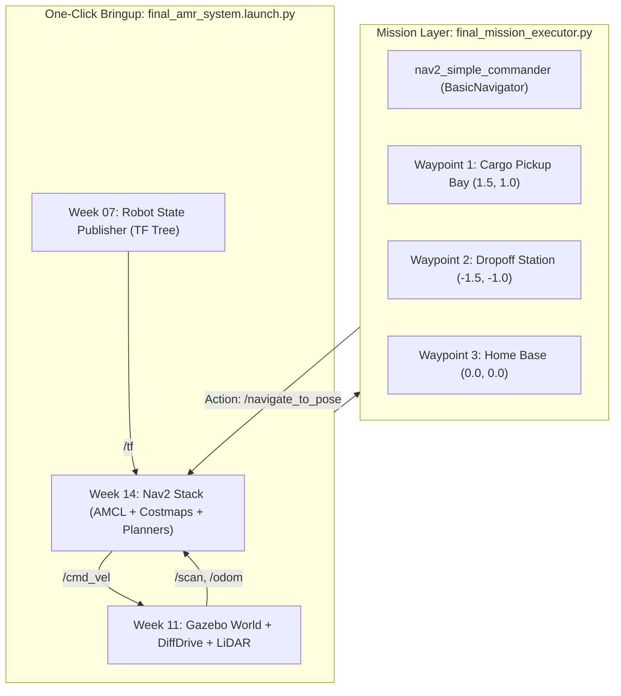

# 🏆 Week 16: การสอบปฏิบัติการปลายภาคและการนำเสนอโครงงาน (Final AMR Demonstration & Defense)
**เวลาเรียน:** บรรยายและซักถาม 2 ชั่วโมง | ปฏิบัติการและสาธิตจริง 3 ชั่วโมง  
**วิชาบังคับก่อน:** ผ่านบทเรียนและใบงานปฏิบัติการสัปดาห์ที่ 1 ถึง 15 ครบถ้วน  
**เอกสารเกณฑ์การให้คะแนน:** [เกณฑ์การประเมินผล 5 มิติ (Evaluation Rubric)](Evaluation_Rubric.md)  
**เอกสารคู่มือซ้อมปฏิบัติการ:** [คู่มือซักซ้อมการสาธิต (Rehearsal Lab Guide)](Lab_Exercises.md)

---

## 🎯 วัตถุประสงค์การวัดผล (Capstone Objectives)
การสอบปฏิบัติการปลายภาคเป็นการประเมินผลแบบบูรณาการระดับสูงสุด (Capstone Competency) ของวิศวกร Autonomous Mobile Robot:
1. **End-to-End System Bringup:** บูรณาการระบบ Gazebo Sim, Robot Description, ros_gz_bridge, และ Nav2 Stack ให้เปิดทำงานร่วมกันได้อย่างไร้รอยต่อ
2. **Autonomous Warehouse Logistics Mission:** หุ่นยนต์ AMR ต้องปฏิบัติการรับ-ส่งสินค้าข้ามสถานีโดยอัตโนมัติ 100%
3. **Dynamic Collision Avoidance:** หลบหลีกสิ่งกีดขวางที่ไม่ปรากฏในแผนที่เดิมได้อย่างนุ่มนวลและปลอดภัย
4. **Engineering Defense:** อธิบายหลักการทางวิศวกรรม ตอบข้อซักถามเชิงลึก และแก้ปัญหาเฉพาะหน้าต่อหน้าคณะกรรมการ

---

## ⏱️ กำหนดการประเมินผล (Examination Schedule)
| ช่วงเวลา | กิจกรรมการประเมิน | ผู้รับผิดชอบ |
| :---: | :--- | :--- |
| **00:00 - 00:10** | สุ่มจับฉลากโจทย์พิกัดและตรวจสอบความพร้อมของระบบ | คณะกรรมการ / นักศึกษา |
| **00:10 - 00:40** | ปฏิบัติการเปิดระบบ One-Click Bringup และ Initial Pose | นักศึกษา |
| **00:40 - 01:40** | การรันภารกิจอัตโนมัติและการทดสอบตัดหน้ารถ (Obstacle Challenge) | นักศึกษา / กรรมการแทรกแซง |
| **01:40 - 02:40** | การสอบสัมภาษณ์ปากเปล่าเชิงสถาปัตยกรรม (Oral Defense) | กรรมการซักถามทีละคน |
| **02:40 - 03:00** | รวบรวมคะแนนและประกาศผลการประเมิน | คณะกรรมการ |

---

## 🏛️ สถาปัตยกรรมระบบแบบบูรณาการ (End-to-End System Architecture)



---

## 🛠️ การวิเคราะห์โค้ดระบบปลายภาค (Code Walkthrough)

### 1. `launch/final_amr_system.launch.py`
ไฟล์ Launch นี้รวบรวมระบบทั้งหมดของหุ่นยนต์ AMR เข้าด้วยกันในคำสั่งเดียว:
- เรียกใช้ `gazebo_launch` (สัปดาห์ที่ 11) เพื่อเปิดโลกจำลองโกดังและ Spawn หุ่นยนต์
- เรียกใช้ `display_urdf_launch` (สัปดาห์ที่ 7) เพื่อกระจายทรานส์ฟอร์ม TF ของชิ้นส่วนหุ่นยนต์ทั้งหมด
- เรียกใช้ `nav2_launch` (สัปดาห์ที่ 14) เพื่อเปิดการทำงานของ Costmaps, AMCL, และ Path Planners

### 2. `src/final_mission_executor.py`
สคริปต์ควบคุมภารกิจอัตโนมัติระดับสูง:
- สร้างอ็อบเจกต์ `navigator = BasicNavigator()`
- สั่งส่ง Initial Pose ที่จุดเริ่มต้น $(0, 0)$ และรอจนกระทั่ง Nav2 เข้าสู่สถานะพร้อมทำงาน (`waitUntilNav2Active()`)
- ขับเคลื่อนตามลำดับสถานีคลังสินค้า:
  1. **สถานีที่ 1: Cargo Pickup Bay** $(x=1.5, y=1.0, \text{yaw}=90^\circ)$ พร้อมหน่วงเวลาโหลดของ 3 วินาที
  2. **สถานีที่ 2: Dropoff Station** $(x=-1.5, y=-1.0, \text{yaw}=180^\circ)$ พร้อมหน่วงเวลาส่งของ 2 วินาที
  3. **สถานีที่ 3: Home Charging Base** $(x=0.0, y=0.0, \text{yaw}=0^\circ)$ เพื่อจอดเทียบแท่นชาร์จ
- สรุปผลการปฏิบัติการ: แสดงจำนวนสถานีที่สำเร็จ เปอร์เซ็นต์ความสำเร็จ และเวลาที่ใช้ทั้งหมด

---

## 🗣️ คลังคำถามสัมภาษณ์ปากเปล่าสำหรับการสอบป้องกัน (Oral Defense Question Bank)

กรรมการจะสุ่มถามคำถามเชิงสถาปัตยกรรม 2 - 3 ข้อจากคลังคำถามต่อไปนี้:

### หมวดที่ 1: เครือข่าย DDS และการสื่อสาร
**คำถาม 1.1:** หากในโรงงานมีหุ่นยนต์ AMR ทำงานพร้อมกัน 10 ตัวบน Wi-Fi เดียวกัน จะป้องกันไม่ให้คำสั่ง `/cmd_vel` ของหุ่นยนต์ตัวที่ 1 ไปสั่งงานตัวที่ 2 ได้อย่างไร?  
<details><summary>🔍 แนวทางการตอบ</summary>
กำหนดตัวแปร <code>ROS_DOMAIN_ID</code> ให้กับหุ่นยนต์แต่ละตัวไม่ซ้ำกัน (เช่น ตัวที่ 1 ใช้ ID=1, ตัวที่ 2 ใช้ ID=2) ซึ่ง DDS จะทำการแยกพอร์ต UDP Multicast โดยอัตโนมัติตามสูตร $7400 + (250 \times \text{DOMAIN\_ID})$ หรือใช้การตั้งค่า Namespace (เช่น <code>/robot1/cmd_vel</code>)
</details>

**คำถาม 1.2:** เพราะเหตุใดการเรียก Service แบบ Synchronous ภายใน Callback ของโหนดธรรมดาจึงทำให้เกิด Deadlock?  
<details><summary>🔍 แนวทางการตอบ</summary>
เพราะใน <code>SingleThreadedExecutor</code> มีเพียง 1 Thread เท่านั้น เมื่อ Callback ถูกเรียก Thread จะถูกจองเพื่อรอคำตอบ แต่เหตุการณ์รับ Response จาก DDS ต้องใช้ Thread เดียวกันนี้มาประมวลผล ทำให้เกิดการบล็อกซึ่งกันและกัน (Deadlock) ทางแก้คือใช้ <code>call_async()</code> หรือใช้ <code>MultiThreadedExecutor</code> ร่วมกับ <code>ReentrantCallbackGroup</code>
</details>

---

### หมวดที่ 2: จลนศาสตร์และระบบพิกัด TF2
**คำถาม 2.1:** ทำไมตามมาตรฐาน REP 105 จึงต้องแยกเฟรม <code>map</code> ออกจากเฟรม <code>odom</code>?  
<details><summary>🔍 แนวทางการตอบ</summary>
เพื่อแยกความต้องการของระบบควบคุม: เฟรม <code>odom</code> มีความต่อเนื่องสูงมาก ไม่มีการกระโดด เหมาะกับ Local Control และการหลบสิ่งกีดขวางเฉพาะหน้า แต่มี Drift สะสม ส่วนเฟรม <code>map</code> ยึดกับโลกจริง ไม่มี Drift สะสม แต่อาจเกิดการกระโดดของพิกัดเมื่อ AMCL หรือ SLAM มีการ Re-localize ตำแหน่งใหม่
</details>

**คำถาม 2.2:** ในการคำนวณหุ่นยนต์ขับเคลื่อนสองล้อ (Differential Drive) หากสั่งความเร็ว $v = 0$ และ $\omega = 1.0$ rad/s ล้อซ้ายและล้อขวาจะเคลื่อนที่อย่างไร?  
<details><summary>🔍 แนวทางการตอบ</summary>
ล้อทั้งสองข้างจะหมุนด้วยความเร็วเท่ากันแต่ทิศทางตรงกันข้าม โดยล้อขวาหมุนไปข้างหน้าด้วยความเร็ว $v_R = +\frac{\omega \cdot L}{2}$ และล้อซ้ายหมุนถอยหลัง $v_L = -\frac{\omega \cdot L}{2}$ ส่งผลให้หุ่นยนต์หมุนตัวอยู่กับที่รอบแกนกึ่งกลาง
</details>

---

### หมวดที่ 3: SLAM, Costmaps และ Nav2 Navigation
**คำถาม 3.1:** ใน Costmap 2D รหัสคอสต์ 253 (Inscribed Obstacle) มีความหมายทางฟิสิกส์อย่างไร?  
<details><summary>🔍 แนวทางการตอบ</summary>
เป็นระยะห่างที่หากจุดกึ่งกลางของหุ่นยนต์เข้าไป ขอบตัวถังด้านนอกสุดของหุ่นยนต์จะชนเข้ากับสิ่งกีดขวางพอดี อัลกอริทึม Path Planner จึงต้องห้ามไม่ให้เส้นทางเดินลากผ่านเซลล์ที่มีค่าคอสต์นี้เด็ดขาด
</details>

**คำถาม 3.2:** หากหุ่นยนต์ขับไปเจอกำแพงขวางทางกะทันหัน Behavior Tree ของ Nav2 จะมีลำดับขั้นตอนในการแก้ไขสถานการณ์อย่างไร?  
<details><summary>🔍 แนวทางการตอบ</summary>
ระบบจะเข้าสู่ <code>RecoveryNode</code> โดยลำดับแรกจะสั่งให้ Planner พยายามวางเส้นทางใหม่ หากไม่ได้ผลจะสั่งล้างข้อมูลเซนเซอร์ใน Costmap (<code>ClearEntireCostmap</code>), สั่งหมุนตัวสำรวจรอบทิศทาง 360 องศา (<code>Spin</code>), หรือสั่งถอยหลังตั้งหลัก (<code>BackUp</code>) หากยังไม่พ้นจึงจะรายงานสถานะล้มเหลว (<code>ABORTED</code>)
</details>

---

## ⌨️ ตารางคำสั่งสำหรับวันสอบจริง
```bash
# 1. รันระบบรวมทุกส่วน (Terminal 1)
./docker/run_lab.sh ros2 launch Essential_ROS/Week_16_Final_Demonstration/launch/final_amr_system.launch.py

# 2. เริ่มต้นภารกิจนำทางอัตโนมัติ (Terminal 2)
./docker/run_lab.sh python3 Essential_ROS/Week_16_Final_Demonstration/src/final_mission_executor.py
```

---

## 📚 สรุปและก้าวต่อไปหลังจบหลักสูตร Essential ROS 2
ยินดีด้วยที่ท่านได้ศึกษาและปฏิบัติการจนสำเร็จครบทั้ง 16 สัปดาห์ของหลักสูตร **Essential ROS 2 Track**!  
ท่านมีความพร้อมอย่างเต็มที่ในฐานะวิศวกร Autonomous Mobile Robot และพร้อมที่จะก้าวสู่หลักสูตรขั้นสูงใน **Advanced ROS 2 Track** (Nav2 Custom Plugins, BehaviorTree.CPP Development, Fleet Management System, ROS 2 Control Hardware Interfaces, และ Real-time Linux RT-PREEMPT)
