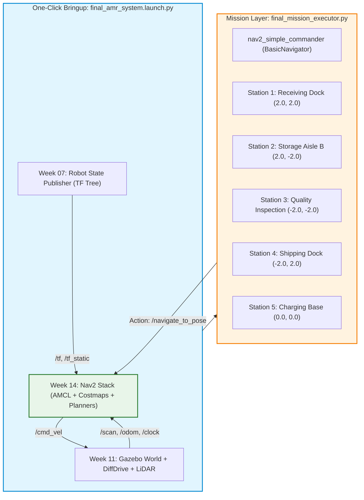

# 🏆 Week 16: การสอบปฏิบัติการปลายภาคและการนำเสนอโครงงาน (Final AMR Demonstration & Defense)
**เวลาเรียน:** บรรยายและซักถาม 2 ชั่วโมง | ปฏิบัติการและสาธิตจริง 3 ชั่วโมง  
**วิชาบังคับก่อน:** ผ่านบทเรียนและใบงานปฏิบัติการสัปดาห์ที่ 1 ถึง 15 ครบถ้วน  
**เอกสารเกณฑ์การให้คะแนน:** [เกณฑ์การประเมินผล 5 มิติ (Evaluation Rubric)](Evaluation_Rubric.md)  
**เอกสารคู่มือซ้อมปฏิบัติการ:** [คู่มือซักซ้อมการสาธิต (Rehearsal Lab Guide)](Lab_Exercises.md)

---

## 🎯 วัตถุประสงค์การวัดผล (Capstone Competency Objectives)
การสอบปฏิบัติการปลายภาคเป็นการประเมินผลแบบบูรณาการระดับสูงสุด (Capstone Integration) ของวิศวกร Autonomous Mobile Robot (AMR):
1. **End-to-End System Bringup:** บูรณาการระบบ Gazebo Sim 8 (Harmonic), Robot Description (URDF), `ros_gz_bridge`, และ Nav2 Navigation Stack ให้เปิดทำงานร่วมกันได้ด้วยคำสั่งเดียว (One-Click Bringup)
2. **Autonomous Warehouse Logistics Mission:** หุ่นยนต์ AMR ต้องปฏิบัติการรับ-ส่งสินค้าข้ามสถานีคลังสินค้าจำลองโดยอัตโนมัติ $100\%$ โดยไม่มีการบังคับด้วยมือ
3. **Dynamic Collision Avoidance & Recovery:** หลบหลีกสิ่งกีดขวางที่ไม่มีในแผนที่เดิมได้อย่างนุ่มนวล และกู้คืนสถานการณ์ได้สำเร็จเมื่อถูกขวางเส้นทาง
4. **Engineering Defense:** อธิบายหลักการทางวิศวกรรม ถอดรหัสโครงสร้างคณิตศาสตร์และสถาปัตยกรรมระบบ ตอบข้อซักถามเชิงลึก และแก้ปัญหาเฉพาะหน้าต่อหน้าคณะกรรมการ

---

## ⏱️ กำหนดการประเมินผล (Examination Schedule)
| ช่วงเวลา | กิจกรรมการประเมิน | ผู้รับผิดชอบ |
| :---: | :--- | :--- |
| **00:00 - 00:15** | สุ่มจับฉลากโจทย์พิกัดและตรวจสอบความพร้อมสภาพแวดล้อมระบบ | คณะกรรมการ / นักศึกษา |
| **00:15 - 00:45** | ปฏิบัติการเปิดระบบ One-Click Bringup และส่ง Initial Pose | นักศึกษา |
| **00:45 - 01:45** | การรันภารกิจอัตโนมัติ 5 สถานี และการทดสอบตัดหน้ารถ (Obstacle Challenge) | นักศึกษา / กรรมการแทรกแซง |
| **01:45 - 02:45** | การสอบสัมภาษณ์ปากเปล่าเชิงสถาปัตยกรรม (Oral Engineering Defense) | กรรมการซักถามทีละคน |
| **02:45 - 03:00** | รวบรวมคะแนนและประกาศผลการประเมิน Capstone | คณะกรรมการ |

---

## 🏛️ สถาปัตยกรรมระบบแบบบูรณาการ (End-to-End System Architecture)



---

## 🛠️ การวิเคราะห์โค้ดระบบปลายภาค (Code Walkthrough)

### 1. [`final_amr_system.launch.py`](file:///mnt/sda/ros/Essential_ROS/Week_16_Final_Demonstration/launch/final_amr_system.launch.py)
ไฟล์ Launch รวมที่ทำหน้าที่เปิดระบบทั้งลำของ AMR:
- **Gazebo Bringup ([L23-L25](file:///mnt/sda/ros/Essential_ROS/Week_16_Final_Demonstration/launch/final_amr_system.launch.py#L23-L25)):**
  รวมการจำลองโลกโกดังสินค้า ฟิสิกส์ 1000 Hz, การ Spawn หุ่นยนต์ AMR และเปิดสะพาน `ros_gz_bridge` เพื่อเชื่อมโยง `/cmd_vel`, `/scan`, `/odom`, `/clock`
- **Robot State Publisher ([L28-L31](file:///mnt/sda/ros/Essential_ROS/Week_16_Final_Demonstration/launch/final_amr_system.launch.py#L28-L31)):**
  กระจายทรานส์ฟอร์ม TF ของโครงสร้างหุ่นยนต์ทั้งหมดจากไฟล์ URDF เข้าสู่ `/tf` และ `/tf_static`
- **Nav2 Stack Bringup ([L34-L36](file:///mnt/sda/ros/Essential_ROS/Week_16_Final_Demonstration/launch/final_amr_system.launch.py#L34-L36)):**
  เปิด Lifecycle Nodes ทั้งหมด: Map Server, AMCL, Global Planner, Local Controller, Costmap 2D และ Behavior Tree Navigator

---

### 2. `final_mission_executor.py`
สคริปต์ควบคุมภารกิจอัตโนมัติระดับสูง:
- เรียกใช้งาน `nav2_simple_commander.robot_navigator.BasicNavigator`
- กำหนด Initial Pose เริ่มต้น ณ จุด $(0.0, 0.0)$ และรอจนกระทั่งระบบ Nav2 เปลี่ยนสถานะเป็น `Active` สมบูรณ์
- สั่งเคลื่อนที่วนรอบสถานีคลังสินค้า พร้อมจำลองการหยุดนิ่งขนถ่ายสินค้า (Dwell Time):
  1. **Station 1 (Receiving Dock):** พิกัด $(2.0, 2.0)$ Dwell 3s
  2. **Station 2 (Storage Aisle B):** พิกัด $(2.0, -2.0)$ Dwell 3s
  3. **Station 3 (Quality Inspection):** พิกัด $(-2.0, -2.0)$ Dwell 3s
  4. **Station 4 (Shipping Dock):** พิกัด $(-2.0, 2.0)$ Dwell 3s
  5. **Station 5 (Charging Base):** พิกัด $(0.0, 0.0)$ Dwell 2s เพื่อจอดเทียบแท่นชาร์จ

---

## 🗣️ คลังคำถามสัมภาษณ์ปากเปล่าสำหรับการสอบป้องกัน (Oral Defense Question Bank)

คณะกรรมการจะสุ่มถามคำถามเชิงสถาปัตยกรรมครอบคลุมทั้ง 16 สัปดาห์ โดยมีแนวทางการประเมินดังนี้:

### หมวดที่ 1: เครือข่าย DDS และการสื่อสาร (Weeks 01–03)
**คำถาม 1.1:** หากในโรงงานมีหุ่นยนต์ AMR ทำงานพร้อมกัน 10 ตัวบนเครือข่าย Wi-Fi เดียวกัน จะป้องกันไม่ให้คำสั่ง `/cmd_vel` ของหุ่นยนต์ตัวที่ 1 ไปสั่งงานตัวที่ 2 ได้อย่างไร?  
<details><summary>🔍 แนวทางการตอบ</summary>
กำหนดตัวแปร <code>ROS_DOMAIN_ID</code> ให้กับหุ่นยนต์แต่ละตัวไม่ซ้ำกัน (เช่น ตัวที่ 1 ใช้ ID=1, ตัวที่ 2 ใช้ ID=2) ซึ่ง DDS จะทำการแยกพอร์ต UDP Multicast โดยอัตโนมัติตามสูตร $7400 + (250 \times \text{Domain ID})$ ร่วมกับการตั้งค่า Robot Namespace (เช่น <code>/amr_01/cmd_vel</code>)
</details>

**คำถาม 1.2:** เพราะเหตุใดการเรียก Service แบบ Synchronous (`client.call()`) ภายใน Callback ของโหนดใน <code>SingleThreadedExecutor</code> จึงทำให้เกิด Deadlock?  
<details><summary>🔍 แนวทางการตอบ</summary>
เพราะใน <code>SingleThreadedExecutor</code> มีเพียง 1 Thread เท่านั้น เมื่อ Callback ถูกเรียก Thread จะถูกจองเพื่อรอคำตอบ แต่เหตุการณ์รับ Response จาก DDS ต้องใช้ Thread เดียวกันนี้มาประมวลผล ทำให้เกิดการบล็อกซึ่งกันและกัน ทางแก้คือใช้ <code>call_async()</code> หรือใช้ <code>MultiThreadedExecutor</code> ร่วมกับ <code>ReentrantCallbackGroup</code>
</details>

---

### หมวดที่ 2: Action Protocol, Parameters และ Launch (Weeks 04–05)
**คำถาม 2.1:** เหตุใดระบบนำทาง Nav2 จึงเลือกใช้ Action แทน Service ในการสั่งให้หุ่นยนต์เคลื่อนที่ไปยังจุดหมาย?  
<details><summary>🔍 แนวทางการตอบ</summary>
เพราะการนำทางเป็นงานระยะยาว (Long-running Task) ที่ต้องทราบความคืบหน้าและระยะทางที่เหลืออยู่ตลอดเวลา (Feedback Stream) และที่สำคัญที่สุดคือ **ต้องสามารถสั่งยกเลิกภารกิจกลางคันได้ทันที (Goal Preemption / Cancellation)** หากมีสิ่งกีดขวางหรือคำสั่งฉุกเฉิน ซึ่ง Service ทั่วไปทำไม่ได้
</details>

**คำถาม 2.2:** ในการเขียน Dynamic Parameter Callback หากผู้ใช้งานป้อนค่าความเร็วเกินขีดจำกัดความปลอดภัย ระบบควรตอบสนองอย่างไร?  
<details><summary>🔍 แนวทางการตอบ</summary>
ต้องส่งคืนอ็อบเจกต์ <code>SetParametersResult</code> โดยกำหนด <code>successful = False</code> พร้อมระบุเหตุผลเตือนใน <code>reason</code> เพื่อให้โหนดปฏิเสธคำขอและคงค่าความเร็วเดิมไว้
</details>

---

### หมวดที่ 3: จลนศาสตร์และระบบพิกัด TF2 (Weeks 06, 07, 09)
**คำถาม 3.1:** ตามมาตรฐาน REP 105 เหตุใดจึงต้องแยกเฟรม <code>map</code> ออกจากเฟรม <code>odom</code>?  
<details><summary>🔍 แนวทางการตอบ</summary>
เพื่อแยกความรับผิดชอบของระบบควบคุม: เฟรม <code>odom</code> คำนวณจากตัวถอดรหัสล้อ มีความต่อเนื่องสูงมาก ไม่มีการกระโดด เหมาะกับ Local Control และการหลบสิ่งกีดขวางเฉพาะหน้า แต่มี Drift สะสม ส่วนเฟรม <code>map</code> ยึดกับสิ่งแวดล้อมโลกจริง ไม่มี Drift แต่พิกัดอาจกระโดดเมื่อระบบแก้ตำแหน่งหลงทาง
</details>

**คำถาม 3.2:** หากหุ่นยนต์ขับเคลื่อนสองล้อ (Differential Drive) ได้รับคำสั่ง $v = 0$ และ $\omega = 1.0\text{ rad/s}$ ล้อซ้ายและล้อขวาจะมีความเร็วเชิงเส้นเท่าใด?  
<details><summary>🔍 แนวทางการตอบ</summary>
ล้อทั้งสองข้างจะหมุนด้วยความเร็วเท่ากันแต่ทิศตรงกันข้าม โดยล้อขวาหมุนไปข้างหน้า $v_R = +\frac{\omega L}{2}$ และล้อซ้ายหมุนถอยหลัง $v_L = -\frac{\omega L}{2}$ ส่งผลให้หุ่นยนต์หมุนตัวอยู่กับที่
</details>

**คำถาม 3.3:** ทำไมในระบบ TF2 จึงต้องใช้ควอเทอร์เนียน (Quaternions) แทนการใช้มุมออยเลอร์ (Roll, Pitch, Yaw)?  
<details><summary>🔍 แนวทางการตอบ</summary>
เพื่อป้องกันปัญหา **Gimbal Lock** ซึ่งทำให้สูญเสีย 1 องศาอิสระเมื่อมุม Pitch เอียงแตะ $\pm 90^\circ$ และช่วยให้การทำ Slerp (Spherical Linear Interpolation) พิกัดระหว่างเสี้ยววินาทีทำได้อย่างราบรื่น
</details>

---

### หมวดที่ 4: การจำลอง Gazebo และเซนเซอร์ (Weeks 10–11)
**คำถาม 4.1:** หากค่า Real-Time Factor (RTF) ใน Gazebo ตกลงมาอยู่ที่ $0.50$ จะส่งผลกระทบอย่างไรต่อโหนดใน ROS 2 หากไม่ได้ตั้งค่า <code>use_sim_time: true</code>?  
<details><summary>🔍 แนวทางการตอบ</summary>
โหนด ROS 2 จะยึดเวลาตามนาฬิกาคอมพิวเตอร์จริง (Wall Time) ซึ่งเดินเร็วกว่าเวลาจำลองของฟิสิกส์ ทำให้เกิดปัญหาเวลาเหลื่อมล้ำอย่างรุนแรง ส่งผลให้ **TF2 แจ้งเตือน Extrapolation Error** และระบบ SLAM หรือ Costmap จะทำงานล้มเหลว
</details>

**คำถาม 4.2:** ในการแปลงระยะเลเซอร์จาก <code>sensor_msgs/msg/LaserScan</code> ช่องดัชนี $i$ มีมุมองศาสัมพัทธ์เทียบกับหัวหุ่นยนต์อย่างไร?  
<details><summary>🔍 แนวทางการตอบ</summary>
คำนวณได้จากสูตร: $\theta_i = \text{angle min} + (i \cdot \text{angle increment})$
</details>

---

### หมวดที่ 5: SLAM, Costmaps, Nav2 และ Behavior Trees (Weeks 12–15)
**คำถาม 5.1:** ใน Costmap 2D รหัสคอสต์ 253 (Inscribed Obstacle) มีความสำคัญอย่างไรในการป้องกันการชน?  
<details><summary>🔍 แนวทางการตอบ</summary>
เป็นระยะขอบเขตที่หากจุดศูนย์กลางของหุ่นยนต์ก้าวล่วงเข้าไป ขอบตัวถังด้านนอกสุดของหุ่นยนต์จะชนเข้ากับสิ่งกีดขวางพอดี อัลกอริทึม Path Planner จึงต้องห้ามไม่ให้เส้นทางลากผ่านเซลล์นี้เด็ดขาด
</details>

**คำถาม 5.2:** หากหุ่นยนต์ขับไปเจอกำแพงขวางทางกะทันหัน โครงสร้าง Behavior Tree ของ Nav2 จะมีลำดับขั้นตอนในการแก้ไขสถานการณ์อย่างไร?  
<details><summary>🔍 แนวทางการตอบ</summary>
ระบบจะเข้าสู่ <code>RecoveryNode</code> โดยลำดับแรกจะสั่งให้ Planner วางเส้นทางใหม่ หากไม่ได้ผลจะสั่งล้างข้อมูลเซนเซอร์ใน Costmap (<code>ClearEntireCostmap</code>), สั่งหมุนตัวสำรวจรอบทิศ (<code>Spin</code>), หรือสั่งถอยหลังตั้งหลัก (<code>BackUp</code>) หากยังไม่พ้นจึงจะรายงานสถานะล้มเหลว (<code>ABORTED</code>)
</details>

---

## ⌨️ ตารางคำสั่งสำหรับวันสอบจริง
```bash
# 1. รันระบบรวมทุกส่วน (Terminal 1)
./docker/run_lab.sh ros2 launch Essential_ROS/Week_16_Final_Demonstration/launch/final_amr_system.launch.py

# 2. เริ่มต้นภารกิจนำทางอัตโนมัติ 5 สถานี (Terminal 2)
./docker/run_lab.sh python3 Essential_ROS/Week_16_Final_Demonstration/src/final_mission_executor.py
```

---

## 📚 สรุปและก้าวต่อไปหลังจบหลักสูตร Essential ROS 2
ยินดีด้วยที่ท่านได้ศึกษาและปฏิบัติการจนสำเร็จครบทั้ง 16 สัปดาห์ของหลักสูตร **Essential ROS 2 Track**!  
ท่านมีความพร้อมอย่างเต็มที่ในฐานะวิศวกร Autonomous Mobile Robot (AMR) และพร้อมที่จะก้าวสู่หลักสูตรขั้นสูงใน **Advanced ROS 2 Track** (Nav2 Custom Plugins, BehaviorTree.CPP Development, Fleet Management System, ROS 2 Control Hardware Interfaces, และ Real-time Linux RT-PREEMPT)
