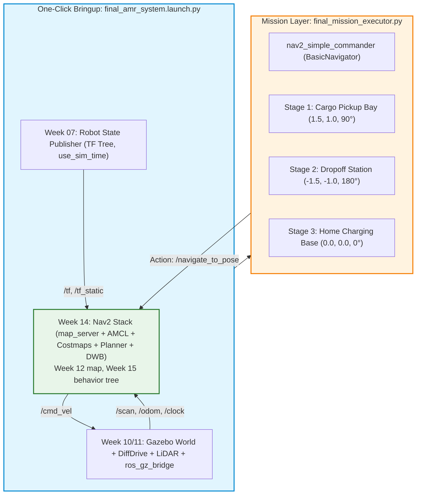

# 🏆 Week 16: การสอบปฏิบัติการปลายภาคและการนำเสนอโครงงาน (Final AMR Demonstration & Defense)
**เวลาเรียน:** บรรยายและซักถาม 2 ชั่วโมง | ปฏิบัติการและสาธิตจริง 3 ชั่วโมง  
**วิชาบังคับก่อน:** ผ่านบทเรียนและใบงานปฏิบัติการสัปดาห์ที่ 1 ถึง 15 ครบถ้วน  
**เอกสารเกณฑ์การให้คะแนน:** [เกณฑ์การประเมินผล 5 มิติ (Evaluation Rubric)](Evaluation_Rubric.md)  
**เอกสารคู่มือซ้อมปฏิบัติการ:** [คู่มือซักซ้อมการสาธิต (Rehearsal Lab Guide)](Lab_Exercises.md)

---

## 🎯 วัตถุประสงค์การวัดผล (Capstone Competency Objectives)
การสอบปฏิบัติการปลายภาคเป็นการประเมินผลแบบบูรณาการระดับสูงสุด (Capstone Integration) ของวิศวกร Autonomous Mobile Robot (AMR):
1. **End-to-End System Bringup:** บูรณาการระบบ Gazebo Sim 8 (Harmonic), Robot Description (URDF), `ros_gz_bridge`, และ Nav2 Navigation Stack ให้เปิดทำงานร่วมกันได้ด้วยคำสั่งเดียว (One-Click Bringup)
2. **Autonomous Warehouse Logistics Mission:** หุ่นยนต์ AMR ต้องปฏิบัติการรับ-ส่งสินค้าข้ามสถานีคลังสินค้าจำลองโดยอัตโนมัติ $100\%$ โดยไม่มีการบังคับด้วยมือ
3. **Dynamic Collision Avoidance & Recovery:** หลบหลีกสิ่งกีดขวางที่ไม่มีในแผนที่เดิมได้อย่างนุ่มนวล และกู้คืนสถานการณ์ได้สำเร็จเมื่อถูกขวางเส้นทาง
4. **Engineering Defense:** อธิบายหลักการทางวิศวกรรม ถอดรหัสโครงสร้างคณิตศาสตร์และสถาปัตยกรรมระบบ ตอบข้อซักถามเชิงลึก และแก้ปัญหาเฉพาะหน้าต่อหน้าคณะกรรมการ

---

## ⏱️ กำหนดการประเมินผล (Examination Schedule)
| ช่วงเวลา | กิจกรรมการประเมิน | ผู้รับผิดชอบ |
| :---: | :--- | :--- |
| **00:00 - 00:15** | สุ่มจับฉลากโจทย์พิกัดและตรวจสอบความพร้อมสภาพแวดล้อมระบบ | คณะกรรมการ / นักศึกษา |
| **00:15 - 00:45** | ปฏิบัติการเปิดระบบ One-Click Bringup และส่ง Initial Pose | นักศึกษา |
| **00:45 - 01:45** | การรันภารกิจขนส่งอัตโนมัติ 3 สถานี และการทดสอบตัดหน้ารถ (Obstacle Challenge) | นักศึกษา / กรรมการแทรกแซง |
| **01:45 - 02:45** | การสอบสัมภาษณ์ปากเปล่าเชิงสถาปัตยกรรม (Oral Engineering Defense) | กรรมการซักถามทีละคน |
| **02:45 - 03:00** | รวบรวมคะแนนและประกาศผลการประเมิน Capstone | คณะกรรมการ |

---

## 🏛️ สถาปัตยกรรมระบบแบบบูรณาการ (End-to-End System Architecture)



---

## 🛠️ การวิเคราะห์โค้ดระบบปลายภาค (Code Walkthrough)

### 1. [`launch/final_amr_system.launch.py`](launch/final_amr_system.launch.py)
ไฟล์ Launch รวมที่เปิดระบบทั้งลำของ AMR ด้วยคำสั่งเดียว (ทุกส่วนอ้างถึงแพ็กเกจของสัปดาห์ก่อนผ่าน `get_package_share_directory`):
```bash
ros2 launch amr_week16 final_amr_system.launch.py                    # Gazebo GUI
ros2 launch amr_week16 final_amr_system.launch.py headless:=true     # Docker / ไม่มีจอ
ros2 launch amr_week16 final_amr_system.launch.py rviz:=true         # + RViz2 (use_sim_time:=true)
```
- **Simulation (`amr_week11/gazebo_world.launch.py`):** โลกโกดัง (`amr_week10`), spawn หุ่นยนต์, `ros_gz_bridge` (`/cmd_vel`, `/scan`, `/odom`, `/tf`, `/joint_states`, `/clock`) และ `robot_state_publisher` ของ `amr_week07` ด้วย `use_sim_time:=true use_jsp:=false` — เวอร์ชันเดิม include `display_urdf.launch.py` ซ้ำโดยไม่มี `use_sim_time` (TF ใช้นาฬิกาจริงขัดกับเวลาจำลอง) และเปิด RViz/joint_state_publisher ซ้อนกับข้อมูลจาก Gazebo
- **Nav2 (`amr_week14/nav2_bringup.launch.py`):** map_server (แผนที่จริงของสัปดาห์ที่ 12), AMCL, controller/planner/smoother/behavior servers, velocity_smoother, collision_monitor, bt_navigator (BT ของสัปดาห์ที่ 15), waypoint_follower
- อาร์กิวเมนต์: `headless`, `rviz`, `map`, `bt_xml`

---

### 2. [`src/final_mission_executor.py`](src/final_mission_executor.py)
`ros2 run amr_week16 final_mission_executor --ros-args -p use_sim_time:=true`
- ใช้ `nav2_simple_commander.robot_navigator.BasicNavigator` (ชื่อโหนด `final_mission_executor`)
- **Stage 0:** ตั้ง Initial Pose ที่ $(0.0, 0.0, 0^\circ)$ แล้ว `waitUntilNav2Active(localizer='amcl')`
- **Stage 1–3** (ทุกจุดอยู่ในพื้นที่ว่างของแผนที่จริง ห่างสิ่งกีดขวาง > 0.55 m — ตรวจโดย `test/test_mission_unit.py`):
  1. **Cargo Pickup Bay:** $(1.5, 1.0, 90^\circ)$ Dwell 3 s
  2. **Dropoff Station:** $(-1.5, -1.0, 180^\circ)$ Dwell 2 s
  3. **Home Charging Base:** $(0.0, 0.0, 0^\circ)$ Dwell 1 s
- ทุก stage log ผล `TaskResult`, เวลาที่ใช้ (sim time) และระยะคลาดเคลื่อนสุดท้ายจาก feedback ของ Nav2; ถ้า stage ใดไม่ `SUCCEEDED` จะหยุดภารกิจ
- สรุปท้าย: `MISSION SUMMARY: n/3 stages SUCCEEDED (xx%), total ... s (sim time) -> PASS|FAIL` และ **exit code 0 เฉพาะ PASS** (เวอร์ชันเดิมใช้ `print()` และไม่เคยพิมพ์ข้อความ "SUCCEEDED: 100% PASS" ตามที่เอกสารเดิมอ้าง)
- เครื่องมือเสริม: `ros2 run amr_week16 record_path path.csv` (บันทึก TF `map → base_footprint` 5 Hz) และ `ros2 run amr_week16 plot_path path.csv out.png`

### 3. การทดสอบอัตโนมัติ
- [`test/test_mission_unit.py`](test/test_mission_unit.py): ตำแหน่งสถานีเทียบแผนที่จริง, ตรรกะ PASS/FAIL, การวาดเส้นทาง
- [`test/test_final_mission.py`](test/test_final_mission.py): เปิด `final_amr_system.launch.py headless:=true` แล้วรัน `final_mission_executor` จริง ต้องได้ `MISSION SUMMARY: 3/3 stages SUCCEEDED (100%)`, exit code 0 และตำแหน่งจริงใน Gazebo กลับมาที่ Home (< 0.45 m)

---

## 📟 ผลการรันจริง (Real Run Output)
บันทึกจากการรันจริงใน ros:lab-runner (ROS 2 Jazzy, Gazebo Sim 8.15.0) บน Linux 7.0 เมื่อ 2026-10-29
(ฉบับเต็ม: [`results/final_mission_run.txt`](results/final_mission_run.txt), เส้นทางดิบ: [`results/mission_path.csv`](results/mission_path.csv))

```console
$ ros2 launch amr_week16 final_amr_system.launch.py headless:=true   # terminal 1 (log excerpt at the end)
$ ros2 run amr_week16 final_mission_executor --ros-args -p use_sim_time:=true
[INFO] [1793247061.753251399] [final_mission_executor]: AMR-101 final mission: initial pose (0.0, 0.0, 0 deg), waiting for Nav2
[INFO] [1793247061.754060006] [final_mission_executor]: Publishing Initial Pose
[INFO] [1793247063.845859152] [final_mission_executor]: Setting initial pose
[INFO] [1793247063.846142402] [final_mission_executor]: Publishing Initial Pose
...
[INFO] [1793247070.074358076] [final_mission_executor]: Nav2 is ready for use!
[INFO] [1793247070.076549884] [final_mission_executor]: Stage 0 Localization + Nav2 bringup: ACTIVE
[INFO] [1793247070.078633782] [final_mission_executor]: Stage 1/3 -> Cargo Pickup Bay (x=1.50, y=1.00, yaw=90 deg)
[INFO] [1793247070.080643383] [final_mission_executor]: Navigating to goal: 1.5 1.0...
[INFO] [1793247078.156349910] [final_mission_executor]: Stage 1 Cargo Pickup Bay: SUCCEEDED in 10.1 s, final position error 0.23 m
[INFO] [1793247081.153855467] [final_mission_executor]: Stage 2/3 -> Dropoff Station (x=-1.50, y=-1.00, yaw=180 deg)
[INFO] [1793247081.154933043] [final_mission_executor]: Navigating to goal: -1.5 -1.0...
[INFO] [1793247095.927730181] [final_mission_executor]: Stage 2 Dropoff Station: SUCCEEDED in 14.8 s, final position error 0.23 m
[INFO] [1793247097.925684714] [final_mission_executor]: Stage 3/3 -> Home Charging Base (x=0.00, y=0.00, yaw=0 deg)
[INFO] [1793247097.926695447] [final_mission_executor]: Navigating to goal: 0.0 0.0...
[INFO] [1793247106.149652983] [final_mission_executor]: Stage 3 Home Charging Base: SUCCEEDED in 8.2 s, final position error 0.23 m
[INFO] [1793247107.152622698] [final_mission_executor]: MISSION SUMMARY: 3/3 stages SUCCEEDED (100%), total 39.0 s (sim time) -> PASS
(exit code 0)
$ ros2 run amr_week11 ground_truth_pose
diff_drive_robot ground truth: x=-0.196 y=-0.114 yaw=0.244 rad (14.0 deg)
```
ผลวัด: `lifecycle_manager_localization` และ `lifecycle_manager_navigation` รายงาน `Managed nodes are active` ที่เวลา log 1793247061.7 และ 1793247067.1 ตามลำดับ (ดูท้ายไฟล์ผลลัพธ์), executor เห็น Nav2 พร้อมที่ 1793247070.1,
ภารกิจทั้ง 3 stage `SUCCEEDED` รวม 39.0 วินาที (เวลาจำลอง รวม dwell 6 วินาที), ตำแหน่งจริงสุดท้ายใน Gazebo ห่าง Home 0.23 m
— ระยะคลาดเคลื่อน ~0.23 m ในทุก stage มาจาก `xy_goal_tolerance: 0.25` (goal checker หยุดทันทีที่เข้าเกณฑ์) ถ้าต้องการ ≤ 0.10 m ตามเกณฑ์ "ดีเยี่ยม" ใน [Evaluation Rubric](Evaluation_Rubric.md) ต้องปรับค่านี้ (ดู Challenge 14.1)


*ภาพ: เส้นทางจริงของหุ่นยนต์ (TF `map → base_footprint` จาก AMCL, 213 จุดที่ 5 Hz) บนแผนที่ SLAM ของสัปดาห์ที่ 12 บันทึกด้วย `record_path` ระหว่างการรันข้างต้นแล้ววาดด้วย `ros2 run amr_week16 plot_path results/mission_path.csv images/mission_path_real.png`*

---

## 🗣️ คลังคำถามสัมภาษณ์ปากเปล่าสำหรับการสอบป้องกัน (Oral Defense Question Bank)

คณะกรรมการจะสุ่มถามคำถามเชิงสถาปัตยกรรมครอบคลุมทั้ง 16 สัปดาห์ โดยมีแนวทางการประเมินดังนี้:

### หมวดที่ 1: เครือข่าย DDS และการสื่อสาร (Weeks 01–03)
**คำถาม 1.1:** หากในโรงงานมีหุ่นยนต์ AMR ทำงานพร้อมกัน 10 ตัวบนเครือข่าย Wi-Fi เดียวกัน จะป้องกันไม่ให้คำสั่ง `/cmd_vel` ของหุ่นยนต์ตัวที่ 1 ไปสั่งงานตัวที่ 2 ได้อย่างไร?  
<details><summary>🔍 แนวทางการตอบ</summary>
กำหนดตัวแปร <code>ROS_DOMAIN_ID</code> ให้กับหุ่นยนต์แต่ละตัวไม่ซ้ำกัน (เช่น ตัวที่ 1 ใช้ ID=1, ตัวที่ 2 ใช้ ID=2) ซึ่ง DDS จะทำการแยกพอร์ต UDP Multicast โดยอัตโนมัติตามสูตร $7400 + (250 \times \text{Domain ID})$ ร่วมกับการตั้งค่า Robot Namespace (เช่น <code>/amr_01/cmd_vel</code>)
</details>

**คำถาม 1.2:** เพราะเหตุใดการเรียก Service แบบ Synchronous (`client.call()`) ภายใน Callback ของโหนดใน <code>SingleThreadedExecutor</code> จึงทำให้เกิด Deadlock?  
<details><summary>🔍 แนวทางการตอบ</summary>
เพราะใน <code>SingleThreadedExecutor</code> มีเพียง 1 Thread เท่านั้น เมื่อ Callback ถูกเรียก Thread จะถูกจองเพื่อรอคำตอบ แต่เหตุการณ์รับ Response จาก DDS ต้องใช้ Thread เดียวกันนี้มาประมวลผล ทำให้เกิดการบล็อกซึ่งกันและกัน ทางแก้คือใช้ <code>call_async()</code> หรือใช้ <code>MultiThreadedExecutor</code> ร่วมกับ <code>ReentrantCallbackGroup</code>
</details>

---

### หมวดที่ 2: Action Protocol, Parameters และ Launch (Weeks 04–05)
**คำถาม 2.1:** เหตุใดระบบนำทาง Nav2 จึงเลือกใช้ Action แทน Service ในการสั่งให้หุ่นยนต์เคลื่อนที่ไปยังจุดหมาย?  
<details><summary>🔍 แนวทางการตอบ</summary>
เพราะการนำทางเป็นงานระยะยาว (Long-running Task) ที่ต้องทราบความคืบหน้าและระยะทางที่เหลืออยู่ตลอดเวลา (Feedback Stream) และที่สำคัญที่สุดคือ **ต้องสามารถสั่งยกเลิกภารกิจกลางคันได้ทันที (Goal Preemption / Cancellation)** หากมีสิ่งกีดขวางหรือคำสั่งฉุกเฉิน ซึ่ง Service ทั่วไปทำไม่ได้
</details>

**คำถาม 2.2:** ในการเขียน Dynamic Parameter Callback หากผู้ใช้งานป้อนค่าความเร็วเกินขีดจำกัดความปลอดภัย ระบบควรตอบสนองอย่างไร?  
<details><summary>🔍 แนวทางการตอบ</summary>
ต้องส่งคืนอ็อบเจกต์ <code>SetParametersResult</code> โดยกำหนด <code>successful = False</code> พร้อมระบุเหตุผลเตือนใน <code>reason</code> เพื่อให้โหนดปฏิเสธคำขอและคงค่าความเร็วเดิมไว้
</details>

---

### หมวดที่ 3: จลนศาสตร์และระบบพิกัด TF2 (Weeks 06, 07, 09)
**คำถาม 3.1:** ตามมาตรฐาน REP 105 เหตุใดจึงต้องแยกเฟรม <code>map</code> ออกจากเฟรม <code>odom</code>?  
<details><summary>🔍 แนวทางการตอบ</summary>
เพื่อแยกความรับผิดชอบของระบบควบคุม: เฟรม <code>odom</code> คำนวณจากตัวถอดรหัสล้อ มีความต่อเนื่องสูงมาก ไม่มีการกระโดด เหมาะกับ Local Control และการหลบสิ่งกีดขวางเฉพาะหน้า แต่มี Drift สะสม ส่วนเฟรม <code>map</code> ยึดกับสิ่งแวดล้อมโลกจริง ไม่มี Drift แต่พิกัดอาจกระโดดเมื่อระบบแก้ตำแหน่งหลงทาง
</details>

**คำถาม 3.2:** หากหุ่นยนต์ขับเคลื่อนสองล้อ (Differential Drive) ได้รับคำสั่ง $v = 0$ และ $\omega = 1.0\text{ rad/s}$ ล้อซ้ายและล้อขวาจะมีความเร็วเชิงเส้นเท่าใด?  
<details><summary>🔍 แนวทางการตอบ</summary>
ล้อทั้งสองข้างจะหมุนด้วยความเร็วเท่ากันแต่ทิศตรงกันข้าม โดยล้อขวาหมุนไปข้างหน้า $v_R = +\frac{\omega L}{2}$ และล้อซ้ายหมุนถอยหลัง $v_L = -\frac{\omega L}{2}$ ส่งผลให้หุ่นยนต์หมุนตัวอยู่กับที่
</details>

**คำถาม 3.3:** ทำไมในระบบ TF2 จึงต้องใช้ควอเทอร์เนียน (Quaternions) แทนการใช้มุมออยเลอร์ (Roll, Pitch, Yaw)?  
<details><summary>🔍 แนวทางการตอบ</summary>
เพื่อป้องกันปัญหา **Gimbal Lock** ซึ่งทำให้สูญเสีย 1 องศาอิสระเมื่อมุม Pitch เอียงแตะ $\pm 90^\circ$ และช่วยให้การทำ Slerp (Spherical Linear Interpolation) พิกัดระหว่างเสี้ยววินาทีทำได้อย่างราบรื่น
</details>

---

### หมวดที่ 4: การจำลอง Gazebo และเซนเซอร์ (Weeks 10–11)
**คำถาม 4.1:** หากค่า Real-Time Factor (RTF) ใน Gazebo ตกลงมาอยู่ที่ $0.50$ จะส่งผลกระทบอย่างไรต่อโหนดใน ROS 2 หากไม่ได้ตั้งค่า <code>use_sim_time: true</code>?  
<details><summary>🔍 แนวทางการตอบ</summary>
โหนด ROS 2 จะยึดเวลาตามนาฬิกาคอมพิวเตอร์จริง (Wall Time) ซึ่งเดินเร็วกว่าเวลาจำลองของฟิสิกส์ ทำให้เกิดปัญหาเวลาเหลื่อมล้ำอย่างรุนแรง ส่งผลให้ **TF2 แจ้งเตือน Extrapolation Error** และระบบ SLAM หรือ Costmap จะทำงานล้มเหลว
</details>

**คำถาม 4.2:** ในการแปลงระยะเลเซอร์จาก <code>sensor_msgs/msg/LaserScan</code> ช่องดัชนี $i$ มีมุมองศาสัมพัทธ์เทียบกับหัวหุ่นยนต์อย่างไร?  
<details><summary>🔍 แนวทางการตอบ</summary>
คำนวณได้จากสูตร: $\theta_i = \text{angle min} + (i \cdot \text{angle increment})$
</details>

---

### หมวดที่ 5: SLAM, Costmaps, Nav2 และ Behavior Trees (Weeks 12–15)
**คำถาม 5.1:** ใน Costmap 2D รหัสคอสต์ 253 (Inscribed Obstacle) มีความสำคัญอย่างไรในการป้องกันการชน?  
<details><summary>🔍 แนวทางการตอบ</summary>
เป็นระยะขอบเขตที่หากจุดศูนย์กลางของหุ่นยนต์ก้าวล่วงเข้าไป ขอบตัวถังด้านนอกสุดของหุ่นยนต์จะชนเข้ากับสิ่งกีดขวางพอดี อัลกอริทึม Path Planner จึงต้องห้ามไม่ให้เส้นทางลากผ่านเซลล์นี้เด็ดขาด
</details>

**คำถาม 5.2:** หากหุ่นยนต์ขับไปเจอกำแพงขวางทางกะทันหัน โครงสร้าง Behavior Tree ของ Nav2 จะมีลำดับขั้นตอนในการแก้ไขสถานการณ์อย่างไร?  
<details><summary>🔍 แนวทางการตอบ</summary>
ระบบจะเข้าสู่ <code>RecoveryNode</code> โดยลำดับแรกจะสั่งให้ Planner วางเส้นทางใหม่ หากไม่ได้ผลจะสั่งล้างข้อมูลเซนเซอร์ใน Costmap (<code>ClearEntireCostmap</code>), สั่งหมุนตัวสำรวจรอบทิศ (<code>Spin</code>), หรือสั่งถอยหลังตั้งหลัก (<code>BackUp</code>) หากยังไม่พ้นจึงจะรายงานสถานะล้มเหลว (<code>ABORTED</code>)
</details>

---

## ⌨️ ตารางคำสั่งสำหรับวันสอบจริง
```bash
# 0. build ทุกแพ็กเกจที่ใช้ (ครั้งแรกครั้งเดียว)
./docker/run_lab.sh colcon build --base-paths Essential_ROS --packages-up-to amr_week16

# 1. รันระบบรวมทุกส่วน (Terminal 1) — เพิ่ม headless:=true ถ้าไม่มีจอ, rviz:=true เพื่อเปิด RViz2
./docker/run_lab.sh ros2 launch amr_week16 final_amr_system.launch.py

# 2. เริ่มต้นภารกิจขนส่งอัตโนมัติ 3 สถานี (Terminal 2) — exit code 0 = PASS
./docker/run_lab.sh ros2 run amr_week16 final_mission_executor --ros-args -p use_sim_time:=true
```

---

## 📚 สรุปและก้าวต่อไปหลังจบหลักสูตร Essential ROS 2
ยินดีด้วยที่ท่านได้ศึกษาและปฏิบัติการจนสำเร็จครบทั้ง 16 สัปดาห์ของหลักสูตร **Essential ROS 2 Track**!  
ท่านมีความพร้อมอย่างเต็มที่ในฐานะวิศวกร Autonomous Mobile Robot (AMR) และพร้อมที่จะก้าวสู่หลักสูตรขั้นสูงใน **Advanced ROS 2 Track** (Nav2 Custom Plugins, BehaviorTree.CPP Development, Fleet Management System, ROS 2 Control Hardware Interfaces, และ Real-time Linux RT-PREEMPT)
