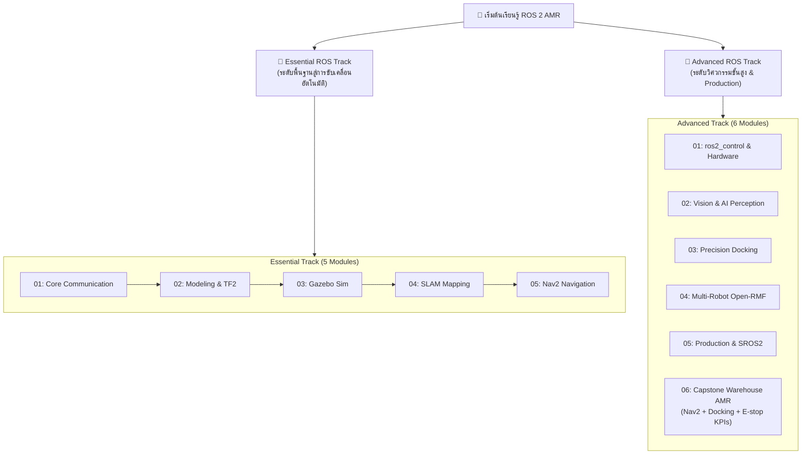

# 🤖 ROS 2 & Gazebo Sim AMR Engineering Masterclass

[](https://docs.ros.org/en/jazzy/)
[](https://gazebosim.org/)
[](docker/)
[](https://www.python.org/)
[](LICENSE)

หลักสูตรและคู่มือปฏิบัติการวิศวกรรมหุ่นยนต์เคลื่อนที่อัตโนมัติ (**Autonomous Mobile Robot - AMR**) ครบวงจร ตั้งแต่ระดับพื้นฐานจนถึงระดับอุตสาหกรรม โดยใช้มาตรฐานสากล **ROS 2 Jazzy Jalisco**, **Gazebo Sim (Harmonic)** และ **Nav2 Stack**

---

## 🛠️ คู่มือการติดตั้งและชุดเครื่องมือพัฒนา (Installation & Toolkit)
> เลือกลิงก์คู่มือฉบับเต็มด้านล่างสำหรับการติดตั้งสภาพแวดล้อมตั้งแต่เริ่มต้น:
- 📖 [**คู่มือการติดตั้ง ROS 2 อย่างละเอียด (Native, Docker, WSL2, macOS)**](docs/ros2_installation_guide.md): ขั้นตอนการติดตั้งแบบ Step-by-Step, การตั้งค่าเครือข่าย DDS, และการแก้ปัญหาพบบ่อย
- 🧰 [**คู่มือชุดเครื่องมือโปรแกรมเมอร์ (Developer Toolkit & CLI Cheat Sheet)**](docs/ros2_developer_toolkit.md): การตั้งค่า VSCode, การออกแบบ Colcon Workspace, และรวมคำสั่งลัด CLI ครบวงจร

---

## 🎯 เลือกเส้นทางการเรียนรู้ (Choose Your Track)



---

## 📘 1. Essential ROS Track
> เหมาะสำหรับผู้เริ่มต้น วิศวกร และนักวิจัยที่ต้องการสร้างแบบจำลอง ทำแผนที่ และระบบนำทางพื้นฐาน

👉 **เข้าสู่หน้าหลักของ Track:** [`Essential_ROS/README.md`](Essential_ROS/README.md) (ประกอบด้วยโฟลเดอร์บทเรียนและแล็บรายสัปดาห์ครบทั้ง 16 สัปดาห์: `Week_01` ถึง `Week_16`)

| สัปดาห์ | หัวข้อ | แพ็กเกจ | คู่มือ | ใบงานแล็บ | ผลรันจริง |
| :---: | :--- | :--- | :--- | :--- | :--- |
| **01** | **Environment & DDS Network** | `amr_week01` | [`Readme.md`](Essential_ROS/Week_01_Environment_DDS/Readme.md) | [`Lab_Exercises.md`](Essential_ROS/Week_01_Environment_DDS/Lab_Exercises.md) | [`results/`](Essential_ROS/Week_01_Environment_DDS/results/) |
| **02** | **Nodes, Topics & QoS** | `amr_week02` | [`Readme.md`](Essential_ROS/Week_02_Nodes_Topics_QoS/Readme.md) | [`Lab_Exercises.md`](Essential_ROS/Week_02_Nodes_Topics_QoS/Lab_Exercises.md) | [`results/`](Essential_ROS/Week_02_Nodes_Topics_QoS/results/) |
| **03** | **Services & Clients** | `amr_week03` | [`Readme.md`](Essential_ROS/Week_03_Services_Clients/Readme.md) | [`Lab_Exercises.md`](Essential_ROS/Week_03_Services_Clients/Lab_Exercises.md) | [`results/`](Essential_ROS/Week_03_Services_Clients/results/) |
| **04** | **Actions, Cancel & Preemption** | `amr_week04` | [`Readme.md`](Essential_ROS/Week_04_Actions_Preemption/Readme.md) | [`Lab_Exercises.md`](Essential_ROS/Week_04_Actions_Preemption/Lab_Exercises.md) | [`results/`](Essential_ROS/Week_04_Actions_Preemption/results/) |
| **05** | **Parameters & Launch** | `amr_week05` | [`Readme.md`](Essential_ROS/Week_05_Parameters_Launch/Readme.md) | [`Lab_Exercises.md`](Essential_ROS/Week_05_Parameters_Launch/Lab_Exercises.md) | [`results/`](Essential_ROS/Week_05_Parameters_Launch/results/) |
| **06** | **Kinematics & REP Standards** | `amr_week06` | [`Readme.md`](Essential_ROS/Week_06_Kinematics_REP_Standards/Readme.md) | [`Lab_Exercises.md`](Essential_ROS/Week_06_Kinematics_REP_Standards/Lab_Exercises.md) | [`results/`](Essential_ROS/Week_06_Kinematics_REP_Standards/results/) |
| **07** | **URDF Robot Modeling** | `amr_week07` | [`Readme.md`](Essential_ROS/Week_07_URDF_Robot_Modeling/Readme.md) | [`Lab_Exercises.md`](Essential_ROS/Week_07_URDF_Robot_Modeling/Lab_Exercises.md) | [`results/`](Essential_ROS/Week_07_URDF_Robot_Modeling/results/) |
| **08** | **🔴 Midterm Practical Exam (+ autograder)** | `amr_week08` | [`Readme.md`](Essential_ROS/Week_08_Midterm_Practical_Exam/Readme.md) | [`Exam_Task.md`](Essential_ROS/Week_08_Midterm_Practical_Exam/Exam_Task.md) | [`results/`](Essential_ROS/Week_08_Midterm_Practical_Exam/results/) |
| **09** | **TF2 Coordinate Transforms** | `amr_week09` | [`Readme.md`](Essential_ROS/Week_09_TF2_Coordinate_Transforms/Readme.md) | [`Lab_Exercises.md`](Essential_ROS/Week_09_TF2_Coordinate_Transforms/Lab_Exercises.md) | [`results/`](Essential_ROS/Week_09_TF2_Coordinate_Transforms/results/) |
| **10** | **Gazebo Sim World (SDF)** | `amr_week10` | [`Readme.md`](Essential_ROS/Week_10_Gazebo_Sim_Harmonic/Readme.md) | [`Lab_Exercises.md`](Essential_ROS/Week_10_Gazebo_Sim_Harmonic/Lab_Exercises.md) | [`results/`](Essential_ROS/Week_10_Gazebo_Sim_Harmonic/results/) |
| **11** | **Actuators, Sensors & Bridge** | `amr_week11` | [`Readme.md`](Essential_ROS/Week_11_Actuators_Sensors_Bridge/Readme.md) | [`Lab_Exercises.md`](Essential_ROS/Week_11_Actuators_Sensors_Bridge/Lab_Exercises.md) | [`results/`](Essential_ROS/Week_11_Actuators_Sensors_Bridge/results/) |
| **12** | **SLAM Mapping** | `amr_week12` | [`Readme.md`](Essential_ROS/Week_12_SLAM_Mapping_Ceres/Readme.md) | [`Lab_Exercises.md`](Essential_ROS/Week_12_SLAM_Mapping_Ceres/Lab_Exercises.md) | [`results/`](Essential_ROS/Week_12_SLAM_Mapping_Ceres/results/) |
| **13** | **Nav2 Costmaps & Layers** | `amr_week13` | [`Readme.md`](Essential_ROS/Week_13_Nav2_Costmaps_Layers/Readme.md) | [`Lab_Exercises.md`](Essential_ROS/Week_13_Nav2_Costmaps_Layers/Lab_Exercises.md) | [`results/`](Essential_ROS/Week_13_Nav2_Costmaps_Layers/results/) |
| **14** | **Path Planning & AMCL** | `amr_week14` | [`Readme.md`](Essential_ROS/Week_14_Path_Planning_AMCL/Readme.md) | [`Lab_Exercises.md`](Essential_ROS/Week_14_Path_Planning_AMCL/Lab_Exercises.md) | [`results/`](Essential_ROS/Week_14_Path_Planning_AMCL/results/) |
| **15** | **Waypoint Patrol & Behavior Tree** | `amr_week15` | [`Readme.md`](Essential_ROS/Week_15_Waypoint_Patrol_BT/Readme.md) | [`Lab_Exercises.md`](Essential_ROS/Week_15_Waypoint_Patrol_BT/Lab_Exercises.md) | [`results/`](Essential_ROS/Week_15_Waypoint_Patrol_BT/results/) |
| **16** | **🏆 Final Demonstration** | `amr_week16` | [`Readme.md`](Essential_ROS/Week_16_Final_Demonstration/Readme.md) | [`Lab_Exercises.md`](Essential_ROS/Week_16_Final_Demonstration/Lab_Exercises.md) | [`results/`](Essential_ROS/Week_16_Final_Demonstration/results/) |

> โฟลเดอร์ `Essential_ROS/01_…05_` เป็นโมดูลรุ่นเก่า ปัจจุบันเป็นเพียงหน้าชี้ทาง (redirect) ไปยังสัปดาห์ที่เกี่ยวข้อง


---

## 🚀 2. Advanced ROS Track
> มุ่งเน้นการใช้งานในอุตสาหกรรมจริง (Production-Ready) การควบคุมมอเตอร์ การมองเห็นด้วย AI และระบบฝูงหุ่นยนต์

👉 **เข้าสู่หน้าหลักของ Track:** [`Advanced_ROS/README.md`](Advanced_ROS/README.md)

| โมดูล (แพ็กเกจ) | หัวข้อการเรียนรู้ | เอกสารคู่มือ | ใบงานแล็บ | โค้ดตัวอย่างสำคัญ |
| :---: | :--- | :--- | :--- | :--- |
| **01**<br>`amr_adv01` | **`ros2_control` & Hardware** | [`README.md`](Advanced_ROS/01_ros2_control_Hardware/README.md) | [`Lab_Exercises.md`](Advanced_ROS/01_ros2_control_Hardware/Lab_Exercises.md) | [`diff_drive_controller.yaml`](Advanced_ROS/01_ros2_control_Hardware/config/diff_drive_controller.yaml) |
| **02**<br>`amr_adv02` | **Vision & AI Perception** | [`README.md`](Advanced_ROS/02_Vision_AI_Perception/README.md) | [`Lab_Exercises.md`](Advanced_ROS/02_Vision_AI_Perception/Lab_Exercises.md) | [`object_detector_node.py`](Advanced_ROS/02_Vision_AI_Perception/src/object_detector_node.py) |
| **03**<br>`amr_adv03` | **Nav2 Precision Docking** | [`README.md`](Advanced_ROS/03_Nav2_Precision_Docking/README.md) | [`Lab_Exercises.md`](Advanced_ROS/03_Nav2_Precision_Docking/Lab_Exercises.md) | [`dock_and_charge_bt.xml`](Advanced_ROS/03_Nav2_Precision_Docking/behavior_trees/dock_and_charge_bt.xml) |
| **04**<br>`amr_adv04` | **Multi-Robot Fleet & Open-RMF** | [`README.md`](Advanced_ROS/04_Multi_Robot_Fleet_OpenRMF/README.md) | [`Lab_Exercises.md`](Advanced_ROS/04_Multi_Robot_Fleet_OpenRMF/Lab_Exercises.md) | [`multi_robot_fleet.launch.py`](Advanced_ROS/04_Multi_Robot_Fleet_OpenRMF/launch/multi_robot_fleet.launch.py) |
| **05**<br>`amr_adv05` | **Production, CI/CD & Security** | [`README.md`](Advanced_ROS/05_Production_CI_CD_Security/README.md) | [`Lab_Exercises.md`](Advanced_ROS/05_Production_CI_CD_Security/Lab_Exercises.md) | [`lifecycle_laser_sensor.py`](Advanced_ROS/05_Production_CI_CD_Security/src/lifecycle_laser_sensor.py) |
| **06**<br>`amr_adv06` | **Capstone AMR Project** | [`Readme.md`](Advanced_ROS/06_Capstone_Project/Readme.md) | [`Lab_Exercises.md`](Advanced_ROS/06_Capstone_Project/Lab_Exercises.md) | [`full_warehouse_system.launch.py`](Advanced_ROS/06_Capstone_Project/launch/full_warehouse_system.launch.py) |

---

## ⚡ Quick Start: รันสภาพแวดล้อมด้วย Docker

ทุกแล็บรันผ่าน Docker Image `ros:lab-runner` ([`docker/Dockerfile`](docker/Dockerfile): ROS 2 **Jazzy**, Gazebo Sim **Harmonic 8.15**,
Nav2, SLAM Toolbox, ros2_control, opennav_docking, Open-RMF fleet adapter, rmw_zenoh, launch_testing) เครื่องที่เป็น
Ubuntu 26.04 ไม่มีแพ็กเกจ Jazzy ให้ติดตั้งตรง ๆ จึงต้องใช้วิธีนี้ (ดู[คู่มือติดตั้ง](docs/ros2_installation_guide.md))

แต่ละโฟลเดอร์แล็บเป็น ROS 2 package (`amr_week01`…`amr_week16`, `amr_adv01`…`amr_adv06`) จึง build/test ได้ด้วย colcon:

```bash
git clone https://github.com/alfaXphoori/ros2.git && cd ros2
make image                 # build ros:lab-runner (ครั้งแรกเท่านั้น)
make build                 # colcon build ทุกแพ็กเกจ
make test                  # colcon test ทุกแพ็กเกจ (รันทีละแพ็กเกจ, headless, ไม่ต้องใช้ GPU)
make test PKG=amr_week14   # เฉพาะแพ็กเกจเดียว
make lint                  # yamllint / xmllint / check_urdf / ตรวจลิงก์ markdown
make check                 # lint + test ทั้งหมด: รันบนเครื่องก่อน push ทุกครั้ง (repo นี้ไม่ใช้ GitHub CI, ~11 นาที)

# ตัวอย่างการรันแล็บ (headless:=true เมื่อไม่มีจอ; เปิด GUI ได้เมื่อตั้ง DISPLAY + xhost +local:)
./docker/run_lab.sh ros2 launch amr_week05 core_system.launch.py robot_ns:=amr_01
./docker/run_lab.sh ros2 launch amr_week11 gazebo_world.launch.py headless:=true
./docker/run_lab.sh ros2 launch amr_week12 slam_mapping_sim.launch.py headless:=true explore:=true
./docker/run_lab.sh ros2 launch amr_week16 final_amr_system.launch.py headless:=true
./docker/run_lab.sh ros2 launch amr_adv01 mock_diff_drive.launch.py
./docker/run_lab.sh ros2 launch amr_adv03 docking_sim.launch.py
./docker/run_lab.sh ros2 launch amr_adv06 full_warehouse_system.launch.py headless:=true
```

### 📟 ผลการรันจริง (Real Run Output)
ทุกสัปดาห์/โมดูลมีหัวข้อ **ผลการรันจริง** ใน Readme และไฟล์ log ดิบในโฟลเดอร์ `results/` ซึ่งบันทึกจากการรันจริงใน
`ros:lab-runner` บนโฮสต์ Ubuntu 26.04 / Linux 7.0 (2026-10-29) ภาพทุกภาพสร้างจากข้อมูลจริง (แผนที่ SLAM, costmap,
เส้นทางหุ่นยนต์, TF tree, เฟรมกล้อง) ตัวอย่างตัวเลขที่วัดได้:

| แล็บ | ผลที่วัดได้จริง |
| :--- | :--- |
| W07 Odometry ใน Gazebo | หมุน 169.7° (odom) เทียบกับ 169.7° (ground truth) หลังแก้ฟิสิกส์ล้อ (ก่อนแก้ 165.8° vs 142.1°) |
| W12 SLAM | แผนที่ 200×199 cells @ 0.05 m, ผนัง/เสาจริงปรากฏในแผนที่ 89.4% |
| W14 Nav2 | NavigateToPose สำเร็จใน 14.2 s, ปลายทางคลาด 0.125 m / 14.3° จาก ground truth |
| W15 Patrol | 5/5 สถานี SUCCEEDED ใน 111.6 s (sim time) |
| Adv 01 ros2_control | ล้อขวา 7.75 rad/s ที่ v=0.5, ω=1.0 ตรงกับ IK |
| Adv 02 AprilTag | ความคลาดเคลื่อนตำแหน่ง 0.99 mm / 0.23° ที่ระยะ 0.8 m |
| Adv 03 Docking | คลาด 11.4–14.5 mm เมื่อใช้กล้อง (48.9 mm เมื่อปิดกล้อง) |
| Adv 06 Capstone | 5/5 รอบผ่านครบ 7/7 ขั้น (pick → drop → dock → undock → e-stop → home), docking คลาด 2.2–4.5 mm / 0.99–1.79°, e-stop 48–104 ms (sim) เหลือระยะกันชน 5.6–7.4 cm |

> ภาพหน้าจอ "terminal" ชุดเดิมของ repo (ก่อน 2026-10-29) ถูกวาดจากข้อความที่เขียนขึ้นเอง ไม่ใช่ผลการรัน จึงถูกลบออกทั้งหมด
> และแทนที่ด้วยผลรันจริงข้างต้น

---

## 🎓 แผนการสอนระดับมหาวิทยาลัย / องค์กร (Academic Courses: 2x16 Weeks)
สำหรับสถาบันการศึกษา หรือการจัดอบรมในองค์กร หลักสูตรได้รับการออกแบบเป็น **2 รายวิชาอิสระ (ชุดละ 16 สัปดาห์ ครบ 1 ภาคการศึกษา)**:

1. 📘 **วิชาชุดที่ 1:** [`course_syllabus_01_essential_ros2.md`](course_syllabus_01_essential_ros2.md)  
   **AMR-101: Essential ROS 2 for Autonomous Mobile Robots (16 สัปดาห์)**  
   *เน้นพื้นฐานวิศวกรรม, DDS, Topics/Services/Actions, URDF, TF2, Gazebo Sim, SLAM Toolbox และ Nav2 Stack*  
   👉 [**อ่านคู่มือเนื้อหาบรรยายและขั้นตอนแล็บละเอียด 16 สัปดาห์**](Essential_ROS/docs/weekly_lectures_and_labs.md)

2. 🚀 **วิชาชุดที่ 2:** [`course_syllabus_02_advanced_ros2.md`](course_syllabus_02_advanced_ros2.md)  
   **AMR-201: Advanced ROS 2 & Industrial Fleet Robotics (16 สัปดาห์)**  
   *เน้นการคุมฮาร์ดแวร์จริงด้วย `ros2_control`, micro-ROS, การมองเห็นด้วย AI (YOLO/AprilTag), Nav2 Docking Server, ระบบฝูงหุ่นยนต์ Open-RMF, Lifecycle Nodes, SROS 2 และ CI/CD*  
   👉 [**อ่านคู่มือเนื้อหาบรรยายและขั้นตอนแล็บละเอียด 16 สัปดาห์**](Advanced_ROS/docs/weekly_lectures_and_labs.md)

