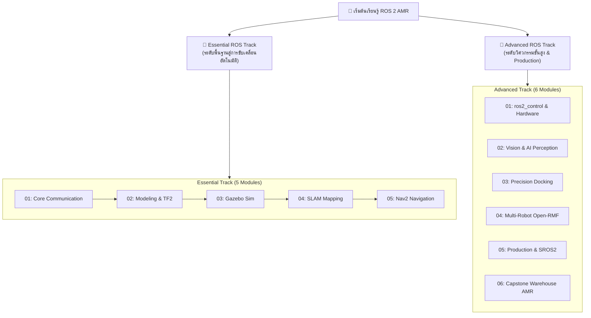

# 🤖 ROS 2 & Gazebo Sim AMR Engineering Masterclass

[](https://docs.ros.org/en/jazzy/)
[](https://gazebosim.org/)
[](docker/)
[](https://www.python.org/)
[](LICENSE)

หลักสูตรและคู่มือปฏิบัติการวิศวกรรมหุ่นยนต์เคลื่อนที่อัตโนมัติ (**Autonomous Mobile Robot - AMR**) ครบวงจร ตั้งแต่ระดับพื้นฐานจนถึงระดับอุตสาหกรรม โดยใช้มาตรฐานสากล **ROS 2 Jazzy Jalisco**, **Gazebo Sim (Harmonic)** และ **Nav2 Stack**

---

## 🎯 เลือกเส้นทางการเรียนรู้ (Choose Your Track)



---

## 📘 1. Essential ROS Track
> เหมาะสำหรับผู้เริ่มต้น วิศวกร และนักวิจัยที่ต้องการสร้างแบบจำลอง ทำแผนที่ และระบบนำทางพื้นฐาน

👉 **เข้าสู่หน้าหลักของ Track:** [`Essential_ROS/README.md`](Essential_ROS/README.md) (ประกอบด้วยโฟลเดอร์บทเรียนและแล็บรายสัปดาห์ครบทั้ง 16 สัปดาห์: `Week_01` ถึง `Week_16`)

| โมดูลหลัก | หัวข้อการเรียนรู้ | เอกสารคู่มือ | ใบงานแล็บ |
| :--- | :--- | :--- | :--- |
| **01** | **Core Communication** (W1-W5) | [`01_Core_Communication/Readme.md`](Essential_ROS/01_Core_Communication/Readme.md) | [`Lab_Exercises.md`](Essential_ROS/01_Core_Communication/Lab_Exercises.md) |
| **02** | **Robot Modeling & TF2** (W6-W9) | [`02_Robot_Modeling_TF2/Readme.md`](Essential_ROS/02_Robot_Modeling_TF2/Readme.md) | [`Lab_Exercises.md`](Essential_ROS/02_Robot_Modeling_TF2/Lab_Exercises.md) |
| **03** | **Gazebo Simulation** (W10-W11) | [`03_Gazebo_Simulation/Readme.md`](Essential_ROS/03_Gazebo_Simulation/Readme.md) | [`Lab_Exercises.md`](Essential_ROS/03_Gazebo_Simulation/Lab_Exercises.md) |
| **04** | **SLAM Mapping** (W12) | [`04_SLAM_Mapping/Readme.md`](Essential_ROS/04_SLAM_Mapping/Readme.md) | [`Lab_Exercises.md`](Essential_ROS/04_SLAM_Mapping/Lab_Exercises.md) |
| **05** | **Nav2 Navigation** (W13-W16) | [`05_Nav2_Navigation/Readme.md`](Essential_ROS/05_Nav2_Navigation/Readme.md) | [`Lab_Exercises.md`](Essential_ROS/05_Nav2_Navigation/Lab_Exercises.md) |
| **W01-16** | **16-Week Dedicated Labs** | [**ตารางครบ 16 สัปดาห์**](Essential_ROS/README.md#🗺️-ตารางบทเรียนและแล็บปฏิบัติการครบ-16-สัปดาห์-weeks-01---16) | [**คู่มือปฏิบัติการละเอียด**](Essential_ROS/docs/weekly_lectures_and_labs.md) |

---

## 🚀 2. Advanced ROS Track
> มุ่งเน้นการใช้งานในอุตสาหกรรมจริง (Production-Ready) การควบคุมมอเตอร์ การมองเห็นด้วย AI และระบบฝูงหุ่นยนต์

👉 **เข้าสู่หน้าหลักของ Track:** [`Advanced_ROS/README.md`](Advanced_ROS/README.md)

| โมดูล | หัวข้อการเรียนรู้ | เอกสารคู่มือและโค้ดตัวอย่าง |
| :--- | :--- | :--- |
| **01** | **`ros2_control` & Hardware** | [`01_ros2_control_Hardware/README.md`](Advanced_ROS/01_ros2_control_Hardware/README.md) <br> • [`diff_drive_controller.yaml`](Advanced_ROS/01_ros2_control_Hardware/config/diff_drive_controller.yaml) <br> • [`diff_drive_ros2_control.xacro`](Advanced_ROS/01_ros2_control_Hardware/urdf/diff_drive_ros2_control.xacro) |
| **02** | **Vision & AI Perception** | [`02_Vision_AI_Perception/README.md`](Advanced_ROS/02_Vision_AI_Perception/README.md) <br> • [`cv_bridge_yolo_node.py`](Advanced_ROS/02_Vision_AI_Perception/src/cv_bridge_yolo_node.py) <br> • [`apriltag_dock_tracker.py`](Advanced_ROS/02_Vision_AI_Perception/src/apriltag_dock_tracker.py) |
| **03** | **Nav2 Precision Docking** | [`03_Nav2_Precision_Docking/README.md`](Advanced_ROS/03_Nav2_Precision_Docking/README.md) <br> • [`docking_server_params.yaml`](Advanced_ROS/03_Nav2_Precision_Docking/config/docking_server_params.yaml) <br> • [`dock_and_charge_bt.xml`](Advanced_ROS/03_Nav2_Precision_Docking/behavior_trees/dock_and_charge_bt.xml) |
| **04** | **Multi-Robot Fleet & Open-RMF** | [`04_Multi_Robot_Fleet_OpenRMF/README.md`](Advanced_ROS/04_Multi_Robot_Fleet_OpenRMF/README.md) <br> • [`fleet_adapter_config.yaml`](Advanced_ROS/04_Multi_Robot_Fleet_OpenRMF/config/fleet_adapter_config.yaml) <br> • [`multi_robot_fleet.launch.py`](Advanced_ROS/04_Multi_Robot_Fleet_OpenRMF/launch/multi_robot_fleet.launch.py) |
| **05** | **Production, CI/CD & Security** | [`05_Production_CI_CD_Security/README.md`](Advanced_ROS/05_Production_CI_CD_Security/README.md) <br> • [`lifecycle_laser_sensor.py`](Advanced_ROS/05_Production_CI_CD_Security/src/lifecycle_laser_sensor.py) <br> • [`test_amr_launch.py`](Advanced_ROS/05_Production_CI_CD_Security/tests/test_amr_launch.py) |
| **06** | **Capstone AMR Project** | [`06_Capstone_Project/Readme.md`](Advanced_ROS/06_Capstone_Project/Readme.md) <br> • [`full_warehouse_system.launch.py`](Advanced_ROS/06_Capstone_Project/launch/full_warehouse_system.launch.py) <br> • [`rubrics.md`](Advanced_ROS/06_Capstone_Project/rubrics.md) |

---

## ⚡ Quick Start: รันสภาพแวดล้อมด้วย Docker

ทุกโมดูลได้รับการตั้งค่าให้รันผ่าน Docker Image `ros:lab-runner` ที่ติดตั้ง **ROS 2 Jazzy**, **Gazebo Harmonic**, **Nav2**, **SLAM Toolbox** และเครื่องมือจำเป็นทั้งหมด

```bash
cd /mnt/sda/ros

# 1. รัน Core Communication Launch
./docker/run_lab.sh ros2 launch Essential_ROS/01_Core_Communication/launch/core_system.launch.py

# 2. ตรวจสอบ URDF Model และเปิดดูใน RViz2
./docker/run_lab.sh check_urdf Essential_ROS/02_Robot_Modeling_TF2/urdf/diff_drive_robot.urdf

# 3. เปิด Gazebo Sim โกดังสินค้า 3D
./docker/run_lab.sh ros2 launch Essential_ROS/03_Gazebo_Simulation/launch/gazebo_world.launch.py

# 4. ทำแผนที่ด้วย SLAM Toolbox
./docker/run_lab.sh ros2 launch Essential_ROS/04_SLAM_Mapping/launch/online_async_slam.launch.py

# 5. รันระบบนำทาง Nav2 Stack เต็มรูปแบบ
./docker/run_lab.sh ros2 launch Essential_ROS/05_Nav2_Navigation/launch/nav2_bringup.launch.py

# 6. รัน Capstone Warehouse Full System (Gazebo + Nav2)
./docker/run_lab.sh ros2 launch Advanced_ROS/06_Capstone_Project/launch/full_warehouse_system.launch.py
```

---

## 🎓 แผนการสอนระดับมหาวิทยาลัย / องค์กร (Academic Courses: 2x16 Weeks)
สำหรับสถาบันการศึกษา หรือการจัดอบรมในองค์กร หลักสูตรได้รับการออกแบบเป็น **2 รายวิชาอิสระ (ชุดละ 16 สัปดาห์ ครบ 1 ภาคการศึกษา)**:

1. 📘 **วิชาชุดที่ 1:** [`course_syllabus_01_essential_ros2.md`](course_syllabus_01_essential_ros2.md)  
   **AMR-101: Essential ROS 2 for Autonomous Mobile Robots (16 สัปดาห์)**  
   *เน้นพื้นฐานวิศวกรรม, DDS, Topics/Services/Actions, URDF, TF2, Gazebo Sim, SLAM Toolbox และ Nav2 Stack*  
   👉 [**อ่านคู่มือเนื้อหาบรรยายและขั้นตอนแล็บละเอียด 16 สัปดาห์**](Essential_ROS/docs/weekly_lectures_and_labs.md)

2. 🚀 **วิชาชุดที่ 2:** [`course_syllabus_02_advanced_ros2.md`](course_syllabus_02_advanced_ros2.md)  
   **AMR-201: Advanced ROS 2 & Industrial Fleet Robotics (16 สัปดาห์)**  
   *เน้นการคุมฮาร์ดแวร์จริงด้วย `ros2_control`, micro-ROS, การมองเห็นด้วย AI (YOLO/AprilTag), Nav2 Docking Server, ระบบฝูงหุ่นยนต์ Open-RMF, Lifecycle Nodes, SROS 2 และ CI/CD*  
   👉 [**อ่านคู่มือเนื้อหาบรรยายและขั้นตอนแล็บละเอียด 16 สัปดาห์**](Advanced_ROS/docs/weekly_lectures_and_labs.md)

