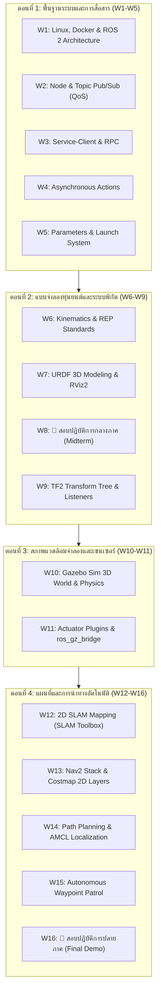

# 🎓 แผนการสอนรายวิชา: Essential ROS 2 for Autonomous Mobile Robots
**รหัสวิชา:** AMR-101 (3 หน่วยกิต: บรรยาย 2 ชม. / ปฏิบัติการ 3 ชม. / ศึกษาด้วยตนเอง 4 ชม. ต่อสัปดาห์)  
**ระดับการศึกษา:** ปริญญาตรี (Undergraduate) / ผู้เริ่มต้นสู่ระดับกลาง (Beginner to Intermediate)  
**ระยะเวลาเรียน:** 16 สัปดาห์ (1 ภาคการศึกษา)  
**มาตรฐานซอฟต์แวร์:** ROS 2 Jazzy Jalisco (LTS) | Gazebo Sim 8.15 (Harmonic) | Ubuntu 24.04 LTS / Docker  

> 📖 **คู่มือเนื้อหาบรรยายและขั้นตอนแล็บฉบับเต็ม:** ดูรายละเอียดทฤษฎี โค้ดแล็บ และคำสั่งรันทุกสัปดาห์ได้ที่ [`Essential_ROS/docs/weekly_lectures_and_labs.md`](Essential_ROS/docs/weekly_lectures_and_labs.md)

---

## 🎯 คำอธิบายรายวิชา (Course Description)
ศึกษาและปฏิบัติการเกี่ยวกับสถาปัตยกรรมระบบปฏิบัติการหุ่นยนต์ (ROS 2), เครือข่ายการสื่อสารแบบกระจายศูนย์ผ่านโปรโตคอล DDS, กลไกการสื่อสารพื้นฐาน (Topics, Services, Actions, Dynamic Parameters, Launch Systems), มาตรฐานพิกัดและจลนศาสตร์ของหุ่นยนต์เคลื่อนที่ (REP 103, REP 105, Differential Drive), การสร้างแบบจำลอง 3 มิติ (URDF, Xacro, Robot State Publisher), การจัดการระบบพิกัดสัมพัทธ์ (TF2 Transform System), การจำลองสภาพแวดล้อมเสมือนจริงด้วย Gazebo Sim (Harmonic), การเชื่อมโยงข้อมูลเซนเซอร์ (LiDAR, Encoders, IMU), การสร้างแผนที่ 2 มิติด้วยเทคนิค SLAM Toolbox และการพัฒนาระบบนำทางอัตโนมัติด้วย Nav2 Stack

---

## 📊 แผนการประเมินผลการเรียนรู้ (Grading & Assessment)
| หมวดหมู่การประเมิน | สัดส่วนคะแนน | รายละเอียด |
| :--- | :---: | :--- |
| **1. Weekly Hands-on Labs** | 30% | ใบงานปฏิบัติการสัปดาห์ละ 1 แล็บ (ประเมินความถูกต้องของโค้ดและผลการรัน) |
| **2. Midterm Practical Exam** | 20% | สอบปฏิบัติการกลางภาค (สัปดาห์ที่ 8): สร้างโมเดล URDF และระบบ Core ROS 2 |
| **3. Mini-Projects (Mapping & Nav2)** | 20% | การบ้านการสร้างแผนที่ SLAM และปรับจูนพารามิเตอร์ Nav2 Costmaps |
| **4. Final Autonomous AMR Demo** | 20% | สอบปฏิบัติการปลายภาค (สัปดาห์ที่ 16): จำลองหุ่นยนต์วิ่งลาดตระเวนใน Gazebo |
| **5. Class Participation & Code Quality** | 10% | การเข้าเรียน, มารยาทการเขียนโค้ด (PEP8 / Clean Code), Git Workflow |

---

## 📅 ตารางแผนการสอนรายสัปดาห์ (16-Week Course Schedule)

---

### สัปดาห์ที่ 1: สถาปัตยกรรม ROS 2, ระบบ Linux และเครือข่าย DDS
- **บรรยาย (2 ชม.):**
  - วิวัฒนาการจาก ROS 1 Master สู่สถาปัตยกรรมกระจายศูนย์ของ ROS 2
  - Data Distribution Service (DDS), FastDDS, CycloneDDS, `ROS_DOMAIN_ID`
  - โครงสร้าง Workspaces (`src/`, `build/`, `install/`) และ Colcon Build System
- **ปฏิบัติการ (3 ชม.):**
  - ติดตั้งและรันแล็บผ่าน Docker Container [`docker/run_lab.sh`](docker/run_lab.sh)
  - ทดสอบเครื่องมือ `ros2 doctor`, `ros2 multicast receive/send`
- **การบ้าน/แบบฝึกหัด:** ทดสอบการแบ่งกลุ่มเครือข่ายหุ่นยนต์ด้วย `ROS_DOMAIN_ID`

---

### สัปดาห์ที่ 2: โครงสร้างโหนด และการสื่อสารผ่าน Topic พร้อมกำหนด QoS
- **บรรยาย (2 ชม.):**
  - โครงสร้างคลาส `rclpy.node.Node`, Object-Oriented Architecture
  - Publish-Subscribe Pattern, การเลือกประเภทข้อความ (`std_msgs`, `sensor_msgs`)
  - นโยบาย Quality of Service (QoS): Reliability (`BEST_EFFORT` vs `RELIABLE`), Durability (`TRANSIENT_LOCAL` vs `VOLATILE`)
- **ปฏิบัติการ (3 ชม.):**
  - เขียนและรัน [`sensor_qos_publisher.py`](Essential_ROS/01_Core_Communication/src/sensor_qos_publisher.py)
  - เขียนและรัน [`sensor_qos_subscriber.py`](Essential_ROS/01_Core_Communication/src/sensor_qos_subscriber.py)
  - ดีบั๊กข้อความผ่าน CLI (`ros2 topic echo`, `ros2 topic hz`, `rqt_graph`)
- **การบ้าน/แบบฝึกหัด:** ออกแบบ QoS สำหรับข้อมูล IMU 100 Hz และข้อมูล Battery State

---

### สัปดาห์ที่ 3: ระบบ Service-Client สำหรับคำสั่งแบบ Request-Response
- **บรรยาย (2 ชม.):**
  - Synchronous vs Asynchronous Communication, เมื่อไหร่ควรใช้ Service
  - โครงสร้างไฟล์ `.srv`, การป้องกัน Service Deadlock ด้วย Multi-threaded Executor
- **ปฏิบัติการ (3 ชม.):**
  - สร้างโหนด Service Server สลับโหมดประหยัดพลังงาน [`power_service_server.py`](Essential_ROS/01_Core_Communication/src/power_service_server.py)
  - ทดสอบเรียก Service ผ่าน CLI `ros2 service call /robot/set_power_mode std_srvs/srv/SetBool "{data: true}"`
- **การบ้าน/แบบฝึกหัด:** สร้าง Custom Service สำหรับรีเซ็ตระยะทางสะสมของหุ่นยนต์

---

### สัปดาห์ที่ 4: ระบบ Action สำหรับงานระยะยาวและการยกเลิกภารกิจ
- **บรรยาย (2 ชม.):**
  - โครงสร้าง Action Protocol (3 Services + 2 Topics เบื้องหลัง)
  - วงจรชีวิตของ Action Goal: Goal Request -> Accept/Reject -> Feedback -> Result / Cancel
- **ปฏิบัติการ (3 ชม.):**
  - รันโหนด Action Server [`navigate_action_server.py`](Essential_ROS/01_Core_Communication/src/navigate_action_server.py)
  - สั่งการ Action ผ่าน CLI พร้อมรับ Feedback แบบเรียลไทม์ และทดลองส่งคำสั่ง Cancel กลางคัน
- **การบ้าน/แบบฝึกหัด:** เพิ่มขีดจำกัดความเร็วใน Action Server หากอุณหภูมิสูงเกินกำหนด

---

### สัปดาห์ที่ 5: การจัดการพารามิเตอร์แบบพลวัต และระบบ Python Launch
- **บรรยาย (2 ชม.):**
  - Parameter Server ใน ROS 2, `add_on_set_parameters_callback`
  - สถาปัตยกรรม Python Launch System: `DeclareLaunchArgument`, `Node`, Grouping, Namespaces
- **ปฏิบัติการ (3 ชม.):**
  - รันโหนดตรวจสอบ Parameter แบบไดนามิก [`fleet_parameters.py`](Essential_ROS/01_Core_Communication/src/fleet_parameters.py)
  - รวมโหนดทั้งหมดเป็นระบบเดียวผ่าน [`core_system.launch.py`](Essential_ROS/01_Core_Communication/launch/core_system.launch.py)
- **การบ้าน/แบบฝึกหัด:** สร้างไฟล์ YAML กำหนด Parameter สำหรับหุ่นยนต์ 2 ขนาด (Small / Large)

---

### สัปดาห์ที่ 6: มาตรฐานวิศวกรรมพิกัดและจลนศาสตร์หุ่นยนต์เคลื่อนที่
- **บรรยาย (2 ชม.):**
  - **REP 103:** พิกัดมือขวา (X-หน้า, Y-ซ้าย, Z-บน), มุม Euler และเรเดียน
  - **REP 105:** ลำดับพิกัดหุ่นยนต์เคลื่อนที่ (`earth` -> `map` -> `odom` -> `base_footprint` -> `base_link`)
  - จลนศาสตร์ Differential Drive (Forward & Inverse Kinematics), Dead Reckoning Odometry
- **ปฏิบัติการ (3 ชม.):**
  - เขียนสคริปต์คำนวณ Odometry จากข้อมูลจำลอง Wheel Encoders
  - วิเคราะห์สาเหตุของ Odometry Drift (Wheel Slip, Backlash)
- **การบ้าน/แบบฝึกหัด:** คำนวณความเร็วล้อซ้ายและขวาเมื่อหุ่นยนต์เคลื่อนที่เป็นวงกลมรัศมี 1.5 เมตร

---

### สัปดาห์ที่ 7: การสร้างแบบจำลองหุ่นยนต์ 3 มิติ (URDF & RViz2)
- **บรรยาย (2 ชม.):**
  - โครงสร้าง Unified Robot Description Format (URDF)
  - ชนิดของ Joint (`fixed`, `continuous`, `revolute`), การกำหนด Origin และ Axis
  - การคำนวณและกำหนด Moment of Inertia เพื่อป้องกันการระเบิดของ Physics Engine
- **ปฏิบัติการ (3 ชม.):**
  - ศึกษาและปรับแต่งโมเดลหุ่นยนต์ [`diff_drive_robot.urdf`](Essential_ROS/02_Robot_Modeling_TF2/urdf/diff_drive_robot.urdf)
  - ตรวจสอบความถูกต้องของโมเดลด้วยคำสั่ง `check_urdf`
  - แสดงผลโมเดลบน RViz2 ผ่าน [`display_urdf.launch.py`](Essential_ROS/02_Robot_Modeling_TF2/launch/display_urdf.launch.py)
- **การบ้าน/แบบฝึกหัด:** เพิ่มข้อต่อเสาอากาศและไฟเตือนบนแชสซีของหุ่นยนต์ในไฟล์ URDF

---

### สัปดาห์ที่ 8: 🔴 สอบปฏิบัติการกลางภาค (Midterm Practical Exam)
- **ข้อสอบปฏิบัติการ (3 ชม.):**
  - **โจทย์:** กำหนดสเปกหุ่นยนต์ 3 ล้อ (2 ล้อขับ + 1 Caster)
  - ผู้เรียนต้องเขียนไฟล์ URDF ให้ผ่านการตรวจสอบ `check_urdf`
  - เขียน Launch file เปิด `robot_state_publisher` และแสดงผลใน RViz2
  - เขียนโหนด Publisher ควบคุมความเร็ว พร้อมผูก Dynamic Parameter ตรวจสอบความปลอดภัย

---

### สัปดาห์ที่ 9: การจัดการระบบพิกัดและทรานส์ฟอร์ม (TF2 Transformation System)
- **บรรยาย (2 ชม.):**
  - โครงสร้าง TF Tree, กฎเกณฑ์ความต่อเนื่อง (ห้ามมี Loop หรือ Parent หลายตัว)
  - Static Broadcasters vs Dynamic Broadcasters, การใช้งาน TF2 Buffer และ Listener
  - การแก้ปัญหา TF Exceptions (`LookupException`, `ExtrapolationException`)
- **ปฏิบัติการ (3 ชม.):**
  - บรอดแคสต์พิกัดเซนเซอร์ LiDAR และกล้องสัมพันธ์กับ `base_link`
  - ตรวจสอบสายสัมพันธ์พิกัดด้วย `ros2 run tf2_tools view_frames`
  - เขียนโหนด TF Listener รับพิกัดเป้าหมายจาก Sensor Frame แปลงเข้า `odom`
- **การบ้าน/แบบฝึกหัด:** จำลองตำแหน่งวัตถุที่กล้องมองเห็น แล้วคำนวณตำแหน่งจริงเทียบกับจุดเริ่มต้นของหุ่นยนต์

---

### สัปดาห์ที่ 10: การจำลองสภาพแวดล้อมเสมือนจริงด้วย Gazebo Sim (Harmonic)
- **บรรยาย (2 ชม.):**
  - สถาปัตยกรรมของ Gazebo Sim 8.15 (Harmonic) และ Gazebo Transport
  - การเขียนโลกจำลอง 3 มิติด้วย Simulation Description Format (SDF)
  - ค่าคุณสมบัติทางฟิสิกส์: แรงโน้มถ่วง, ค่าความเสียดทาน (mu1, mu2), พื้นผิวและแสงสว่าง
- **ปฏิบัติการ (3 ชม.):**
  - ปรับแต่งและตรวจสอบความถูกต้องของโลกคลังสินค้า [`warehouse.sdf`](Essential_ROS/03_Gazebo_Simulation/worlds/warehouse.sdf)
  - ทดสอบรัน Gazebo Sim แบบ Headless และเปิด GUI
- **การบ้าน/แบบฝึกหัด:** เพิ่มสิ่งกีดขวางทรงกระบอกและชั้นวางพาเลทเพิ่มเติมลงในโลกคลังสินค้า

---

### สัปดาห์ที่ 11: การต่อเชื่อมมอเตอร์ขับเคลื่อน เซนเซอร์ และ ros_gz_bridge
- **บรรยาย (2 ชม.):**
  - การทำงานของสะพานเชื่อมต่อข้อมูล `ros_gz_bridge` (Protobuf <-> ROS 2 Messages)
  - การฝัง Gazebo Plugins ใน URDF: `gz-sim-diff-drive-system`, `gpu_lidar`
- **ปฏิบัติการ (3 ชม.):**
  - ตั้งค่าสะพานเชื่อมต่อใน [`ros_gz_bridge.yaml`](Essential_ROS/03_Gazebo_Simulation/config/ros_gz_bridge.yaml)
  - เปิด Launch file สปอว์นหุ่นยนต์เข้าสู่โลกจำลอง [`gazebo_world.launch.py`](Essential_ROS/03_Gazebo_Simulation/launch/gazebo_world.launch.py)
  - ขับเคลื่อนหุ่นยนต์ผ่าน `teleop_twist_keyboard` พร้อมดูข้อมูล LaserScan
- **การบ้าน/แบบฝึกหัด:** เขียนโหนด Emergency Stop สั่งหยุดหุ่นยนต์ทันทีเมื่อ LiDAR ตรวจพบสิ่งกีดขวางใกล้กว่า 0.25 ม.

---

### สัปดาห์ที่ 12: การสร้างแผนที่ 2 มิติด้วย SLAM Toolbox
- **บรรยาย (2 ชม.):**
  - หลักการของ Simultaneous Localization and Mapping (SLAM)
  - Occupancy Grid Mapping (ความน่าจะเป็น 0-100 และ Unknown -1)
  - Graph-based SLAM, Scan Matching, Loop Closure Detection และ Ceres Solver
- **ปฏิบัติการ (3 ชม.):**
  - คอนฟิกพารามิเตอร์ใน [`slam_toolbox_params.yaml`](Essential_ROS/04_SLAM_Mapping/config/slam_toolbox_params.yaml)
  - รัน Online Asynchronous SLAM [`online_async_slam.launch.py`](Essential_ROS/04_SLAM_Mapping/launch/online_async_slam.launch.py)
  - ขับหุ่นยนต์สำรวจโกดังจนปิด Loop และบันทึกแผนที่เป็นไฟล์ `.yaml` และ `.pgm`
- **การบ้าน/แบบฝึกหัด:** เปรียบเทียบผลลัพธ์ของแผนที่เมื่อขับหุ่นยนต์ด้วยความเร็วต่ำ (0.2 m/s) เทียบกับความเร็วสูง (0.8 m/s)

---

### สัปดาห์ที่ 13: สถาปัตยกรรม Nav2 Stack และระบบ Costmap 2D
- **บรรยาย (2 ชม.):**
  - สถาปัตยกรรมของ Navigation 2 (Nav2): Planner, Controller, Smoother, Recoveries
  - Costmap 2D แบบหลายเลเยอร์: Static Layer, Obstacle Layer, Inflation Layer
  - การกำหนด Robot Footprint และการคำนวณ Inflation Radius / Cost Decay
- **ปฏิบัติการ (3 ชม.):**
  - วิเคราะห์และปรับแต่งไฟล์คอนฟิก [`nav2_params.yaml`](Essential_ROS/05_Nav2_Navigation/config/nav2_params.yaml)
  - สังเกต Gradient ความปลอดภัยบน RViz2 ขณะวางสิ่งกีดขวางใหม่ในโลกจำลอง
- **การบ้าน/แบบฝึกหัด:** ปรับจูน Footprint ของหุ่นยนต์ให้ครอบคลุมส่วนที่ยื่นออกมาของเซนเซอร์ LiDAR

---

### สัปดาห์ที่ 14: การวางแผนเส้นทาง, การควบคุมการเคลื่อนที่ และ AMCL Localization
- **บรรยาย (2 ชม.):**
  - Global Planners: NavFn (Dijkstra / A*) vs Smac Planner
  - Local Controllers: DWB (Dynamic Window Approach) vs Regulated Pure Pursuit (RPP)
  - Adaptive Monte Carlo Localization (AMCL): Particle Filter, KLD-Sampling, Particle Cloud Convergence
- **ปฏิบัติการ (3 ชม.):**
  - รันระบบนำทางเต็มรูปแบบ [`nav2_bringup.launch.py`](Essential_ROS/05_Nav2_Navigation/launch/nav2_bringup.launch.py)
  - ส่งพิกัดเริ่มต้นอัตโนมัติด้วย [`amcl_initial_pose.py`](Essential_ROS/05_Nav2_Navigation/src/amcl_initial_pose.py)
  - สั่งเป้าหมาย Navigation Goal ผ่าน RViz2 และประเมินการหลบหลีกสิ่งกีดขวาง
- **การบ้าน/แบบฝึกหัด:** ทดสอบความแม่นยำในการเข้าจอดเป้าหมายโดยวัดความคลาดเคลื่อนเชิงตำแหน่งและมุมหัน

---

### สัปดาห์ที่ 15: ระบบลาดตระเวนจุดตรวจอัตโนมัติ (Waypoint Patrol)
- **บรรยาย (2 ชม.):**
  - การใช้งาน `nav2_simple_commander` Python API สำหรับสั่งการแบบไร้ GUI
  - การจัดการคิวงาน (Task Queuing), การตรวจจับสถานะความล้มเหลว (Navigation Failures)
  - วงจรการกู้คืนสถานะอัตโนมัติ (Recovery Behaviors: Spin, Back-up, Wait)
- **ปฏิบัติการ (3 ชม.):**
  - ศึกษาและทดสอบรันสคริปต์ลาดตระเวน 4 จุดตรวจ [`waypoint_patrol.py`](Essential_ROS/05_Nav2_Navigation/src/waypoint_patrol.py)
  - วางสิ่งกีดขวางขวางทางเดินระหว่าง Waypoint เพื่อสังเกตพฤติกรรมการอ้อมทางใหม่
- **การบ้าน/แบบฝึกหัด:** เพิ่มเงื่อนไขให้หุ่นยนต์หมุนตัวสแกน 360 องศาทุกครั้งที่ถึงจุดตรวจก่อนเดินทางต่อ

---

### สัปดาห์ที่ 16: 🏁 สอบปฏิบัติการปลายภาค (Final Autonomous AMR Demonstration)
- **การประเมินผลภาคปฏิบัติ (Individual Practical Demonstration):**
  - สุ่มจุดเป้าหมาย Pick-up และ Drop-off ในโลกจำลองคลังสินค้า
  - หุ่นยนต์ต้องเริ่มต้นระบุตำแหน่งตัวเอง (Localization) ได้อย่างถูกต้อง
  - เคลื่อนที่ไปยังจุด Pick-up หลบหลีกสิ่งกีดขวางที่ถูกเพิ่มเข้ามาแบบฉับพลัน
  - เดินทางต่อไปยังจุด Drop-off และกลับสู่จุดเริ่มต้นอย่างปลอดภัย
  - ตอบคำถามปากเปล่าเชิงสถาปัตยกรรม (Oral Defense)
