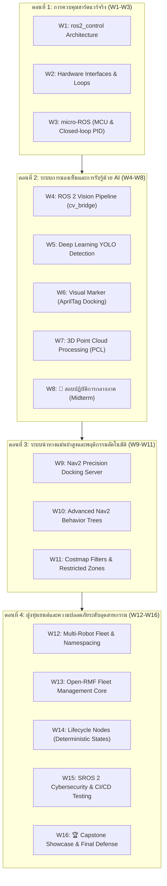

# 🎓 แผนการสอนรายวิชา: Advanced ROS 2 & Industrial Fleet Robotics
**รหัสวิชา:** AMR-201 (3 หน่วยกิต: บรรยาย 2 ชม. / ปฏิบัติการ 3 ชม. / ศึกษาด้วยตนเอง 4 ชม. ต่อสัปดาห์)  
**ระดับการศึกษา:** ปริญญาตรีชั้นปีที่ 4 / ปริญญาโท (Senior Undergraduate / Graduate) / วิศวกรอุตสาหกรรม  
**วิชาบังคับก่อน:** AMR-101 (Essential ROS 2 for Autonomous Mobile Robots) หรือเทียบเท่า  
**ระยะเวลาเรียน:** 16 สัปดาห์ (1 ภาคการศึกษา)  
**มาตรฐานซอฟต์แวร์:** ROS 2 Jazzy Jalisco (LTS) | Gazebo Sim 8.15 | ros2_control | Open-RMF | SROS 2  

---

## 🎯 คำอธิบายรายวิชา (Course Description)
ศึกษาและปฏิบัติการขั้นสูงเกี่ยวกับการพัฒนาระบบหุ่นยนต์เคลื่อนที่อัตโนมัติระดับอุตสาหกรรม (Production-Grade AMR), เฟรมเวิร์กการควบคุมฮาร์ดแวร์จริงด้วย `ros2_control` (Controller Manager, Hardware Interface, DiffDriveController), การต่อเชื่อมไมโครคอนโทรลเลอร์ควบคุมมอเตอร์แบบปิดลูปด้วย micro-ROS (STM32 / ESP32), การประมวลผลภาพขั้นสูงและการฝังโมเดลปัญญาประดิษฐ์ (Deep Learning Object Detection ด้วย YOLOv8/11, การตรวจจับ Visual Marker ด้วย AprilTag / ArUco), การประมวลผลข้อมูล 3D Point Cloud ด้วย PCL, ระบบการเข้าแท่นชาร์จอัตโนมัติความแม่นยำสูง (Nav2 Precision Docking Server), การปรับแต่ง Nav2 Behavior Trees ขั้นสูง, ระบบบริหารจัดการฝูงหุ่นยนต์คลังสินค้า (Multi-Robot Fleet) ด้วย Open-RMF, การออกแบบโหนดแบบ Managed Lifecycle Nodes เพื่อความปลอดภัยของระบบ, การรักษาความมั่นคงปลอดภัยไซเบอร์ด้วย SROS 2 (DDS Security, Keystores, Encryption) และการทดสอบระบบอัตโนมัติในกระบวนการ CI/CD ด้วย `launch_testing`

---

## 📊 แผนการประเมินผลการเรียนรู้ (Grading & Assessment)
| หมวดหมู่การประเมิน | สัดส่วนคะแนน | รายละเอียด |
| :--- | :---: | :--- |
| **1. Advanced Weekly Labs** | 25% | ใบงานปฏิบัติการระบบขั้นสูง (ros2_control, AI Perception, Docking, Open-RMF) |
| **2. Midterm System Architecture Review** | 20% | สอบปฏิบัติการและนำเสนอโครงสร้างฮาร์ดแวร์ + AI Pipeline (สัปดาห์ที่ 8) |
| **3. Industrial Capstone AMR Project** | 35% | โครงงานบูรณาการหุ่นยนต์คลังสินค้าอัจฉริยะ (ส่งมอบซอฟต์แวร์, รายงาน, และการทดสอบ) |
| **4. Final Oral Defense & Demonstration** | 10% | สาธิตการทำงานจริงในโลกจำลองแบบครบวงจร และการตอบคำถามเชิงวิศวกรรม (สัปดาห์ที่ 16) |
| **5. Code Review & Engineering Standards** | 10% | คุณภาพโค้ด, Lifecycle Nodes, SROS 2 Security, CI/CD Integration Tests |

---

## 📅 ตารางแผนการสอนรายสัปดาห์ (16-Week Course Schedule)

---

### สัปดาห์ที่ 1: สถาปัตยกรรมเฟรมเวิร์ก `ros2_control` และการจัดการทรัพยากร
- **บรรยาย (2 ชม.):**
  - ข้อจำกัดของการใช้ Topic `/cmd_vel` แบบดิบ และความสำคัญของ `ros2_control`
  - สถาปัตยกรรม: `controller_manager`, `hardware_interface`, `controllers`
  - การใช้งาน `diff_drive_controller` และ `joint_state_broadcaster`
- **ปฏิบัติการ (3 ชม.):**
  - วิเคราะห์ไฟล์คอนฟิกคอนโทรลเลอร์ [`diff_drive_controller.yaml`](Advanced_ROS/01_ros2_control_Hardware/config/diff_drive_controller.yaml)
  - เขียนแท็ก `<ros2_control>` ใน URDF/Xacro ใน [`diff_drive_ros2_control.xacro`](Advanced_ROS/01_ros2_control_Hardware/urdf/diff_drive_ros2_control.xacro)
- **การบ้าน/แบบฝึกหัด:** กำหนด Acceleration Limits และ Wheel Multipliers เพื่อชดเชยการลื่นไถล

---

### สัปดาห์ที่ 2: การพัฒนา Custom Hardware Interface สำหรับหุ่นยนต์จริง
- **บรรยาย (2 ชม.):**
  - โครงสร้างคลาส `hardware_interface::SystemInterface` ในภาษา C++
  - ฟังก์ชันวงรอบควบคุม: `on_init()`, `on_activate()`, `read()`, `write()`, `on_deactivate()`
  - การจัดการความปลอดภัย Real-time: หลีกเลี่ยง Dynamic Memory Allocation ภายในลูปควบคุม
- **ปฏิบัติการ (3 ชม.):**
  - เขียนและคอมไพล์ Hardware Interface จำลองการส่งคำสั่งผ่าน Serial Communication
  - ทดสอบโหลดและสลับการทำงานของคอนโทรลเลอร์ผ่าน `ros2 control` CLI
- **การบ้าน/แบบฝึกหัด:** ออกแบบระบบ Fail-safe ตัดกำลังขับมอเตอร์เมื่อขาดการติดต่อเกิน 100 ms

---

### สัปดาห์ที่ 3: การเชื่อมต่อไมโครคอนโทรลเลอร์ควบคุมมอเตอร์ด้วย micro-ROS
- **บรรยาย (2 ชม.):**
  - สถาปัตยกรรมของ micro-ROS (Client บน Microcontroller <-> Agent บน Single Board Computer)
  - โปรโตคอลการสื่อสาร: XRCE-DDS ผ่าน UART Serial / CAN Bus
  - การอ่านสัญญาณ Quadrature Encoder และลูปควบคุมความเร็ว PID บน ESP32 / STM32
- **ปฏิบัติการ (3 ชม.):**
  - ติดตั้งและรัน `micro_ros_agent` ผ่านพอร์ต Serial
  - เชื่อมโยงข้อมูลความเร็วล้อจริงเข้าสู่ระบบ ROS 2 ผ่าน Topic `/joint_states`
- **การบ้าน/แบบฝึกหัด:** ปรับจูนค่า $K_p, K_i, K_d$ ของมอเตอร์กระแสตรงในเฟิร์มแวร์ micro-ROS

---

### สัปดาห์ที่ 4: ระบบการประมวลผลภาพใน ROS 2 และการคาลิเบรตกล้อง
- **บรรยาย (2 ชม.):**
  - โครงสร้างข้อมูลภาพ: `sensor_msgs/msg/Image`, `CompressedImage`, `CameraInfo`
  - สถาปัตยกรรม `image_transport` เพื่อลดภาระแบนด์วิดท์เครือข่าย
  - แบบจำลองกล้องรูเข็ม (Pinhole Camera Model), พารามิเตอร์ Intrinsic & Extrinsic
- **ปฏิบัติการ (3 ชม.):**
  - การใช้งาน `cv_bridge` แปลงภาพระหว่าง ROS 2 และ OpenCV (`imgmsg_to_cv2`)
  - รันการคาลิเบรตกล้องด้วยตารางหมากรุก (Checkerboard Calibration) และบันทึกไฟล์ `.yaml`
- **การบ้าน/แบบฝึกหัด:** เขียนโหนดคำนวณและแสดงค่าฮิสโตแกรมของภาพแบบเรียลไทม์

---

### สัปดาห์ที่ 5: การประมวลผลภาพด้วยปัญญาประดิษฐ์ (Deep Learning with YOLO)
- **บรรยาย (2 ชม.):**
  - การเชื่อมโยงโมเดล Deep Learning (YOLOv8 / YOLO11) เข้ากับ ROS 2 Node
  - สถาปัตยกรรม Inference Engine: PyTorch, ONNX Runtime, TensorRT สำหรับ Edge AI
  - การสร้าง Custom Detection Messages และการส่งพิกัด Bounding Boxes
- **ปฏิบัติการ (3 ชม.):**
  - ศึกษาและรันโหนดตรวจจับวัตถุ [`cv_bridge_yolo_node.py`](Advanced_ROS/02_Vision_AI_Perception/src/cv_bridge_yolo_node.py)
  - ทดสอบจำลองการตรวจจับพาเลทสินค้าและกรวยจราจรในคลังสินค้า
- **การบ้าน/แบบฝึกหัด:** เพิ่มตัวกรองความเชื่อมั่น (Confidence Threshold Filter) คัดกรองเฉพาะวัตถุที่มั่นใจเกิน 80%

---

### สัปดาห์ที่ 6: การตรวจจับ Visual Marker และการประมาณตำแหน่ง 3 มิติ
- **บรรยาย (2 ชม.):**
  - การทำงานของ Fiducial Markers (AprilTag และ ArUco)
  - การแก้ปัญหา Perspective-n-Point (PnP Algorithm) เพื่อหาตำแหน่ง $[X, Y, Z]$ และมุม $[Roll, Pitch, Yaw]$
  - การแปลงพิกัดจาก Camera Optical Frame สู่ Base Link Frame
- **ปฏิบัติการ (3 ชม.):**
  - รันโหนดตรวจจับแท่นชาร์จ [`apriltag_dock_tracker.py`](Advanced_ROS/02_Vision_AI_Perception/src/apriltag_dock_tracker.py)
  - Publish ข้อมูล `geometry_msgs/PoseStamped` ไปยังระบบนำทาง
- **การบ้าน/แบบฝึกหัด:** ทดสอบการหมุนกล้องในมุมเอียงและบันทึกความคลาดเคลื่อนของการประมาณตำแหน่ง

---

### สัปดาห์ที่ 7: การประมวลผลข้อมูล 3D Point Cloud ด้วย PCL
- **บรรยาย (2 ชม.):**
  - โครงสร้างข้อความ `sensor_msgs/msg/PointCloud2` และ Point Field Layout
  - เฟรมเวิร์ก Point Cloud Library (PCL): PassThrough Filter, VoxelGrid Downsampling
  - RANSAC Plane Segmentation สำหรับการตัดระนาบพื้น (Ground Plane Removal)
- **ปฏิบัติการ (3 ชม.):**
  - เขียนโหนดแปลงภาพ Depth Camera เป็น Point Cloud
  - กรองพ้อยท์คลาวด์ตัดระนาบพื้นออกเพื่อส่งเฉพาะสิ่งกีดขวางเข้า Costmap 2D
- **การบ้าน/แบบฝึกหัด:** ปรับค่า Leaf Size ของ Voxel Grid เพื่อลดขนาดข้อมูลลง 70% โดยไม่สูญเสียรูปทรงสิ่งกีดขวาง

---

### สัปดาห์ที่ 8: 🔴 สอบปฏิบัติการกลางภาค (Midterm Industrial Architecture Review)
- **การประเมินผลกลางภาค (Project Presentation & Live Demo):**
  - นำเสนอการผสานระบบ `ros2_control` ร่วมกับ Vision Pipeline
  - สาธิตหุ่นยนต์ขับเคลื่อนด้วย Hardware Interface และตรวจจับวัตถุ AI ได้พร้อมกัน
  - ตรวจสอบประสิทธิภาพการใช้ CPU / RAM / Latency ของระบบ

---

### สัปดาห์ที่ 9: ระบบเข้าแท่นชาร์จอัตโนมัติความแม่นยำสูง (Nav2 Precision Docking)
- **บรรยาย (2 ชม.):**
  - ข้อจำกัดของ AMCL ในการระบุตำแหน่งละเอียดระดับมิลลิเมตร
  - สถาปัตยกรรม Nav2 Docking Server (`opennav_docking`) ใน ROS 2 Jazzy
  - ลำดับขั้นตอน: Staging Pose -> Detector Plugin -> Closed-Loop Servoing -> Charging Contact
- **ปฏิบัติการ (3 ชม.):**
  - ปรับแต่งค่าพารามิเตอร์ของ Docking Server ใน [`docking_server_params.yaml`](Advanced_ROS/03_Nav2_Precision_Docking/config/docking_server_params.yaml)
  - ทดสอบจำลองการเข้าชาร์จที่ความเร็วต่ำ 0.05 m/s พร้อมระบบตรวจเช็คการชน
- **การบ้าน/แบบฝึกหัด:** กำหนดระยะ Staging Offset เพิ่มเติมเป็น 0.8 ม. สำหรับแท่นชาร์จขนาดใหญ่

---

### สัปดาห์ที่ 10: การออกแบบ Nav2 Behavior Trees ขั้นสูง
- **บรรยาย (2 ชม.):**
  - โครงสร้างและทฤษฎี Behavior Trees (BT): Control Nodes, Action Nodes, Condition Nodes, Decorators
  - การเขียน Pipeline การทำงาน: ComputePath -> FollowPath -> Recovery Actions
  - การสร้าง Custom C++ Action Plugins สำหรับขยายขีดความสามารถของ Nav2
- **ปฏิบัติการ (3 ชม.):**
  - ศึกษาและทดสอบ Behavior Tree ชาร์จไฟอัตโนมัติ [`dock_and_charge_bt.xml`](Advanced_ROS/03_Nav2_Precision_Docking/behavior_trees/dock_and_charge_bt.xml)
  - เพิ่มเงื่อนไขตรวจสอบระดับแบตเตอรี่ก่อนเริ่มภารกิจ
- **การบ้าน/แบบฝึกหัด:** เพิ่ม Recovery Node ให้หุ่นยนต์ถอยหลัง 0.3 เมตรเมื่อพบทางตันก่อนสั่ง Clear Costmap

---

### สัปดาห์ที่ 11: การควบคุมพื้นที่ด้วย Nav2 Costmap Filters & Speed Restricted Zones
- **บรรยาย (2 ชม.):**
  - Costmap Filter Architecture (Filter Masks และ Information Masks)
  - Keep-out Zones (พื้นที่ห้ามเข้าสำหรับหุ่นยนต์)
  - Speed Restricted Zones (พื้นที่ควบคุมความเร็ว เช่น ทางม้าลาย หรือจุดที่มีคนพลุกพล่าน)
- **ปฏิบัติการ (3 ชม.):**
  - สร้างภาพแผนที่ Mask กำหนดพื้นที่ห้ามเข้าและพื้นที่ลดความเร็ว
  - ทดสอบสั่งหุ่นยนต์นำทางผ่านพื้นที่ที่ถูกจำกัดความเร็วและสังเกตพฤติกรรม
- **การบ้าน/แบบฝึกหัด:** สร้าง Keep-out Zone ป้องกันหุ่นยนต์วิ่งเข้าไปในเขตกำลังซ่อมบำรุง

---

### สัปดาห์ที่ 12: สถาปัตยกรรมระบบฝูงหุ่นยนต์ (Multi-Robot Fleet Architecture)
- **บรรยาย (2 ชม.):**
  - ความท้าทายในระบบฝูงหุ่นยนต์: การชนกันของ TF Frames, การแย่งใช้ Bandwidth เครือข่าย
  - เทคนิค ROS 2 Namespacing และการใช้ `frame_prefix` (`/amr_01/odom`, `/amr_02/odom`)
  - การเชื่อมต่อเครือข่ายความเร็วสูงด้วย Zenoh Protocol
- **ปฏิบัติการ (3 ชม.):**
  - รัน Launch File สปอว์นหุ่นยนต์ 2 ตัวแยก Namespace ใน [`multi_robot_fleet.launch.py`](Advanced_ROS/04_Multi_Robot_Fleet_OpenRMF/launch/multi_robot_fleet.launch.py)
  - สั่งการควบคุมหุ่นยนต์แต่ละตัวแยกอิสระผ่าน CLI
- **การบ้าน/แบบฝึกหัด:** เพิ่มหุ่นยนต์ตัวที่ 3 เข้าสู่ Launch File พร้อมกำหนด Namespace `amr_03`

---

### สัปดาห์ที่ 13: ระบบจัดการจราจรและงานส่วนกลางด้วย Open-RMF
- **บรรยาย (2 ชม.):**
  - สถาปัตยกรรม Open-RMF (Robotics Middleware Framework)
  - Traffic Deconfliction (การแก้ปัญหาการแย่งทางแยกและการสวนทางกัน)
  - การเชื่อมต่อระบบอาคารอัจฉริยะ (Smart Infrastructure: การเรียกใช้ลิฟต์และประตูปิด-เปิดอัตโนมัติ)
- **ปฏิบัติการ (3 ชม.):**
  - ปรับแต่งคอนฟิก Open-RMF Fleet Adapter ใน [`fleet_adapter_config.yaml`](Advanced_ROS/04_Multi_Robot_Fleet_OpenRMF/config/fleet_adapter_config.yaml)
  - จำลองสถานการณ์หุ่นยนต์ 2 ตัวเดินสวนกันในทางแคบ และดูผลการจัดตารางทางเดิน
- **การบ้าน/แบบฝึกหัด:** กำหนดจุดชาร์จไฟสำรอง (Secondary Charger) ในคอนฟิก Open-RMF

---

### สัปดาห์ที่ 14: วิศวกรรมระบบระดับ Production ด้วย Managed Lifecycle Nodes
- **บรรยาย (2 ชม.):**
  - วงจรชีวิตของโหนด: Unconfigured -> Inactive -> Active -> Finalized
  - การป้องกันอุบัติเหตุมอเตอร์กระชากขณะระบบปฏิบัติการยังบูตไม่เสร็จ
  - การเขียน Lifecycle Publisher และ Lifecycle State Machine
- **ปฏิบัติการ (3 ชม.):**
  - ศึกษาและรันโหนดเซนเซอร์แบบ Lifecycle [`lifecycle_laser_sensor.py`](Advanced_ROS/05_Production_CI_CD_Security/src/lifecycle_laser_sensor.py)
  - สั่ง Transition สถานะของโหนดผ่าน `ros2 lifecycle` CLI
- **การบ้าน/แบบฝึกหัด:** เขียนโหนด Motor Controller แบบ Lifecycle และดักจับ Error ให้ Transition กลับสู่ Inactive อัตโนมัติ

---

### สัปดาห์ที่ 15: ความมั่นคงปลอดภัยไซเบอร์ (SROS 2) และการทดสอบระบบอัตโนมัติ (CI/CD)
- **บรรยาย (2 ชม.):**
  - ภัยคุกคามไซเบอร์ในระบบหุ่นยนต์อุตสาหกรรม (Man-in-the-Middle, Unauthorized Control)
  - มาตรฐานความปลอดภัย SROS 2 (DDS Security: Authentication, Access Control, Encryption)
  - Automated Integration Testing ด้วยเฟรมเวิร์ก `launch_testing` และ GitHub Actions
- **ปฏิบัติการ (3 ชม.):**
  - สร้าง Keystores และ Enclaves สำหรับเข้ารหัสข้อความของหุ่นยนต์
  - รันชุดทดสอบความสมบูรณ์ของระบบ [`test_amr_launch.py`](Advanced_ROS/05_Production_CI_CD_Security/tests/test_amr_launch.py)
- **การบ้าน/แบบฝึกหัด:** สร้างไฟล์ GitHub Actions Workflow `.github/workflows/ci.yml` รันการทดสอบอัตโนมัติเมื่อมีการเปิด Pull Request

---

### สัปดาห์ที่ 16: 🏆 Capstone Project Final Showcase & Defense
- **การนำเสนอและประเมินผลโครงการ (Final Industrial Defense):**
  - รันระบบคลังสินค้าครบวงจร [`full_warehouse_system.launch.py`](Advanced_ROS/06_Capstone_Project/launch/full_warehouse_system.launch.py)
  - ทดสอบการรับคำสั่งขนส่งสินค้า (Pickup -> Carry -> Dropoff -> Autocharge)
  - ประเมินคะแนนตามเกณฑ์ 5 มิติใน [`rubrics.md`](Advanced_ROS/06_Capstone_Project/rubrics.md)
  - ส่งมอบซอฟต์แวร์ คลังโค้ด Git และรายงานทางวิศวกรรมฉบับสมบูรณ์
