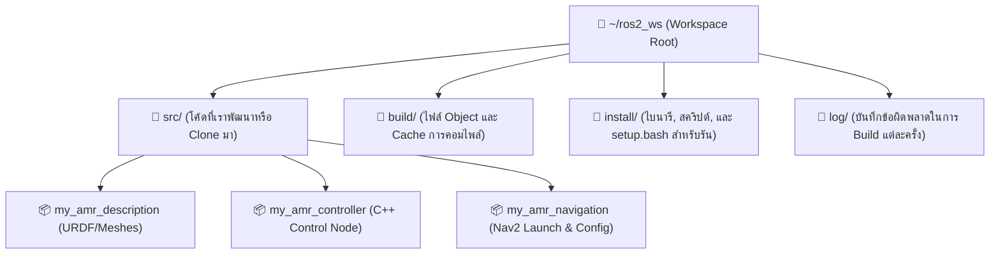
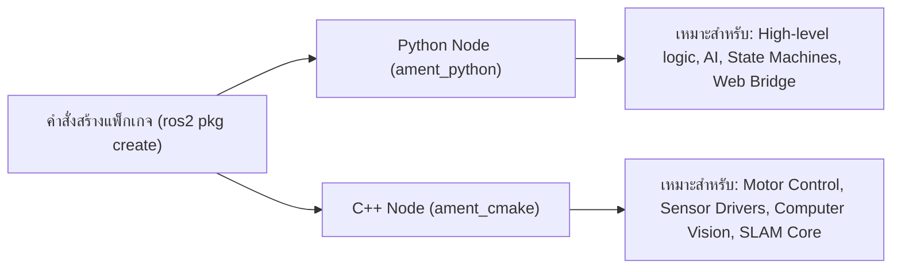

# 🧰 คู่มือชุดเครื่องมือและเทคนิคการพัฒนา ROS 2 ขั้นสูง (Developer Toolkit)
## Professional ROS 2 Development Workflow, IDE Configuration & CLI Cheat Sheet

คู่มือนี้รวบรวมแนวทางปฏิบัติที่ดีที่สุด (Best Practices), การตั้งค่าสภาพแวดล้อมโปรแกรมเมอร์ (IDE Setup), เทคนิคการคอมไพล์ด้วย Colcon, และรวมคำสั่งลัด CLI ครบวงจร

---

## 📑 สารบัญ
1. [การตั้งค่า Visual Studio Code สำหรับ ROS 2](#1-การตั้งค่า-visual-studio-code-สำหรับ-ros-2)
2. [การออกแบบและจัดการ Colcon Workspace อย่างมืออาชีพ](#2-การออกแบบและจัดการ-colcon-workspace-อย่างมืออาชีพ)
3. [เทคนิคการคอมไพล์ระดับโปร (Colcon Build Mastery)](#3-เทคนิคการคอมไพล์ระดับโปร-colcon-build-mastery)
4. [รวมคำสั่งลัด ROS 2 CLI Cheat Sheet](#4-รวมคำสั่งลัด-ros-2-cli-cheat-sheet)
5. [การสร้างแพ็กเกจหุ่นยนต์: Python vs C++ (Package Creation Standard)](#5-การสร้างแพ็กเกจหุ่นยนต์-python-vs-c-package-creation-standard)
6. [เครื่องมือวิเคราะห์และแก้ปัญหา (Debugging, Profiling & Diagnostics)](#6-เครื่องมือวิเคราะห์และแก้ปัญหา-debugging-profiling--diagnostics)

---

## 1. การตั้งค่า Visual Studio Code สำหรับ ROS 2

Visual Studio Code เป็น IDE ยอดนิยมสูงสุดสำหรับการพัฒนาหุ่นยนต์ ROS 2 ทั้งภาษา Python และ C++

### 🔌 Extensions สำคัญที่แนะนำให้ติดตั้ง
| Extension Name | Extension ID | หน้าที่ |
| :--- | :--- | :--- |
| **ROS** | `ranch-hand-robotics.rde-ros-2` | ช่วยจัดการ ROS 2 Workspace, Build task, และรันโหนด (เป็นตัวที่พัฒนาต่อจาก `ms-iot.vscode-ros` ซึ่ง Microsoft เลิกดูแลแล้ว ให้ตรวจชื่อใน Marketplace อีกครั้งก่อนติดตั้ง) |
| **Python** | `ms-python.python` | Intellisense, Linting, Debugging สำหรับ rclpy |
| **C/C++** | `ms-vscode.cpptools` | การจัดการ Header, Auto-complete C++ และ rclcpp |
| **CMake Tools** | `ms-vscode.cmake-tools` | อำนวยความสะดวกในการจัดทำ `CMakeLists.txt` |
| **URDF Viewer** | `smilerobotics.urdf` | แสดงผลโมเดล 3 มิติจากไฟล์ URDF และ Xacro ภายใน VSCode ทันที |
| **XML Tools** | `DotJoshJohnson.xml` | จัดการ Indent และตรวจสอบไวยากรณ์ไฟล์ Launch XML และ URDF |

### ⚙️ ตัวอย่างการคอนฟิก `.vscode/settings.json` ใน Workspace
สร้างโฟลเดอร์ `.vscode` ที่ Root ของ Workspace และใส่ไฟล์ `settings.json`:

> colcon ใช้ layout แบบ isolated เป็นค่าเริ่มต้น แต่ละแพ็กเกจจึงอยู่ใน `install/<ชื่อแพ็กเกจ>/lib/python3.12/site-packages`
> (ไม่ใช่ `install/lib/...`) ให้เพิ่มหนึ่งบรรทัดต่อแพ็กเกจที่ต้องการ auto-complete ส่วน `python.autoComplete.extraPaths`
> เป็นค่าที่เลิกใช้แล้ว ให้ใช้ `python.analysis.extraPaths` (Pylance) แทน

```json
{
  "python.analysis.extraPaths": [
    "/opt/ros/jazzy/lib/python3.12/site-packages",
    "${workspaceFolder}/install/amr_week02/lib/python3.12/site-packages"
  ],
  "files.associations": {
    "*.launch.py": "python",
    "*.xacro": "xml",
    "*.urdf": "xml",
    "*.sdf": "xml"
  },
  "editor.tabSize": 4,
  "editor.formatOnSave": true
}
```

---

## 2. การออกแบบและจัดการ Colcon Workspace อย่างมืออาชีพ



### กฎทองในการจัดการ Workspace:
1. **ห้าม Commit โฟลเดอร์ `build/`, `install/`, และ `log/` ขึ้น Git เด็ดขาด** (ใส่ไว้ใน `.gitignore`)
2. ใช้การแยก Repository ตามหน้าที่ (Single Responsibility) เช่น แพ็กเกจหุ่นยนต์ (`_description`), แพ็กเกจคอนโทรลเลอร์ (`_controller`), และแพ็กเกจระบบนำทาง (`_navigation`)
3. สำหรับไฟล์ 3D Mesh (.stl, .dae) ที่มีขนาดใหญ่เกิน 10MB ควรใช้ **Git LFS (Large File Storage)**

---

## 3. เทคนิคการคอมไพล์ระดับโปร (Colcon Build Mastery)

| คำสั่ง (Command) | ประโยชน์และการใช้งาน |
| :--- | :--- |
| `colcon build --symlink-install` | สำหรับแพ็กเกจ Python มาตรฐาน (โค้ดอยู่ในโฟลเดอร์ชื่อเดียวกับแพ็กเกจ): สร้าง Symbolic Link ใน `install/` ไปยังซอร์ส แก้โค้ดแล้วรันได้ทันที **ข้อยกเว้น:** แพ็กเกจรายสัปดาห์ของวิชานี้ใช้ `package_dir={'amr_weekNN': 'src'}` เพื่อคงโครงสร้างโฟลเดอร์เดิม คำสั่งนี้ยัง build ผ่าน แต่ colcon จะ *คัดลอก* ไฟล์จาก `src/` ไปไว้ใน `build/<pkg>/<pkg>/` (ทดสอบแล้ว: ไม่ใช่ symlink) จึงต้อง build ใหม่ทุกครั้งที่แก้โค้ด เหมือน `colcon build` ธรรมดา (`make build`) |
| `colcon build --packages-select <pkg_name>` | คอมไพล์เฉพาะแพ็กเกจที่ระบุ ช่วยลดเวลาจากหลายนาทีเหลือเพียงไม่กี่วินาที |
| `colcon build --packages-up-to <pkg_name>` | คอมไพล์แพ็กเกจที่ระบุพร้อมกับ Dependencies ทั้งหมดที่แพ็กเกจนั้นต้องใช้ |
| `colcon build --parallel-workers 4` | จำกัดจำนวน CPU Cores ที่ใช้คอมไพล์ ป้องกันไม่ให้ RAM หมด (Out-Of-Memory) |
| `colcon build --cmake-args -DCMAKE_BUILD_TYPE=Release` | คอมไพล์ C++ โหมด Release เพื่อประสิทธิภาพการคำนวณสูงสุด |
| `colcon build --cmake-args -DCMAKE_BUILD_TYPE=Debug` | คอมไพล์พร้อม Debug Symbols สำหรับใช้โปรแกรม gdb ตรวจสอบ Memory Leak |

---

## 4. รวมคำสั่งลัด ROS 2 CLI Cheat Sheet

### 🔹 การตรวจสอบโหนดและเครือข่าย (Nodes & System)
```bash
ros2 node list                       # แสดงรายชื่อโหนดทั้งหมดที่กำลังทำงาน
ros2 node info /my_node              # แสดงรายละเอียด Subscriptions, Publishers, Services ของโหนด
ros2 doctor                          # ตรวจสอบสุขภาพของระบบและ Network Interface
ros2 doctor --report                 # พิมพ์รายงานระบบโดยละเอียด (IP, RMW, ROS Distro)
ros2 daemon status                   # ตรวจสอบสถานะ Background Discovery Daemon
ros2 daemon stop && ros2 daemon start # รีสตาร์ต Discovery Daemon เมื่อโหนดค้นหากันไม่เจอ
```

### 🔹 การจัดการ Topic และ Data Stream
```bash
ros2 topic list                      # แสดงรายชื่อ Topics ทั้งหมด
ros2 topic list -t                   # แสดงรายชื่อ Topics พร้อมประเภทของ Message Type
ros2 topic echo /cmd_vel             # แสดงข้อมูลที่กำลังส่งผ่าน Topic แบบ Real-time
ros2 topic hz /scan                  # วัดอัตราความถี่ (Frequency ในหน่วย Hz)
ros2 topic bw /camera/image_raw      # วัดปริมาณการใช้แบนด์วิดท์เครือข่าย (Bandwidth)
ros2 topic pub /cmd_vel geometry_msgs/msg/Twist "{linear: {x: 0.5}, angular: {z: 0.1}}" -r 10 # Publish ด้วยความถี่ 10Hz
```

### 🔹 การจัดการ Service และ Action
```bash
ros2 service list                    # แสดงรายชื่อ Services ทั้งหมด
ros2 service type /set_power_mode    # ดูประเภท Request/Response ของ Service
ros2 service call /reset_odom std_srvs/srv/Trigger "{}" # เรียกใช้งาน Service

ros2 action list                     # แสดงรายชื่อ Actions ที่เปิดให้บริการ
ros2 action info /navigate_to_pose   # ดู Action Server และ Goal Client ที่เชื่อมต่ออยู่
ros2 action send_goal -f /navigate_to_pose nav2_msgs/action/NavigateToPose "{pose: {...}}" # ส่ง Goal พร้อมขอ Feedback
```

### 🔹 การปรับแต่งพารามิเตอร์แบบ Dynamic
```bash
ros2 param list                      # แสดงพารามิเตอร์ทั้งหมดในระบบแยกตามโหนด
ros2 param get /my_node max_speed    # อ่านค่าพารามิเตอร์
ros2 param set /my_node max_speed 1.5 # เปลี่ยนค่าพารามิเตอร์ขณะโหนดกำลังทำงาน (Dynamic Reconfigure)
ros2 param dump /my_node             # Export พารามิเตอร์ทั้งหมดออกมาเป็นไฟล์ YAML
```

### 🔹 การบันทึกและเล่นย้อนหลังข้อมูลเซนเซอร์ (ros2 bag)
```bash
ros2 bag record -o test_flight /scan /odom /tf # บันทึกเฉพาะ Topic ที่ระบุลงโฟลเดอร์ test_flight
ros2 bag record -a                             # บันทึกทุก Topic ในระบบ
ros2 bag info test_flight/test_flight_0.mcap   # ตรวจสอบจำนวนข้อความและเวลาที่บันทึก
ros2 bag play test_flight/test_flight_0.mcap   # เล่นข้อมูลย้อนกลับเข้าสู่ระบบ ROS
```

---

## 5. การสร้างแพ็กเกจหุ่นยนต์: Python vs C++ (Package Creation Standard)



### 🐍 คำสั่งสร้างแพ็กเกจ Python:
```bash
cd ~/ros2_ws/src
ros2 pkg create --build-type ament_python my_py_pkg \
  --dependencies rclpy geometry_msgs nav_msgs sensor_msgs
```

### ⚙️ คำสั่งสร้างแพ็กเกจ C++:
```bash
cd ~/ros2_ws/src
ros2 pkg create --build-type ament_cmake my_cpp_pkg \
  --dependencies rclcpp geometry_msgs nav_msgs sensor_msgs
```

---

## 6. เครื่องมือวิเคราะห์และแก้ปัญหา (Debugging, Profiling & Diagnostics)

### 1. เครื่องมือวิเคราะห์กราฟการเชื่อมต่อ (`rqt_graph`)
เครื่องมือที่วิศวกรทุกคนต้องใช้เพื่อดูความสัมพันธ์ระหว่าง Node และ Topic:
```bash
rqt_graph
```

### 2. การตรวจสอบการแปลงพิกัด TF2 Frame Tree
สร้างแผนผัง PDF แสดงลำดับพิกัดของหุ่นยนต์ตั้งแต่ `map` -> `odom` -> `base_footprint` -> `base_link` -> `laser_frame`:
```bash
ros2 run tf2_tools view_frames
# คำสั่งจะสร้างไฟล์ frames_<วันเวลา>.pdf (และ .gv) ในโฟลเดอร์ปัจจุบัน
```

### 3. การมอนิเตอร์สถานะพิกัดแบบสด (Live TF Echo)
```bash
ros2 run tf2_ros tf2_echo base_link laser_frame
```

### 4. การรัน Debugger GDB สำหรับภาษา C++
หากโหนดภาษา C++ เกิดอาการ Segmentation Fault (Core Dumped) ให้ใช้ GDB ช่วยชี้บรรทัดที่พัง:
```bash
ros2 run --prefix 'gdb -ex run --args' my_cpp_pkg my_node
```
