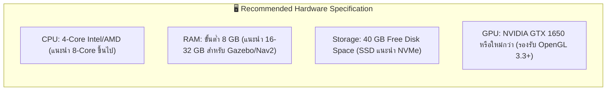
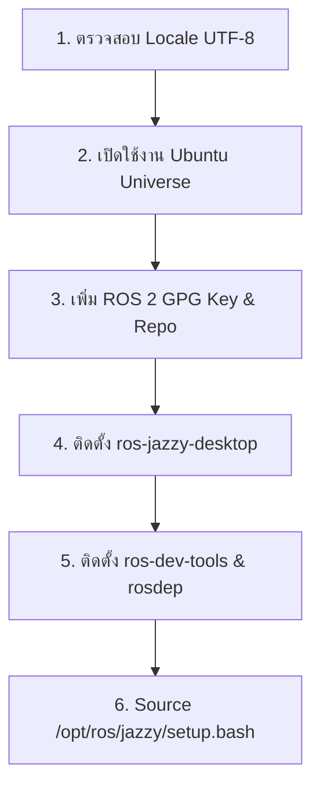
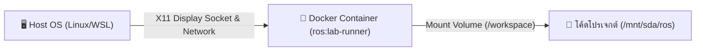
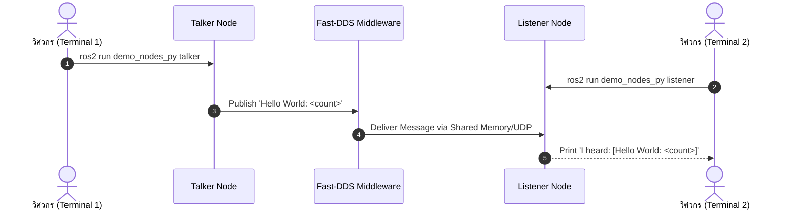

# 🛠️ คู่มือการติดตั้งและตั้งค่าสภาพแวดล้อม ROS 2 อย่างสมบูรณ์
## Comprehensive ROS 2 Installation & Environment Setup Guide
**ระบบเป้าหมายหลัก:** ROS 2 Jazzy Jalisco (LTS) บน Ubuntu 24.04 LTS (Noble Numbat)  
**ระบบเป้าหมายทางเลือก:** Docker Container, Windows 11 (WSL2), macOS, และ Ubuntu 22.04 (ROS 2 Humble)

---

## 📑 สารบัญ (Table of Contents)
1. [ข้อกำหนดฮาร์ดแวร์และซอฟต์แวร์ขั้นต่ำ (System Requirements)](#1-ข้อกำหนดฮาร์ดแวร์และซอฟต์แวร์ขั้นต่ำ-system-requirements)
2. [วิธีที่ 1: การติดตั้งแบบเนทีฟบน Ubuntu 24.04 LTS (Native Installation - แนะนำสูงสุด)](#วิธีที่-1-การติดตั้งแบบเนทีฟบน-ubuntu-2404-lts-native-installation---แนะนำสูงสุด)
3. [วิธีที่ 2: การติดตั้งและใช้งานผ่าน Docker Container (Isolated & Portable)](#วิธีที่-2-การติดตั้งและใช้งานผ่าน-docker-container-isolated--portable)
4. [วิธีที่ 3: การติดตั้งบน Windows 10/11 ผ่าน WSL2 + WSLg GUI](#วิธีที่-3-การติดตั้งบน-windows-1011-ผ่าน-wsl2--wslg-gui)
5. [วิธีที่ 4: การติดตั้งบน macOS (Apple Silicon / Intel)](#วิธีที่-4-การติดตั้งบน-macos-apple-silicon--intel)
6. [การติดตั้งชุดเครื่องมือพัฒนาหุ่นยนต์ (Essential Robotics Development Tools)](#การติดตั้งชุดเครื่องมือพัฒนาหุ่นยนต์-essential-robotics-development-tools)
7. [การตั้งค่าสภาพแวดล้อมอัตโนมัติใน Shell (~/.bashrc)](#การตั้งค่าสภาพแวดล้อมอัตโนมัติใน-shell-bashrc)
8. [การทดสอบความสมบูรณ์ของระบบหลังติดตั้ง (Post-Installation Verification)](#การทดสอบความสมบูรณ์ของระบบหลังติดตั้ง-post-installation-verification)
9. [คู่มือแก้ปัญหาและข้อผิดพลาดที่พบบ่อย (Troubleshooting & FAQs)](#คู่มือแก้ปัญหาและข้อผิดพลาดที่พบบ่อย-troubleshooting--faqs)

---

## 1. ข้อกำหนดฮาร์ดแวร์และซอฟต์แวร์ขั้นต่ำ (System Requirements)



| รายการ | ขั้นต่ำ (Minimum) | แนะนำสำหรับงานวิจัยและอุตสาหกรรม (Recommended) |
| :--- | :--- | :--- |
| **หน่วยประมวลผล (CPU)** | Intel Core i5 / AMD Ryzen 5 (4 Cores) | Intel Core i7/i9 หรือ AMD Ryzen 7/9 (8 Cores ขึ้นไป) |
| **หน่วยความจำ (RAM)** | 8 GB | 16 GB - 32 GB (จำเป็นสำหรับการคอมไพล์ Nav2 และเรนเดอร์ 3D Gazebo) |
| **พื้นที่จัดเก็บข้อมูล** | 30 GB (SSD) | 60+ GB (NVMe SSD เพื่อการ Build แพ็กเกจที่รวดเร็ว) |
| **การ์ดแสดงผล (GPU)** | Integrated Graphics (Intel Iris Xe / AMD Radeon) | NVIDIA GPU พร้อม CUDA Driver (RTX 3060 ขึ้นไป เพื่อรัน AI & SLAM 3D) |
| **ระบบปฏิบัติการ** | Ubuntu 24.04 LTS (Noble Numbat) | Ubuntu 24.04 LTS 64-bit Desktop |

---

## วิธีที่ 1: การติดตั้งแบบเนทีฟบน Ubuntu 24.04 LTS (Native Installation - แนะนำสูงสุด)

การติดตั้งผ่าน APT Official Repository ของ Open Robotics โดยตรง เป็นวิธีที่มีประสิทธิภาพสูงสุด (Native Performance) และไม่มี Overhead ด้านการจำลอง Hardware หรือ Display



### ขั้นตอนที่ 1.1: ตรวจสอบและตั้งค่า System Locale
ROS 2 จำเป็นต้องทำงานบน Locale ที่รองรับ UTF-8 เพื่อป้องกันข้อผิดพลาดในการประมวลผลสตริงและ Topic Data:

```bash
# ตรวจสอบ Locale ปัจจุบัน
locale

# หากยังไม่ใช่ UTF-8 ให้รันคำสั่งต่อไปนี้
sudo apt update && sudo apt install -y locales
sudo locale-gen en_US en_US.UTF-8
sudo update-locale LC_ALL=en_US.UTF-8 LANG=en_US.UTF-8
export LANG=en_US.UTF-8

# ตรวจสอบอีกครั้งเพื่อยืนยัน
locale
```

### ขั้นตอนที่ 1.2: เปิดใช้งาน Ubuntu Universe Repository
```bash
sudo apt install -y software-properties-common curl gnupg lsb-release
sudo add-apt-repository universe -y
```

### ขั้นตอนที่ 1.3: เพิ่ม ROS 2 GPG Key และ Official APT Repository
```bash
# ดาวน์โหลดและติดตั้ง ROS 2 GPG Key เข้าสู่ Keyrings
sudo curl -sSL https://raw.githubusercontent.com/ros/rosdistro/master/ros.key -o /usr/share/keyrings/ros-archive-keyring.gpg

# เพิ่ม ROS 2 Repository ลงใน Sources List
echo "deb [arch=$(dpkg --print-architecture) signed-by=/usr/share/keyrings/ros-archive-keyring.gpg] http://packages.ros.org/ros2/ubuntu $(. /etc/os-release && echo $UBUNTU_CODENAME) main" | sudo tee /etc/apt/sources.list.d/ros2.list > /dev/null

# อัปเดตรายการแพ็กเกจ
sudo apt update
```

### ขั้นตอนที่ 1.4: ติดตั้ง ROS 2 Jazzy Jalisco Packages
เลือกระหว่าง **Desktop Install (แนะนำสำหรับการพัฒนาทั่วไป)** หรือ **Base Install (สำหรับคอมพิวเตอร์ออนบอร์ดของหุ่นยนต์)**:

* **ตัวเลือก A: Desktop Install (แนะนำ)** - รวม Core, RViz2, Demos, และ Tutorials ครบชุด:
  ```bash
  sudo apt install -y ros-jazzy-desktop
  ```
* **ตัวเลือก B: ROS-Base Install (Bare Bones)** - มีเฉพาะ Core Communication Libraries (เหมาะสำหรับ Single-Board Computer เช่น Raspberry Pi 5):
  ```bash
  sudo apt install -y ros-jazzy-ros-base
  ```

### ขั้นตอนที่ 1.5: ติดตั้งชุดเครื่องมือพัฒนา (Development Tools & Compilers)
```bash
sudo apt install -y \
  python3-colcon-common-extensions \
  python3-rosdep \
  python3-vcstool \
  python3-argcomplete \
  ros-dev-tools \
  build-essential \
  git
```

### ขั้นตอนที่ 1.6: กำหนดค่าและอัปเดตฐานข้อมูล Dependencies ด้วย rosdep
```bash
sudo rosdep init
rosdep update
```

---

## วิธีที่ 2: การติดตั้งและใช้งานผ่าน Docker Container (Isolated & Portable)

หากท่านใช้เครื่องที่มีระบบปฏิบัติการอื่น หรือไม่ต้องการให้แพ็กเกจระบบตีกับโปรเจกต์อื่น โครงการนี้มี Dockerfile ที่ติดตั้ง ROS 2 Jazzy, Gazebo Harmonic, Nav2, SLAM Toolbox และ X11 GUI ไว้พร้อมใช้งานทันที



### ขั้นตอนที่ 2.1: ตรวจสอบและติดตั้ง Docker Engine
บน Ubuntu โฮสต์:
```bash
# ตรวจสอบ Docker
docker --version

# หากยังไม่ได้ติดตั้ง สามารถติดตั้งผ่านสคริปต์ทางการของ Docker:
curl -fsSL https://get.docker.com -o get-docker.sh
sudo sh get-docker.sh
sudo usermod -aG docker $USER
newgrp docker
```

### ขั้นตอนที่ 2.2: สั่ง Build Docker Image ของโปรเจกต์
เข้าสู่โฟลเดอร์โครงการแล้วสั่ง Build:
```bash
cd /mnt/sda/ros
docker build -t ros:lab-runner docker/
```

### ขั้นตอนที่ 2.3: การอนุญาตสิทธิ์การแสดงผล GUI ข้ามคอนเทนเนอร์ (X11 Forwarding)
```bash
# สั่งอนุญาตการเชื่อมต่อ X11 Display จาก Local Container
xhost +local:root
```

### ขั้นตอนที่ 2.4: เปิดใช้งานคอนเทนเนอร์ด้วยสคริปต์อเนกประสงค์
โปรเจกต์นี้มีสคริปต์ [`docker/run_lab.sh`](../docker/run_lab.sh) ซึ่งตั้งค่า `--net host`, `--ipc host`, ส่งผ่านค่า `DISPLAY`, และ Mount ไฟล์โค้ดเข้า `/workspace` ให้อัตโนมัติ:

```bash
# เปิด Interactive Bash Shell ภายในคอนเทนเนอร์
./docker/run_lab.sh

# หรือส่งคำสั่งตรงไปรันภายในคอนเทนเนอร์
./docker/run_lab.sh ros2 doctor --report
```

> [!TIP]
> หากเครื่องของท่านมีการ์ดจอ NVIDIA และต้องการเปิดใช้งานฮาร์ดแวร์เร่งความเร็ว 3D ใน Gazebo ให้ติดตั้ง **NVIDIA Container Toolkit** แล้วเพิ่มแฟล็ก `--gpus all` ในสคริปต์รัน

---

## วิธีที่ 3: การติดตั้งบน Windows 10/11 ผ่าน WSL2 + WSLg GUI

สำหรับผู้ใช้งาน Windows แนะนำให้ใช้ **WSL2 (Windows Subsystem for Linux)** ร่วมกับ **WSLg** ซึ่งสามารถรันโปรแกรม GUI ของ Linux (เช่น RViz2, Gazebo, rqt) เสมือนเป็นหน้าต่าง Native บน Windows ได้อย่างราบรื่น

### ขั้นตอนที่ 3.1: เปิดใช้งานและติดตั้ง Ubuntu 24.04 บน WSL2
เปิด PowerShell ด้วยสิทธิ์ Administrator แล้วรัน:
```powershell
# อัปเดต WSL และเคอร์เนล Linux
wsl --update

# ตรวจสอบและติดตั้ง Ubuntu 24.04
wsl --install -d Ubuntu-24.04
```
รีสตาร์ตเครื่องคอมพิวเตอร์เมื่อระบบแจ้งเตือน จากนั้นตั้งชื่อผู้ใช้งาน (Username) และรหัสผ่าน (Password) ใน Ubuntu Terminal

### ขั้นตอนที่ 3.2: ตั้งค่า DDS Multicast Network ใน WSL2 (สำคัญมาก)
โดยปกติ WSL2 จะใช้ระบบเครือข่ายแบบ NAT ซึ่งอาจบล็อก UDP Multicast ทำให้โหนด ROS 2 ข้ามระหว่าง Windows กับ WSL มองไม่เห็นกัน  
เปิดไฟล์ `C:\Users\<Username>\.wslconfig` บน Windows แล้วเพิ่มบรรทัดต่อไปนี้:
```ini
[wsl2]
networkingMode=mirrored
dnsTunneling=true
firewall=true
autoProxy=true
```
จากนั้นสั่ง Restart WSL ใน PowerShell:
```powershell
wsl --shutdown
```

### ขั้นตอนที่ 3.3: ติดตั้ง ROS 2 Jazzy ภายใน Ubuntu 24.04 ของ WSL2
เปิดหน้าต่าง Ubuntu 24.04 ใน Windows แล้วทำตามขั้นตอนใน [วิธีที่ 1: การติดตั้งแบบเนทีฟบน Ubuntu 24.04 LTS](#วิธีที่-1-การติดตั้งแบบเนทีฟบน-ubuntu-2404-lts-native-installation---แนะนำสูงสุด) ได้ทันที

---

## วิธีที่ 4: การติดตั้งบน macOS (Apple Silicon / Intel)

ระบบปฏิบัติการ macOS ไม่รองรับการรัน ROS 2 Jazzy แบบ Native APT วิธีที่แนะนำและมีประสิทธิภาพสูงสุดคือ:

1. **ติดตั้ง OrbStack หรือ Docker Desktop:**
   - ดาวน์โหลด [OrbStack](https://orbstack.dev/) (แนะนำสำหรับ Mac เพราะใช้ RAM น้อยและเปิดเร็วมาก) หรือ [Docker Desktop](https://www.docker.com/)
2. **ติดตั้ง XQuartz สำหรับแสดงผล GUI:**
   ```bash
   brew install --cask xquartz
   ```
   เปิดโปรแกรม XQuartz เข้าไปที่ `Preferences > Security` แล้วติ๊กถูกที่:
   `Allow connections from network clients`
3. **รันคำสั่งอนุญาตและเชื่อมต่อ:**
   ```bash
   xhost + $(ipconfig getifaddr en0)
   ```
4. สั่งรันคอนเทนเนอร์ `ros:lab-runner` ผ่าน Docker โดยชี้ `DISPLAY=<IP_HOST>:0`

---

## การติดตั้งชุดเครื่องมือพัฒนาหุ่นยนต์ (Essential Robotics Development Tools)

ในการสร้างหุ่นยนต์ AMR จริง จำเป็นต้องมีชุดแพ็กเกจเสริมด้านแบบจำลอง 3D, การจำลองฟิสิกส์, และการนำทาง:

```bash
# 1. ติดตั้ง Gazebo Sim 8 (Harmonic) และ ROS-Gazebo Bridge
sudo apt install -y \
  ros-jazzy-ros-gz \
  ros-jazzy-ros-gz-sim \
  ros-jazzy-ros-gz-bridge \
  ros-jazzy-ros-gz-image

# 2. ติดตั้ง Robot State Publisher และ URDF/Xacro Tools
sudo apt install -y \
  ros-jazzy-robot-state-publisher \
  ros-jazzy-joint-state-publisher \
  ros-jazzy-joint-state-publisher-gui \
  ros-jazzy-xacro \
  ros-jazzy-urdf \
  liburdfdom-tools

# 3. ติดตั้ง TF2 Coordinate Transformation Suite
sudo apt install -y \
  ros-jazzy-tf2-tools \
  ros-jazzy-tf2-ros \
  ros-jazzy-tf-transformations \
  python3-transforms3d

# 4. ติดตั้ง Nav2 Navigation Stack และ SLAM Toolbox
sudo apt install -y \
  ros-jazzy-navigation2 \
  ros-jazzy-nav2-bringup \
  ros-jazzy-nav2-simple-commander \
  ros-jazzy-slam-toolbox

# 5. ติดตั้ง Diagnostic & Graphical Analysis Tools (rqt)
sudo apt install -y \
  ros-jazzy-rqt \
  ros-jazzy-rqt-graph \
  ros-jazzy-rqt-plot \
  ros-jazzy-teleop-twist-keyboard
```

---

## การตั้งค่าสภาพแวดล้อมอัตโนมัติใน Shell (~/.bashrc)

เพื่อให้คำสั่ง `ros2` และการ Auto-complete ทำงานได้ทันทีเมื่อเปิด Terminal ใหม่ทุกครั้ง แนะนำให้บันทึกคำสั่ง Environment เข้าไฟล์ `~/.bashrc`:

```bash
# เพิ่มคำสั่ง Source ROS 2 Core และ Auto-complete ลงใน ~/.bashrc
echo "source /opt/ros/jazzy/setup.bash" >> ~/.bashrc
echo "source /usr/share/colcon_argcomplete/hook/colcon-argcomplete.bash" >> ~/.bashrc

# กำหนด ROS_DOMAIN_ID ประจำตัว (ตัวอย่าง: กลุ่มที่ 1 ให้ใช้ ID 1)
echo "export ROS_DOMAIN_ID=0" >> ~/.bashrc

# ป้องกันไม่ให้สัญญาณ DDS ทะลุออกไปกวนเครื่องอื่นใน Wi-Fi สาธารณะ (ถ้าต้องการ Local เท่านั้น)
# echo "export ROS_AUTOMATIC_DISCOVERY_RANGE=LOCALHOST" >> ~/.bashrc

# โหลดการตั้งค่าใหม่เข้าสู่ Shell ทันที
source ~/.bashrc
```

---

## การทดสอบความสมบูรณ์ของระบบหลังติดตั้ง (Post-Installation Verification)



### การทดสอบที่ 1: ตรวจสอบความสมบูรณ์ด้วย ROS 2 Doctor
```bash
ros2 doctor
```
*ระบบควรแสดงผล:* `All 4 checks passed`

### การทดสอบที่ 2: ทดสอบการสื่อสารแบบ Pub/Sub
เปิด 2 หน้าต่าง Terminal:

* **Terminal 1 (Publisher):**
  ```bash
  ros2 run demo_nodes_py talker
  ```
  *ผลลัพธ์:* `[INFO] [talker]: Publishing: "Hello World: 1"`

* **Terminal 2 (Subscriber):**
  ```bash
  ros2 run demo_nodes_py listener
  ```
  *ผลลัพธ์:* `[INFO] [listener]: I heard: [Hello World: 1]`

### การทดสอบที่ 3: ทดสอบการแสดงผลกราฟิก 3D (RViz2)
```bash
rviz2
```
*ระบบจะต้องเปิดหน้าต่างแสดงผล 3D สีเทาเข้มของ RViz2 ขึ้นมาได้อย่างราบรื่น ไม่มีการแจ้งเตือน OpenGL Crash*

---

## คู่มือแก้ปัญหาและข้อผิดพลาดที่พบบ่อย (Troubleshooting & FAQs)

### 🔴 ปัญหาที่ 1: GPG Key Error (`NO_PUBKEY F42ED6FBAB17C654`)
* **สาเหตุ:** คีย์ GPG เก่าหมดอายุ หรือยังไม่ได้เพิ่ม Key เข้าสู่ระบบ APT
* **วิธีแก้:**
  ```bash
  sudo curl -sSL https://raw.githubusercontent.com/ros/rosdistro/master/ros.key -o /usr/share/keyrings/ros-archive-keyring.gpg
  sudo apt update
  ```

### 🔴 ปัญหาที่ 2: `rosdep init` แจ้งเตือน `default sources list file already exists`
* **สาเหตุ:** เคยรัน `rosdep init` มาก่อนแล้ว
* **วิธีแก้:** สามารถข้ามคำสั่ง `init` ไปรัน `rosdep update` ได้ทันที หรือหากต้องการรีเซ็ตใหม่:
  ```bash
  sudo rm -f /etc/ros/rosdep/sources.list.d/20-default.list
  sudo rosdep init
  rosdep update
  ```

### 🔴 ปัญหาที่ 3: `ros2: command not found` หลังเปิด Terminal ใหม่
* **สาเหตุ:** ยังไม่ได้ใส่คำสั่ง `source /opt/ros/jazzy/setup.bash` ใน `~/.bashrc`
* **วิธีแก้:**
  ```bash
  echo "source /opt/ros/jazzy/setup.bash" >> ~/.bashrc
  source ~/.bashrc
  ```

### 🔴 ปัญหาที่ 4: RViz2 หรือ Gazebo เกิดอาการหน้าจอดำ หรือ Crash ด้วย `libGL error`
* **สาเหตุ:** Driver ของการ์ดจอไม่รองรับการจำลองเร่งความเร็วฮาร์ดแวร์บน VM หรือคอนเทนเนอร์
* **วิธีแก้:** บังคับให้ใช้ Software Rendering ชั่วคราว:
  ```bash
  export LIBGL_ALWAYS_SOFTWARE=1
  rviz2
  ```

### 🔴 ปัญหาที่ 5: สองเครื่องมองไม่เห็น Node ของกันและกัน
* **สาเหตุ:** `ROS_DOMAIN_ID` ไม่ตรงกัน, หรือ Firewall บล็อกพอร์ต UDP Multicast (ช่วงพอร์ต 7400 - 7650)
* **วิธีแก้:**
  1. ตรวจสอบว่าทั้งสองเครื่องใช้ Domain ID เดียวกัน: `echo $ROS_DOMAIN_ID`
  2. ปลดล็อกพอร์ต Firewall บน Ubuntu:
     ```bash
     sudo ufw allow 7400:7650/udp
     ```
  3. ทดสอบส่งสัญญาณด้วย Multicast Probe:
     - เครื่องที่ 1: `ros2 multicast receive`
     - เครื่องที่ 2: `ros2 multicast send`
