# ROS 2 Lyrical Luth: Network Stack

เอกสารวิจัยเรื่อง network stack ของ ROS 2 Lyrical Luth (พฤษภาคม 2026, LTS ถึง 2031) ไล่ตั้งแต่ `publish()` ใน user space ผ่าน rmw และ DDS ลงไปถึง Linux kernel ไปจนถึงการส่งข้ามเครื่อง มีทั้งการวิเคราะห์จาก source code และผลการทดลองจริงที่ capture packet ไว้



## ลำดับการอ่าน

หมายเลขภาคคือลำดับที่เขียน ไม่ใช่ลำดับที่อ่านง่ายที่สุด ภาค 2 ลึกที่สุดจึงควรอ่านท้ายสุด ลำดับที่แนะนำคือ

| ขั้น | อ่าน / เปิด | ได้อะไร | เวลาโดยประมาณ |
|---|---|---|---|
| 1 | หน้า [Data Paths](https://alfaxphoori.github.io/ros2/ros2_lyrical/interactive/data-paths.html) | เห็นภาพรวมว่าข้อมูลวิ่งได้กี่ทาง ผ่านชั้นไหน และ copy กี่ครั้ง | 10 นาที |
| 2 | [ภาค 1](docs/01_network_stack_deep_dive.md) §0–§4 | รู้จักแต่ละชั้น: rclcpp → rmw → middleware → syscall และ RMW ทั้ง 4 ตัว | 30 นาที |
| 3 | [Packet Lab](https://alfaxphoori.github.io/ros2/ros2_lyrical/interactive/lyrical-packet-lab.html) บทที่ 1–16 | ดูสิ่งที่อ่านในขั้น 2 เป็นภาพ 3D ทีละบท | 30 นาที |
| 4 | [ภาค 1](docs/01_network_stack_deep_dive.md) §5–§6 | packet ระดับ byte และเส้นทางใน Linux kernel ทีละฟังก์ชัน | 30 นาที |
| 5 | [ภาค 4](docs/04_architectures.md) | มองระดับระบบ: discovery, data path ในเครื่อง, deployment, security | 30 นาที |
| 6 | [ภาค 3](docs/03_wire_experiments.md) (เริ่มจากตารางสรุปผลใน[§1.1](docs/03_wire_experiments.md#11-สรุปผลสำคัญของการทดลองที่-117)) แล้วดู Packet Lab บทที่ 17–20 | ผลการทดลองจริง เทียบกับที่อ่านมาในขั้น 2–5 | 30 นาที |
| 7 | [ภาค 2](docs/02_wire_format_and_kernel.md) §1–§6 | รายละเอียดเชิงลึก: wire format, reliability, Fast DDS internals, `truesize`, latency budget | 1–2 ชั่วโมง |
| 8 | [ภาค 2 §7](docs/02_wire_format_and_kernel.md#7-ทิศทางวิจัยที่ตามมาโดยตรงจากหัวข้อ-16) และ [ภาค 2 §6.4–§6.6](docs/02_wire_format_and_kernel.md#64-แผนวัดให้ครบทุกช่วง) | หัวข้อวิจัย R1–R13 และระเบียบวิธีวัด (template การทดลอง) | 30 นาที |

ทางลัดตามเป้าหมาย

- **อยากเห็นภาพรวมเร็ว ๆ**: ขั้น 1 → 3 → 6
- **จะตั้งค่าระบบจริง**: ขั้น 1 → 2 → 5 (ดูตารางเลือกสถาปัตยกรรมในภาค 4 §8) → 6
- **จะหาหัวข้อวิจัย**: ขั้น 1 → 6 → 8 แล้วย้อนอ่านหัวข้อในภาค 2 ที่ R แต่ละข้ออ้างถึง
- **จะทำการทดลองซ้ำ**: ขั้น 6 แล้วไปที่หัวข้อ “ทำซ้ำและตรวจผล” ด้านล่าง คำสั่งเต็มของทุกชุดอยู่ในภาคผนวก[ภาค 3 §9](docs/03_wire_experiments.md#9-ภาคผนวก-วิธีทำซ้ำทุกการทดลอง)
- **ใช้สอนหรือทบทวนตัวเอง**: ต้นแต่ละภาคมีวัตถุประสงค์การเรียนรู้และพื้นฐานที่ควรมี ทำ[แบบฝึกหัด](docs/exercises.md)ของภาคนั้นหลังอ่านจบ (เฉลยใน [answers.md](docs/answers.md)) และเปิด[อภิธานศัพท์](docs/glossary.md)กับ[สรุปย่อหนึ่งหน้า](docs/cheatsheet.md)ไว้ข้างกันระหว่างอ่าน

## เอกสาร

แต่ละภาคอ้างอิงกันด้วยหมายเลขภาค

| ภาค | ไฟล์ | เนื้อหา |
|---|---|---|
| 1 | [docs/01_network_stack_deep_dive.md](docs/01_network_stack_deep_dive.md) | ภาพรวม stack, เทียบกับ OSI, RMW ทั้ง 4 ตัว, discovery, transport, packet anatomy และเส้นทางใน kernel ขา TX/RX |
| 2 | [docs/02_wire_format_and_kernel.md](docs/02_wire_format_and_kernel.md) | RTPS ระดับ byte, DATA_FRAG/NACK_FRAG, Zenoh framing, การคิด `truesize` ของ SO_RCVBUF, latency budget, ระเบียบวิธีวัด และหัวข้อวิจัย R1–R13 |
| 3 | [docs/03_wire_experiments.md](docs/03_wire_experiments.md) | การทดลอง 17 ชุดใน Docker พร้อม pcap เทียบคำทำนายกับสิ่งที่เกิดบนสายจริง จัดตามหัวข้อ: สรุปผลสำคัญและสภาพแวดล้อม, หนึ่ง sample บนสายผ่าน Fast DDS, Cyclone DDS, Zenoh และ SROS2 (ชุดที่ 1, 10, 3, 15), QoS บนสาย (16), message ใหญ่และ reliability: fragment, receive buffer, tc shaping, DDS tuning, ภาพผ่าน Zenoh (2, 5–7, 9, 13, 12), SHM ในเครื่องและข้าม container (4, 14), Zenoh router ล้ม (11), latency และ trace หนึ่ง sample (8, 17), ข้อจำกัดและ protocol สำหรับ 2 เครื่องจริง และภาคผนวกวิธีทำซ้ำ (ภาค 3 §9) |
| 4 | [docs/04_architectures.md](docs/04_architectures.md) | rmw plugin และ internals ของ middleware 4 ตัว, discovery 3 แบบ, topic/service/action บน DDS และ Zenoh, data path ในเครื่องเดียวกัน 6 ทาง, deployment (LAN, fleet, cloud, micro-ROS), security และตารางเลือกสถาปัตยกรรม |
| แบบฝึกหัด | [docs/exercises.md](docs/exercises.md) | แบบฝึกหัด 17 ข้อ แยกตามภาค 1–4 (ง่าย → ยาก) ทุกข้อตอบได้จาก pcap, CSV และสคริปต์ใน repo |
| เฉลย | [docs/answers.md](docs/answers.md) | คำสั่งที่รันจริง ผลที่ได้ และคำอธิบายพร้อมลิงก์ไปยังหัวข้อในเอกสาร |
| อภิธานศัพท์ | [docs/glossary.md](docs/glossary.md) | คำศัพท์ที่ใช้ในเอกสาร (RTPS, SPDP, DATA_FRAG, `SO_RCVBUF`, `truesize`, Zenoh ฯลฯ) พร้อมหัวข้อที่อธิบาย |
| สรุปย่อ | [docs/cheatsheet.md](docs/cheatsheet.md) | หนึ่งหน้า: สูตร port, ตัวแปรแวดล้อม, sysctl, คำสั่งที่ใช้บ่อย และตัวเลขหลักที่วัดได้ |

## หน้า interactive (GitHub Pages)

| หน้า | เนื้อหา |
|---|---|
| [**Data Paths**](https://alfaxphoori.github.io/ros2/ros2_lyrical/interactive/data-paths.html) | เทียบเส้นทางการส่ง 10 แบบ (intra-process, UDP loopback, Fast DDS SHM, Zenoh SHM, loaned message, `rosidl::Buffer`, DDS UDP, ภาพ RELIABLE, ภาพ BEST_EFFORT, Zenoh TCP) แบบภาพเคลื่อนไหว พร้อมจุดที่ CPU copy payload และ packet จริงจาก capture แยกสีตามชั้น |
| [**Lyrical Packet Lab**](https://alfaxphoori.github.io/ros2/ros2_lyrical/interactive/lyrical-packet-lab.html) | ฉาก 3D (ต้องใช้ WebGL) จำลอง 4 hosts ต่อผ่าน switch มี 20 บท บทที่ 1–16 ครอบคลุม topic, service, action, serialize, syscall, kernel TX/RX, packet bytes, SHM, `rosidl::Buffer`, discovery, Zenoh และ observability บทที่ 17–20 เล่นผลการทดลองจริงซ้ำ ([#lesson-17](https://alfaxphoori.github.io/ros2/ros2_lyrical/interactive/lyrical-packet-lab.html#lesson-17)) |

`interactive/lyrical-packet-lab.src.html` เป็นต้นฉบับของ Packet Lab ส่วน `lyrical-packet-lab.html` คือไฟล์เดียวกันที่ห่อด้วย `<html>`/`<head>`/`<body>` สำหรับ GitHub Pages แก้ไฟล์หนึ่งแล้วต้องแก้อีกไฟล์ให้ตรงกัน

## โครงสร้างโฟลเดอร์

```
ros2_lyrical/
├── README.md        หน้านี้
├── docs/            เอกสารภาค 1–4
├── diagrams/        animated SVG 14 ภาพที่เอกสารฝังไว้
├── interactive/     data-paths.html, Lyrical Packet Lab (3D, Three.js)
├── captures/        pcap จากการทดลอง (กรอง hostname ของเครื่องออกแล้ว)
│   ├── results/     สรุปผลการทดลองที่ 7–17 (CSV/JSON/txt: rcvbuf sweep, latency, tc shaping, tuning, cyclone, zenoh, ipc, sros2, qos, trace)
│   └── scripts/     Dockerfile (+ Dockerfile.extra), lib.sh, run_experiments.sh, run_rcvbuf_sweep.sh, run_latency.sh, run_tuning.sh, run_cyclone.sh, run_zenoh_extra.sh, run_container_ipc.sh, run_sros2.sh, run_qos.sh, run_trace.sh และไฟล์ประกอบ
└── tools/           rtps_peek.py (ถอด packet) และสคริปต์สร้าง SVG
```

## ทำซ้ำและตรวจผล

```bash
# รันการทดลองทั้ง 6 ชุด (ภาค 3 §9.2; ต้องมี Docker, ราว 2 นาที) ผลจะอยู่ใน ros2_lyrical/captures/scripts/out/
# ได้ทั้ง pcap ดิบ (*.raw.pcap) และที่กรองแล้ว (*.pcap), env.txt (สภาพแวดล้อม) และ summary.txt (ตัวเลขที่ใช้เทียบกับภาค 3)
ros2_lyrical/captures/scripts/run_experiments.sh

# การทดลองที่ 7 และ 9 (ภาค 3 §4.2, §4.3; คำสั่ง §9.3): sweep receive buffer และแบบจำกัดอัตราด้วย tc (ชุดเต็ม 81 run ราว 25 นาที)
ros2_lyrical/captures/scripts/run_rcvbuf_sweep.sh --help
# การทดลองที่ 8 (ภาค 3 §7.1; คำสั่ง §9.4): latency end-to-end 7 config × 30 รอบ (ราว 26 นาที)
ros2_lyrical/captures/scripts/run_latency.sh --help

# การทดลองที่ 10–17 ใช้ image lyrical-wire:exp-extra (เพิ่ม rmw_cyclonedds_cpp, ros2trace, babeltrace2 จาก Dockerfile.extra)
cd ros2_lyrical/captures/scripts
docker build -t lyrical-wire:exp . && docker build -t lyrical-wire:exp-extra -f Dockerfile.extra .
L=out/exp.lock   # flock -x = การทดลองที่ได้ตัวเลขเวลา/การสูญหาย (รันทีละชุด), flock -s = การทดลองเชิง functional
flock -s $L ./run_cyclone.sh                 # ชุดที่ 10 (ภาค 3 §2.2, §4.4.6; คำสั่ง §9.5) ราว 20 วินาที
flock -x $L ./run_zenoh_extra.sh kill        # ชุดที่ 11 (ภาค 3 §6; §9.6) router ล้มกลางทาง 3 รอบ ราว 3.5 นาที
flock -x $L ./run_zenoh_extra.sh image       # ชุดที่ 12 (ภาค 3 §4.5; §9.6) ภาพ 640×480 ผ่าน Zenoh ราว 1 นาที
./run_tuning.sh                              # ชุดที่ 13 (ภาค 3 §4.4; §9.7) 60 run ราว 19 นาที (ถือ lock เอง; --extra-arms สำหรับ flowctl)
./run_container_ipc.sh --all 3               # ชุดที่ 14 (ภาค 3 §5.2; §9.8) SHM ข้าม container 7 แขน × 3 ราว 7 นาที
./run_sros2.sh --all 3                       # ชุดที่ 15 (ภาค 3 §2.4; §9.9) SROS2 Enforce ราว 3 นาที (สร้าง keystore ใหม่ใน out/sros2 ทุกครั้ง)
flock -s $L ./run_qos.sh tl_d1 tl_d10 tl_all vol_d10   # ชุดที่ 16 (ภาค 3 §3; §9.10) ดูรายชื่อ case ใน run_qos.sh
flock -x $L ./run_trace.sh                   # ชุดที่ 17 (ภาค 3 §7.2; §9.11) LTTng-UST + tcpdump ราว 1 นาที
cd -

# ถอด packet จาก pcap โดยไม่ต้องมี tshark (ใช้แค่ Python standard library)
python3 ros2_lyrical/tools/rtps_peek.py frame ros2_lyrical/captures/exp1_fastdds_default.pcap 95
python3 ros2_lyrical/tools/rtps_peek.py sms   ros2_lyrical/captures/exp2_image_reliable.pcap.gz NACK_FRAG
python3 ros2_lyrical/tools/rtps_peek.py sedp  ros2_lyrical/captures/exp16_qos_tl_d10.pcap      # QoS PID ใน SEDP (มี params, stats และ -v ด้วย)

# สร้าง SVG ใหม่ (13 จาก 14 ภาพ; anim-lyrical-packet-path.svg เขียนด้วยมือ)
python3 ros2_lyrical/tools/gen_stack_osi_svgs.py      ros2_lyrical/diagrams
python3 ros2_lyrical/tools/gen_packet_kernel_svgs.py  ros2_lyrical/diagrams
python3 ros2_lyrical/tools/gen_capture_svgs.py        ros2_lyrical/diagrams
python3 ros2_lyrical/tools/gen_architecture_svgs.py   ros2_lyrical/diagrams
```

> `run_experiments.sh` กรอง pcap ให้เองแล้ว (เหลือ IPv4 และ ARP ระหว่าง container ด้วย filter เดียวกับไฟล์ใน `captures/` ดู[ภาค 3 §9.1](docs/03_wire_experiments.md#91-ขั้นตอนร่วม)) ถ้าจะเผยแพร่ไฟล์ที่ capture เอง ให้ใช้เฉพาะ `*.pcap` ที่กรองแล้ว อย่าใช้ `*.raw.pcap` เพราะ mDNS ของเครื่อง host อาจติดชื่อเครื่องมาด้วย Docker network, IP ของแต่ละ container และ helper สำหรับ script อื่นอยู่ใน `captures/scripts/lib.sh`
