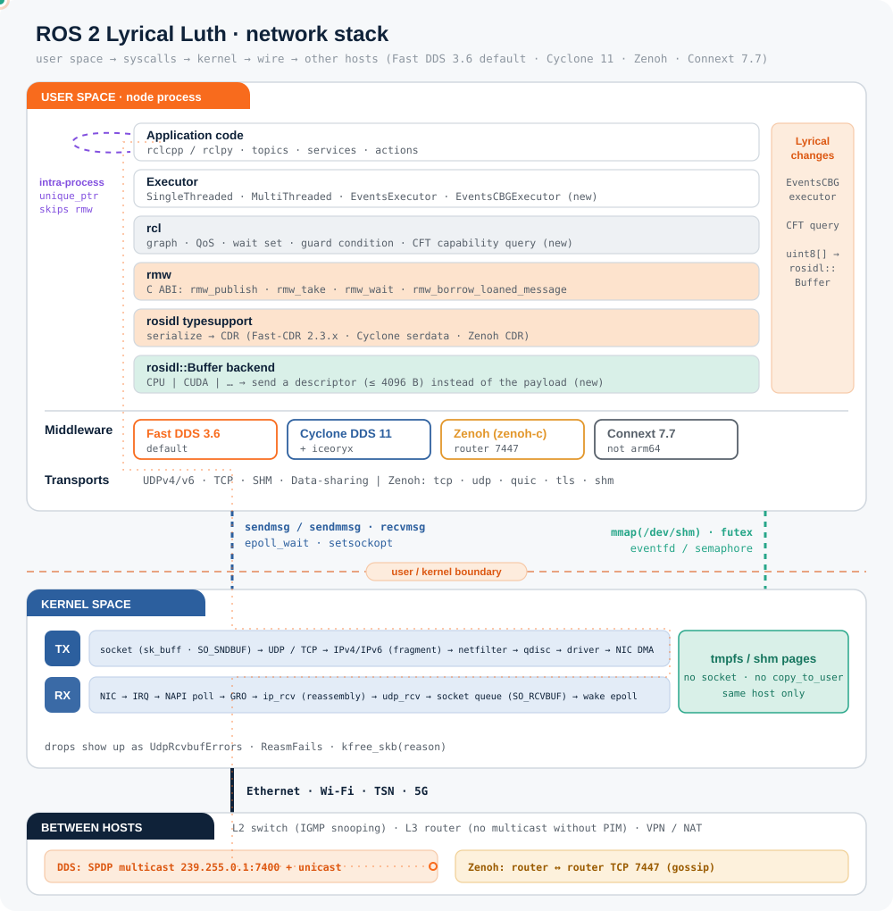
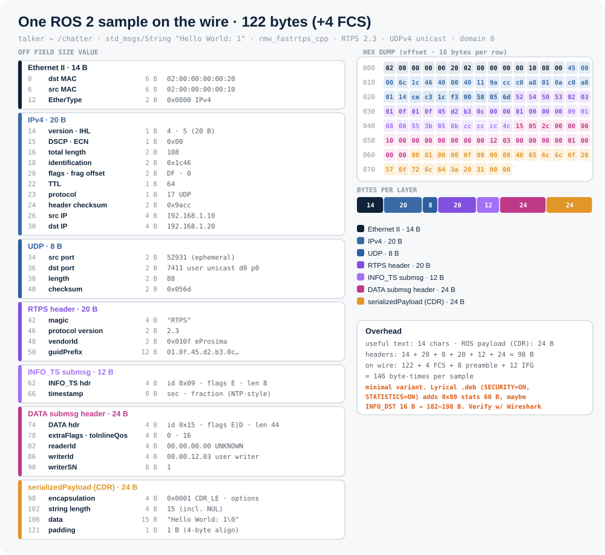
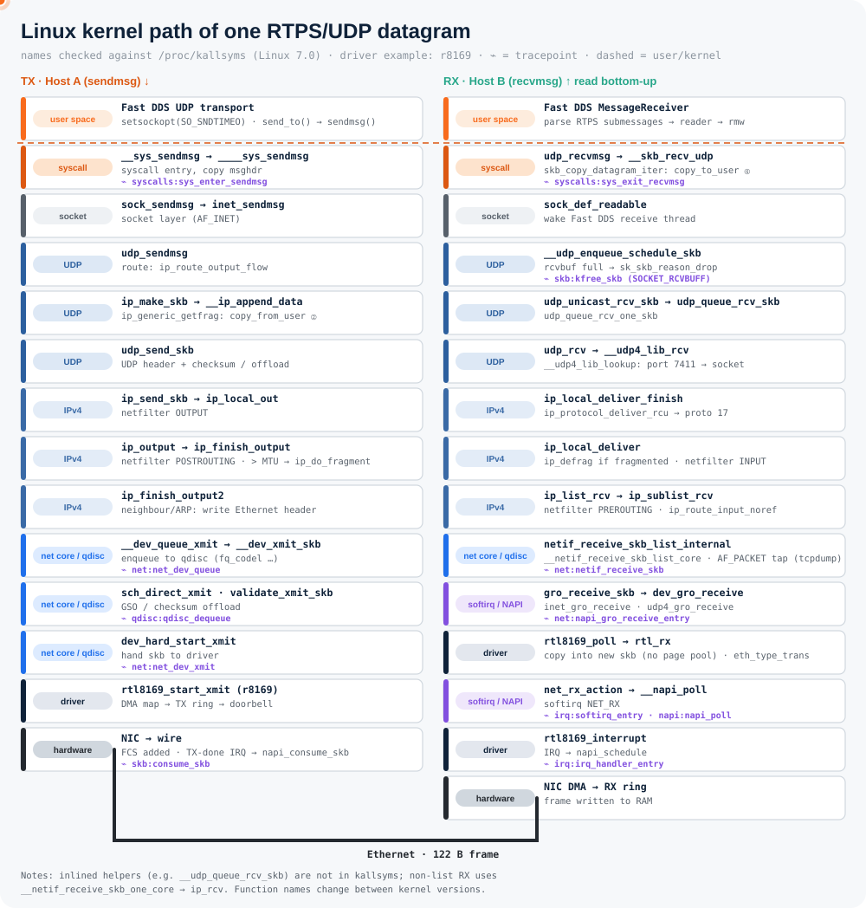

# ROS 2 Lyrical Luth: Network Stack เชิงลึก (User Space → Kernel Space → ระหว่างเครื่อง)

> **ลำดับการอ่าน:** ขั้นที่ 2 และ 4 จาก 8 ([ดูทั้งหมด](../README.md#ลำดับการอ่าน)) · ก่อนหน้า: [หน้า Data Paths](https://alfaxphoori.github.io/ros2/ros2_lyrical/interactive/data-paths.html) · ถัดไป: [ภาค 4 สถาปัตยกรรม](04_architectures.md)

> เอกสารอ้างอิงระดับนักวิจัย สำหรับใช้พัฒนาต่อยอด middleware / transport ของ ROS 2
> สถานะ ณ 2026-11-24 · Distro: **Lyrical Luth** (LTS, ออก 22 พ.ค. 2026, ซัพพอร์ตถึง พ.ค. 2031)

**สัญลักษณ์ระดับความเชื่อมั่น**
- **[V]** ตรวจกับต้นฉบับของ Lyrical แล้ว (ros2_documentation branch `lyrical`, `ros2.repos`, repo `rmw_zenoh` branch `lyrical`)
- **[K]** เป็นความรู้มาตรฐานของ DDS-RTPS / Linux networking ที่ไม่ได้ผูกกับ Lyrical โดยตรง ควรตรวจกับ source หรือ spec ของเวอร์ชันที่ใช้จริงก่อนอ้างอิงใน paper

---

> **ภาค 4 (สถาปัตยกรรม):** [04_architectures.md](04_architectures.md) middleware internals, discovery, data path ในเครื่อง, deployment แบบ fleet/cloud และ security
>
> **ภาค 3 (ทดลองจริง):** [03_wire_experiments.md](03_wire_experiments.md) packet capture จาก Docker พร้อม pcap และสคริปต์ทำซ้ำ
>
> **ภาค 2 (ลึกกว่า):** [02_wire_format_and_kernel.md](02_wire_format_and_kernel.md) ครอบคลุม discovery ระดับ byte, reliable protocol และ DATA_FRAG, Fast DDS internals, Zenoh framing, การนับ `SO_RCVBUF`, latency/CPU budget และหัวข้อวิจัย R1–R9

**วัตถุประสงค์การเรียนรู้** อ่านภาคนี้จบแล้วควรทำได้ดังนี้
1. อธิบายเส้นทางของ sample จาก `publish()` ผ่าน rcl → rmw → middleware → syscall และบอกได้ว่า copy เกิดที่ใด (§1–§2, §4)
2. เปรียบเทียบ RMW 4 ตัวของ Lyrical ในด้าน discovery, SHM default และ daemon ที่ต้องรัน (§3, ตาราง §3.4)
3. คำนวณ UDP port ของ RTPS จาก domain id และ participant id แล้วตรวจกับ pcap จริง (§3.1)
4. ถอด frame 198 B ทีละชั้น (Ethernet/IPv4/UDP/RTPS) และบอกได้ว่าใครเขียนแต่ละ field (§5.4)
5. ไล่ฟังก์ชันของ kernel ขา TX/RX และชี้จุดที่ packet ถูกทิ้งเมื่อ socket buffer เต็ม (§5.2, §5.3, §5.5)

**พื้นฐานที่ควรมี** header ของ Ethernet/IPv4/UDP (port, MTU, fragmentation) · อ่าน hex และ little-endian · ROS 2 pub/sub ระดับใช้งาน (node, topic, `ros2 run`) · Linux CLI · ยังไม่ต้องอ่านภาคอื่นก่อน (แนะนำหน้า Data Paths ตามขั้น 1 ใน README)

แบบฝึกหัด: [exercises.md ภาค 1](exercises.md#ภาค-1) · คำศัพท์: [glossary.md](glossary.md) · สรุปย่อหนึ่งหน้า: [cheatsheet.md](cheatsheet.md)

---

## 0. ข้อเท็จจริงหลักของ Lyrical ที่เกี่ยวกับ network [V]

| หัวข้อ | ค่าใน Lyrical | แหล่ง |
|---|---|---|
| Default RMW | `rmw_fastrtps_cpp` | supported-platforms.rst |
| Fast DDS / Fast CDR | 3.6.x / 2.3.x | ros2.repos |
| Cyclone DDS | 11.0.x (+ iceoryx `release_2.0`) | ros2.repos |
| Connext DDS | 7.7.0 (Tier 1 ยกเว้น arm64) | supported-platforms.rst |
| Zenoh | ตารางในเอกสารระบุ **1.8.0** แต่ comment ใน `zenoh_cpp_vendor/CMakeLists.txt` ของ branch `lyrical` ระบุ **zenoh-c 1.10.1 + fixes** เช็กจาก binary `.deb` ที่ติดตั้งจริงใน image ของ[ภาค 3](03_wire_experiments.md) แล้ว: `rmw_zenoh_cpp` / `zenoh_cpp_vendor` **0.10.6** ภายในเป็น **zenoh-c 1.8.0**, **zenoh-cpp 1.9.0** และ crate **zenoh (Rust) 1.8.0** (git commit `2687c51`) ตรงกับตารางในเอกสาร ไม่ใช่ 1.10.1 | ทั้งสองไฟล์; binary: `zenoh_configure.h`, `zenohc.pc`, `zenohcxx.pc` และ version string ใน `libzenohc.so` ของ package จาก apt (`dpkg -l` ใน image ภาค 3) |
| Tier 1 RMW | fastrtps, cyclonedds, zenoh, connextdds | supported-platforms.rst |
| Tier 2 RMW | `rmw_fastrtps_dynamic_cpp` | supported-platforms.rst |
| Platform Tier 1 | Ubuntu 26.04 Resolute (amd64/arm64), Windows 11 | supported-platforms.rst |
| ภาษา | C++20, C17, Python 3.12–3.14 | supported-platforms.rst |
| **ฟีเจอร์ใหม่ด้าน data path** | `rosidl::Buffer<T>`: ฟิลด์ `uint8[]` ใน C++ เปลี่ยนจาก `std::vector<uint8_t>` เป็น `rosidl::Buffer<uint8_t>` มี backend แบบ pluggable (เช่น CUDA) ตอนนี้รองรับใน `rmw_fastrtps_cpp` และ `rmw_zenoh_cpp` | Release notes, About-Buffer-Backends.rst |
| Executor ใหม่ | `rclcpp::executors::EventsCBGExecutor` (event queue, หลาย thread, ใช้ CPU น้อยกว่า Single/MultiThreaded 10–15%) | Release notes |
| rcl API ใหม่ | `rcl_subscription_is_cft_supported()` ใช้เช็กว่า middleware รองรับ Content Filtered Topic หรือไม่ | Release notes |
| Observability | rosbag2 message-loss events (`/events/rosbag2_messages_lost`), `ros2 topic bw` วัดหลาย topic ได้, ros2_tracing แบบ snapshot/dual session, ปิด tracing ตอน runtime ด้วย `TRACETOOLS_RUNTIME_DISABLE=1` | Release notes |

---

## 1. ภาพรวมแต่ละชั้น



> **Interactive 3D lab:** [`interactive/lyrical-packet-lab.html`](../interactive/lyrical-packet-lab.html) จำลอง 4 hosts ต่อผ่าน switch มี 20 บทเรียน (ภาพรวม, intra-process, serialize, syscall, kernel TX/RX, **packet bytes (hex dump 198 B จาก capture จริง)**, **kernel call path**, loopback, SHM, `rosidl::Buffer`, **service**, **action**, DDS discovery, Zenoh router mesh, observability และ**ผลการทดลองจริง 4 บท**: traffic breakdown, ภาพ RELIABLE + NACK_FRAG, rcvbuf 13/20 → 20/20, Zenoh & SHM) หมุน/ซูมฉากได้ คลิก layer เพื่อดูรายละเอียด และกด Run เพื่อดู trace console ตัวอย่าง
> **เปิดออนไลน์:** https://alfaxphoori.github.io/ros2/ros2_lyrical/interactive/lyrical-packet-lab.html (ต้องใช้เบราว์เซอร์ที่รองรับ WebGL)



<details>
<summary>ASCII version</summary>

```
┌──────────────────────────── USER SPACE (process ของ node) ────────────────────────────┐
│ Application code                                                                       │
│   rclcpp / rclpy (Executor: SingleThreaded, MultiThreaded, EventsExecutor,              │
│                   EventsCBGExecutor[ใหม่])                                             │
│     │  intra-process (unique_ptr, ไม่ผ่าน rmw)  ←── ทางลัดเมื่อ pub/sub อยู่ process เดียวกัน   │
│   rcl  (graph, QoS, wait set, guard condition, CFT capability query)                    │
│   rmw  (C ABI กลาง: rmw_publish / rmw_take / rmw_wait / rmw_borrow_loaned_message)       │
│   rosidl typesupport  ──►  serialization (Fast-CDR 2.3.x / Cyclone serdata / Zenoh CDR) │
│   rosidl::Buffer backend (CPU | CUDA | ...)  ──► descriptor แทน payload                  │
│ ───────────────────────────────────────────────────────────────────────────────────── │
│ Middleware: Fast DDS 3.6 │ Cyclone DDS 11 (+iceoryx) │ Zenoh (zenoh-c) │ Connext 7.7   │
│   Transports: UDPv4/v6, TCP, SHM, Data-sharing, (Zenoh: tcp/udp/quic/tls/shm)           │
└───────────────┬──────────────────────────────────────────────┬─────────────────────────┘
                │ syscalls: sendmsg/sendmmsg, recvmsg,          │ mmap(/dev/shm), futex,
                │ epoll_wait, setsockopt                        │ eventfd/semaphore
┌───────────────▼──────────────── KERNEL SPACE ────────────────▼─────────────────────────┐
│ Socket layer (sk_buff, SO_SNDBUF/SO_RCVBUF)                     tmpfs/shm pages         │
│ UDP / TCP  →  IPv4/IPv6 (fragmentation / reassembly)  →  netfilter                     │
│ qdisc (pfifo_fast/fq/mqprio/taprio)  →  driver  →  NIC DMA ring                         │
│ RX: IRQ → NAPI poll → GRO → ip_rcv → udp_rcv → socket queue → wake epoll                │
└───────────────┬────────────────────────────────────────────────────────────────────────┘
                │ Ethernet / Wi-Fi / TSN / 5G
┌───────────────▼──────────────── ระหว่างเครื่อง ──────────────────────────────────────────┐
│ L2 switch (IGMP snooping), L3 router (multicast ข้ามไม่ได้ถ้าไม่ตั้ง PIM), VPN/NAT       │
│ DDS: SPDP multicast 239.255.0.1 + unicast │ Zenoh: router-to-router TCP 7447             │
└────────────────────────────────────────────────────────────────────────────────────────┘
```

</details>

### 1.1 เทียบกับ OSI 7 Layer



การเทียบชั้นนี้เป็นค่าโดยประมาณ [K] ชั้น 5–7 อยู่ใน user space (rclcpp/rcl → typesupport/CDR → DDS-RTPS หรือ Zenoh) ชั้น 2–4 อยู่ใน kernel (UDP/TCP → IP → driver) และชั้น 1 เป็น hardware ส่วน SHM, loaned messages และ `rosidl::Buffer` backend ข้ามชั้น 1–4 ไปได้เมื่อส่งระหว่าง process บนเครื่องเดียวกัน

---

## 2. User space (ละเอียด)

### 2.1 rclcpp → rcl → rmw [K, ยืนยันโครงสร้างจาก repo]

1. `Publisher<T>::publish(msg)`
   - ถ้าเปิด intra-process และมี subscriber ใน process เดียวกัน: ส่ง `unique_ptr`/`shared_ptr` ผ่าน `IntraProcessManager` เข้า ring buffer ของ subscription โดยไม่ serialize
   - ถ้ามี subscriber นอก process: เรียก `rcl_publish()` → `rmw_publish()`
2. `rmw_publish()` เรียก typesupport (`rosidl_typesupport_fastrtps_cpp` / introspection) เพื่อ serialize เป็น **CDR** (XCDR v1/v2 ขึ้นกับ RMW และ type) แล้วส่งให้ DataWriter ของ middleware
3. ฝั่งรับ: middleware ได้ sample → แจ้ง listener → RMW trigger guard condition หรือ event callback → executor ปลุก → `rmw_take()` deserialize → callback

**จุดที่เกิด copy (ค่า default ไม่ใช้ SHM/loan):**

| # | copy | ชั้น |
|---|---|---|
| 1 | message C++ → CDR buffer | rmw/typesupport (serialize) |
| 2 | CDR buffer → sk_buff | kernel (`copy_from_user` ใน sendmsg) |
| 3 | sk_buff → NIC (DMA, ไม่นับ CPU copy) / loopback ข้าม skb | kernel |
| 4 | sk_buff → user buffer | kernel (`copy_to_user` ใน recvmsg) |
| 4′ | RX DMA buffer → skb ใหม่ | kernel driver ที่ copy ทุก packet เช่น `r8169` ไม่ใช้ page pool จึงมี copy ฝั่งรับใน kernel 2 รอบ [แก้ไข 2026-11-24 ตามภาค 2] |
| 5 | CDR → message C++ | rmw (deserialize) |

ถ้าส่งผ่าน DDS history (KEEP_LAST/RELIABLE) อาจมี copy เพิ่มเข้า history cache ด้วย ขึ้นกับ implementation

### 2.2 Executor และ wait mechanism [V/K]
- **Wait-set executors** (Single/Multi): `rcl_wait()` → `rmw_wait()` ใช้ condition variable ภายใน RMW ซึ่งลงไปเป็น `futex` ใน kernel ส่วนตัว middleware เองมี receive thread ที่ block อยู่บน `recvmsg`/`epoll`
- **EventsExecutor / EventsCBGExecutor** [V]: RMW เรียก callback (`rmw_*_set_on_new_message_callback`) แล้ว push event ลงคิวโดยไม่ต้องสร้าง wait set ใหม่ทุกรอบ ตัว CBG แยก callback group ได้และรองรับหลาย clock source/หลาย thread ประหยัด CPU 10–15% ตามที่ release notes ระบุ
- งานวิจัยที่ควรทำต่อ: วัด end-to-end latency ของ EventsCBGExecutor เทียบกับ executor อื่นบน PREEMPT_RT (ตอนนี้ release notes ให้มาแค่ตัวเลข CPU)

### 2.3 กลไกลด copy มีอยู่ 4 แบบ และเป็นอิสระต่อกัน [V]

| กลไก | ขอบเขต | ข้อจำกัด |
|---|---|---|
| Intra-process | ใน process เดียวกัน | ต้องเปิด `use_intra_process_comms`, QoS บางแบบใช้ไม่ได้ |
| Loaned messages (`borrow_loaned_message`) | ข้าม process บนเครื่องเดียวกัน ผ่าน SHM ของ RMW | ใช้ได้กับ **plain/bounded type** เท่านั้น (ไม่มี string/sequence แบบ unbounded) |
| Type adaptation (REP 2007/2009, เช่น NITROS) | ใน process เท่านั้น | ไม่ข้าม process |
| **`rosidl::Buffer` backends (ใหม่ใน Lyrical)** | ขึ้นกับ backend: intra-host หรือ inter-host ก็ได้ | ใช้กับ **topic เท่านั้น** (service/action ยังใช้ serialization ปกติ), descriptor ใหญ่ได้ไม่เกิน `rosidl::kMaxBufferDescriptorSize` = 4096 bytes |

### 2.4 `rosidl::Buffer` ทำงานอย่างไร [V]

แพ็กเกจหลัก
- `rosidl_buffer`: `rosidl::Buffer<T>` + `BufferImplBase<T>` (pimpl) โดย default ใช้ `CpuBufferImpl<T>` ที่ห่อ `std::vector<T>` และแปลงเป็น `std::vector<T>&` แบบ implicit ได้ จึงเข้ากับโค้ดเดิม
- `rosidl_buffer_backend`: interface ของ plugin `rosidl::BufferBackend`
- `rosidl_buffer_backend_registry`: หา backend ผ่าน `pluginlib`

ลำดับการทำงาน (non-CPU backend)
1. ตอน discovery: backend ได้รับ hook `on_creating_endpoint` (local) และ `on_discovering_endpoint` (remote) เพื่อตัดสินว่า peer คู่นั้นใช้ transport ของตัวเองได้หรือไม่ (เช่น CUDA backend จะรับ peer เฉพาะเมื่อแชร์ CUDA VMM allocation ได้อย่างปลอดภัย)
2. ตอน publish: RMW เรียก `create_descriptor_with_endpoint()` แล้ว serialize **descriptor message** (ไม่ใช่ข้อมูลจริง) ลงตำแหน่งของฟิลด์ `uint8[]`
3. ตอนรับ: RMW deserialize descriptor แล้วเรียก `from_descriptor_with_endpoint()` เพื่อประกอบ `BufferImplBase<T>` กลับมา (เช่น เปิด CUDA IPC handle)
4. ถ้า backend คืนค่า `nullptr` RMW จะ **fallback ไป serialize แบบ CPU ปกติ**

ผลต่อ network stack: เมื่อ backend ทำงาน payload ขนาดใหญ่จะไม่ผ่าน kernel socket path เลย เหลือแค่ descriptor ขนาดไม่เกิน 4 KB ที่วิ่งผ่าน UDP/SHM ปกติ ส่วน payload จริงไปทางช่องของ backend เอง (CUDA IPC, SHM, หรือในอนาคตอาจเป็น RDMA) จุดนี้เปิดทางวิจัยได้กว้างมาก (ดูหัวข้อ 7)

ข้อสังเกตด้าน implementation: plugin contract ไม่ผูกกับ RMW ตัวใด (`get_descriptor_type_support()` คืน aggregate handle) แต่ `rmw_fastrtps_cpp` ตอนนี้ resolve ไปที่ `rosidl_typesupport_fastrtps_cpp`

ข้อความที่เกี่ยวข้อง: `tensor_msgs/msg/ExperimentalTensor` (metadata แบบ DLPack + `uint8[] data`) และ `torch_conversions`

---

## 3. RMW และ middleware แต่ละตัว

### 3.1 `rmw_fastrtps_cpp` + Fast DDS 3.6.x (default) [V: เวอร์ชัน · K: รายละเอียด protocol]

**การ map ROS → DDS**
- 1 Context ≈ 1 DomainParticipant (ตั้งแต่ Foxy เป็นต้นมา node หลายตัวใน process เดียวกันแชร์ participant)
- Topic `/chatter` → DDS topic `rt/chatter`, service → `rq/<srv>Request` และ `rr/<srv>Reply`
- ข้อมูล graph ของ ROS (node ↔ endpoint) ส่งผ่าน topic `ros_discovery_info` (`rmw_dds_common`)

**Discovery (RTPS)**
- SPDP (Participant discovery): ส่ง multicast ไปที่ `239.255.0.1` + unicast ไปยัง initial peers
- SEDP (Endpoint discovery): ส่ง reliable unicast ระหว่าง participant
- ช่วงของ discovery คุมด้วย `ROS_AUTOMATIC_DISCOVERY_RANGE` (`SUBNET`/`LOCALHOST`/`OFF`/`SYSTEM_DEFAULT`) และ `ROS_STATIC_PEERS` (มีมาตั้งแต่ Iron)
- ทางเลือก: Fast DDS **Discovery Server** (`fastdds discovery -i 0`, `ROS_DISCOVERY_SERVER=ip:port`) ลด traffic จาก O(N²) ให้เหลือ client/server

**สูตรพอร์ตตาม RTPS spec** (PB=7400, DG=250, PG=2, d0=0, d1=10, d2=1, d3=11)
```
SPDP multicast   = 7400 + 250·domain + 0
SPDP unicast     = 7400 + 250·domain + 10 + 2·participantId
User multicast   = 7400 + 250·domain + 1
User unicast     = 7400 + 250·domain + 11 + 2·participantId
```
เช่น domain 0, participant 0 จะได้ 7400 / 7410 / 7401 / 7411 (ต้องเปิดใน firewall)

**Transports ของ Fast DDS**
- `UDPv4` (default) และ `SHM` (default บนเครื่องเดียวกัน: Fast DDS เปิด SHM transport ให้อัตโนมัติ)
- `FASTDDS_BUILTIN_TRANSPORTS=DEFAULT|UDPv4|SHM|LARGE_DATA|...` โดย `LARGE_DATA` ใช้ TCP สำหรับ user data + UDP สำหรับ discovery + SHM ช่วยแก้ปัญหา IP fragmentation ของข้อความใหญ่ (ดูตาราง tuning และผลวัดใน[ภาค 3 §15](03_wire_experiments.md#15-การทดลองที่-13-dds-tuning))
- **Data-sharing delivery**: zero-copy ระหว่าง DataWriter/DataReader บน host เดียวกัน แต่ `rmw_fastrtps_cpp` ของ Lyrical **สั่ง `data_sharing().off()` เป็นค่าเริ่มต้น** ทั้ง writer และ reader จะเปิดได้ต้องตั้ง `RMW_FASTRTPS_USE_QOS_FROM_XML=1` พร้อม XML profile [แก้ไข 2026-11-24 ตามภาค 2]
- Native Buffers / `rosidl::Buffer` integration [V] (ข่าวจาก eProsima และ release notes)

**SHM ในระดับ OS** [K]: Fast DDS 3.6.x สร้าง segment ใน `/dev/shm` ชื่อ `fastdds_port<N>` และ `fastdds_<uuid>` (data-sharing ใช้ `fast_datasharing_…`) [แก้ไข 2026-11-24 ตามภาค 2] แล้ว map ด้วย `mmap` ใช้ named semaphore/futex แจ้งเตือน และมี port file ไว้ประกาศ "SHM port" ถ้า process crash อาจมีไฟล์ค้าง ล้างได้ด้วย `fastdds shm clean`

### 3.2 `rmw_cyclonedds_cpp` + Cyclone DDS 11.0.x [V: เวอร์ชัน · K: รายละเอียด]
- ตั้งค่าผ่าน XML ใน `CYCLONEDDS_URI` (เช่น `General/Interfaces`, `Internal/SocketReceiveBufferSize`, `General/MaxMessageSize`) ดูตาราง tuning และผลวัดใน[ภาค 3 §15](03_wire_experiments.md#15-การทดลองที่-13-dds-tuning)
- SHM ทำผ่าน **iceoryx** (`release_2.0` อยู่ใน ros2.repos) ต้องรัน RouDi daemon (`iox-roudi`) และเปิด `<SharedMemory><Enable>true`
- เอกสาร ROS แนะนำให้เพิ่ม `net.core.rmem_max` เพราะ Cyclone ขอ socket receive buffer ขนาดใหญ่

### 3.3 `rmw_zenoh_cpp` (Tier 1) [V จาก README/config branch lyrical]

**สถาปัตยกรรม**
- แต่ละ context เปิด **Zenoh session** ใน `mode: "peer"`
- **Router** `ros2 run rmw_zenoh_cpp rmw_zenohd` ฟังอยู่ที่ `tcp/…:7447` โดย default
- **ปิด multicast scouting ไว้เป็นค่าเริ่มต้น** node จึงหากันผ่าน **gossip ของ router** ดังนั้นถ้าไม่รัน router node จะหากันไม่เจอ
- หลังหากันเจอแล้ว peer จะเชื่อมกันตรง (peer-to-peer) ข้อมูลไม่ได้วิ่งผ่าน router (ภายในเครื่องเดียวกัน)
- ข้ามเครื่อง: ตั้ง router config ให้ `connect/endpoints=["tcp/<other-host>:7447"]` ตามค่า default แล้ว discovery ถูกจำกัดอยู่ใน host
- Graph ใช้ **liveliness tokens** ของ Zenoh แทน SPDP/SEDP [K]
- Env สำคัญ: `ZENOH_ROUTER_CHECK_ATTEMPTS` (0 = รอไม่จำกัด, <0 = ข้าม, >0 = จำนวนครั้ง), `ZENOH_ROUTER_CONFIG_URI`, `ZENOH_SESSION_CONFIG_URI`, `ZENOH_CONFIG_OVERRIDE="key/path=value;..."`

**Shared memory ใน Zenoh (ค่า default ของ ROS)**
```json5
shared_memory: {
  enabled: false,                 // "ROS setting: disabled by default until fully tested"
  mode: "lazy",
  transport_optimization: {
    enabled: true,
    pool_size: 50331648,          // 48 MiB (เผื่อเฟรม 4K ขนาด 24 MiB ได้ 2 เฟรมใน flight)
    message_size_threshold: 512,  // ข้อความ >= 512 B จะถูกย้ายเข้า SHM
  }
}
```
→ เปิดใช้ได้ด้วย `ZENOH_CONFIG_OVERRIDE='transport/shared_memory/enabled=true'` (ต้องเปิด**ทั้งสองฝั่ง** เพราะมีขั้น probing ตอนเปิด session)

**Transport ของ Zenoh**: tcp, udp, quic, tls, unixsock-stream (ขึ้นกับ feature ตอน build) [K] และมี `zenoh_security_tools` สำหรับ SROS2-equivalent [V มีแพ็กเกจ]

### 3.4 ตารางเปรียบเทียบ (ใช้วางแผนการทดลอง)

| คุณสมบัติ | Fast DDS 3.6 | Cyclone 11 | Zenoh | Connext 7.7 |
|---|---|---|---|---|
| Discovery default | SPDP multicast | SPDP multicast | router gossip (TCP) | SPDP multicast |
| ต้องมี daemon | ไม่ต้อง (DS เป็นทางเลือก) | RouDi (ถ้าใช้ SHM) | `rmw_zenohd` | ไม่ต้อง |
| SHM default | เปิด | ปิด | ปิด | ขึ้นกับ config |
| `rosidl::Buffer` [V] | ✔ | ✘ (ยังไม่มีในเอกสาร) | ✔ | ✘ (ยังไม่มีในเอกสาร) |
| ทำงานดีบน Wi-Fi / multicast จำกัด | ปานกลาง (ใช้ DS ช่วย) | ปานกลาง | ดี (unicast TCP) | ปานกลาง |

---

## 4. ขอบเขตระหว่าง user space กับ kernel [K]

| การทำงาน | syscall / กลไก | ข้อสังเกต |
|---|---|---|
| ส่ง UDP | `setsockopt(SO_SNDTIMEO)` + `sendmsg` | Fast DDS 3.6.x เรียก 2 syscall ต่อ datagram ไม่พบ `sendmmsg` ใน Fast DDS, Cyclone หรือ Zenoh [แก้ไข 2026-11-24 ตามภาค 2] |
| รับ UDP | `recvmsg` ใน receive thread แบบ blocking หรือ `epoll` | Fast DDS ใช้ thread ต่อ locator |
| ส่ง/รับ TCP | `send`/`recv`, `epoll` | Zenoh, Fast DDS TCP/LARGE_DATA |
| SHM | `shm_open` + `mmap` (`/dev/shm`, tmpfs) | ข้อมูลไม่ผ่าน kernel network stack |
| แจ้งเตือน | `futex` (condvar/semaphore), `eventfd` | เกิด context switch, wakeup latency ขึ้นกับ scheduler |
| ตั้งค่า socket | `setsockopt(SO_RCVBUF/SO_SNDBUF/IP_MULTICAST_*/SO_PRIORITY)` | ถูกจำกัดด้วย `rmem_max`/`wmem_max` |
| GPU (Buffer backend) | ioctl ของ driver CUDA (`cuIpcGetMemHandle`/VMM) | อยู่นอก network stack ทั้งหมด |

เครื่องมือดู: `strace -f -e trace=network,ipc -p <pid>`, `perf trace`, `bpftrace -e 'tracepoint:syscalls:sys_enter_sendmsg /comm=="talker"/ {@[ustack]=count()}'`

---

## 5. Kernel space: เส้นทางของ packet [K]

### 5.1 TX
```
sendmsg() → sock_sendmsg → udp_sendmsg
  → ip_make_skb (copy_from_user, สร้าง sk_buff; ถ้าเกิน MTU จะ fragment หรือใช้ UDP GSO)
  → ip_local_out → netfilter (OUTPUT/POSTROUTING)
  → dev_queue_xmit → qdisc (fq_codel / mqprio / taprio[TSN])
  → driver ndo_start_xmit → NIC TX ring (DMA)
```

### 5.2 RX
```
NIC → DMA ring → IRQ → NAPI poll (softirq NET_RX) → GRO
  → __netif_receive_skb → ip_rcv → (reassembly ถ้าเป็น fragment) → udp_rcv
  → __udp_enqueue_schedule_skb (ถ้า sk_rcvbuf เต็ม → DROP, นับใน UdpRcvbufErrors)
  → sk_data_ready → ปลุก thread ที่รออยู่ใน recvmsg/epoll
recvmsg() → skb_copy_datagram_iter (copy_to_user)
```
บนเครื่องเดียวกันถ้าไม่ใช้ SHM packet จะวิ่งผ่าน `lo` คือผ่าน stack เต็มทั้งสองทิศ แต่ไม่ผ่าน NIC

### 5.3 คอขวดคลาสสิกของ ROS 2 ในระดับ kernel

1. **IP fragmentation**: RTPS ส่ง datagram ได้ใหญ่ถึงประมาณ 64 KB ซึ่งแตกเป็น fragment 45 ชิ้นที่ MTU 1500 (datagram เต็มของ Fast DDS = UDP 65 476 B) ถ้าหายแม้ชิ้นเดียว ทั้ง datagram จะถูกทิ้ง และถ้า reassembly buffer เต็มก็จะทิ้งเช่นกัน
2. **Socket receive buffer overflow** จากรูปภาพ/point cloud ที่มาเป็น burst
3. **Wakeup latency** ของ receive thread → executor (เกิด context switch 2 ครั้ง)
4. **Wi-Fi multicast** ถูกส่งที่ basic rate ทำให้ SPDP ช้าหรือหาย

ค่าแนะนำที่ใช้กันทั่วไป (ตามแนวทาง "DDS tuning" ในเอกสาร ROS 2 ควรตรวจหน้า Lyrical อีกครั้ง):
```bash
sudo sysctl -w net.ipv4.ipfrag_time=3                 # ทิ้ง fragment ที่ค้างเร็วขึ้น (default 30 s)
sudo sysctl -w net.ipv4.ipfrag_high_thresh=134217728  # 128 MiB reassembly memory
sudo sysctl -w net.core.rmem_max=2147483647           # อนุญาตให้ขอ SO_RCVBUF ใหญ่
sudo sysctl -w net.core.rmem_default=8388608
```
เพิ่มเติม: IRQ affinity / RPS / RFS, `ethtool -G` (ขนาด ring), `ethtool -C` (coalescing), jumbo frame (MTU 9000) บนเครือข่ายที่ควบคุมเองได้, kernel PREEMPT_RT (ตั้งแต่ Linux 6.12 รวมเข้า mainline แล้ว), `SO_BUSY_POLL`

ตัวชี้วัดที่ต้องเฝ้าดู:
```bash
nstat -az | grep -E 'UdpRcvbufErrors|UdpInErrors|ReasmFails|ReasmTimeout'
cat /proc/net/snmp ; ss -uamp ; ethtool -S <iface> | grep -i drop
```

---

### 5.4 Packet จริงระดับ byte: หนึ่ง sample บนสาย



> **[แก้ไข 2026-11-27 ตาม capture ภาค 3]:** ฉบับก่อนใช้ frame สังเคราะห์ 122 B (`std_msgs/String`, readerId `UNKNOWN`, ไม่มี INFO_DST และ statistics submessage) ตอนนี้เปลี่ยนเป็น frame จริงจาก[ภาค 3](03_wire_experiments.md) ยาว **198 B** frame 122 B เดิมคือ frame เดียวกันนี้ที่ตัด INFO_DST 16 B และ statistics submessage `0x80` 60 B ออก (198 − 16 − 60 = 122) ซึ่งเป็นรูปสมมติของ build ที่ปิด `FASTDDS_STATISTICS` และไม่ได้ใส่ INFO_DST (ยังไม่ได้ capture build แบบนั้น) binary `.deb` ของ Lyrical build Fast DDS ด้วย `-DSECURITY=ON` (RTPS version 2.3) และเปิด `FASTDDS_STATISTICS` ตามค่าเริ่มต้น ผู้ที่ build จาก source โดยไม่ใส่ flag จะได้ version 2.2 รายละเอียดอยู่ใน[ภาค 2 §3.7](02_wire_format_and_kernel.md#37-build-option-ที่เปลี่ยน-byte-บนสาย) ภาพ animation ด้านบนสร้างจาก frame นี้โดยตรง (`tools/gen_packet_kernel_svgs.py` อ่าน frame 95 จาก pcap)

ตัวอย่างนี้คือ frame 95 ใน [`captures/exp1_fastdds_default.pcap`](../captures/exp1_fastdds_default.pcap) (การทดลองที่ 1 ของภาค 3): `demo_nodes_cpp talker` ส่ง `example_interfaces/msg/String` ค่า `"Hello World: 1"` บน topic `/chatter` (ชื่อบนสาย `rt/chatter`, type บนสาย `example_interfaces::msg::dds_::String_`) ผ่าน `rmw_fastrtps_cpp` (`ros-lyrical-fastdds 3.6.2` จาก apt) แบบ UDPv4 unicast จาก container 172.20.0.3 ไปยัง listener 172.20.0.2 ที่ domain 0, participant 0 ทุก byte มาจาก capture จริง (MAC, IP, guidPrefix และ timestamp เป็นค่าของ container ในการทดลอง) [V: capture ภาค 3, ถอดด้วย `tools/rtps_peek.py frame`]

```
0000  62 1b 4b 57 a2 ac 42 8d e7 ce ea 36 08 00 45 00   Ethernet dst/src/type │ IPv4 →
0010  00 b8 10 29 40 00 40 11 d1 de ac 14 00 03 ac 14   len=184 id DF TTL=64 proto=17 csum src dst
0020  00 02 b0 4f 1c f3 00 a4 58 e3 52 54 50 53 02 03   UDP 45135→7411 len=164 csum │ "RTPS" v2.3
0030  01 0f 01 0f 11 31 1a 00 bc 0d 00 00 00 00 0e 01   vendor 0x010f · guidPrefix │ INFO_DST
0040  0c 00 01 0f 2c 17 1d 00 1c 48 00 00 00 00 09 01   len=12 · guidPrefix ของ listener │ INFO_TS
0050  08 00 b1 58 05 6b 63 88 85 8b 15 05 2c 00 00 00   timestamp │ DATA flags=E|D len=44
0060  10 00 00 00 13 04 00 00 13 03 00 00 00 00 01 00   toInlineQos=16 readerId writerId SN=1
0070  00 00 00 01 00 00 0f 00 00 00 48 65 6c 6c 6f 20   CDR_LE · len=15 · "Hello "
0080  57 6f 72 6c 64 3a 20 31 00 00 80 01 38 00 01 00   "World: 1\0" + pad │ 0x80 statistics len=56
0090  00 00 f3 1c 00 00 00 00 00 00 00 00 00 00 00 00   locator UDPv4 port 7411 …
00a0  00 00 ac 14 00 02 b1 58 05 6b 07 49 88 8b 05 00   … 172.20.0.2 │ timestamp │ sequence
00b0  00 00 00 00 00 00 94 02 00 00 00 00 00 00 00 00
00c0  00 00 00 00 00 00
```

| ชั้น | ขนาด | field สำคัญ | ใครเขียน field นี้ |
|---|---|---|---|
| Ethernet II | 14 B (+4 FCS บนสายจริง; ไม่อยู่ใน pcap) | dst/src MAC, EtherType 0x0800 | kernel `ip_finish_output2` → neighbour/ARP cache; NIC เติม FCS |
| IPv4 | 20 B | total length 184, ID, DF, TTL 64 (multicast มักตั้ง TTL=1), protocol 17, checksum | kernel `ip_make_skb` / `__ip_append_data` |
| UDP | 8 B | src port 45135 (ephemeral ของ send socket), dst port **7411** = 7400 + 250·0 + 11 + 2·0, length 164, checksum (หรือ offload ให้ NIC) | kernel `udp_send_skb` |
| RTPS header | 20 B | `"RTPS"`, version 2.3, vendorId 0x010f (eProsima), guidPrefix 12 B | Fast DDS (`RTPSMessageGroup`) |
| INFO_DST | 16 B | submessage id 0x0e, flag E, guidPrefix 12 B ของ participant ปลายทาง (listener) | Fast DDS |
| INFO_TS | 12 B | submessage id 0x09, flag E (little endian), source timestamp | Fast DDS |
| DATA header | 24 B | id 0x15, flags E\|D, length 44 (= 20 ส่วนคงที่ + 24 payload), octetsToInlineQos=16, readerId `00.00.13.04` (user reader ปลายทาง, ไม่มี key), writerId `00.00.13.03` (user writer, ไม่มี key), writerSN 1 | Fast DDS writer |
| serializedPayload | 24 B | encapsulation `0x0001` = CDR_LE (XCDR1), options, CDR body: `uint32` length 15 + `"Hello World: 1\0"` + pad 1 | rmw typesupport (Fast-CDR 2.3.x) |
| statistics `0x80` | 60 B | header 4 + `StatisticsSubmessageData` 56: locator ปลายทาง (UDPv4 172.20.0.2:7411) 24, timestamp 8, sequence 24 | Fast DDS (`add_stats_submsg`, เพราะ compile ด้วย `FASTDDS_STATISTICS`) |

รวม: 14 + 20 + 8 + 20 + 16 + 12 + 24 + 24 + 60 = **198 B** (UDP payload = RTPS message 156 B, IPv4 total length 184 B)

ข้อสังเกตสำหรับงานวิจัย
- **Overhead:** ข้อความจริงยาว 14 ตัวอักษร แต่ใช้ 222 byte-times บนสาย (198 + FCS 4 + preamble 8 + IFG 12) statistics submessage อย่างเดียวก็ยาว 60 B แล้ว ข้อความเล็กจึงเปลือง header เกือบทั้งหมด การรวมหลาย sample ไว้ในข้อความ RTPS เดียวกัน (Fast DDS ทำ message grouping) จึงช่วยได้มาก [K]
- **Submessage ที่อาจเพิ่มเข้ามา:** นอกจาก `INFO_DST` (16 B รวม header) และ statistics submessage `0x80` (60 B) ที่อยู่ใน frame นี้แล้ว ยังมี `HEARTBEAT` / `ACKNACK` เมื่อเป็น RELIABLE, `DATA_FRAG` เมื่อข้อมูลใหญ่เกินขนาด datagram, และ inline QoS (เช่น key hash เมื่อ type มี key) [K]
- ค่าใน field ขึ้นกับ implementation และเวอร์ชัน ควรยืนยันกับ capture จริงก่อนอ้างอิง

```bash
# capture แล้วเปิดใน Wireshark (มี RTPS dissector ในตัว)
sudo tcpdump -i <iface> -w chatter.pcap 'udp portrange 7400-7500'
tshark -r chatter.pcap -Y 'rtps.sm.id == 0x15' -V | less     # DATA submessages
tshark -r chatter.pcap -Y rtps -x | head -40                  # hex dump
```

### 5.5 เส้นทางใน Linux kernel ทีละฟังก์ชัน (TX และ RX)



ชื่อฟังก์ชันทุกตัวด้านล่างตรวจแล้วว่ามีอยู่ใน `/proc/kallsyms` ของ Linux 7.0.0 (Ubuntu 26.04 generic) ฟังก์ชันที่ถูก inline จะไม่ปรากฏใน kallsyms และชื่อฟังก์ชันอาจเปลี่ยนตามเวอร์ชัน kernel เช่น symbol `napi_gro_receive` ไม่มีแล้ว (ยังเป็น `static inline` ที่ห่อ `gro_receive_skb` และ driver ยังเรียกชื่อเดิม) ตัวอย่าง driver ใช้ `r8169` (Realtek)

**User space ก่อนถึง kernel (Fast DDS 3.6) [K: ตรวจ symbol ด้วย `perf`/`gdb` อีกครั้ง]**
`rclcpp::Publisher::publish` → `rcl_publish` → `rmw_publish` (`rmw_fastrtps_shared_cpp`) → serialize ด้วย typesupport → `DataWriter::write` → writer history → `RTPSMessageGroup` (ประกอบ RTPS header + INFO_TS + DATA) → `UDPTransportInterface::send` → `setsockopt(SO_SNDTIMEO)` → asio `send_to()` → **`sendmsg()`** (publish mode เริ่มต้นเป็น SYNCHRONOUS จึงรันใน thread ที่เรียก `publish()`)

**TX (Host A)**

| # | subsystem | ฟังก์ชัน | หน้าที่ | tracepoint |
|---|---|---|---|---|
| 1 | syscall | `__sys_sendmsg` → `____sys_sendmsg` | เข้า kernel, copy `msghdr` | `syscalls:sys_enter_sendmsg` |
| 2 | socket | `sock_sendmsg` → `inet_sendmsg` | dispatch ตาม protocol family | |
| 3 | UDP | `udp_sendmsg` | หา route (`ip_route_output_flow`), corking | |
| 4 | UDP/IP | `ip_make_skb` → `__ip_append_data` | จอง `sk_buff`, **copy_from_user** (`ip_generic_getfrag`) = copy ที่ ② | |
| 5 | UDP | `udp_send_skb` | เขียน UDP header + checksum (หรือ `CHECKSUM_PARTIAL` ให้ NIC) | |
| 6 | IPv4 | `ip_send_skb` → `ip_local_out` → `__ip_local_out` | netfilter `NF_INET_LOCAL_OUT` | |
| 7 | IPv4 | `ip_output` → `ip_finish_output` → `__ip_finish_output` | netfilter `POST_ROUTING`; ถ้าใหญ่กว่า MTU → `ip_do_fragment` | |
| 8 | neighbour | `ip_finish_output2` → `neigh_resolve_output` | ARP/neighbour cache เขียน Ethernet header | |
| 9 | net core | `__dev_queue_xmit` → `__dev_xmit_skb` | เข้า qdisc (`fq_codel`, `mqprio`, `taprio`) | `net:net_dev_queue` |
| 10 | qdisc | `__qdisc_run` → `sch_direct_xmit` → `validate_xmit_skb` | dequeue, GSO, checksum offload (`skb_csum_hwoffload_help`) | `qdisc:qdisc_dequeue` |
| 11 | net core | `dev_hard_start_xmit` | ส่ง skb ให้ driver | `net:net_dev_start_xmit`, `net:net_dev_xmit` |
| 12 | driver | `rtl8169_start_xmit` | DMA map → TX descriptor ring → doorbell | |
| 13 | NIC | hardware | เติม FCS ส่งออกสาย; TX-done IRQ → `napi_consume_skb` คืน skb | `skb:consume_skb` |

**RX (Host B)**

| # | subsystem | ฟังก์ชัน | หน้าที่ | tracepoint |
|---|---|---|---|---|
| 1 | NIC | hardware | DMA frame ลง RX ring แล้วยิง MSI-X (`r8169` ไม่ใช้ page pool และ copy ทุก packet ไป skb ใหม่) | |
| 2 | driver | `rtl8169_interrupt` | ปิด IRQ, `napi_schedule` | `irq:irq_handler_entry` |
| 3 | softirq | `net_rx_action` → `__napi_poll` | ทำงานใน `NET_RX_SOFTIRQ` (หรือ ksoftirqd) | `irq:softirq_entry`, `napi:napi_poll` |
| 4 | driver | `rtl8169_poll` → `rtl_rx` | สร้าง skb, `eth_type_trans` ตั้ง protocol | |
| 5 | GRO | `gro_receive_skb` → `dev_gro_receive` → `inet_gro_receive` → `udp4_gro_receive` | รวม packet (UDP GRO ทำงานเมื่อเปิดใช้) | `net:napi_gro_receive_entry` |
| 6 | net core | `netif_receive_skb_list_internal` → `__netif_receive_skb_list_core` | ส่งให้ AF_PACKET tap (tcpdump เห็น packet ที่จุดนี้) แล้วจึง dispatch ตาม EtherType | `net:netif_receive_skb` |
| 7 | IPv4 | `ip_list_rcv` → `ip_sublist_rcv` → `ip_rcv_finish` | netfilter `PRE_ROUTING`, `ip_route_input_noref` (เป็น local) | |
| 8 | IPv4 | `ip_local_deliver` | ถ้าเป็น fragment → `ip_defrag` (คุมด้วย `ipfrag_*`); netfilter `LOCAL_IN` | |
| 9 | IPv4 | `ip_local_deliver_finish` → `ip_protocol_deliver_rcu` | ส่งให้ protocol 17 | |
| 10 | UDP | `udp_rcv` → `__udp4_lib_rcv` → `__udp4_lib_lookup` | หา socket จาก dst port 7411 (multicast ใช้เส้นทาง mcast deliver) | |
| 11 | UDP | `udp_unicast_rcv_skb` → `udp_queue_rcv_skb` → `udp_queue_rcv_one_skb` | ตรวจ checksum, socket filter (BPF) | |
| 12 | UDP | `__udp_enqueue_schedule_skb` | ถ้า `sk_rcvbuf` เต็ม → `sk_skb_reason_drop` (`SKB_DROP_REASON_SOCKET_RCVBUFF`) | `skb:kfree_skb`, `sock:sock_rcvqueue_full` |
| 13 | socket | `sock_def_readable` | ปลุก thread ที่รออยู่ใน `recvmsg`/`epoll` | |
| 14 | syscall | `____sys_recvmsg` → `sock_recvmsg` → `inet_recvmsg` → `udp_recvmsg` → `__skb_recv_udp` → `skb_copy_datagram_iter` | **copy_to_user** = copy ที่ ④ | `syscalls:sys_exit_recvmsg` |

**User space หลัง kernel (Fast DDS 3.6) [K]**
receive thread ของ `UDPChannelResource` → `MessageReceiver::processCDRMsg` (แยก submessage: INFO_TS → DATA) → reader (`StatefulReader`/`StatelessReader`) → ReaderHistory → listener `on_data_available` → rmw แจ้ง executor (event callback หรือ guard condition) → `rmw_take` → deserialize (copy ที่ ⑤) → callback

**คำสั่งตรวจสอบบนเครื่องจริง**
```bash
# 1) call graph ของ udp_sendmsg ใน process talker
sudo perf ftrace -G udp_sendmsg -p $(pgrep -f demo_nodes_cpp/talker)
# 2) kernel stack ตอน enqueue ลง socket ฝั่งรับ
sudo bpftrace -e 'kprobe:__udp_enqueue_schedule_skb { @[kstack(12)] = count(); }'
# 3) packet ถูกทิ้งที่ไหน เพราะอะไร
sudo bpftrace -e 'tracepoint:skb:kfree_skb { @[args->reason, ksym(args->location)] = count(); }'
# 4) latency ของแต่ละช่วงใน kernel (เปิด tracepoint ทั้งชุด)
sudo perf record -e net:net_dev_queue,net:net_dev_xmit,net:netif_receive_skb,irq:softirq_entry,syscalls:sys_exit_recvmsg -a -- sleep 5
# 5) ตรวจว่าฟังก์ชันมีอยู่ใน kernel ของคุณ
sudo grep -w -E 'udp_sendmsg|gro_receive_skb|__udp_enqueue_schedule_skb' /proc/kallsyms
```

## 6. ระหว่างเครื่อง (inter-host) [K + V สำหรับ Zenoh]

| ประเด็น | DDS (Fast/Cyclone/Connext) | Zenoh |
|---|---|---|
| Discovery ข้าม subnet | multicast ข้าม router ไม่ได้ → ต้องใช้ `ROS_STATIC_PEERS`, Discovery Server หรือ initial peers | router ↔ router ผ่าน TCP endpoint |
| NAT / Internet | ยาก (RTPS ฝัง IP ไว้ใน payload) | ทำได้ (client→router, รองรับ TLS/QUIC) |
| Security | SROS2 = DDS-Security (PKI auth, access control, AES-GCM) | TLS/mTLS + ACL (`zenoh_security_tools`) |
| QoS ในระดับเครือข่าย | Fast DDS 3.6.x **ไม่ตั้ง DSCP/`SO_PRIORITY`** (ทิ้ง `transport_priority`) [แก้ไข 2026-11-24 ตามภาค 2] ต้องจัดลำดับนอก middleware เช่น `tc`/nftables หรือ `taprio`/`mqprio` สำหรับ TSN | ระดับ priority ของ Zenoh + DSCP config |
| Wi-Fi | ปัญหา multicast → แนะนำ DS / unicast | เหมาะกว่า |

ภาพรวมเส้นทาง inter-host (DDS, default):
```
Host A talker ─UDP unicast (user data, best-effort/reliable RTPS)→ switch → Host B listener
             ─UDP multicast 239.255.0.1:7400 (SPDP announce, ~3 s period)→ ทุก host ใน subnet
             ─UDP unicast SEDP (reliable, HEARTBEAT/ACKNACK)→ peer
```
Reliability ของ RTPS อยู่ใน user space (HEARTBEAT / ACKNACK / GAP / NACK_FRAG) ไม่ใช่ TCP ดังนั้น retransmission ทั้งหมดจึงเกิดใน middleware

---

## 7. ช่องว่างงานวิจัยและแนวทางพัฒนาต่อ (ข้อเสนอ ยังไม่ได้ตรวจว่ามีคนทำแล้วหรือไม่)

> **รายการนี้ซ้อนกับ R1–R9 ใน[ภาค 2 §7](02_wire_format_and_kernel.md#7-ทิศทางวิจัยที่ตามมาโดยตรงจากหัวข้อ-16)** ซึ่งละเอียดกว่า (สมมติฐาน, สิ่งที่วัด, งานที่เกี่ยวข้องใน §7.1, threats to validity ใน §7.2, แผนสู่ paper ของ R4/R2 ใน §7.3) ให้ใช้ R1–R9 เป็นรายการหลัก ข้อ 1–7 ข้างล่างคงไว้ตามเดิม ตารางนี้จับคู่ให้ ข้อที่ไม่มีคู่อาจเสนอเป็น R10 ขึ้นไปในภายหลัง (ยังไม่ได้เพิ่มใน R1–R9)
>
> | ข้อในภาค 1 | คู่ใน R1–R9 ของภาค 2 | หมายเหตุ |
> |---|---|---|
> | 1 `rosidl::Buffer` backend RDMA/RoCE/AF_XDP | ไม่มีใน R1–R9 | ข้อเสนอ R10; R7 ใน §7.1 อ้าง AF_XDP เพียงเป็นทางเลือก |
> | 2 kernel zero-copy (`MSG_ZEROCOPY`, io_uring zero-copy RX, UDP GSO/GRO) | R8 (`MSG_ZEROCOPY`), R1 (GSO/GRO) | io_uring zero-copy RX ไม่มีใน R1–R9 |
> | 3 EventsCBGExecutor บน PREEMPT_RT | บางส่วน: R7 (วัดบน PREEMPT_RT แต่ตัวแปรคือ busy polling) | การเทียบ executor ไม่มีใน R1–R9 (ข้อเสนอ R11) |
> | 4 เปรียบเทียบ 4 Tier-1 RMW | บางส่วน: R6 (discovery 10–500 node), R9 (การรายงาน driver ใน benchmark) | benchmark ข้าม RMW ทั้งชุดไม่มีใน R1–R9 |
> | 5 Zenoh SHM | ไม่มีใน R1–R9 (R5 ศึกษาเฉพาะ SHM ของ Fast DDS) | ข้อเสนอ R12 ใช้แบบการวัดของ R5 ได้ |
> | 6 Content Filtered Topic | ไม่มีใน R1–R9 | ข้อเสนอ R13 |
> | 7 observability pipeline (หายที่ชั้นไหน) | บางส่วน: R4 (การทิ้งที่ socket), R2 (การซ่อมของ RELIABLE) และระเบียบวิธีใน[ภาค 2 §6.4–6.5](02_wire_format_and_kernel.md#65-ระเบียบวิธีวัด-clock-sync-และ-trace-จริงหนึ่ง-sample) | ภาค 3 §19 ทำส่วน userspace + capture แล้ว ส่วน kernel ยังต้องใช้สิทธิ์ root |

1. **`rosidl::Buffer` backend สำหรับ RDMA / RoCE / AF_XDP**: interface ถูกออกแบบให้ backend เป็น "memory substrate or transport technology" และมี discovery hook ต่อ peer จึงเหมาะจะทำ backend ที่ส่ง descriptor ผ่าน DDS แล้วส่ง payload ผ่าน RDMA verbs (ข้ามเครื่องแบบ zero-copy)
2. **Kernel zero-copy**: ทดลองใช้ `MSG_ZEROCOPY` (TX), io_uring zero-copy RX (มีใน Linux รุ่นใหม่), UDP GSO/GRO ใน Fast DDS UDP transport แล้ววัด CPU/throughput ของข้อความ ≥1 MB
3. **ประเมิน EventsCBGExecutor**: วัด latency distribution (p50/p99/p99.9) บน PREEMPT_RT เทียบกับ executor อื่น และวัดร่วมกับ SHM ของแต่ละ RMW
4. **เปรียบเทียบ 4 Tier-1 RMW บน Lyrical**: ระบบเดียวกันกับ payload 64 B–32 MB ภายใต้ intra-host (UDP lo / SHM) และ inter-host (Ethernet 1/10 GbE, Wi-Fi 6) รวมถึงช่วง discovery time ตอนมี node 10–500 ตัว
5. **Zenoh SHM**: ค่า default ปิดไว้เพราะ "until fully tested" ซึ่งเป็นโอกาสทำ characterization (pool size, threshold 512 B) และหาจุดเสีย
6. **Content Filtered Topic**: `rcl_subscription_is_cft_supported` ช่วยให้วัดผลการกรองฝั่ง writer (ลด bandwidth) ข้าม RMW ได้อย่างเป็นระบบ
7. **Observability pipeline**: ใช้ rosbag2 message-loss events + ros2_tracing snapshot mode + eBPF kernel drop (`kfree_skb` reason) เพื่อตอบว่า **หายที่ชั้นไหน** (rmw history / socket buffer / reassembly / NIC)

---

## 8. Template การทดลอง (methodology)

**ตัวแปรอิสระ**: RMW × transport (UDP / SHM / Buffer backend) × payload size × QoS (reliability, history depth) × executor × kernel (generic / PREEMPT_RT) × จำนวน subscriber

**ตัวแปรตาม**: end-to-end latency (ใช้ timestamp จาก ros2_tracing: `rclcpp_publish` → `rmw_publish` → `rmw_take` → `callback_start`), jitter, throughput, CPU (%/core), memory, message loss, discovery time

**เครื่องมือ**
- Benchmark: `apex.ai performance_test`, `irobot ros2-performance` (ตรวจว่ารองรับ Lyrical หรือยัง)
- Tracing: `ros2_tracing` + `tracetools_analysis`, LTTng kernel events (`net_dev_xmit`, `netif_receive_skb`, `sched_switch`)
- Kernel: `bpftrace`, `perf sched`, `nstat`
- Packet: Wireshark (มี dissector สำหรับ RTPS; Zenoh มี dissector แยก)

**แนวปฏิบัติ**: ปิด CPU frequency scaling (`performance` governor), isolate core (`isolcpus`, `nohz_full`), ทำซ้ำ ≥30 รอบ, รายงาน p99/p99.9 ไม่ใช่แค่ค่าเฉลี่ย, ระบุเวอร์ชัน (`ros2 doctor --report` ใน Lyrical รายงาน env ได้ด้วย)

ตัวอย่างสลับ RMW ระหว่างการทดลอง:
```bash
export RMW_IMPLEMENTATION=rmw_fastrtps_cpp   # | rmw_cyclonedds_cpp | rmw_zenoh_cpp | rmw_connextdds
export FASTDDS_BUILTIN_TRANSPORTS=UDPv4       # บังคับไม่ใช้ SHM เพื่อวัด kernel path
# Zenoh + SHM
ros2 run rmw_zenoh_cpp rmw_zenohd &
export ZENOH_CONFIG_OVERRIDE='transport/shared_memory/enabled=true'
```

---

## 9. แหล่งอ้างอิง

ต้นฉบับ Lyrical (ตรวจแล้ว 2026-11-24)
- Release notes: https://github.com/ros2/ros2_documentation/blob/lyrical/source/Releases/Release-Lyrical-Luth.rst
- Supported platforms & middleware tiers: https://github.com/ros2/ros2_documentation/blob/lyrical/source/Releases/lyrical/supported-platforms.rst
- About `rosidl::Buffer` backends: https://github.com/ros2/ros2_documentation/blob/lyrical/source/ROS-Framework/interfaces/Working-with-interfaces/Buffer-Backends/About-Buffer-Backends.rst
- ros2.repos (Lyrical): https://github.com/ros2/ros2/blob/lyrical/ros2.repos
- rmw_zenoh (Lyrical) README + default configs: https://github.com/ros2/rmw_zenoh/tree/lyrical
- eProsima announcement: https://discourse.openrobotics.org/t/ros-2-lyrical-luth-and-11-years-of-fast-dds-as-ros-2-default-middleware/55062
- RMW feature freeze thread: https://discourse.openrobotics.org/t/upcomming-rmw-feature-freeze-april-6th-2026-ros-lyrical/53696

มาตรฐาน/พื้นฐาน (ควรอ้างในงานวิจัย)
- OMG DDS-RTPS (DDSI-RTPS) v2.5 Specification; OMG DDS v1.4; OMG DDS-Security v1.1
- REP 2007 (Type Adaptation), REP 2009 (Type Negotiation)
- Fast DDS documentation (Transports, Discovery Server, Data-sharing); Eclipse Cyclone DDS docs; Zenoh docs (zenoh.io)
- Linux kernel networking docs (`Documentation/networking/` ใน kernel source: scaling.rst, msg_zerocopy.rst, ip-sysctl.rst)
- งานวิจัยวัดผล ROS 2 ที่ควรอ่าน: Maruyama et al., "Exploring the performance of ROS2" (EMSOFT 2016); Kronauer et al., "Latency Analysis of ROS2 Multi-Node Systems" (MFI 2021); งานด้าน executor โดย Casini et al. (ECRTS 2019) และ Blass et al. (RTSS 2021) **(ตรวจรายละเอียดบรรณานุกรมจากต้นฉบับก่อนอ้าง)**
