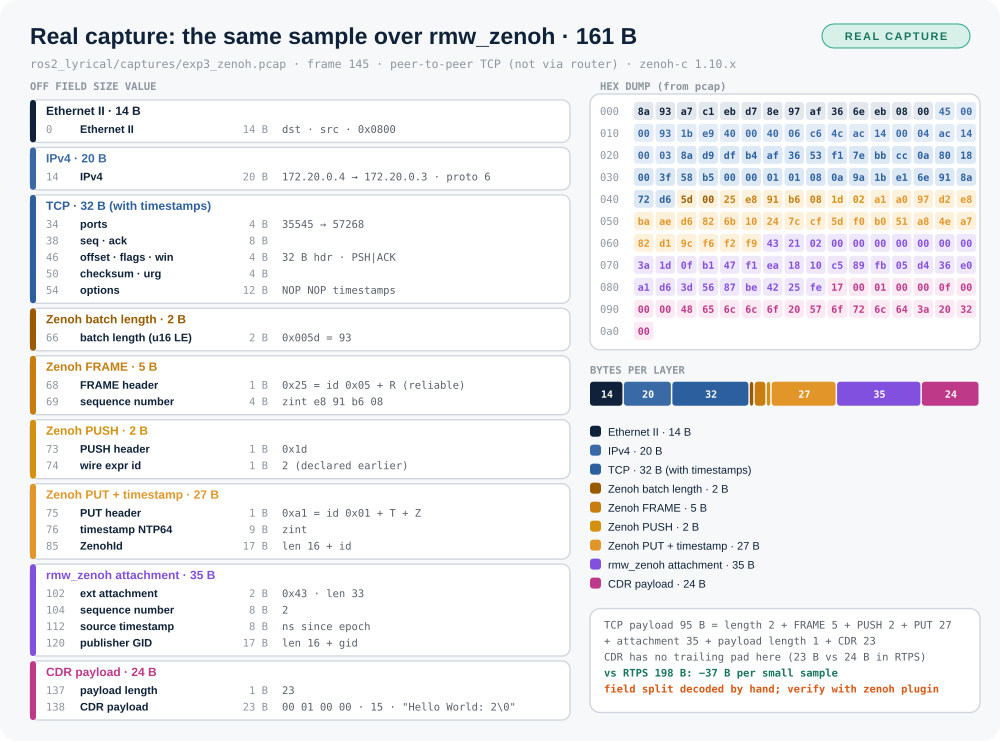

# ROS 2 Lyrical Luth: ผลการทดลองจริงบนสาย (packet capture)

> **ลำดับการอ่าน:** ขั้นที่ 6 จาก 8 ([ดูทั้งหมด](../README.md#ลำดับการอ่าน)) · ก่อนหน้า: [ภาค 4](04_architectures.md) · ถัดไป: [ภาค 2 เชิงลึก](02_wire_format_and_kernel.md)

> ภาค 3 ของชุดเอกสาร network stack · ภาค 1: [Deep Dive](01_network_stack_deep_dive.md) · ภาค 2: [Wire format & kernel accounting](02_wire_format_and_kernel.md)
> ดูแบบ 3D: [Lyrical Packet Lab บทที่ 17–20](https://alfaxphoori.github.io/ros2/ros2_lyrical/interactive/lyrical-packet-lab.html#lesson-17) (packet วิ่งตามจำนวนจริงจาก pcap)
> ทดลองเมื่อ 2026-11-24 (รันซ้ำด้วย script ฉบับปรับปรุงเมื่อ 2026-11-27 ดู §6 และ §8) · ไฟล์ pcap ทั้งหมดอยู่ใน [`captures/`](../captures/) · ทำซ้ำได้ด้วย [`captures/scripts/run_experiments.sh`](../captures/scripts/run_experiments.sh)

เอกสารภาค 1 และภาค 2 สร้างจากการอ่าน source code ภาคนี้คือการ**รันของจริงแล้ว capture packet** เพื่อตรวจว่าที่วิเคราะห์ไว้ตรงกับสิ่งที่เกิดบนสายหรือไม่ ทุกตัวเลขในเอกสารนี้มาจาก pcap หรือจากตัวนับของ kernel (`/proc/net/snmp`) ในการรันจริง การทดลองชุดเต็มรันซ้ำ 2 รอบเมื่อ 2026-11-24 ได้ผลตรงกัน ส่วนการรันซ้ำอีก 2 รอบเมื่อ 2026-11-27 ได้ผลเชิงโครงสร้างเหมือนเดิม (เช่น frame แรกของ `"Hello World: 1"` ยังเป็น frame 95 ยาว 198 B) แต่ตัวเลขที่ขึ้นกับการสูญหาย (การทดลองที่ 2 และ 5) ต่างไปจากเดิม ดู §6

---

## 1. สภาพแวดล้อมการทดลอง

| รายการ | ค่า |
|---|---|
| Image | `ros:lyrical-ros-base` (Docker Official Image, digest `sha256:c69a7a39142b0a19c8cc5e80a35e9087e2ae46080dfa0a59961ff72287fdc5f6` ตรึงไว้ใน Dockerfile แล้ว) + `ros-lyrical-demo-nodes-cpp`, `ros-lyrical-rmw-zenoh-cpp`, `tcpdump`, `tshark 4.6.4` ([Dockerfile](../captures/scripts/Dockerfile), เวอร์ชัน package หลักบันทึกไว้ใน [`apt-pins.txt`](../captures/scripts/apt-pins.txt)) |
| package จริงจาก apt | `ros-lyrical-fastdds 3.6.2`, `ros-lyrical-fastcdr 2.3.6`, `ros-lyrical-rmw-fastrtps-cpp 9.4.10`, `ros-lyrical-rclcpp 32.0.3`, `ros-lyrical-rmw-zenoh-cpp 0.10.6`, `ros-lyrical-zenoh-cpp-vendor 0.10.6` (zenoh-c 1.8.0, zenoh-cpp 1.9.0) |
| Kernel | Linux 7.0.0-43-generic เมื่อ 2026-11-24 และ 7.0.0-44-generic ในการรันซ้ำ 2026-11-27 (Ubuntu 26.04, container ใช้ kernel ของ host) |
| sysctl (2026-11-27) | `net.core.rmem_max` = `wmem_max` = 4 194 304, `rmem_default` = `wmem_default` = 212 992 ทั้งใน host และใน container (อ่านอย่างเดียว ไม่ได้แก้) ค่าของวันที่ 2026-11-24 ไม่ได้บันทึกไว้ |
| CPU | Intel Core i3-12100, 8 logical CPU (บันทึก 2026-11-27) |
| บันทึกสภาพแวดล้อม | ตั้งแต่ 2026-11-27 ทุกการรันเขียน `captures/scripts/out/env.txt` (kernel, Docker, image ID, digest, sysctl, เวอร์ชัน tool และผลตรวจ `apt-pins.txt`) พร้อม `dpkg_all.txt`, `dpkg_ros_lyrical.txt`, `ros2_doctor.txt` |
| Topology | container แต่ละตัวเป็น "host" แยก network namespace ต่อกันผ่าน Docker bridge (`veth`, MTU 1500, subnet 172.20.0.0/16) multicast ใช้ได้ |
| จุด capture | `tcpdump -i eth0` ภายใน container ฝั่งรับ (Host B) ซึ่งเห็น packet ที่ AF_PACKET tap ก่อนเข้า IP stack |
| ข้อจำกัด | traffic ไม่ผ่าน NIC จริง (ผ่าน `veth`) ผลด้าน driver เช่น r8169 จึงไม่อยู่ในการทดลองนี้ และทุก container ใช้ CPU เครื่องเดียวกัน |

```
 Host A (talker)                 Docker bridge (veth)               Host B (listener + tcpdump)
 172.20.0.3  ───────────────────────────────────────────────────────  172.20.0.2
             SPDP multicast 239.255.0.1:7400 · SEDP unicast :7410 · user data unicast :7411
```

| # | การทดลอง | pcap |
|---|---|---|
| 1 | Fast DDS ค่าเริ่มต้น: `demo_nodes_cpp talker` → `listener` ข้าม container | [`exp1_fastdds_default.pcap`](../captures/exp1_fastdds_default.pcap) |
| 2 | `sensor_msgs/Image` 640×480 rgb8 (921 600 B) แบบ RELIABLE 5 ภาพ | [`exp2_image_reliable.pcap.gz`](../captures/exp2_image_reliable.pcap.gz) |
| 3 | `rmw_zenoh_cpp` ผ่าน router 1 ตัว | [`exp3_zenoh.pcap`](../captures/exp3_zenoh.pcap) |
| 4 | talker + listener ใน container เดียวกัน (SHM) | [`exp4_samehost_shm.pcap`](../captures/exp4_samehost_shm.pcap) |
| 5 | Image แบบ BEST_EFFORT 20 ภาพ, receive buffer ค่าเริ่มต้น | [`exp5_image_besteffort.pcap.gz`](../captures/exp5_image_besteffort.pcap.gz) |
| 6 | เหมือนข้อ 5 แต่ตั้ง `receiveBufferSize` 4 MiB ผ่าน XML profile | [`exp6_image_besteffort_bigbuf.pcap.gz`](../captures/exp6_image_besteffort_bigbuf.pcap.gz) (capture เมื่อ 2026-11-27 คนละรอบกับตัวนับของ 2026-11-24; รอบนี้ได้รับ 20/20, `RcvbufErrors` 0, `ReasmOKs` 300 และ DATA_FRAG 15 ก้อนครบทั้ง 20 ภาพ) |
| 7 | sweep `SO_RCVBUF` ของผู้รับอย่างเดียว (แก้ตัวแปรกวนของข้อ 6) 81 run ([§9](#9-การทดลองที่-7-sweep-ขนาด-receive-buffer-แก้ตัวแปรกวนของการทดลองที่-56)) | ไม่เก็บ pcap ใน repo ผลอยู่ใน [`captures/results/rcvbuf_sweep_*.csv`](../captures/results/) |
| 8 | latency end-to-end (rclpy) 7 config × 30 รอบ ([§10](#10-การทดลองที่-8-latency-ที่วัดจริง-end-to-end-rclpy)) | ไม่มี capture ผลอยู่ใน [`captures/results/latency_*`](../captures/results/) |
| 9 | ภาพ BEST_EFFORT/RELIABLE เมื่อจำกัดอัตราส่งด้วย `tc` ([§11](#11-การทดลองที่-9-จำกัดอัตราส่งด้วย-tc-จำลอง-link-1-gbits)) | ไม่เก็บ pcap ใน repo ผลอยู่ใน [`captures/results/shaping_*.csv`](../captures/results/) |

---

## 2. การทดลองที่ 1: หนึ่ง sample ของ talker บนสายจริง


frame 95 ใน `exp1_fastdds_default.pcap` คือ `"Hello World: 1"` ตัวแรก **ยาว 198 B**

```
0000  62 1b 4b 57 a2 ac 42 8d e7 ce ea 36 08 00 45 00   Ethernet │ IPv4
0010  00 b8 10 29 40 00 40 11 d1 de ac 14 00 03 ac 14   len 184 · DF · TTL 64 · UDP · 172.20.0.3 →
0020  00 02 b0 4f 1c f3 00 a4 58 e3 52 54 50 53 02 03   172.20.0.2 │ UDP 45135→7411 len 164 │ "RTPS" 2.3
0030  01 0f 01 0f 11 31 1a 00 bc 0d 00 00 00 00 0e 01   vendor 01.0f · guidPrefix │ INFO_DST
0040  0c 00 01 0f 2c 17 1d 00 1c 48 00 00 00 00 09 01   dst guidPrefix (listener) │ INFO_TS
0050  08 00 b1 58 05 6b 63 88 85 8b 15 05 2c 00 00 00   timestamp │ DATA E|D len 44
0060  10 00 00 00 13 04 00 00 13 03 00 00 00 00 01 00   readerId 00.00.13.04 · writerId 00.00.13.03 · SN
0070  00 00 00 01 00 00 0f 00 00 00 48 65 6c 6c 6f 20   =1 │ CDR_LE · len 15 · "Hello "
0080  57 6f 72 6c 64 3a 20 31 00 00 80 01 38 00 01 00   "World: 1\0" pad │ 0x80 statistics len 56
0090  00 00 f3 1c 00 00 00 00 00 00 00 00 00 00 00 00   locator UDPv4 port 7411 …
00a0  00 00 ac 14 00 02 b1 58 05 6b 07 49 88 8b 05 00   … 172.20.0.2 │ timestamp │ sequence data
00b0  00 00 00 00 00 00 94 02 00 00 00 00 00 00 00 00
00c0  00 00 00 00 00 00
```

**ตรวจคำทำนายจากภาค 1 และภาค 2 กับของจริง**

| ประเด็น | คำทำนาย | ผลจริง | สรุป |
|---|---|---|---|
| ขนาด frame | ภาค 1: 122 B (แบบน้อยที่สุด) · ภาค 2: 138–198 B | **198 B** | ตรงกับขอบบนของภาค 2 |
| RTPS version | ภาค 2: 2.2 (CMake default) · ตรวจเพิ่ม: 2.3 เพราะ `.deb` ใช้ `-DSECURITY=ON` | **2.3** | ยืนยันว่า `.deb` build ด้วย SECURITY=ON |
| INFO_DST | ภาค 2: 16 B | 16 B (`0e 01 0c 00` + guidPrefix 12 B) | ตรง |
| Statistics submessage | ภาค 2: `0x80` ยาว 60 B ทุก message | `80 01 38 00` + 56 B มีทุก RTPS message ในไฟล์ | ตรง |
| ลำดับ submessage | — | INFO_DST → INFO_TS → DATA → 0x80 | ได้ข้อมูลใหม่ |
| readerId | ภาค 1 (สมมติ): `UNKNOWN` | **`00.00.13.04`** (ระบุ reader ปลายทาง) | ภาค 1 ผิด |
| type ของ demo talker | ภาค 1: `std_msgs/String` | **`example_interfaces::msg::dds_::String_`** | ภาค 1 ผิด (demo ใน Lyrical ใช้ `example_interfaces`) |
| CDR payload | `00 01 00 00` + len 15 + text + pad 1 | ตรงทุก byte | ตรง |
| dst port | 7411 = 7400 + 250·0 + 11 + 2·0 | 7411 | ตรง |
| IP DF / TTL | DF, 64 | DF, 64 | ตรง |

**Discovery และ traffic ทั้งหมดใน 14 วินาที** (137 RTPS frame, 53 434 B)

| ประเภท | frame | byte | สัดส่วน |
|---|---|---|---|
| SPDP `DATA(p)` (frame 610 B/ครั้ง = UDP payload 568 B, multicast + unicast) | 32 | 19 520 | 36.5% |
| SEDP `DATA(w)`/`DATA(r)` | 21 | 16 166 | 30.3% |
| HEARTBEAT / ACKNACK | 40 | 6 728 | 12.6% |
| `ros_discovery_info` DATA | 13 | 4 754 | 8.9% |
| อื่นๆ (รวม SEDP แบบ packed, GAP) | 22 | 4 484 | 8.4% |
| **ข้อมูล chatter จริง** (9 sample × 198 B) | 9 | 1 782 | **3.3%** |

ข้อค้นพบจาก discovery
- SPDP `DATA(p)` ของ listener ส่ง multicast 6 ครั้งห่างกัน 100 ms ตอนเริ่ม (frame 3–6, 9, 10; frame 7 และ 8 ไม่ใช่ SPDP) แล้วจึงเปลี่ยนเป็นคาบ 3 s (ครั้งถัดไปคือ frame 99) 6 ครั้ง = ประกาศทันที 1 ครั้งตอน enable participant + initial announcements `count` = 5 ตามภาค 2 §1.2 ฝั่ง talker ก็ส่ง 6 ครั้งเช่นกัน (multicast frame 12, 61, 85, 87, 90, 92) ตั้งแต่ครั้งที่ 2 มีสำเนา unicast ไปยัง listener ที่รู้จักแล้วคู่กันด้วย (frame 60, 84, 86, 89, 91) และมี unicast อีก 1 ฉบับ (frame 21) ส่งทันทีหลังได้รับ `DATA(p)` ของ listener (frame 15)
- `DATA(p)` มี parameter ตามลำดับที่ภาค 2 ทำนายไว้ รวมถึง SHM locator **kind `0x13` (=19)** ซึ่ง Wireshark แสดงว่า "Unknown" และ `USER_DATA` = `enclave=/;\0`
- **ข้อค้นพบใหม่ (privacy):** `PID_PROPERTY_LIST` ส่ง `fastdds.physical_data.host` (hash ของเครื่อง), **`fastdds.physical_data.user` = ชื่อผู้ใช้ (`root`)** และ **`fastdds.physical_data.process` = PID** ผ่าน multicast ให้ทุกเครื่องใน subnet ควรระวังในเครือข่ายที่ใช้ร่วมกับผู้อื่น
- **ข้อค้นพบใหม่:** reader ของ `ros_discovery_info` ประกาศ unicast locator ที่ **UDP port 7000** แยกจาก 7411 (เห็นใน `DATA(r)` frame 29, 69) Wireshark จึงแปลผิดเป็นโปรโตคอล "RX" ส่วนสาเหตุในโค้ดยังไม่ได้ไล่ [K]

---

## 3. การทดลองที่ 2: ภาพ 640×480 rgb8 แบบ RELIABLE

| ค่า | คำทำนาย (ภาค 2 §2.4) | ผลจริง |
|---|---|---|
| sampleSize | 921 652 B | **921 648 B** (ต่างกัน 4 B เพราะภาค 2 สมมติ `frame_id = "camera"` (12 B ใน CDR) แต่ [`img_pub.py`](../captures/scripts/img_pub.py) ใช้ `"f0"`… (8 B) คำนวณใหม่ด้วย `"f0"` ได้ 921 648 ตรงพอดี และยืนยันว่า sampleSize นับรวม encapsulation 4 B ดูภาค 2 §2.4) |
| fragmentSize | 65 324 B (เมื่อมี statistics) | **65 324 B** |
| DATA_FRAG ต่อภาพ | 15 | **15** (ครบทั้ง 5 ภาพ) |
| IP fragment ต่อ datagram | 45 | **45** (reassembled 65 476 B) |
| ชื่อ topic บนสาย | `rt/img` | **`rt/img/_buf_cpu`** (ข้อค้นพบใหม่ ดูด้านล่าง) |

ผลการส่ง: ได้รับครบ 5/5 ภาพ แต่ตัวนับ kernel ของ Host B แสดง **`RcvbufErrors = 23`**, `ReasmOKs = 97` (75 datagram ที่ควรมี + ส่งซ้ำ) และเห็น `NACK_FRAG` 4 ครั้ง จำนวน DATA_FRAG ต่อ sequence number คือ 18, 21, 15, 15, 28 แปลว่าภาพที่ 1, 2 และ 5 ต้องส่ง fragment ซ้ำ 3, 6 และ 13 ชิ้น รวม 22 ชิ้น ซึ่งตรงกับตัวนับ kernel พอดี (75 + 22 = 97 = `ReasmOKs`) กลไก RELIABLE ของ RTPS กู้ข้อมูลที่ kernel ทิ้งไปได้ แต่ทำให้ traffic เพิ่มขึ้นราว 29%

ตัวอย่าง `NACK_FRAG` (frame 749): `writerSN 1, bitmapBase 4, numBits 3, bitmap 00 00 00 e0` (u32 little-endian = `0xe0000000` คือ 3 บิตแรกเป็น 1) reader ขอ fragment 4, 5 และ 6 ของภาพแรกใหม่ และ DATA_FRAG ที่ส่งซ้ำตามมาคือ fragment 4, 5, 6 จริง

NACK_FRAG ทั้ง 4 ฉบับในไฟล์

| frame | SN | bitmapBase | numBits | fragment ที่ขอ |
|---|---|---|---|---|
| 749 | 1 | 4 | 3 | 4, 5, 6 |
| 1534 | 2 | 3 | 10 | 3, 4, 10, 11, 12 |
| 1764 | 2 | 12 | 1 | 12 (ขอซ้ำ เพราะก้อนที่ส่งซ้ำหายอีกรอบ) |
| 3746 | 5 | 3 | 13 | 3–15 |

> **แก้ไข 2026-11-26:** ฉบับก่อนหน้าระบุว่า frame 749 ขอ fragment 4 และ 5 และ SN 1 มี DATA_FRAG 17 ก้อน ซึ่งผิด ตรวจใหม่โดยถอด bitmap จาก byte ดิบด้วย [`tools/rtps_peek.py`](../tools/rtps_peek.py) (`python3 ros2_lyrical/tools/rtps_peek.py sms ros2_lyrical/captures/exp2_image_reliable.pcap.gz NACK_FRAG`)

**ข้อค้นพบใหม่: topic `/_buf_cpu`** [V capture + source]
ใน Lyrical ถ้า message มีฟิลด์ `uint8[]` (ซึ่งตอนนี้เป็น `rosidl::Buffer`) และไม่ได้ใช้ QoS แบบ transient-local `rmw_fastrtps_cpp` จะสร้าง DDS topic เพิ่มชื่อ `<topic>/_buf_cpu` เป็นช่องทางร่วมของ subscriber ที่ใช้ CPU backend ทั้งหมด (`rmw_fastrtps_cpp/src/publisher.cpp` บรรทัด 385–395) ส่วน subscriber ที่ใช้ backend อื่น เช่น CUDA จะได้ช่องทาง `/_buf/<gid>` ของตัวเอง ตาม `rmw_zenoh/docs/design.md` ผลที่ตามมาคือเครื่องมือที่ filter ตามชื่อ topic DDS (Wireshark, firewall, bridge) จะไม่เห็นภาพบน `rt/img` แต่จะเห็นบน `rt/img/_buf_cpu` แทน

---

## 4. การทดลองที่ 3: sample เดียวกันผ่าน rmw_zenoh



- หลังจาก router gossip ส่งข้อมูลให้แล้ว session ของ talker (172.20.0.4) **เปิด TCP ตรงไปหา listener** (172.20.0.3:57268) ข้อมูลจึงไม่ผ่าน router (172.20.0.2:7447) ตรงตาม README ของ rmw_zenoh
- หนึ่ง sample = **161 B** (Ethernet 14 + IP 20 + TCP 32 + Zenoh 95) **สั้นกว่า RTPS 37 B**
- TCP payload ขึ้นต้นด้วย `5d 00` คือ batch length แบบ u16 little-endian (=93) ตรงตามภาค 2 §4.2
- attachment ของ rmw_zenoh ยาว 33 B ตรงตามภาค 2: sequence number (8) + source timestamp (8) + ความยาว GID (1) + GID (16)
- CDR payload ยาว 23 B ไม่มี padding ท้าย ส่วน RTPS pad เป็น 24 B
- การแยก field `FRAME 0x25`, `PUSH 0x1d`, `PUT 0xa1` และ timestamp ถอดด้วยมือตามลำดับ codec ที่อ่านจาก source ของ Zenoh 1.10.1 แต่ binary ที่ใช้ในการทดลองจริงคือ zenoh-c 1.8.0 / zenoh 1.8.0 (commit `2687c51`) จาก `ros-lyrical-zenoh-cpp-vendor 0.10.6` (ดูหมายเหตุเวอร์ชันใน[ภาค 2 §4](02_wire_format_and_kernel.md#4-rmw_zenoh_cpp-บนสาย)) ยังไม่ได้เทียบ codec สองเวอร์ชันทีละ field และยังไม่ได้ตรวจด้วย Zenoh dissector [K]

---

## 5. การทดลองที่ 4: เครื่องเดียวกัน (Fast DDS SHM)

- ใน pcap ที่ capture ทุก interface (`-i any`) **ไม่มี user DATA ของ `rt/chatter` เลย** มีแค่ discovery (`DATA(p)` 40, `DATA(w)` 21, `DATA(r)` 17, HEARTBEAT/ACKNACK 28) แต่ listener ได้รับครบทุกข้อความ จึงยืนยันว่าข้อมูลวิ่งผ่าน shared memory
  - **ตรวจซ้ำ 2026-11-27 ด้วย [`tools/rtps_peek.py`](../tools/rtps_peek.py) [V]:** pcap นี้เป็น link type 276 (Linux cooked v2 จาก `-i any`) ซึ่ง tool ฉบับก่อนอ่านไม่ได้ (`sms` ไม่แสดงผลเลย) หลังแก้ให้รองรับแล้วพบ DATA 100 submessage ทั้งหมดมาจาก builtin writer: `00.01.00.c2` (SPDP) 43, `00.00.03.c2` (SEDP publications) 32, `00.00.04.c2` (SEDP subscriptions) 25 ในจำนวนนี้ DATA ที่มี payload (flags `0x05`) คือ 40/21/17 ตรงกับตัวเลขข้างบน ส่วนอีก 3/11/8 (flags `0x03`) มีแค่ inline QoS ที่มี `STATUS_INFO` = dispose+unregister ตอนปิด node (Wireshark แสดงเป็น `[UD]`) HEARTBEAT 14 มาจาก `00.00.03.c2` 4, `00.00.04.c2` 4, `00.02.00.c2` (participant message) 2, `00.03.00.c3`/`00.03.01.c3` (type lookup request/reply) 2/2 และ ACKNACK 14 **ไม่มี DATA หรือ DATA_FRAG จาก user writer เลย** ตรวจไขว้ด้วยสคริปต์แยกที่อ่าน header SLL2 เองได้ผลเดียวกัน
  - interface ที่เห็น: `lo` (127.0.0.1 → 127.0.0.1 unicast ไป UDP 7410/7412 รวม 77 frame และ → 239.255.0.1:7400 16 frame) กับ interface ของ container (172.17.0.2 → 239.255.0.1:7400 16 frame, เป็น SPDP multicast เท่านั้น) นอกจากนี้มีแค่ IGMP 4 และ ARP 2
  - ทำซ้ำ (จาก root ของ repo):

```bash
python3 ros2_lyrical/tools/rtps_peek.py sms ros2_lyrical/captures/exp4_samehost_shm.pcap DATA DATA_FRAG | grep -o 'flags 0x.. .*writer [0-9a-f.]*' | awk '{print $1,$2,$NF}' | sort | uniq -c
python3 ros2_lyrical/tools/rtps_peek.py sms ros2_lyrical/captures/exp4_samehost_shm.pcap HEARTBEAT | grep -o 'writer [0-9a-f.]*' | sort | uniq -c
```

- `/dev/shm` ระหว่างรัน:

```
fastdds_1f31487e5015077c      549 408 B   segment ของ participant (ภาค 2: 512 KiB + header)
fastdds_55f2d4e72058e46e      549 408 B
fastdds_port7000 / 7001 / 7411 / 7413   52 400 B   port (ring buffer) ของแต่ละ locator
sem.fastdds_port7000_mutex …             named semaphore
```

- thread ของ Fast DDS (`ps -eLo comm`): `dds.udp.<port>`, `dds.shm.<port>`, `dds.ev.0`, `dds.asyn.0.*`, `dds.shm.wdog` ตรงกับภาค 2 §3.2 และพบเพิ่ม `dds.tls.request`, `dds.tls.replies` (type lookup service) ซึ่งภาค 2 ไม่ได้ระบุ

---

## 6. การทดลองที่ 5–6: receive buffer ตัดสินว่าภาพจะรอดหรือไม่



| | ค่าเริ่มต้น | XML `receiveBufferSize` 4 MiB |
|---|---|---|
| `SO_RCVBUF` จริง (`ss -uam`) | `rb212992` (= `net.core.rmem_default`) | `rb8388608` (kernel คูณสองค่าที่ขอ) |
| ภาพที่ได้รับ (BEST_EFFORT) | **13/20 (หาย 35%)** | **20/20** |
| `Udp RcvbufErrors` | **45** | **0** |
| DATA_FRAG ที่เห็นใน capture | 15/15 ครบทุกภาพ | — |

- capture เห็น fragment ครบทุกภาพ แปลว่า**ข้อมูลมาถึงเครื่องครบ แต่ kernel ทิ้งตอนนำเข้า socket queue** (`__udp_enqueue_schedule_skb`) ซึ่งอยู่หลังจุดที่ tcpdump มองเห็น
- **แก้ไข 2026-11-27:** ฉบับก่อนเขียนว่า "เพิ่ม buffer อย่างเดียวโดยไม่เปลี่ยนอย่างอื่น" ซึ่งไม่ถูกต้อง [`bigbuf.xml`](../captures/scripts/bigbuf.xml) ตั้ง `sendBufferSize` 4 MiB ด้วย, ใช้ `useBuiltinTransports=false` ซึ่งตัด SHM transport และแทน UDPv4 ในตัวด้วย transport ของผู้ใช้ และถูกใส่ให้ทั้ง Host A และ Host B การทดลองที่ 6 จึงยืนยันได้เพียงว่าชุดการตั้งค่านี้ทำให้ภาพไม่หาย ผลที่เปลี่ยนเฉพาะ receive buffer ของผู้รับ (ยืนยันว่า rcvbuf เป็นสาเหตุของการทิ้งบน veth และหาจุดที่การสูญหายหายไป) อยู่ใน §9
- ผลนี้สอดคล้องกับการวิเคราะห์ของภาค 2 §5.3 ว่าค่าเริ่มต้น 212 992 B รับ datagram เต็มขนาด 65 KB ได้เพียง 1–2 ก้อน (เพราะคิดตาม `truesize`)
- เมื่อ 2026-11-24 รันซ้ำ 2 รอบได้ตัวเลขเดิมทุกตัว (13/20, 45 และ 20/20, 0) ตัวเลขในตารางข้างบนมาจากรอบนั้น
- **รันซ้ำ 2026-11-27 [V]** (`run_experiments.sh` ฉบับปรับปรุง 2 รอบ, kernel 7.0.0-44, ไฟล์ `out/run1/summary.txt` และ `out/run2/summary.txt`): ค่าเริ่มต้นได้รับ **19/20, `RcvbufErrors` 6** และ **19/20, 5** ส่วน 4 MiB ได้ **20/20, 0** ทั้งสองรอบ capture เห็น DATA_FRAG 15 ก้อนครบทั้ง 20 ภาพ และ tcpdump รายงาน `0 packets dropped by kernel` ทุกรอบ ทิศทางของผลยังเหมือนเดิม (ข้อมูลมาถึงครบ การทิ้งเกิดที่ socket queue และหายไปเมื่อเพิ่ม buffer) แต่**ขนาดของการสูญหายลดลงมาก** เพื่อแยกว่าเป็นผลจากการแก้ script หรือไม่ ได้รันการทดลองที่ 5 ด้วยขั้นตอนเดิมทุกอย่าง (script และ `img_pub.py`/`img_sub.py` จาก commit ก่อนแก้, `sleep` แบบเดิม, ผลใน `out/oldflow_exp5/`) อีก 2 รอบ ได้ 19/20, `RcvbufErrors` 3 ทั้งสองรอบ จึงสรุปว่าความต่างมาจากสภาพของเครื่องหรือ kernel ไม่ใช่จาก script ยังไม่ได้ระบุสาเหตุ ตัวเลข 35% จึงควรอ่านเป็นผลของรอบ 2026-11-24 เท่านั้น ไม่ใช่ค่าคงที่ของ setup นี้
- การทดลองที่ 2 (RELIABLE) ในการรันซ้ำ 2026-11-27 ก็ต่างจาก §3 เช่นกัน: ได้รับครบ 5/5 ทั้งสองรอบ แต่เห็น `NACK_FRAG` เพียง 1 ฉบับ (SN 1) DATA_FRAG ต่อ SN เป็น 21, 15, 15, 15, 15 และ 18, 15, 15, 15, 15, `RcvbufErrors` 6 และ 3, `ReasmOKs` 81 และ 78 (ยังเป็นไปตาม 75 + จำนวนที่ส่งซ้ำ: 75 + 6 = 81, 75 + 3 = 78)

วิธีแก้ในงานจริงมี 2 ระดับ
1. ระดับ OS: เพิ่ม `net.core.rmem_max` (และ `rmem_default` ถ้าไม่ใช้ XML)
2. ระดับ middleware: ตั้ง `receiveBufferSize` ใน XML profile ตาม [`bigbuf.xml`](../captures/scripts/bigbuf.xml) (ค่าที่ได้จะถูกจำกัดด้วย `rmem_max`)

---

## 7. สรุปสิ่งที่แก้หรือเพิ่มในเอกสารภาค 1–2 จากผลการทดลอง

| เรื่อง | ผลจากการทดลอง |
|---|---|
| frame ตัวอย่างในภาค 1 (122 B) | frame จริงยาว 198 B (เพิ่ม INFO_DST 16 + statistics 60) readerId เป็น reader จริง ไม่ใช่ UNKNOWN (ภาค 1 §5.4 เปลี่ยนไปใช้ frame 95 นี้แล้ว) |
| type ของ demo talker | `example_interfaces/msg/String` ไม่ใช่ `std_msgs/msg/String` |
| RTPS version | 2.3 ใน `.deb` ของ Lyrical |
| `sampleSize` ของภาพ 640×480 | 921 648 B (ภาค 2 คำนวณได้ 921 652 B ด้วย `frame_id = "camera"`; ต่างกัน 4 B จาก `frame_id` ที่สั้นกว่า และยืนยันว่านับรวม encapsulation) |
| topic ของ message ที่มี `uint8[]` | มี topic `/_buf_cpu` เพิ่มเข้ามา |
| `ros_discovery_info` | reader ใช้ UDP port 7000 |
| ข้อมูลที่ SPDP เปิดเผย | ชื่อผู้ใช้และ PID ของ process |
| rcvbuf | ยืนยันเชิงสาเหตุบน veth เมื่อเปลี่ยนเฉพาะ `SO_RCVBUF` ของผู้รับ (§9, 81 run): ที่ 212 992 และ 425 984 B ภาพแรกหายทุก run (หาย 5–5.6%) ตั้งแต่ 1 048 576 B ขึ้นไปไม่หายเลย ส่วนตัวเลข 35% เป็นผลของรอบ 2026-11-24 เท่านั้น (§6) และเมื่อจำกัดอัตราเท่า 1 Gbit/s ด้วย `tc` ค่าเริ่มต้นก็ไม่หาย (§11) จึงยังไม่ใช่ข้อสรุปสำหรับเครือข่ายจริง |

## 8. วิธีทำซ้ำ

```bash
cd ros2_lyrical/captures/scripts
./run_experiments.sh            # ใช้ Docker อย่างเดียว ผลอยู่ใน ./out/ (OUT=<dir> เพื่อเปลี่ยนที่เก็บ)
./run_experiments.sh --rebuild  # บังคับ build image ใหม่ (ปกติ build เฉพาะเมื่อยังไม่มี lyrical-wire:exp)
cat out/summary.txt             # ตัวเลขที่เอกสารนี้ใช้เทียบ (§2, §3, §6)
cat out/env.txt                 # สภาพแวดล้อมของรอบนั้น
# ถอด packet โดยไม่ต้องมี tshark บน host
python3 ../../tools/rtps_peek.py frame out/exp1_fastdds_default.pcap 95
python3 ../../tools/rtps_peek.py sms   out/exp2_image_reliable.pcap NACK_FRAG
# หรือใช้ tshark ใน image
docker run --rm -v "$PWD/out:/o:ro" lyrical-wire:exp tshark -r /o/exp1_fastdds_default.pcap -Y 'rtps && frame.len==198' -O rtps
```

ขั้นตอนใน script (ตั้งแต่ 2026-11-27; helper อยู่ใน [`lib.sh`](../captures/scripts/lib.sh))
- image: `Dockerfile` ตรึง base image ด้วย digest และบันทึก `dpkg -l` ไว้ใน `/opt/exp/dpkg-l.txt` ขั้นสุดท้ายของ build เทียบเวอร์ชันกับ [`apt-pins.txt`](../captures/scripts/apt-pins.txt) (เตือนเมื่อไม่ตรง, `--build-arg STRICT_PINS=1` ให้ build ล้ม, `--build-arg APT_EXACT=1` ติดตั้งเวอร์ชันตาม pin ซึ่งจะใช้ได้ตราบที่ apt repo ของ ROS ยังเก็บเวอร์ชันนั้นอยู่) การ build เมื่อ 2026-11-27 ใช้ layer apt เดิมจาก cache และได้ `dpkg -l` ตรงกับ image ของ 2026-11-24 ทุกบรรทัด
- network: ใช้ `rosnet` (สร้างด้วย `--subnet 172.20.0.0/16` ถ้ายังไม่มี ถ้ามีอยู่แล้วแต่ subnet ไม่ตรง script จะหยุดโดยไม่ลบ) และกำหนด IP ตายตัว: Host B (listener + tcpdump) 172.20.0.2, Host A (talker) 172.20.0.3, การทดลองที่ 3 ใช้ router .2, listener .3, talker .4 ตาม §1 และ §4 ถ้ามี container อื่นบน `rosnet` ถือ IP เหล่านี้อยู่ script จะรอสูงสุด 60 s แล้วหยุด
- ลำดับเวลา: Host A เริ่มเมื่อ tcpdump เขียน pcap header แล้วและ listener เริ่มแล้ว (`img_sub.py` พิมพ์ `subscription ready`; demo listener ไม่มีบรรทัดแบบนี้จึงรอ 1 s เท่ากับช่วงห่างของรอบ 2026-11-24) `img_pub.py` รอจน match กับ subscriber (สูงสุด 15 s) แต่ไม่เริ่มส่งก่อน 3.0 s เท่ากับ `sleep 3` เดิม ภาพและคาบ 0.5 s เหมือนเดิม จบแต่ละการทดลองด้วย `docker wait` ไม่ใช่ `sleep`
- ผลที่ได้: `expN_*.raw.pcap` (ไม่กรอง), `expN_*.pcap` (กรองแล้ว), `*.listener.log`, `*.talker.log`, `*.snmp.txt`, `*.tcpdump.log` (จำนวน packet ที่ tcpdump ทิ้ง), `*.exit.txt` และ `summary.txt`
- เวลาที่ใช้: script รายงาน 107 s และ 102 s ในการรัน 2 รอบเมื่อ 2026-11-27 (ไม่รวม build เพราะ image มีอยู่แล้ว)
- การทดลองที่ 5–6 เป็นแค่สองจุดปลายของคำถามเรื่อง receive buffer และมีตัวแปรกวน (§9.1) การกวาดค่าแบบมีการทำซ้ำอยู่ใน [`run_rcvbuf_sweep.sh`](../captures/scripts/run_rcvbuf_sweep.sh) (§9, และ `--shape` สำหรับ §11) ส่วน latency อยู่ใน [`run_latency.sh`](../captures/scripts/run_latency.sh) (§10) ทั้งสองเขียนสรุปลง [`captures/results/`](../captures/results/)

ไฟล์ `.pcap.gz` ต้อง `gunzip` ก่อนเปิดด้วย Wireshark (`rtps_peek.py` อ่าน `.gz` ได้โดยตรง)

**หมายเหตุเรื่องข้อมูลใน pcap:** ไฟล์ใน repo ผ่านการกรองแล้วให้เหลือเฉพาะ IPv4 และ ARP ระหว่าง container (ตัด mDNS, IPv6 และ packet จาก/ถึง gateway ของ Docker bridge ซึ่งมีชื่อเครื่อง host) เลข frame ในเอกสารนี้อ้างอิงไฟล์ที่กรองแล้ว ตั้งแต่ 2026-11-27 `run_experiments.sh` กรองให้เองด้วย tshark ใน image (`filter_pcap` ใน `lib.sh`) โดยเก็บไฟล์ดิบไว้เป็น `*.raw.pcap` ถ้าจะเผยแพร่ ให้ใช้เฉพาะ `*.pcap` ที่กรองแล้ว filter ที่ใช้คือ

```
(ip || arp) && !(udp.port==5353) && !(ip.addr==172.20.0.1) && !(arp.src.proto_ipv4==172.20.0.1) && !(arp.dst.proto_ipv4==172.20.0.1)
```

> **แก้ไข 2026-11-27:** ฉบับก่อนหน้าระบุ filter เป็น `ip && !(udp.port==5353) && !(ip.addr==172.20.0.1)` แต่ pcap ใน repo มี ARP อยู่ (เช่น 9 frame ใน `exp1_fastdds_default.pcap`, 10 frame ใน `exp3_zenoh.pcap`, 2 frame ใน `exp4_samehost_shm.pcap`) ซึ่ง filter นั้นจะตัดทิ้งและทำให้เลข frame เลื่อน filter ข้างบนเมื่อรันกับ pcap ทั้ง 5 ไฟล์ที่ commit ไว้ได้ไฟล์เหมือนเดิมทุก byte [V] ในการรันซ้ำ 2 รอบเมื่อ 2026-11-27 frame แรกของ `"Hello World: 1"` ใน `out/exp1_fastdds_default.pcap` ที่กรองแล้วคือ frame 95 ยาว 198 B เหมือนไฟล์ใน repo (จำนวน frame ทั้งไฟล์ 169 และ 170 เทียบกับ 172 ในไฟล์ใน repo)

---

## 9. การทดลองที่ 7: sweep ขนาด receive buffer (แก้ตัวแปรกวนของการทดลองที่ 5–6)

> ทดลอง 2026-11-27 (kernel 7.0.0-44) · script [`run_rcvbuf_sweep.sh`](../captures/scripts/run_rcvbuf_sweep.sh) · ผลดิบต่อ run [`captures/results/rcvbuf_sweep_runs.csv`](../captures/results/rcvbuf_sweep_runs.csv) · สรุปต่อแขน [`rcvbuf_sweep_summary.csv`](../captures/results/rcvbuf_sweep_summary.csv) · ภาพที่หายต่อ run [`rcvbuf_sweep_lost_images.csv`](../captures/results/rcvbuf_sweep_lost_images.csv) · สภาพแวดล้อม [`rcvbuf_sweep_env.txt`](../captures/results/rcvbuf_sweep_env.txt) · ทุกตัวเลขในหัวข้อนี้มาจากไฟล์เหล่านี้ [V]

### 9.1 ตัวแปรกวนในการทดลองที่ 6

[`bigbuf.xml`](../captures/scripts/bigbuf.xml) ที่ใช้เมื่อ 2026-11-24 เปลี่ยนมากกว่า receive buffer [V: ไฟล์ XML + `ss` + `/dev/shm` ใน 9.3]

1. `<receiveBufferSize>4194304` **และ** `<sendBufferSize>4194304` ใน transport descriptor เดียวกัน (send buffer ของผู้ส่งจึงเปลี่ยนด้วย)
2. `<useBuiltinTransports>false</useBuiltinTransports>` + `<userTransports>udp_bigbuf` ทำให้ participant **ไม่มี SHM transport** และใช้ UDPv4 ที่ผู้ใช้สร้างแทน UDPv4 ในตัว (field อื่นของ descriptor เป็นค่า default ของ class)
3. `run_experiments.sh` ใส่ `FASTDDS_DEFAULT_PROFILES_FILE` ให้ **ทั้ง Host A และ Host B** (`run_pair ... -e FASTDDS_DEFAULT_PROFILES_FILE=/exp/bigbuf.xml` ซึ่งส่ง argument เดียวกันให้ `docker run` ทั้งสองตัว)

ดังนั้นประโยค "เพิ่ม buffer อย่างเดียว" ใน §6 ไม่ถูกต้อง ผลของการทดลองที่ 6 สรุปได้เพียงว่า "ชุดการตั้งค่านี้" ทำให้ภาพไม่หาย

### 9.2 การออกแบบใหม่

- **ตัวแปรเดียว:** Fast DDS 3.6.2 มี attribute ระดับ participant `<rtps><listenSocketBufferSize>` [V: `RTPSParticipantAttributes.hpp` บรรทัด 824 ใน image, `fastdds_profiles.xsd` บรรทัด 163] ซึ่งถูกนำไปใช้กับ listen socket ของ UDPv4 ในตัว โดยไม่ต้องปิด builtin transports profile ถูกสร้างจาก template [`socket_buffer_only.xml.in`](../captures/scripts/socket_buffer_only.xml.in) ต่อจุด sweep และใส่ให้ **Host B (ผู้รับ) เท่านั้น** ผู้ส่งไม่มี XML
- **ตรวจว่าเปลี่ยนแค่นั้นจริง** ทุก run บันทึก `ss -uamn` ใน Host B หลังผู้รับพร้อม (คอลัมน์ `rb_B_port` = `rb` ของ socket port 7411 ซึ่งรับ user data, `rb_B_all`, `udp_ports_B`), `tb` สูงสุดของ Host A (`tb_A_max`) และจำนวนไฟล์ `fastdds*` ใน `/dev/shm` ของ Host B (`shm_files_B`)
- **workload** เหมือนการทดลองที่ 5: `img_pub.py be 20` / `img_sub.py be` (ภาพ 640×480 rgb8, 20 ภาพ, คาบ 0.5 s) ใช้สำเนาของไฟล์ ณ เวลารัน (เก็บ sha256 ใน env)
- **ต่อ run** container ใหม่ทั้งคู่ ตัวนับ `/proc/net/snmp` เป็น delta ภายใน netns ของ Host B (ก่อน tcpdump เริ่ม → หลังผู้รับหยุด) tcpdump เปิดทุก run เหมือนการทดลองที่ 5 แล้วนับ DATA_FRAG จาก pcap ด้วย [`sweep_pcap_stats.py`](../captures/scripts/sweep_pcap_stats.py) แล้วลบ pcap (ราว 19 MB ต่อ run) เก็บเฉพาะตัวเลข
- **แขน** (ค่าที่ขอเป็น byte): `noxml` (ไม่มี XML), 106496 (XML ที่ควรให้ผลเท่าค่า default เพราะ kernel คูณ 2), 212992, 524288, 1048576, 2097152, 4194304, 8388608 (คาดว่าถูกจำกัดโดย `rmem_max`), `oldbigbuf` (`bigbuf.xml` เดิมทั้งสองฝั่ง เพื่อเทียบกับ §6 แบบตรงตัว), `sndonly` (ผู้ส่งตั้ง `<sendSocketBufferSize>4194304` ผู้รับไม่มี XML) และแขน RELIABLE 20 ภาพที่ `noxml` กับ 4194304
- **จำนวนรอบและลำดับ:** 8 รอบสำหรับแขน BEST_EFFORT หลัก 7 แขน, 5 รอบสำหรับ 8388608, `oldbigbuf`, `sndonly` และแขน RELIABLE ทั้งสอง รวม 81 run (1477 s) ลำดับเป็น round-robin ตามรอบ และสุ่มลำดับแขนภายในแต่ละรอบ (seed 1, ลำดับจริงในคอลัมน์ `order`)
- หมายเหตุเครื่องมือ: คอลัมน์ `gap_us_med` และ `dgram_us_med` ใน `rcvbuf_sweep_runs.csv` / `shaping_runs.csv` คำนวณด้วย `sweep_pcap_stats.py` รุ่นที่แปลงเวลาเป็น float ตั้งแต่ epoch ซึ่งคลาดได้ราว ±0.5 µs (เช่น 3.099 หมายถึง 3 µs, 0.954 หมายถึง 1 µs) แก้แล้วในรุ่นปัจจุบัน ค่าระดับ ms (`burst_ms_*`) ไม่ได้รับผล
- คำสั่ง: `flock <lock> ./run_rcvbuf_sweep.sh --arms 'noxml,106496,212992,524288,1048576,2097152,4194304,8388608*5,oldbigbuf*5,sndonly*5,rel:noxml*5,rel:4194304*5' --reps 8`

### 9.3 ตรวจตัวแปร: ค่าที่ kernel ใช้จริงและสิ่งที่ไม่เปลี่ยน [V]

| แขน | ค่าที่ขอ | `SO_RCVBUF` จริงของ port 7411 (`ss` rb) | socket ที่ได้ค่านี้ | `tb` สูงสุดของ Host A | ไฟล์ `fastdds*` ใน `/dev/shm` ของ Host B |
|---|---|---|---|---|---|
| `noxml` | – | 212 992 | – | 212 992 | 6 |
| 106496 | 106 496 | **212 992** | 7000, 7400, 7410, 7411 | 212 992 | 6 |
| 212992 | 212 992 | **425 984** | เหมือนข้างบน | 212 992 | 6 |
| 524288 | 524 288 | 1 048 576 | เหมือนข้างบน | 212 992 | 6 |
| 1048576 | 1 048 576 | 2 097 152 | เหมือนข้างบน | 212 992 | 6 |
| 2097152 | 2 097 152 | 4 194 304 | เหมือนข้างบน | 212 992 | 6 |
| 4194304 | 4 194 304 | 8 388 608 | เหมือนข้างบน | 212 992 | 6 |
| 8388608 | 8 388 608 | **8 388 608 (ถูกจำกัด)** | เหมือนข้างบน | 212 992 | 6 |
| `oldbigbuf` | 4 194 304 (ทั้งสองฝั่ง) | 8 388 608 | 7000, 7400, 7410, 7411 | **8 388 608** | **0** |
| `sndonly` | ผู้ส่ง 4 194 304 | 212 992 | – | **8 388 608** | 6 |

- ทุก run ของแต่ละแขนให้ค่าเดียวกัน (ไม่มีค่าอื่นปนในคอลัมน์ `rb_B_port`)
- `listenSocketBufferSize` เปลี่ยนเฉพาะ `rb` ของ listen socket ทั้ง 4 ตัวของ participant (7400 multicast discovery, 7410 metatraffic unicast, 7411 user unicast และ 7000) send socket ของ Host B ยังเป็น 212 992 SHM ยังอยู่ (`fastdds_port7411`, `fastdds_port7000` และ segment ของ participant รวม 6 ไฟล์) และ port ที่เปิดฟังชุดเดียวกับ `noxml`
- `oldbigbuf` ยืนยันตัวแปรกวนทั้งสามข้อของ 9.1: `/dev/shm` ไม่มีไฟล์ `fastdds*` เลย (SHM transport หายไป) และ send socket ของทั้งสองฝั่งได้ `tb8388608`
- ค่าที่ได้คือ `2 × min(ค่าที่ขอ, rmem_max)` ตรงตามกฎใน [ภาค 2 §5.3](02_wire_format_and_kernel.md) ส่วน `noxml` ได้ `rmem_default` โดยไม่คูณ 2 ผลที่ตามมาซึ่งควรระวัง: **XML ที่ขอ 212992 (เท่า `rmem_default`) ไม่ได้ให้ค่าเท่า default แต่ได้ 425 984** แขนควบคุมที่ให้ค่าเท่า default จริงคือขอ 106 496
- **ข้อจำกัดของ host:** `net.core.rmem_max` = 4 194 304 ทำให้ขอ 8 MiB ได้ผลเท่าขอ 4 MiB (8 388 608) การทดสอบจุดที่สูงกว่านี้ต้องให้ผู้ใช้สั่ง `sudo sysctl -w net.core.rmem_max=<ค่า>` บน host เอง script ไม่แก้ค่านี้ ส่วนการตั้งผ่าน container ทำไม่ได้: บน kernel นี้ `net.core.rmem_max` ไม่ใช่ค่าต่อ network namespace ไฟล์ใน container เป็น `-r--r--r--` และ `docker run --sysctl net.core.rmem_max=8388608` ถูกปฏิเสธด้วย `open sysctl net.core.rmem_max file: reopen fd 8: permission denied` (ค่าของ host ยังเป็น 4 194 304 หลังลอง) script พิมพ์ precondition check ทุกครั้งว่าจุดใดถูกจำกัด (`out/rcvbuf_sweep/precheck.txt`)

### 9.4 ผล BEST_EFFORT (20 ภาพต่อ run) [V]

| แขน | `SO_RCVBUF` จริง | n | ภาพที่ได้รับ เฉลี่ย (min–max) | หาย % | `RcvbufErrors` median (min–max) | DATA_FRAG ใน capture ทุก run | ภาพที่หาย |
|---|---|---|---|---|---|---|---|
| `noxml` | 212 992 | 8 | 19.00 (19–19) | 5.0 | 4 (3–5) | 300 | `f0` ทุก run |
| 106496 | 212 992 | 8 | 19.00 (19–19) | 5.0 | 3.5 (2–5) | 300 | `f0` ทุก run |
| 212992 | 425 984 | 8 | 18.88 (18–19) | 5.6 | 2 (1–4) | 300 | `f0` ทุก run และ `f10` อีก 1 run |
| 524288 | 1 048 576 | 8 | 20 (20–20) | 0 | 0 (0–0) | 300 | – |
| 1048576 | 2 097 152 | 8 | 20 (20–20) | 0 | 0 (0–0) | 300 | – |
| 2097152 | 4 194 304 | 8 | 20 (20–20) | 0 | 0 (0–0) | 300 | – |
| 4194304 | 8 388 608 | 8 | 20 (20–20) | 0 | 0 (0–0) | 300 | – |
| 8388608 | 8 388 608 (จำกัด) | 5 | 20 (20–20) | 0 | 0 (0–0) | 300 | – |
| `oldbigbuf` | 8 388 608 | 5 | 20 (20–20) | 0 | 0 (0–0) | 300 | – |
| `sndonly` | 212 992 | 5 | 19.00 (19–19) | 5.0 | 3 (2–5) | 300 | `f0` ทุก run |

- ทุก run ของทุกแขน capture เห็น DATA_FRAG 300 ก้อน (20 × 15) ครบทุกภาพ (`sn_complete` = 20), IP fragment 45 ชิ้นต่อ datagram, `ReasmOKs` = 300 และ `ReasmFails` = 0, tcpdump ไม่ทิ้ง packet เลย ข้อมูลจึงมาถึงและประกอบ IP ได้ครบ การทิ้งเกิดที่ socket เท่านั้น: `RcvbufErrors` = `InErrors` = ตัวนับ drop ของ socket port 7411 (`ss` skmem `d`, คอลัมน์ `drops_B_port`) ทุก run
- `RcvbufErrors` นับเป็น datagram (65 KB) ภาพ `f0` ที่หายจึงขาด 1–5 จาก 15 DATA_FRAG
- ค่าที่ขอ 106496 ให้ผลเท่ากับ `noxml` ซึ่งยืนยันว่าการมีไฟล์ XML เองไม่ได้เปลี่ยนผล

### 9.5 ผล RELIABLE (20 ภาพต่อ run, 5 run ต่อแขน) [V]

| แขน | `SO_RCVBUF` จริง | ภาพที่ได้รับ | `RcvbufErrors` median (min–max) | NACK_FRAG ต่อ run | DATA_FRAG ใน capture เฉลี่ย (min–max) | DATA_FRAG ที่ส่งซ้ำ เฉลี่ย (min–max) |
|---|---|---|---|---|---|---|
| `noxml` | 212 992 | 20/20 ทุก run | 4 (4–5) | 1 ทุก run | 304.4 (304–305) | 4.4 (4–5) |
| 4194304 | 8 388 608 | 20/20 ทุก run | 0 (0–0) | 0 | 300 (300–300) | 0 |

ทุก run ของแขน `noxml` จำนวน DATA_FRAG ที่ส่งซ้ำเท่ากับ `RcvbufErrors` ของ run นั้นพอดี (4 = 4 หรือ 5 = 5) และ `ReasmOKs` = 300 + จำนวนที่ส่งซ้ำ เหมือนความสัมพันธ์ที่เห็นใน §3 RELIABLE จึงซ่อมทุก datagram ที่ socket ทิ้งด้วย NACK_FRAG ฉบับเดียว ส่วน buffer 4 MiB ไม่มีอะไรให้ซ่อม

### 9.6 เทียบกับข้อสรุปเดิม

1. **rcvbuf เป็นสาเหตุจริงเมื่อเป็นตัวแปรเดียว [V]** ผู้ส่ง, transport และ SHM เหมือนเดิมทุกอย่าง เปลี่ยนเฉพาะ `SO_RCVBUF` ของผู้รับ ภาพที่หายลดจากอย่างน้อย 1 ภาพต่อ run (24/24 run ที่ `SO_RCVBUF` ≤ 425 984) เป็น 0 (0/42 run BEST_EFFORT ที่ ≥ 1 048 576 รวม `oldbigbuf`) แขน `sndonly` ยังหายเท่า `noxml` จึงไม่ใช่ผลของ send buffer
2. **จุดที่การสูญหายหายไปในเครื่องนี้:** ระหว่าง `SO_RCVBUF` 425 984 (ยังหาย) กับ 1 048 576 (ไม่หาย) คือขอ `listenSocketBufferSize` ตั้งแต่ 524 288 ขึ้นไป ค่า 4 MiB ของ `bigbuf.xml` จึงเกินความจำเป็นราว 8 เท่าสำหรับ workload นี้ จุดระหว่าง 425 984 กับ 1 048 576 ไม่ได้วัด
3. **แขน `oldbigbuf` (config เดิมทั้งชุด)** ให้ผลเหมือนแขน listen-only ที่ `SO_RCVBUF` เท่ากัน (20/20, 0) ในรอบนี้ตัวแปรกวน (send buffer, การตัด SHM, XML ฝั่งผู้ส่ง) จึงไม่ได้เปลี่ยนข้อสรุป แต่ข้อสรุปนี้เป็นของวันนี้ ไม่ได้พิสูจน์ย้อนหลังว่าในรอบ 2026-11-24 ตัวแปรกวนไม่มีผล
4. **ขนาดของปัญหาต่างจากเดิมมาก** วันนี้ค่าเริ่มต้นหายเพียง `f0` (ภาพแรก) ทุก run ส่วนภาพที่ 2–20 ผ่านเกือบทั้งหมด (ข้อยกเว้นเดียวคือ `f10` 1 ครั้ง) ไม่ใช่ 7/20 อย่างวันที่ 2026-11-24 ข้อสังเกตจาก capture ที่สอดคล้องกัน [V: timing] แต่ยังไม่ได้พิสูจน์ว่าเป็นสาเหตุ:
   - ใน capture ของ 2026-11-24 ([`exp5_image_besteffort.pcap.gz`](../captures/exp5_image_besteffort.pcap.gz)) ภาพหนึ่งใช้เวลาจาก IP fragment แรกถึงสุดท้าย median 1.04 ms ระยะห่างระหว่าง IP fragment median 1 µs (ความละเอียดของ pcap คือ 1 µs)
   - ใน run วันนี้ภาพแรกยังมาเร็วแบบนั้น (0.74–0.96 ms, ระยะห่าง 1 µs) แต่ภาพที่ 2–20 ช้าลงเป็น median ราว 3.4–3.9 ms (ระยะห่าง 3 µs) ตาม run อ้างอิงที่เก็บ pcap ไว้ 3 run ([`shaping_burst_per_image.csv`](../captures/results/shaping_burst_per_image.csv) แถว `none_*`) และ `burst_ms_min` 0.72–1.47 ms กับ `burst_ms_med` 3.40–4.18 ms ของ 81 run ใน `rcvbuf_sweep_runs.csv`
   - ที่ buffer ค่า default ภาพที่หายคือภาพที่มาเร็ว ทั้งวันนี้ (ภาพแรก) และวันที่ 2026-11-24 (ทุกภาพเร็ว หาย 7/20) ข้อมูลที่มาเร็วกว่าเติม socket เร็วกว่าที่ thread `dds.udp.7411` ระบาย ตามกลไกใน [ภาค 2 §5.3](02_wire_format_and_kernel.md) และ §11 แสดงว่าเมื่อบังคับให้ทุกภาพมาช้าเท่า 1 GbE การสูญหายที่ค่า default หายไปเอง
   - สาเหตุที่ผู้ส่งช้าลงหลังภาพแรก (เช่น CPU frequency governor ซึ่งตอนวัดเป็น `powersave`, การเปลี่ยน kernel 7.0.0-43 → -44) ยังไม่ได้ตรวจ [K: สมมติฐาน]
5. ผลข้อ 1–3 เป็นผลบน veth ในเครื่องเดียว ดูข้อจำกัดใน §12 และผลเมื่อจำกัดอัตราส่งให้เท่า 1 GbE ใน §11

---

## 10. การทดลองที่ 8: latency ที่วัดจริง (end-to-end, rclpy)

> วัดเมื่อ 2026-11-27 22:15–22:42 (+07) · สคริปต์ [`run_latency.sh`](../captures/scripts/run_latency.sh), [`lat_pub.py`](../captures/scripts/lat_pub.py), [`lat_sub.py`](../captures/scripts/lat_sub.py), [`analyze_latency.py`](../captures/scripts/analyze_latency.py) · ผลสรุป [`captures/results/latency_summary.json`](../captures/results/latency_summary.json), [`latency_summary.csv`](../captures/results/latency_summary.csv), ผลรายรอบ [`latency_runs.csv`](../captures/results/latency_runs.csv), สภาพแวดล้อม [`latency_env.txt`](../captures/results/latency_env.txt), การตรวจ transport [`latency_transport_check.txt`](../captures/results/latency_transport_check.txt) · ข้อมูลดิบ (CSV รายรอบ) อยู่ที่ `captures/scripts/out/latency/<config>/` ซึ่งไม่ได้ commit

ภาค 2 §6 เป็นประมาณการล้วน หัวข้อนี้คือการวัดจริงครั้งแรกของชุดเอกสาร ทำตามแนวปฏิบัติในภาค 1 §8 (ทำซ้ำ ≥ 30 รอบ, รายงาน p99) ทุกตัวเลขในหัวข้อนี้มาจากการรันครั้งเดียวที่ระบุข้างบน และหาได้ในไฟล์ผลที่อ้างไว้ [V]

### 10.1 สิ่งที่วัด และสิ่งที่ไม่ได้วัด

- **ค่าที่วัดคือ application-level end-to-end latency ของ rclpy**: `t_pub` = `time.clock_gettime_ns(CLOCK_MONOTONIC)` ใน process ผู้ส่ง ก่อนเรียก `publish()` (หลังเขียนค่าลงใน message แล้ว) ถึง `t_recv` = นาฬิกาเดียวกันที่**คำสั่งแรกของ subscription callback** ใน process ผู้รับ ช่วงนี้รวมการแปลง message ของ Python เป็น C และ serialize ใน rclpy, rmw/Fast DDS, transport, kernel, การปลุก thread และ executor ของ rclpy ฝั่งรับ (`SingleThreadedExecutor.spin_once`) **จึงไม่ใช่ network latency** และ node ภาษา C++ (rclcpp) น่าจะได้ค่าต่ำกว่านี้ (ไม่ได้วัด)
- **นาฬิกา**: container ทุกตัวใช้ kernel เดียวกันของ host และ Docker ไม่ได้แยก time namespace `CLOCK_MONOTONIC` ของผู้ส่งและผู้รับจึงเป็นนาฬิกาเดียวกัน ไม่ต้อง sync และไม่มี offset ผลวัดไม่มีค่าติดลบเลยสักค่า (`negative_latencies` = 0 ทุก config)
- **ข้อมูลเสริม**: ผู้ส่งบันทึกเวลาที่ `publish()` ใช้ไป (จาก `t_pub` ถึงหลัง `publish()` คืนค่า) ไว้ใน `run_XX.pub.csv` เพื่อแยกว่า latency ส่วนไหนอยู่ฝั่งผู้ส่ง ฝั่งรับไม่ได้แยกช่วงย่อย (ต้องใช้ ros2_tracing/eBPF ตามแผนในภาค 2 §6.4 ยังไม่ได้ทำ)

### 10.2 Setup

| รายการ | ค่า |
|---|---|
| เครื่อง | Intel Core i3-12100 (nproc 8), Linux 7.0.0-44-generic `PREEMPT_DYNAMIC` (ไม่ใช่ RT), cpufreq governor `powersave` (ไม่ได้เปลี่ยน), Docker 29.1.3 ([`latency_env.txt`](../captures/results/latency_env.txt)) |
| Image | `lyrical-wire:exp` (ROS 2 Lyrical, Fast DDS 3.6.2, rclpy) image ID `sha256:1dd67cf4c3cc…` |
| host sysctl (อ่านอย่างเดียว) | `net.core.rmem_default` 212 992, `net.core.rmem_max` 4 194 304 |
| payload `small` | `std_msgs/String` ข้อความ `"<seq>:<t_pub>:"` เติม `.` ให้ยาว 64 ตัวอักษร, 100 Hz, 400 ข้อความต่อรอบ |
| payload `image` | `sensor_msgs/Image` 640×480 `rgb8` (`data` 921 600 B), `header.stamp` = `t_pub`, `header.frame_id` = seq, 10 Hz (ไม่อิ่มตัว), 50 ภาพต่อรอบ; ผู้รับตรวจ `len(data)` = 921 600 และขนาดภาพทุกภาพ (`bad_length` = 0 ทุก config) |
| QoS | KEEP_LAST depth 10 ทุก config; RELIABLE ยกเว้น `image_cross_be` |
| rcvbuf | ค่าเริ่มต้น (`SO_RCVBUF` = 212 992 ตาม `ss -uamnp` ใน `run_00.ss.txt`) ยกเว้น `_bigbuf` |
| รอบ | 30 รอบต่อ config แต่ละรอบเป็น process ใหม่ทั้งคู่และใช้ `ROS_DOMAIN_ID` ใหม่ (100–129) จึงไม่มี participant ค้างจากรอบก่อน container ใช้ซ้ำภายใน config เดียวกัน |
| readiness | ผู้ส่งรอ `get_subscription_count() ≥ 1` (timeout 15 s) แล้วรออีก 1 s ก่อนเริ่ม ไม่ใช้ sleep แบบเดา; หลังส่งครบ RELIABLE รอ `wait_for_all_acked` แล้วค้างอีก 1 s (เพราะ `wait_for_all_acked` ไม่ครอบคลุม writer `/_buf_cpu` ของภาพ ดู §3; ในการทดสอบเบื้องต้นก่อนเพิ่มช่วงนี้ ภาพสุดท้ายหาย) |
| warm-up | ทิ้ง seq 0–9 ของทุกรอบ (ไม่ว่าจะมาถึงหรือไม่) เหลือ 390 × 30 = **11 700 sample** ต่อ config ของ `small` และ 40 × 30 = **1 200 sample** ต่อ config ของ `image`; ค่า seq 0–1 รายงานแยกใน §10.4 |
| ตัวนับ kernel | `Udp RcvbufErrors` จาก `/proc/net/snmp` ใน network namespace ของผู้รับ ก่อนและหลังแต่ละรอบ (`run_XX.snmp`) |
| การจัดลำดับ | ทั้งชุดรันภายใต้ `flock` เดียวกับการทดลองอื่น จึงไม่มีการทดลองอื่นแย่ง CPU; load average ก่อนรัน 0.68 หลังรัน 0.20; ใช้เวลารวม 1 584 s |

Config ที่วัด

| config | topology | transport |
|---|---|---|
| `small_cross`, `image_cross_rel`, `image_cross_be` | ผู้ส่ง container 172.20.0.3 → ผู้รับ container 172.20.0.2 บน bridge `rosnet` (`veth`) | Fast DDS ค่าเริ่มต้น; SHM ข้าม container ไม่ได้เพราะ `/dev/shm` และ IPC namespace แยกกัน ข้อมูลจึงไปทาง UDPv4 |
| `small_same`, `image_same_rel` | ผู้ส่งและผู้รับใน container เดียวกัน | Fast DDS ค่าเริ่มต้น (SHM): ตรวจแล้วว่า**ไม่มี submessage จาก user writer บน interface ใดเลย** ขณะที่ `/dev/shm` มี segment `fastdds_*` 549 408 B สองก้อนและ port `fastdds_port*` ([`latency_transport_check.txt`](../captures/results/latency_transport_check.txt), รอบตรวจแยก 100 ข้อความ/20 ภาพ ด้วย `tcpdump -i any`) [V] |
| `small_same_udp` | container เดียวกัน | `FASTDDS_BUILTIN_TRANSPORTS=UDPv4` ทั้งสองฝั่ง (UDP ผ่าน loopback ไม่มี SHM) ใช้แยกผลของ SHM ออกจากผลของ "อยู่ container เดียวกัน" |
| `image_cross_rel_bigbuf` | เหมือน `image_cross_rel` | เฉพาะผู้รับใช้ `FASTDDS_DEFAULT_PROFILES_FILE=bigbuf.xml` (UDPv4 อย่างเดียว, `receiveBufferSize` 4 MiB และ `sendBufferSize` 4 MiB) ได้ `SO_RCVBUF` จริง 8 388 608 (`ss`) |

### 10.3 ผลหลัก

ตัวเลขทั้งหมดจาก [`latency_summary.csv`](../captures/results/latency_summary.csv) / [`latency_summary.json`](../captures/results/latency_summary.json) หน่วย **µs สำหรับ `small`** และ **ms สำหรับ `image`** วงเล็บเหลี่ยมคือ 95% CI จาก cluster bootstrap (สุ่มทั้งรอบแบบใส่คืน 2 000 ครั้ง, seed 20261127, percentile interval) เพราะ sample ในรอบเดียวกันไม่อิสระต่อกัน percentile ใช้ linear interpolation และรายงาน p99.9 เฉพาะเมื่อ n ≥ 10 000

| config | รอบ / sample | ได้รับ / ส่ง (ทุก seq) | median | p90 | p99 | p99.9 | max | median รายรอบ (min–max) | `RcvbufErrors` รวม (ต่อรอบ) |
|---|---|---|---|---|---|---|---|---|---|
| `small_cross` | 30 / 11 700 | 12 000 / 12 000 | 754 [738–767] | 799 [792–807] | 879 [862–894] | 976 | 1559 | 635–792 | 0 (0–0) |
| `small_same` (SHM) | 30 / 11 700 | 12 000 / 12 000 | 716 [701–727] | 755 [748–759] | 796 [782–809] | 879 | 2058 | 656–748 | 0 (0–0) |
| `small_same_udp` | 30 / 11 700 | 12 000 / 12 000 | 753 [746–760] | 785 [779–792] | 828 [816–843] | 915 | 962 | 709–782 | 0 (0–0) |
| `image_cross_rel` | 30 / 1 200 | 1 500 / 1 500 | 7.76 [7.72–7.80] | 8.00 [7.93–8.05] | 8.28 [8.15–8.39] | — | 15.89 | 7.60–7.98 | 130 (4–7) |
| `image_same_rel` (SHM) | 30 / 1 200 | 1 500 / 1 500 | 5.35 [5.10–15.47] | 15.69 [15.65–15.71] | 15.88 [15.82–15.99] | — | 16.85 | 4.88–15.63 | 0 (0–0) |
| `image_cross_be` | 30 / 1 200 | **1 470 / 1 500** | 7.53 [7.50–7.56] | 7.76 [7.69–7.82] | 7.99 [7.89–8.09] | — | 9.40 | 5.34–7.81 | 126 (3–6) |
| `image_cross_rel_bigbuf` | 30 / 1 200 | 1 500 / 1 500 | 7.71 [7.68–7.73] | 7.93 [7.88–7.98] | 8.15 [8.03–8.26] | — | 9.40 | 5.48–7.97 | 0 (0–0) |

ทุก config: ไม่มีข้อความมาผิดลำดับ ไม่มีข้อความซ้ำ ไม่มีค่าติดลบ

เวลาที่ใช้ในการเรียก `publish()` ฝั่งผู้ส่ง (`publish_call_us` ใน JSON, หลังทิ้ง warm-up)

| config | median | p99 |
|---|---|---|
| `small_cross` / `small_same` / `small_same_udp` | 207 / 155 / 194 µs | 275 / 195 / 246 µs |
| `image_cross_rel` / `image_cross_be` / `image_cross_rel_bigbuf` | 3.89 / 3.68 / 3.85 ms | 4.27 / 4.03 / 4.20 ms |
| `image_same_rel` | 1.01 ms | 2.10 ms |

### 10.4 sample แรกของแต่ละรอบ (อยู่ในช่วง warm-up จึงไม่อยู่ในตารางข้างบน)

ค่าจาก `first_samples` ใน JSON (median และ max ของ 30 รอบ)

| config | seq 0 | seq 1 |
|---|---|---|
| `image_cross_rel` | 22.18 ms (max 23.70) | 7.98 ms |
| `image_cross_rel_bigbuf` | 9.29 ms (max 10.48) | 7.95 ms |
| `image_cross_be` | **ไม่มาถึงเลยใน 30/30 รอบ** | 9.10 ms |
| `image_same_rel` | 20.28 ms (max 21.55) | 15.55 ms |
| `small_*` | 1.08–1.24 ms | 0.80–0.82 ms |

### 10.5 การตีความ (จำกัดเฉพาะที่ข้อมูลรองรับ)

1. **ข้อความเล็ก: latency ระดับ ~0.7–0.75 ms ถูกครอบงำด้วย rclpy ไม่ใช่ transport** ผลต่างระหว่าง transport ที่ median มีแค่ราว 40 µs (SHM 716 เทียบกับ UDP loopback 753 และ `veth` 754 µs; CI ของ SHM ไม่ซ้อนกับอีกสองค่า ส่วน UDP loopback กับ `veth` แยกไม่ออกที่ median) แต่ต่างกันที่ tail: p99 `veth` 879 เทียบกับ loopback 828 µs (CI ไม่ซ้อนกัน) การเรียก `publish()` อย่างเดียวกินไปแล้ว 155–207 µs ทั้งที่ payload 64 B ค่าต่ำสุดที่เคยเห็นคือ 60–77 µs แต่ histogram มีฐานนิยมอยู่ที่ 600–800 µs (`small_cross` 9 788 จาก 11 700 sample อยู่ในช่วง 600–799 µs) จึงบอกได้ว่าทางเดินจริงเร็วกว่าที่ค่ากลางบอกมาก และส่วนที่เหลือเป็นค่าใช้จ่ายของ Python/executor/การปลุก CPU ที่ governor `powersave` (ยังไม่ได้แยกว่าส่วนไหนเท่าไร)
2. **"อยู่ container เดียวกัน" ไม่ได้ทำให้เร็วขึ้นเอง** `small_same_udp` เท่ากับ `small_cross` ที่ median ส่วนที่เร็วขึ้นใน `small_same` มาจาก SHM
3. **ภาพข้าม container: ราว 7.5–7.8 ms และราวครึ่งหนึ่งอยู่ใน `publish()` ของผู้ส่ง** (3.7–3.9 ms) ซึ่งสอดคล้องกับ publish แบบ synchronous ของ Fast DDS ที่ส่ง 15 datagram ใน thread ผู้ส่ง และบน `veth` ฝั่ง RX ของ kernel มักทำงานต่อใน context ของผู้ส่ง (ข้อหลังเป็น [K] ไม่ได้ตรวจด้วย trace)
4. **`RcvbufErrors` กับ tail**: rcvbuf ค่าเริ่มต้นทำให้มี `RcvbufErrors` ทุกรอบ (3–7 ต่อรอบ) แต่ผลที่เห็นกระจุกอยู่ที่**ภาพแรกของแต่ละรอบ**: BEST_EFFORT เสียภาพ seq 0 ทุกรอบและไม่เสียภาพอื่นเลย (`missing` = `[0]` ใน 30/30 รอบ), RELIABLE ได้ seq 0 ครบแต่ใช้ 22.2 ms (median) เทียบกับ 9.3 ms เมื่อขยาย rcvbuf ซึ่งเข้ากับการส่ง fragment ซ้ำหลัง NACK_FRAG แบบ §3 (การโยงว่าตัวนับทั้งหมดมาจากภาพแรกเป็นการอนุมานจากสองข้อนี้ ไม่ได้ capture ในการทดลองนี้) **หลังช่วง warm-up** rcvbuf ใหญ่ลด p99 ลงเพียงเล็กน้อย (8.15 [8.03–8.26] เทียบกับ 8.28 [8.15–8.39] ms, CI ซ้อนกันบางส่วน) และ max (9.40 เทียบกับ 15.89 ms) ที่อัตรา 10 Hz และระบบว่าง ภาพที่ตามมาจึงแทบไม่ถูกทิ้ง ซึ่งตรงกับ sweep ใน §9 ของวันเดียวกัน (ที่ rcvbuf ค่าเริ่มต้นภาพที่หายคือภาพแรก `f0` ของแต่ละ run) ส่วนตัวเลข 35% ใน §6 เป็นผลของรอบ 2026-11-24 เท่านั้น
5. **ภาพใน container เดียวกัน (SHM) ไม่ได้เร็วกว่าเสมอ และเป็น bimodal** แต่ละภาพใช้ราว 5 ms หรือราว 15–16 ms (48.6% ของ sample > 10 ms, median รายรอบ 17/30 รอบ > 10 ms) สองโหมดสลับกันภายในรอบเดียวกัน CI ของ median จึงกว้างผิดปกติ (5.10–15.47 ms) และค่า median เดี่ยวไม่ควรใช้แทน config นี้ ภาพ 921 648 B ใหญ่กว่า SHM segment ค่าเริ่มต้น (549 408 B ที่เห็นใน `/dev/shm`) สาเหตุของโหมด ~10 ms ที่เพิ่มมา**ยังไม่ได้ตรวจ** (สมมติฐาน: การรอ buffer ของ SHM ว่าง หรือ fallback/timeout ภายใน transport) [K] การเรียก `publish()` ใช้เพียง 1.01 ms ส่วนที่เพิ่มจึงอยู่หลังการเรียก publish
6. เทียบกับประมาณการในภาค 2 §6 ดูตารางเปรียบเทียบใน[ภาค 2 §6](02_wire_format_and_kernel.md#6-แบบจำลอง-latency--cpu--memory-bandwidth)

### 10.6 ข้อจำกัด

- วัดผ่าน rclpy: ค่าที่ได้รวมค่าใช้จ่ายของ Python ทั้งสองฝั่ง ใช้เป็นขอบบนของสิ่งที่ rmw/transport ทำได้ ไม่ใช่ค่าของ C++ node
- `veth` + bridge ไม่ใช่ NIC จริง ไม่มีเวลาบนสาย 1 GbE, interrupt coalescing หรือ driver (r8169) ซึ่งภาค 2 §6.2 ประมาณว่าเป็นส่วนใหญ่ของ latency ภาพข้ามเครื่อง
- ผู้ส่ง ผู้รับ และ kernel ทั้งหมดใช้ CPU ชุดเดียวกัน ไม่ได้ pin core, ไม่ได้ isolate, governor `powersave`, kernel ไม่ใช่ RT (ภาค 1 §8 แนะนำ `performance` + `isolcpus` แต่การทดลองนี้ห้ามเปลี่ยนค่าของ host)
- ทุก config วัดในช่วงเวลาเดียวต่อเนื่องกัน (ครั้งเดียว) ยังไม่ได้ทำซ้ำข้ามวัน/หลัง reboot ความแปรปรวนระหว่างรอบดูได้จากคอลัมน์ median รายรอบ
- แต่ละรอบสั้น (4 s สำหรับ `small`, 5 s สำหรับ `image`) และเริ่มจาก process ใหม่ ผลของ cold cache/การจองหน่วยความจำครั้งแรกถูกตัดออกด้วยกฎ warm-up เท่านั้น
- p99.9 ของ `image` ไม่รายงานเพราะ n = 1 200 ไม่พอ; max เป็นค่าเดี่ยวและไม่มี CI
- `bigbuf.xml` เปลี่ยนมากกว่า receive buffer (ตั้ง `sendBufferSize` และปิด builtin transport ด้วย) แต่ใช้เฉพาะฝั่งผู้รับ ซึ่งส่งข้อมูลภาพออกไม่มี

### 10.7 วิธีทำซ้ำ

```bash
cd ros2_lyrical/captures/scripts
./run_latency.sh --help
# ชุดเต็มที่ใช้ในหัวข้อนี้ (~27 นาที) รันใต้ lock เดียวกับการทดลองอื่นเพื่อไม่ให้แย่ง CPU
flock /path/to/exp.lock ./run_latency.sh --runs 30 --small-count 400 --small-rate 100 \
      --image-count 50 --image-rate 10 --warmup 10 --transport-check
# วิเคราะห์ซ้ำจากข้อมูลดิบใน out/latency/ (Python standard library เท่านั้น)
./run_latency.sh --analyze-only --warmup 10
```

ถ้าจะวัดบนเครื่องจริงสองเครื่อง ใช้ `lat_pub.py`/`lat_sub.py` ชุดเดิมกับ `--clock realtime` และต้อง sync นาฬิกาด้วย PTP หรือ chrony แล้วรายงานขอบเขตของ offset คู่กับผลทุกครั้ง (รายละเอียดใน `run_latency.sh --help`) ยังไม่ได้ทำ เป็นเพียงแผน

---

## 11. การทดลองที่ 9: จำกัดอัตราส่งด้วย tc (จำลอง link 1 Gbit/s)

> ทดลอง 2026-11-27 · script เดียวกับ §9 (`run_rcvbuf_sweep.sh --shape tbf1g|wifi`) · ผลดิบ [`captures/results/shaping_runs.csv`](../captures/results/shaping_runs.csv) · สรุป [`shaping_summary.csv`](../captures/results/shaping_summary.csv) (แถว `none` มาจาก run ของ §9 ชุดเดียวกัน) · เวลาต่อภาพ [`shaping_burst_per_image.csv`](../captures/results/shaping_burst_per_image.csv) · ภาพที่หาย [`shaping_lost_images.csv`](../captures/results/shaping_lost_images.csv) · env [`shaping_env.txt`](../captures/results/shaping_env.txt)

### 11.1 ทำไมต้องจำกัดอัตรา

veth ไม่มี link rate: IP fragment 45 ชิ้นของ datagram 65 KB ถูกส่งข้าม namespace ด้วยความเร็วของหน่วยความจำและ CPU ผู้ส่ง ภาพทั้งภาพจึงอาจมาถึงผู้รับเร็วกว่าที่สาย 1 GbE จะส่งได้ ซึ่งทำให้ผลของ §6 และ §9 อาจมองโลกร้ายเกินจริงสำหรับเครือข่ายจริง

**คำนวณ (ไม่ใช่ผลวัด):** ภาพหนึ่งภาพบนสายคือ 635 Ethernet frame รวม 945 294 B (ไม่รวม FCS; นับจาก capture โดย `sweep_pcap_stats.py` คอลัมน์ `image_frame_bytes`, `image_frames`) บน 1000BASE-T แต่ละ frame ต้องบวก FCS 4 + preamble/SFD 8 + inter-frame gap 12 = 24 B
(945 294 + 24 × 635) × 8 / 10⁹ = 960 534 × 8 / 10⁹ = **7.684 ms** ต่อภาพ (คอลัมน์ `image_wire_us_1g` = 7684.3) และ frame 1514 B หนึ่ง frame ใช้ 1538 × 8 / 10⁹ = 12.3 µs บนสาย ส่วน `tbf` นับเฉพาะความยาว frame ที่ qdisc เห็น (1514 B) จึงคาดว่าได้ 945 294 × 8 / 10⁹ = 7.562 ms ต่อภาพ และ 12.1 µs ต่อ frame

### 11.2 Setup

| เงื่อนไข | คำสั่งใน netns ของ **ทั้งสอง container** (`--cap-add NET_ADMIN`, egress ของ `eth0`) | เหตุผลของค่า |
|---|---|---|
| `none` | ไม่มี qdisc (ค่าเดิมของ veth คือ `noqueue`) | run ของ §9 |
| `tbf1g` | `tc qdisc replace dev eth0 root tbf rate 1gbit burst 3028 latency 50ms` | `burst` 3028 B = 2 frame เต็ม: ต้องไม่น้อยกว่า frame ใหญ่สุด (1514 B มิฉะนั้น tbf ทิ้ง frame นั้น) แต่ต้องเล็กพอที่ datagram 65 KB จะออกไปทีละ frame ตามอัตรา ไม่ใช่ทั้งก้อน (`tc` แสดงเป็น `burst 3024b` หลังปัดตามตาราง) `latency 50ms` ทำให้คิวรับได้ราว 6.25 MB มากกว่าภาพหนึ่งภาพ tbf จึงไม่ทิ้ง packet เอง ผู้ส่งถูกชะลอด้วย send buffer ของ socket แทน |
| `wifi` | `tc qdisc replace dev eth0 root netem delay 3ms 1ms distribution normal rate 80mbit loss random 0.02% limit 10000` | **เป็นการจำลองที่เลือกค่าเอง ไม่ใช่ Wi-Fi** อัตราราว throughput ของ 802.11ac ระยะใกล้, หน่วง 3 ± 1 ms, loss 0.02% ต่อ frame แทน residual loss หลัง ARQ ของ 802.11 ไม่จำลอง medium ที่ใช้ร่วมกัน, half-duplex, การ aggregate หรือ rate adaptation |

- UDP/IP fragment แต่ละชิ้นยาวไม่เกิน MTU อยู่แล้ว (`ip_fragment` แยก skb ก่อนถึง qdisc) จึงไม่มีปัญหา skb ใหญ่กว่า `burst` จาก GSO/TSO ของ veth ตรวจแล้วว่าทุก packet ผ่าน qdisc จริง: `tc -s qdisc show dev eth0` ของ Host A หลัง run (`tc_A.txt`) แสดง tbf ส่ง 12 808 pkt ต่อ run (median, คอลัมน์ `tcA_pkts`) เท่ากับ IP fragment ของภาพ 12 700 ชิ้น + discovery/heartbeat, `dropped 0` และ `overlimits` ราว 37 000 (ครั้งที่ packet ต้องรอ token) ไม่มี `SndbufErrors` ฝั่งผู้ส่ง
- แขน: BEST_EFFORT `noxml`, BEST_EFFORT 4194304 (`SO_RCVBUF` 8 388 608) และ RELIABLE `noxml`, 5 run ต่อแขนต่อเงื่อนไข, สลับลำดับในแต่ละรอบ (seed 2 สำหรับ tbf, 3 สำหรับ wifi) รวม 30 run (tbf 275 s, wifi 274 s) และ run อ้างอิงที่ไม่จำกัดอัตราซึ่งเก็บ pcap ไว้ 3 run (`out/burst_ref`, 55 s)
- ตรวจ module: `sch_tbf` และ `sch_netem` ใช้ได้จาก container โดยไม่ต้องแก้ host (ทดสอบ `tc qdisc add` ใน container สำเร็จทั้งคู่ ไม่ได้สั่ง `modprobe`; หลังทดสอบ `lsmod` แสดงทั้งสอง module โหลดอยู่ ซึ่งอาจเป็นการโหลดอัตโนมัติของ kernel ตอนสร้าง qdisc ครั้งแรก)

### 11.3 เวลาที่ภาพหนึ่งภาพมาถึงผู้รับ [V: capture ฝั่งรับ, ความละเอียด 1 µs]

| เงื่อนไข | IP fragment แรก → สุดท้ายของภาพ (ภาพที่ 2–20, median ใน run อ้างอิง) | ภาพแรก | ระยะห่างระหว่าง IP fragment (median) | หนึ่ง datagram 45 fragment (median) | ที่มา |
|---|---|---|---|---|---|
| `none` (veth) | 3.46 ms (ช่วง 3.15–3.74) | 0.74 ms | 3 µs (ภาพแรก 1 µs) | 161 µs (ภาพแรก 33 µs) | run `1127231830_none_be_noxml_r01` |
| `none` 2026-11-24 | 1.04 ms (median ทุกภาพ) | 1.94 ms | 1 µs | 46 µs | `exp5_image_besteffort.pcap.gz` |
| `tbf1g` | 7.64 ms (7.61–7.82) | 7.54 ms | 12 µs | 515 µs | run `1127230914_tbf1g_be_noxml_r01` |
| `wifi` | 95.2 ms (94.1–97.4) | 94.8 ms | 151 µs | 6 547 µs | run `1127231331_wifi_be_noxml_r01` |

- ข้ามทุก run: median ต่อ run ของ `burst_ms_med` คือ 7.633 ms (tbf, BEST_EFFORT `noxml`) และ 95.5 ms (wifi) ใน `shaping_summary.csv`
- tbf ให้ 12 µs ต่อ frame และราว 7.6 ms ต่อภาพ ตรงกับค่าคำนวณ 12.1 µs และ 7.56 ms (บนสาย 1 GbE จริง 12.3 µs และ 7.68 ms) datagram ใช้ 515 µs แทนที่จะเป็น 44 × 12.1 = 533 µs เพราะ bucket 2 frame ปล่อย frame แรก ๆ ของแต่ละ datagram ติดกันได้
- **veth ไม่ได้จำลอง 1 GbE:** ภาพบน veth มาถึงในราว 3.5 ms (และ 0.7–1 ms สำหรับภาพที่เร็ว) เร็วกว่าสาย 1 GbE 2–10 เท่า ข้อความ "veth ส่ง burst เร็วกว่าที่ 1 GbE ทำได้" จึงมีตัวเลขรองรับแล้ว
- wifi 151 µs ต่อ frame ตรงกับ 1514 × 8 / (80 × 10⁶) = 151.4 µs

### 11.4 ผล [V]

| เงื่อนไข | แขน | n | ภาพที่ได้รับ เฉลี่ย (min–max) | หาย % | `RcvbufErrors` median (min–max) | NACK_FRAG ต่อ run เฉลี่ย (min–max) | DATA_FRAG ส่งซ้ำ เฉลี่ย (min–max) | frame ที่ qdisc ผู้ส่งทิ้ง รวม |
|---|---|---|---|---|---|---|---|---|
| none | BE `noxml` | 8 | 19.00 (19–19) | 5.0 | 4 (3–5) | – | – | – |
| none | BE 4194304 | 8 | 20 (20–20) | 0 | 0 (0–0) | – | – | – |
| none | REL `noxml` | 5 | 20 (20–20) | 0 | 4 (4–5) | 1 (1–1) | 4.4 (4–5) | – |
| tbf1g | BE `noxml` | 5 | 20 (20–20) | 0 | 0 (0–0) | – | – | 0 |
| tbf1g | BE 4194304 | 5 | 20 (20–20) | 0 | 0 (0–0) | – | – | 0 |
| tbf1g | REL `noxml` | 5 | 20 (20–20) | 0 | 0 (0–0) | **20 (20–20)** | **3 (3–3)** | 0 |
| wifi | BE `noxml` | 5 | 17.40 (15–20) | 13.0 | 0 (0–0) | – | – | 13 |
| wifi | BE 4194304 | 5 | 17.00 (16–18) | 15.0 | 0 (0–0) | – | – | 19 |
| wifi | REL `noxml` | 5 | 20 (20–20) | 0 | 0 (0–0) | 173.2 (166–179) | 1 220.2 (1 193–1 233) | 60 |

1. **ที่อัตรา 1 Gbit/s buffer ค่า default พอสำหรับ workload นี้** ไม่มี `RcvbufErrors` เลยใน 15 run ของ tbf ทั้งที่ `SO_RCVBUF` 212 992 B ภาพแรกที่หายทุก run บน veth ก็ไม่หาย ข้อสรุป "ต้องเพิ่ม buffer" ของ §6/§9 จึงขึ้นกับความเร็วที่ข้อมูลมาถึง ซึ่งบน veth สูงกว่าบนสายจริง (แต่ถ้า thread รับถูกหน่วงนานกว่า ~1 datagram ที่ 1 GbE คือราว 0.5 ms การทิ้งยังเกิดได้ตามกลไกใน [ภาค 2 §5.3](02_wire_format_and_kernel.md); 5 run ต่อแขนไม่พอจะบอกว่าโอกาสเป็นศูนย์)
2. **RELIABLE + tbf ส่งซ้ำโดยไม่มีอะไรหาย:** ทุก run มี NACK_FRAG 20 ฉบับ (หนึ่งฉบับต่อภาพ) และ DATA_FRAG ส่งซ้ำ 3 ก้อน แม้ `RcvbufErrors` = 0 และ capture เห็นครบ ตัวอย่างใน pcap ของ run `1127230932_tbf1g_rel_noxml_r01` (เก็บไว้ใน `out/shaping/runs/`, ไม่อยู่ใน repo): writer แทรก HEARTBEAT ระหว่าง DATA_FRAG ของ SN 1 reader ตอบด้วย NACK_FRAG ขอ fragment 13–15 (frame 697) ขณะที่ fragment 13 ยังมาไม่ครบ (IP fragment แรกของมันอยู่ที่ frame 666) และ 14–15 ยังไม่ถูกส่ง writer จึงส่ง 13, 14, 15 ซ้ำหลังส่งตัวจริงครบ (frame 763–855) เป็นการซ่อมที่ไม่จำเป็นเพราะ link ช้ากว่าจังหวะ heartbeat ส่วนว่าทำไม NACK_FRAG ของภาพอื่นไม่ทำให้ส่งซ้ำยังไม่ได้ตรวจ
3. **wifi (จำลอง): ภาพหายเพราะ frame หาย ไม่ใช่เพราะ buffer** `RcvbufErrors` = 0 ทุก run และ buffer 4 MiB ไม่ช่วย (15.0% เทียบ 13.0% ซึ่งต่างกันภายในความแปรปรวนของ 5 run) ภาพที่หายในแต่ละ run ไม่เกินจำนวน frame ที่ netem ทิ้ง (`tcA_dropped`) เพราะ IP fragment หายหนึ่งชิ้นทำให้ datagram ประกอบไม่ได้ และ DATA_FRAG หายหนึ่งก้อนทำให้ภาพ BEST_EFFORT หายทั้งภาพ ค่าคำนวณ 1 − (1 − 0.0002)⁶³⁵ ≈ 11.9% ต่อภาพ ใกล้กับที่วัดได้ (`ReasmFails` เป็น 0 เพราะ timeout ของ reassembly 30 s ยังไม่หมดตอนอ่านตัวนับ)
4. **RELIABLE บน wifi จำลอง ได้ครบ 20/20 แต่ traffic ภาพเพิ่มราว 5 เท่า** (DATA_FRAG เฉลี่ย 1 520.2 ต่อ run เทียบกับ 300) ขณะที่ netem ทิ้งเพียง 7–18 frame ต่อ run การส่งซ้ำส่วนใหญ่จึงไม่ได้ซ่อมสิ่งที่หายจริง น่าจะเป็นกลไกเดียวกับข้อ 2 ที่ขยายตัวเมื่อภาพหนึ่งใช้เวลา 95 ms (ยังไม่ได้วิเคราะห์ทีละ NACK_FRAG) ผลนี้มีนัยกับการส่งภาพแบบ RELIABLE บน link ช้า: ภาระที่เพิ่มขึ้นมาจาก heartbeat/NACK timing มากกว่าจาก loss

### 11.5 ข้อจำกัดของการจำลอง

- tbf จำกัดอัตราเฉลี่ยที่ egress ของผู้ส่ง แต่ยังไม่มี NIC ring, interrupt coalescing, GRO, หรือ switch buffer ที่ฝั่งรับ จังหวะที่ softirq ส่ง packet ขึ้น stack จึงยังเป็นแบบ veth (ทีละ packet บน CPU ของผู้ส่ง)
- ผู้ส่ง ผู้รับ และ qdisc ใช้ CPU เครื่องเดียวกัน การชะลอที่ qdisc ทำให้ thread ผู้ส่ง block ใน `sendmsg` (send buffer 212 992 B) ซึ่งบน NIC จริงเกิดคล้ายกันแต่มี ring ของ NIC คั่นอยู่
- ค่าของ `wifi` เป็นค่าที่เลือกเองทั้งหมด ผลข้อ 3–4 แสดงกลไก (loss ของ fragment, การส่งซ้ำที่ขยายตัว) ไม่ได้ทำนายตัวเลขของ Wi-Fi จริง
- จำนวน run 5 ต่อแขนต่อเงื่อนไข ใช้บอกทิศทางได้ ไม่พอสำหรับประมาณความน่าจะเป็นที่ต่ำ

---

## 12. ข้อจำกัดของผล (threats to validity) และ protocol สำหรับ hardware จริง

### 12.1 ข้อจำกัดของผลในภาคนี้

| ประเด็น | ผลต่อการตีความ |
|---|---|
| **veth ไม่ใช่สาย** [V] | veth ไม่มี link rate, ไม่มี NIC ring, ไม่มี interrupt coalescing และไม่มี driver (`r8169` ฯลฯ) packet ข้าม namespace ด้วยการเรียก `netif_rx` บน CPU ของผู้ส่ง ภาพหนึ่งภาพ (635 frame) จึงมาถึงภายใน 0.7–4 ms แทนที่จะเป็นราว 7.7 ms บน 1 GbE (§11.3) socket จึงถูกเติมเร็วกว่าสายจริง และเมื่อจำกัดอัตราให้เท่า 1 Gbit/s การสูญหายที่ค่า default หายไป (§11.4) ผลการสูญหายใน §6 และ §9 ใช้เทียบ**ระหว่างแขนของการทดลองในเครื่องเดียวกัน**ได้ แต่ไม่ใช่อัตราการสูญหายที่คาดได้บนเครือข่ายจริง |
| **CPU เดียวกัน** [V] | ผู้ส่ง ผู้รับ และ tcpdump ใช้ CPU ชุดเดียวกัน (8 logical CPU) งานอื่นบนเครื่อง (รวมถึง worker อื่นที่รันก่อนหรือหลัง) เปลี่ยนจังหวะของ thread `dds.udp.<port>` ได้ การรันทุกชุดในภาคนี้ serialize ด้วย `flock` แต่ไม่ได้ pin CPU และไม่ได้ปิดงานพื้นหลังของ host |
| **tcpdump เพิ่มภาระฝั่งรับ** [V] | การ capture ทุก frame บน Host B เพิ่มงานใน softirq และเขียนไฟล์ระหว่างรับ จึงเปิดไว้ในทุกแขนเพื่อให้เทียบกันได้ (และเทียบกับการทดลองที่ 5 ได้) แต่ค่าการสูญหายเมื่อไม่ capture อาจต่างไป ยังไม่ได้วัดกรณีไม่ capture |
| **การสูญหายไวต่อจังหวะ** [V] | การทดลองที่ 5 ให้ 13/20 เมื่อ 2026-11-24 แต่ 19/20 เมื่อ 2026-11-27 ด้วย setup เดียวกัน (§6) จึงรายงานเป็นการแจกแจงจากหลายรอบ (§9) ไม่ใช่ค่าเดียว จำนวนรอบ 5–8 ต่อจุดยังน้อยสำหรับการทดสอบทางสถิติ ช่วงที่รายงานคือ min–max ที่เห็นจริง ไม่ใช่ confidence interval |
| **จังหวะของผู้ส่งเปลี่ยนระหว่างวัน** [V] | ภาพบน veth วันที่ 2026-11-24 มาถึงใน ~1 ms ส่วนวันที่ 2026-11-27 ~3.5 ms (ยกเว้นภาพแรก) ด้วย image และ script เดียวกัน (§9.6) สาเหตุยังไม่ทราบ (CPU frequency governor `powersave`, kernel ที่เปลี่ยน) ผลการสูญหายบน veth จึงเปรียบเทียบข้ามวันไม่ได้ ควรบันทึก governor และความถี่ CPU ทุก run |
| **การเรียงลำดับและ drift** | แขนถูกสลับลำดับในแต่ละรอบ (round-robin ตามรอบ, สุ่มลำดับในรอบด้วย seed) เพื่อไม่ให้ drift ตามเวลาไปซ้อนกับขนาด buffer ลำดับจริงอยู่ในคอลัมน์ `order` ของไฟล์ runs |
| **`rmem_max` ของ host** [V] | `net.core.rmem_max` ไม่ได้เป็นค่าต่อ network namespace บน kernel นี้ ใน container เป็นไฟล์อ่านอย่างเดียว (`-r--r--r--`) และ `docker run --sysctl net.core.rmem_max=...` ถูกปฏิเสธ (`open sysctl net.core.rmem_max file: reopen fd 8: permission denied`) จุดที่ขอเกิน 4 MiB จึงทดสอบไม่ได้โดยไม่แก้ host |
| **workload เดียว** | ภาพ 921 600 B คาบ 0.5 s ทิศทางเดียว ไม่ได้ทดสอบหลาย topic, หลาย subscriber, ความถี่สูงกว่า หรือ callback ที่ทำงานหนัก ซึ่งล้วนเปลี่ยนเวลาที่ thread รับใช้ระบาย socket |
| **ตัวกรองของ tc เป็นแบบจำลอง** | `tbf` จำกัดอัตราเฉลี่ยแต่ไม่จำลอง serialization ต่อ bit, preamble/IFG, หรือ flow control ของ switch ส่วน `netem` แบบ "wifi" ใช้ค่าที่เลือกเอง ไม่ได้มาจากการวัด Wi-Fi จริง (ดู §11) |

### 12.2 Protocol สำหรับ 2 เครื่องจริง (ยังไม่ได้รัน)

> ส่วนนี้เป็น **protocol** เท่านั้น ยังไม่มีผลวัด ตัวเลือก `--role`, `--net host`, `--peer`, `--iface` ของ [`run_rcvbuf_sweep.sh`](../captures/scripts/run_rcvbuf_sweep.sh) ทดสอบแล้วเฉพาะการแยกครึ่งผู้รับ (`--role sub`) กับผู้ส่ง (`--role pub`) เป็น 2 คำสั่งบน `rosnet` ในเครื่องเดียว 1 run (2026-11-27: ผู้รับได้ 19/20 ภาพ, ผู้ส่งส่งครบ 20, ไฟล์ `out/split_B/` และ `out/split_A/`; ผู้รับรอจนครบ `--sub-timeout` เพราะได้ไม่ถึง 20 ภาพ) **ยังไม่ได้ทดสอบบน 2 เครื่องจริงและยังไม่ได้ทดสอบ `--net host` / `--peer`**

**ก. บันทึกก่อนรัน (ทั้ง 2 เครื่อง เก็บเป็นไฟล์ข้างผล)**

1. hardware: รุ่น CPU, จำนวน core, RAM, รุ่นเครื่อง
2. NIC และ driver: `ethtool -i <if>` (driver, version, firmware), `ethtool <if>` (speed, duplex, auto-negotiation), `ip -d link show <if>` (MTU, qdisc)
3. offload: `ethtool -k <if>` (gro, gso, tso, rx-udp-gro-forwarding ฯลฯ) และ `ethtool -c <if>` (interrupt coalescing), `ethtool -g <if>` (ขนาด ring)
4. ตัวนับของ NIC **ก่อนและหลัง**ทุกการรัน: `ethtool -S <if>` (ดู `rx_missed`, `rx_fifo_errors`, `rx_no_buffer`, `rx_dropped` ตามชื่อของ driver), `ip -s link show <if>`
5. switch / access point: รุ่น, port speed, flow control, สำหรับ Wi-Fi: มาตรฐาน (802.11ac/ax), ช่องสัญญาณ, ความกว้างช่อง, RSSI/MCS (`iw dev <if> link`), ระยะห่าง
6. sysctl (อ่านอย่างเดียว): `net.core.rmem_max`, `rmem_default`, `wmem_max`, `wmem_default`, `netdev_max_backlog`, `netdev_budget`, `net.ipv4.ipfrag_high_thresh`, `ipfrag_time`, `net.ipv4.udp_mem`
7. `uname -a`, image ID ของ `lyrical-wire:exp` (หรือรายการ package ถ้าติดตั้ง native) ให้ตรงกันทั้ง 2 เครื่อง: ใช้ image เดียวกันด้วย `docker save | docker load` หรือ build จาก Dockerfile ที่ตรึง digest
8. firewall และ multicast: ปิดหรือเปิด UDP 7400–7500 (domain 0) ทั้ง 2 ทาง, ตรวจว่า multicast 239.255.0.1 ผ่าน switch/AP ได้ (`tcpdump -i <if> host 239.255.0.1` ขณะ SPDP ทำงาน) ถ้าไม่ผ่านให้ใช้ `--peer <ip ของอีกเครื่อง>` (ตั้ง `ROS_STATIC_PEERS`)
9. `ROS_DOMAIN_ID` เดียวกันทั้ง 2 เครื่อง และไม่ซ้ำกับ ROS อื่นใน LAN (ถ้าไม่ใช่ 0 ต้องแก้ `port=` ของ `rcvbuf_sweep.py row` เป็น `7400 + 250×domain + 11`)
10. เวลา: สำหรับการวัด latency ต้อง sync นาฬิกา (chrony หรือ PTP `ptp4l`/`phc2sys` ถ้า NIC รองรับ hardware timestamp) และรายงานขอบเขต offset ระหว่างการวัด (`chronyc tracking`, `pmc -u -b 0 'GET TIME_STATUS_NP'`) ผล latency ที่น้อยกว่าขอบเขตนี้ตีความไม่ได้ การทดลองการสูญหายใน §9 ไม่ต้องใช้นาฬิกาที่ sync

**ข. รันอะไร**

```bash
# เครื่องผู้รับ (Host B) ก่อน: รอจนเห็น "receiver ready"
./run_rcvbuf_sweep.sh --role sub --net host --iface <if> --ip-receiver <ip B> --ip-sender <ip A> \
    --arms 'noxml,4194304' --reps 1 --out out/hw_<link>_B
# แล้วเครื่องผู้ส่ง (Host A)
./run_rcvbuf_sweep.sh --role pub --net host --iface <if> --ip-receiver <ip B> --ip-sender <ip A> \
    --arms 'noxml' --reps 1 --out out/hw_<link>_A
```

- โหมดแยก role รันทีละ run ต่อคำสั่ง (ไม่มีการประสานลำดับข้ามเครื่องอัตโนมัติ) ต้องสั่งทั้ง 2 ฝั่งทีละรอบตามลำดับสุ่มที่ `--dry-run` พิมพ์ออกมา ฝั่งผู้รับเลือกแขนของ rcvbuf ส่วนฝั่งผู้ส่งใช้ `noxml` (ยกเว้นแขน `oldbigbuf` / `sndonly`)
- จุดที่ควรรัน: ทุกจุดของ §9 (noxml, 106496, 212992, 524288, 1048576, 2097152, 4194304) BEST_EFFORT และ RELIABLE ที่ noxml และ 4194304, บน (1) 1 GbE ผ่าน switch, (2) Wi-Fi
- จำนวนรอบ: อย่างน้อย 10 รอบต่อจุดสำหรับการสูญหาย, อย่างน้อย 30 รอบ (หรือ ≥ 1000 sample) สำหรับ latency, สลับลำดับแขนในแต่ละรอบเหมือน §9
- `--net host` ทำให้ Fast DDS มองเห็น interface จริงทุกตัวของเครื่อง (รวม docker0) ให้ตรวจ `udp_ports_B` และ locator ใน capture ว่าใช้ interface ที่ตั้งใจ

**ค. รายงานอะไร**

ต่อจุด: จำนวนรอบ, `SO_RCVBUF` จริงจาก `ss`, ภาพที่ได้รับ mean/min/max และ % สูญหาย, `RcvbufErrors` median/min/max, **ตัวนับ NIC (`ethtool -S`) delta**, `ReasmFails`, DATA_FRAG ที่ capture เห็น (capture บนเครื่องผู้รับเห็นเฉพาะสิ่งที่ผ่าน NIC มาแล้ว ถ้า NIC ทิ้งที่ ring จะไม่เห็นใน pcap ต่างจาก veth), burst duration ต่อภาพ, NACK_FRAG และ DATA_FRAG ที่ส่งซ้ำสำหรับ RELIABLE พร้อมไฟล์ runs ดิบและ env ของทั้ง 2 เครื่อง

**ง. สิ่งที่คาดว่าจะเปลี่ยน / ไม่เปลี่ยนเมื่อย้ายจาก veth ไปเครื่องจริง** (คาดการณ์ [K] ยังไม่ได้วัด)

| คาดว่าเปลี่ยน | คาดว่าคงเดิม |
|---|---|
| burst ของหนึ่งภาพยาวขึ้นเป็นราว 7.7 ms บน 1 GbE (คำนวณใน §11) และหลายสิบ ms บน Wi-Fi socket จึงถูกเติมช้ากว่า veth | รูปแบบบนสาย: 15 DATA_FRAG ต่อภาพ, 45 IP fragment ต่อ datagram, `fragmentSize` 65 324, `sampleSize` 921 648 |
| อัตราการสูญหายที่ socket (`RcvbufErrors`) อาจต่ำกว่าบน veth ที่ buffer เท่ากัน เพราะ thread รับมีเวลาระบายมากขึ้น | กลไกของ `SO_RCVBUF`: ค่าจริง = 2 × min(ค่าที่ขอ, `rmem_max`), ค่า default ไม่คูณ 2 |
| การทิ้งอาจเกิดก่อน socket: NIC ring เต็ม (`rx_missed_errors`, `rx_fifo_errors`), `netdev_max_backlog` | ภาพ BEST_EFFORT ที่ขาด fragment เดียวทั้งภาพหาย, RELIABLE ซ่อมด้วย NACK_FRAG |
| Wi-Fi: IP fragment หายบนอากาศ (หลัง ARQ ของ 802.11 แล้ว) ทำให้ `ReasmFails` และ datagram หายที่ระดับ IP ซึ่ง buffer ใหญ่แก้ไม่ได้ | ตัวนับ `/proc/net/snmp` ชุดเดียวกันยังใช้แยกจุดที่ทิ้งได้ |
| interrupt coalescing และ GRO ของ NIC จริงเปลี่ยนจังหวะการส่งขึ้น stack | |
