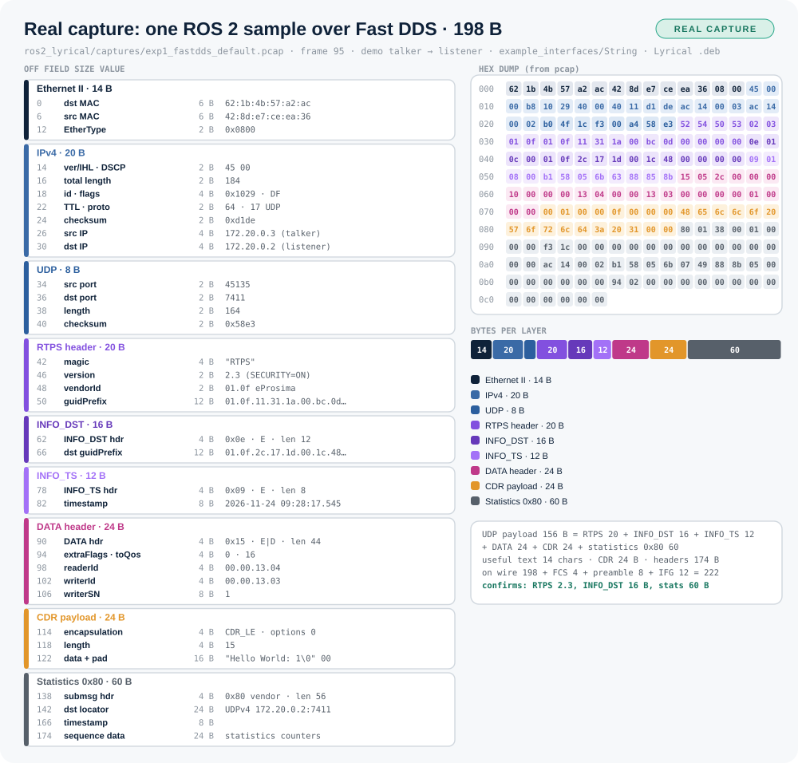

# ROS 2 Lyrical Luth: ผลการทดลองจริงบนสาย (packet capture)

> **ลำดับการอ่าน:** ขั้นที่ 6 จาก 8 ([ดูทั้งหมด](../README.md#ลำดับการอ่าน)) · ก่อนหน้า: [ภาค 4](04_architectures.md) · ถัดไป: [ภาค 2 เชิงลึก](02_wire_format_and_kernel.md)

> ภาค 3 ของชุดเอกสาร network stack · ภาค 1: [Deep Dive](01_network_stack_deep_dive.md) · ภาค 2: [Wire format & kernel accounting](02_wire_format_and_kernel.md)
> ดูแบบ 3D: [Lyrical Packet Lab บทที่ 17–20](https://alfaxphoori.github.io/ros2/ros2_lyrical/interactive/lyrical-packet-lab.html#lesson-17) (packet วิ่งตามจำนวนจริงจาก pcap)
> ทดลองเมื่อ 2026-11-24 (รันซ้ำด้วย script ฉบับปรับปรุงเมื่อ 2026-11-27 ดู §6 และ §8) · ไฟล์ pcap ทั้งหมดอยู่ใน [`captures/`](../captures/) · ทำซ้ำได้ด้วย [`captures/scripts/run_experiments.sh`](../captures/scripts/run_experiments.sh)

เอกสารภาค 1 และภาค 2 สร้างจากการอ่าน source code ภาคนี้คือการ**รันของจริงแล้ว capture packet** เพื่อตรวจว่าที่วิเคราะห์ไว้ตรงกับสิ่งที่เกิดบนสายหรือไม่ ทุกตัวเลขในเอกสารนี้มาจาก pcap หรือจากตัวนับของ kernel (`/proc/net/snmp`) ในการรันจริง การทดลองชุดเต็มรันซ้ำ 2 รอบเมื่อ 2026-11-24 ได้ผลตรงกัน ส่วนการรันซ้ำอีก 2 รอบเมื่อ 2026-11-27 ได้ผลเชิงโครงสร้างเหมือนเดิม (เช่น frame แรกของ `"Hello World: 1"` ยังเป็น frame 95 ยาว 198 B) แต่ตัวเลขที่ขึ้นกับการสูญหาย (การทดลองที่ 2 และ 5) ต่างไปจากเดิม ดู §6

**วัตถุประสงค์การเรียนรู้** อ่านภาคนี้จบแล้วควรทำได้ดังนี้
1. ตรวจตัวเลขของการทดลองที่ 1–6 จาก pcap ใน `captures/` ด้วย `tools/rtps_peek.py` หรือ tshark (§2–§6, §8)
2. เปรียบเทียบคำทำนายของภาค 1–2 กับสิ่งที่เห็นบนสาย และระบุข้อที่ต้องแก้ (§2, §3, §7)
3. ระบุชั้นที่ภาพหาย (สาย, IP reassembly หรือ socket) โดยใช้ capture ร่วมกับตัวนับ `/proc/net/snmp` (§6, §9.4)
4. อ่านไฟล์ผลใน `captures/results/` (rcvbuf sweep, latency, shaping) แล้วสรุปผลพร้อมขอบเขตของข้อสรุป (§9–§11)
5. อธิบาย threats to validity ของการทดลองบน `veth` และออกแบบการทดลองซ้ำบน hardware จริง (§12)

**พื้นฐานที่ควรมี** ภาค 1 §3–§5 และภาค 4 · Docker ระดับรัน container · tcpdump/Wireshark · สถิติพื้นฐาน (median, percentile, confidence interval)

แบบฝึกหัด: [exercises.md ภาค 3](exercises.md#ภาค-3) · คำศัพท์: [glossary.md](glossary.md) · สรุปย่อหนึ่งหน้า: [cheatsheet.md](cheatsheet.md)

---

## 1. สภาพแวดล้อมการทดลอง

| รายการ | ค่า |
|---|---|
| Image | `ros:lyrical-ros-base` (Docker Official Image, digest `sha256:c69a7a39142b0a19c8cc5e80a35e9087e2ae46080dfa0a59961ff72287fdc5f6` ตรึงไว้ใน Dockerfile แล้ว) + `ros-lyrical-demo-nodes-cpp`, `ros-lyrical-rmw-zenoh-cpp`, `tcpdump`, `tshark 4.6.4` ([Dockerfile](../captures/scripts/Dockerfile), เวอร์ชัน package หลักบันทึกไว้ใน [`apt-pins.txt`](../captures/scripts/apt-pins.txt)) |
| package จริงจาก apt | `ros-lyrical-fastdds 3.6.2`, `ros-lyrical-fastcdr 2.3.6`, `ros-lyrical-rmw-fastrtps-cpp 9.4.10`, `ros-lyrical-rclcpp 32.0.3`, `ros-lyrical-rmw-zenoh-cpp 0.10.6`, `ros-lyrical-zenoh-cpp-vendor 0.10.6` (zenoh-c 1.8.0, zenoh-cpp 1.9.0) |
| Kernel | Linux 7.0.0-43-generic เมื่อ 2026-11-24 และ 7.0.0-44-generic ในการรันซ้ำ 2026-11-27 (Ubuntu 26.04, container ใช้ kernel ของ host) |
| sysctl (2026-11-27) | `net.core.rmem_max` = `wmem_max` = 4 194 304, `rmem_default` = `wmem_default` = 212 992 ทั้งใน host และใน container (อ่านอย่างเดียว ไม่ได้แก้) ค่าของวันที่ 2026-11-24 ไม่ได้บันทึกไว้ |
| CPU | Intel Core i3-12100, 8 logical CPU (บันทึก 2026-11-27) |
| บันทึกสภาพแวดล้อม | ตั้งแต่ 2026-11-27 ทุกการรันเขียน `captures/scripts/out/env.txt` (kernel, Docker, image ID, digest, sysctl, เวอร์ชัน tool และผลตรวจ `apt-pins.txt`) พร้อม `dpkg_all.txt`, `dpkg_ros_lyrical.txt`, `ros2_doctor.txt` |
| Topology | container แต่ละตัวเป็น "host" แยก network namespace ต่อกันผ่าน Docker bridge (`veth`, MTU 1500, subnet 172.20.0.0/16) multicast ใช้ได้ |
| จุด capture | `tcpdump -i eth0` ภายใน container ฝั่งรับ (Host B) ซึ่งเห็น packet ที่ AF_PACKET tap ก่อนเข้า IP stack |
| ข้อจำกัด | traffic ไม่ผ่าน NIC จริง (ผ่าน `veth`) ผลด้าน driver เช่น r8169 จึงไม่อยู่ในการทดลองนี้ และทุก container ใช้ CPU เครื่องเดียวกัน |

```
 Host A (talker)                 Docker bridge (veth)               Host B (listener + tcpdump)
 172.20.0.3  ───────────────────────────────────────────────────────  172.20.0.2
             SPDP multicast 239.255.0.1:7400 · SEDP unicast :7410 · user data unicast :7411
```

| # | การทดลอง | pcap |
|---|---|---|
| 1 | Fast DDS ค่าเริ่มต้น: `demo_nodes_cpp talker` → `listener` ข้าม container | [`exp1_fastdds_default.pcap`](../captures/exp1_fastdds_default.pcap) |
| 2 | `sensor_msgs/Image` 640×480 rgb8 (921 600 B) แบบ RELIABLE 5 ภาพ | [`exp2_image_reliable.pcap.gz`](../captures/exp2_image_reliable.pcap.gz) |
| 3 | `rmw_zenoh_cpp` ผ่าน router 1 ตัว | [`exp3_zenoh.pcap`](../captures/exp3_zenoh.pcap) |
| 4 | talker + listener ใน container เดียวกัน (SHM) | [`exp4_samehost_shm.pcap`](../captures/exp4_samehost_shm.pcap) |
| 5 | Image แบบ BEST_EFFORT 20 ภาพ, receive buffer ค่าเริ่มต้น | [`exp5_image_besteffort.pcap.gz`](../captures/exp5_image_besteffort.pcap.gz) |
| 6 | เหมือนข้อ 5 แต่ตั้ง `receiveBufferSize` 4 MiB ผ่าน XML profile | [`exp6_image_besteffort_bigbuf.pcap.gz`](../captures/exp6_image_besteffort_bigbuf.pcap.gz) (capture เมื่อ 2026-11-27 คนละรอบกับตัวนับของ 2026-11-24; รอบนี้ได้รับ 20/20, `RcvbufErrors` 0, `ReasmOKs` 300 และ DATA_FRAG 15 ก้อนครบทั้ง 20 ภาพ) |
| 7 | sweep `SO_RCVBUF` ของผู้รับอย่างเดียว (แก้ตัวแปรกวนของข้อ 6) 81 run ([§9](#9-การทดลองที่-7-sweep-ขนาด-receive-buffer-แก้ตัวแปรกวนของการทดลองที่-56)) | ไม่เก็บ pcap ใน repo ผลอยู่ใน [`captures/results/rcvbuf_sweep_*.csv`](../captures/results/) |
| 8 | latency end-to-end (rclpy) 7 config × 30 รอบ ([§10](#10-การทดลองที่-8-latency-ที่วัดจริง-end-to-end-rclpy)) | ไม่มี capture ผลอยู่ใน [`captures/results/latency_*`](../captures/results/) |
| 9 | ภาพ BEST_EFFORT/RELIABLE เมื่อจำกัดอัตราส่งด้วย `tc` ([§11](#11-การทดลองที่-9-จำกัดอัตราส่งด้วย-tc-จำลอง-link-1-gbits)) | ไม่เก็บ pcap ใน repo ผลอยู่ใน [`captures/results/shaping_*.csv`](../captures/results/) |

---

## 2. การทดลองที่ 1: หนึ่ง sample ของ talker บนสายจริง



frame 95 ใน `exp1_fastdds_default.pcap` คือ `"Hello World: 1"` ตัวแรก **ยาว 198 B**

```
0000  62 1b 4b 57 a2 ac 42 8d e7 ce ea 36 08 00 45 00   Ethernet │ IPv4
0010  00 b8 10 29 40 00 40 11 d1 de ac 14 00 03 ac 14   len 184 · DF · TTL 64 · UDP · 172.20.0.3 →
0020  00 02 b0 4f 1c f3 00 a4 58 e3 52 54 50 53 02 03   172.20.0.2 │ UDP 45135→7411 len 164 │ "RTPS" 2.3
0030  01 0f 01 0f 11 31 1a 00 bc 0d 00 00 00 00 0e 01   vendor 01.0f · guidPrefix │ INFO_DST
0040  0c 00 01 0f 2c 17 1d 00 1c 48 00 00 00 00 09 01   dst guidPrefix (listener) │ INFO_TS
0050  08 00 b1 58 05 6b 63 88 85 8b 15 05 2c 00 00 00   timestamp │ DATA E|D len 44
0060  10 00 00 00 13 04 00 00 13 03 00 00 00 00 01 00   readerId 00.00.13.04 · writerId 00.00.13.03 · SN
0070  00 00 00 01 00 00 0f 00 00 00 48 65 6c 6c 6f 20   =1 │ CDR_LE · len 15 · "Hello "
0080  57 6f 72 6c 64 3a 20 31 00 00 80 01 38 00 01 00   "World: 1\0" pad │ 0x80 statistics len 56
0090  00 00 f3 1c 00 00 00 00 00 00 00 00 00 00 00 00   locator UDPv4 port 7411 …
00a0  00 00 ac 14 00 02 b1 58 05 6b 07 49 88 8b 05 00   … 172.20.0.2 │ timestamp │ sequence data
00b0  00 00 00 00 00 00 94 02 00 00 00 00 00 00 00 00
00c0  00 00 00 00 00 00
```

**ตรวจคำทำนายจากภาค 1 และภาค 2 กับของจริง**

| ประเด็น | คำทำนาย | ผลจริง | สรุป |
|---|---|---|---|
| ขนาด frame | ภาค 1: 122 B (แบบน้อยที่สุด) · ภาค 2: 138–198 B | **198 B** | ตรงกับขอบบนของภาค 2 |
| RTPS version | ภาค 2: 2.2 (CMake default) · ตรวจเพิ่ม: 2.3 เพราะ `.deb` ใช้ `-DSECURITY=ON` | **2.3** | ยืนยันว่า `.deb` build ด้วย SECURITY=ON |
| INFO_DST | ภาค 2: 16 B | 16 B (`0e 01 0c 00` + guidPrefix 12 B) | ตรง |
| Statistics submessage | ภาค 2: `0x80` ยาว 60 B ทุก message | `80 01 38 00` + 56 B มีทุก RTPS message ในไฟล์ | ตรง |
| ลำดับ submessage | — | INFO_DST → INFO_TS → DATA → 0x80 | ได้ข้อมูลใหม่ |
| readerId | ภาค 1 (สมมติ): `UNKNOWN` | **`00.00.13.04`** (ระบุ reader ปลายทาง) | ภาค 1 ผิด |
| type ของ demo talker | ภาค 1: `std_msgs/String` | **`example_interfaces::msg::dds_::String_`** | ภาค 1 ผิด (demo ใน Lyrical ใช้ `example_interfaces`) |
| CDR payload | `00 01 00 00` + len 15 + text + pad 1 | ตรงทุก byte | ตรง |
| dst port | 7411 = 7400 + 250·0 + 11 + 2·0 | 7411 | ตรง |
| IP DF / TTL | DF, 64 | DF, 64 | ตรง |

**Discovery และ traffic ทั้งหมดใน 14 วินาที** (137 RTPS frame, 53 434 B)

| ประเภท | frame | byte | สัดส่วน |
|---|---|---|---|
| SPDP `DATA(p)` (frame 610 B/ครั้ง = UDP payload 568 B, multicast + unicast) | 32 | 19 520 | 36.5% |
| SEDP `DATA(w)`/`DATA(r)` | 21 | 16 166 | 30.3% |
| HEARTBEAT / ACKNACK | 40 | 6 728 | 12.6% |
| `ros_discovery_info` DATA | 13 | 4 754 | 8.9% |
| อื่นๆ (รวม SEDP แบบ packed, GAP) | 22 | 4 484 | 8.4% |
| **ข้อมูล chatter จริง** (9 sample × 198 B) | 9 | 1 782 | **3.3%** |

ข้อค้นพบจาก discovery
- SPDP `DATA(p)` ของ listener ส่ง multicast 6 ครั้งห่างกัน 100 ms ตอนเริ่ม (frame 3–6, 9, 10; frame 7 และ 8 ไม่ใช่ SPDP) แล้วจึงเปลี่ยนเป็นคาบ 3 s (ครั้งถัดไปคือ frame 99) 6 ครั้ง = ประกาศทันที 1 ครั้งตอน enable participant + initial announcements `count` = 5 ตามภาค 2 §1.2 ฝั่ง talker ก็ส่ง 6 ครั้งเช่นกัน (multicast frame 12, 61, 85, 87, 90, 92) ตั้งแต่ครั้งที่ 2 มีสำเนา unicast ไปยัง listener ที่รู้จักแล้วคู่กันด้วย (frame 60, 84, 86, 89, 91) และมี unicast อีก 1 ฉบับ (frame 21) ส่งทันทีหลังได้รับ `DATA(p)` ของ listener (frame 15)
- `DATA(p)` มี parameter ตามลำดับที่ภาค 2 ทำนายไว้ รวมถึง SHM locator **kind `0x13` (=19)** ซึ่ง Wireshark แสดงว่า "Unknown" และ `USER_DATA` = `enclave=/;\0`
- **ข้อค้นพบใหม่ (privacy):** `PID_PROPERTY_LIST` ส่ง `fastdds.physical_data.host` (hash ของเครื่อง), **`fastdds.physical_data.user` = ชื่อผู้ใช้ (`root`)** และ **`fastdds.physical_data.process` = PID** ผ่าน multicast ให้ทุกเครื่องใน subnet ควรระวังในเครือข่ายที่ใช้ร่วมกับผู้อื่น
- **ข้อค้นพบใหม่:** reader ของ `ros_discovery_info` ประกาศ unicast locator ที่ **UDP port 7000** แยกจาก 7411 (เห็นใน `DATA(r)` frame 29, 69) Wireshark จึงแปลผิดเป็นโปรโตคอล "RX" ส่วนสาเหตุในโค้ดยังไม่ได้ไล่ [K]

---

## 3. การทดลองที่ 2: ภาพ 640×480 rgb8 แบบ RELIABLE

| ค่า | คำทำนาย (ภาค 2 §2.4) | ผลจริง |
|---|---|---|
| sampleSize | 921 652 B | **921 648 B** (ต่างกัน 4 B เพราะภาค 2 สมมติ `frame_id = "camera"` (12 B ใน CDR) แต่ [`img_pub.py`](../captures/scripts/img_pub.py) ใช้ `"f0"`… (8 B) คำนวณใหม่ด้วย `"f0"` ได้ 921 648 ตรงพอดี และยืนยันว่า sampleSize นับรวม encapsulation 4 B ดูภาค 2 §2.4) |
| fragmentSize | 65 324 B (เมื่อมี statistics) | **65 324 B** |
| DATA_FRAG ต่อภาพ | 15 | **15** (ครบทั้ง 5 ภาพ) |
| IP fragment ต่อ datagram | 45 | **45** (reassembled 65 476 B) |
| ชื่อ topic บนสาย | `rt/img` | **`rt/img/_buf_cpu`** (ข้อค้นพบใหม่ ดูด้านล่าง) |

ผลการส่ง: ได้รับครบ 5/5 ภาพ แต่ตัวนับ kernel ของ Host B แสดง **`RcvbufErrors = 23`**, `ReasmOKs = 97` (75 datagram ที่ควรมี + ส่งซ้ำ) และเห็น `NACK_FRAG` 4 ครั้ง จำนวน DATA_FRAG ต่อ sequence number คือ 18, 21, 15, 15, 28 แปลว่าภาพที่ 1, 2 และ 5 ต้องส่ง fragment ซ้ำ 3, 6 และ 13 ชิ้น รวม 22 ชิ้น ซึ่งตรงกับตัวนับ kernel พอดี (75 + 22 = 97 = `ReasmOKs`) กลไก RELIABLE ของ RTPS กู้ข้อมูลที่ kernel ทิ้งไปได้ แต่ทำให้ traffic เพิ่มขึ้นราว 29%

ตัวอย่าง `NACK_FRAG` (frame 749): `writerSN 1, bitmapBase 4, numBits 3, bitmap 00 00 00 e0` (u32 little-endian = `0xe0000000` คือ 3 บิตแรกเป็น 1) reader ขอ fragment 4, 5 และ 6 ของภาพแรกใหม่ และ DATA_FRAG ที่ส่งซ้ำตามมาคือ fragment 4, 5, 6 จริง

NACK_FRAG ทั้ง 4 ฉบับในไฟล์

| frame | SN | bitmapBase | numBits | fragment ที่ขอ |
|---|---|---|---|---|
| 749 | 1 | 4 | 3 | 4, 5, 6 |
| 1534 | 2 | 3 | 10 | 3, 4, 10, 11, 12 |
| 1764 | 2 | 12 | 1 | 12 (ขอซ้ำ เพราะก้อนที่ส่งซ้ำหายอีกรอบ) |
| 3746 | 5 | 3 | 13 | 3–15 |

> **แก้ไข 2026-11-26:** ฉบับก่อนหน้าระบุว่า frame 749 ขอ fragment 4 และ 5 และ SN 1 มี DATA_FRAG 17 ก้อน ซึ่งผิด ตรวจใหม่โดยถอด bitmap จาก byte ดิบด้วย [`tools/rtps_peek.py`](../tools/rtps_peek.py) (`python3 ros2_lyrical/tools/rtps_peek.py sms ros2_lyrical/captures/exp2_image_reliable.pcap.gz NACK_FRAG`)

**ข้อค้นพบใหม่: topic `/_buf_cpu`** [V capture + source]
ใน Lyrical ถ้า message มีฟิลด์ `uint8[]` (ซึ่งตอนนี้เป็น `rosidl::Buffer`) และไม่ได้ใช้ QoS แบบ transient-local `rmw_fastrtps_cpp` จะสร้าง DDS topic เพิ่มชื่อ `<topic>/_buf_cpu` เป็นช่องทางร่วมของ subscriber ที่ใช้ CPU backend ทั้งหมด (`rmw_fastrtps_cpp/src/publisher.cpp` บรรทัด 385–395) ส่วน subscriber ที่ใช้ backend อื่น เช่น CUDA จะได้ช่องทาง `/_buf/<gid>` ของตัวเอง ตาม `rmw_zenoh/docs/design.md` ผลที่ตามมาคือเครื่องมือที่ filter ตามชื่อ topic DDS (Wireshark, firewall, bridge) จะไม่เห็นภาพบน `rt/img` แต่จะเห็นบน `rt/img/_buf_cpu` แทน

---

## 4. การทดลองที่ 3: sample เดียวกันผ่าน rmw_zenoh


- หลังจาก router gossip ส่งข้อมูลให้แล้ว session ของ talker (172.20.0.4) กับ listener (172.20.0.3) **มี TCP connection ตรงถึงกัน** โดยใน capture นี้ฝั่ง listener เป็นผู้เปิด (frame 60: SYN จาก 172.20.0.3:57268 ไป 172.20.0.4:35545 [V: `tcp.flags.syn==1`, แก้เมื่อ 2026-11-28 จากเดิมที่เขียนว่า talker เป็นผู้เปิด]) ส่วน sample วิ่งจาก talker ไป listener บน connection นี้ ข้อมูลจึงไม่ผ่าน router (172.20.0.2:7447) ตรงตาม README ของ rmw_zenoh
- หนึ่ง sample = **161 B** (Ethernet 14 + IP 20 + TCP 32 + Zenoh 95) **สั้นกว่า RTPS 37 B**
- TCP payload ขึ้นต้นด้วย `5d 00` คือ batch length แบบ u16 little-endian (=93) ตรงตามภาค 2 §4.2
- attachment ของ rmw_zenoh ยาว 33 B ตรงตามภาค 2: sequence number (8) + source timestamp (8) + ความยาว GID (1) + GID (16)
- CDR payload ยาว 23 B ไม่มี padding ท้าย ส่วน RTPS pad เป็น 24 B
- การแยก field `FRAME 0x25`, `PUSH 0x1d`, `PUT 0xa1` และ timestamp ถอดด้วยมือตามลำดับ codec ที่อ่านจาก source ของ Zenoh 1.10.1 แต่ binary ที่ใช้ในการทดลองจริงคือ zenoh-c 1.8.0 / zenoh 1.8.0 (commit `2687c51`) จาก `ros-lyrical-zenoh-cpp-vendor 0.10.6` (ดูหมายเหตุเวอร์ชันใน[ภาค 2 §4](02_wire_format_and_kernel.md#4-rmw_zenoh_cpp-บนสาย)) ยังไม่ได้เทียบ codec สองเวอร์ชันทีละ field และยังไม่ได้ตรวจด้วย Zenoh dissector [K]

---

## 5. การทดลองที่ 4: เครื่องเดียวกัน (Fast DDS SHM)

- ใน pcap ที่ capture ทุก interface (`-i any`) **ไม่มี user DATA ของ `rt/chatter` เลย** มีแค่ discovery (`DATA(p)` 40, `DATA(w)` 21, `DATA(r)` 17, HEARTBEAT/ACKNACK 28) แต่ listener ได้รับครบทุกข้อความ จึงยืนยันว่าข้อมูลวิ่งผ่าน shared memory
  - **ตรวจซ้ำ 2026-11-27 ด้วย [`tools/rtps_peek.py`](../tools/rtps_peek.py) [V]:** pcap นี้เป็น link type 276 (Linux cooked v2 จาก `-i any`) ซึ่ง tool ฉบับก่อนอ่านไม่ได้ (`sms` ไม่แสดงผลเลย) หลังแก้ให้รองรับแล้วพบ DATA 100 submessage ทั้งหมดมาจาก builtin writer: `00.01.00.c2` (SPDP) 43, `00.00.03.c2` (SEDP publications) 32, `00.00.04.c2` (SEDP subscriptions) 25 ในจำนวนนี้ DATA ที่มี payload (flags `0x05`) คือ 40/21/17 ตรงกับตัวเลขข้างบน ส่วนอีก 3/11/8 (flags `0x03`) มีแค่ inline QoS ที่มี `STATUS_INFO` = dispose+unregister ตอนปิด node (Wireshark แสดงเป็น `[UD]`) HEARTBEAT 14 มาจาก `00.00.03.c2` 4, `00.00.04.c2` 4, `00.02.00.c2` (participant message) 2, `00.03.00.c3`/`00.03.01.c3` (type lookup request/reply) 2/2 และ ACKNACK 14 **ไม่มี DATA หรือ DATA_FRAG จาก user writer เลย** ตรวจไขว้ด้วยสคริปต์แยกที่อ่าน header SLL2 เองได้ผลเดียวกัน
  - interface ที่เห็น: `lo` (127.0.0.1 → 127.0.0.1 unicast ไป UDP 7410/7412 รวม 77 frame และ → 239.255.0.1:7400 16 frame) กับ interface ของ container (172.17.0.2 → 239.255.0.1:7400 16 frame, เป็น SPDP multicast เท่านั้น) นอกจากนี้มีแค่ IGMP 4 และ ARP 2
  - ทำซ้ำ (จาก root ของ repo):

```bash
python3 ros2_lyrical/tools/rtps_peek.py sms ros2_lyrical/captures/exp4_samehost_shm.pcap DATA DATA_FRAG | grep -o 'flags 0x.. .*writer [0-9a-f.]*' | awk '{print $1,$2,$NF}' | sort | uniq -c
python3 ros2_lyrical/tools/rtps_peek.py sms ros2_lyrical/captures/exp4_samehost_shm.pcap HEARTBEAT | grep -o 'writer [0-9a-f.]*' | sort | uniq -c
```

- `/dev/shm` ระหว่างรัน:

```
fastdds_1f31487e5015077c      549 408 B   segment ของ participant (ภาค 2: 512 KiB + header)
fastdds_55f2d4e72058e46e      549 408 B
fastdds_port7000 / 7001 / 7411 / 7413   52 400 B   port (ring buffer) ของแต่ละ locator
sem.fastdds_port7000_mutex …             named semaphore
```

- thread ของ Fast DDS (`ps -eLo comm`): `dds.udp.<port>`, `dds.shm.<port>`, `dds.ev.0`, `dds.asyn.0.*`, `dds.shm.wdog` ตรงกับภาค 2 §3.2 และพบเพิ่ม `dds.tls.request`, `dds.tls.replies` (type lookup service) ซึ่งภาค 2 ไม่ได้ระบุ

---

## 6. การทดลองที่ 5–6: receive buffer ตัดสินว่าภาพจะรอดหรือไม่


| | ค่าเริ่มต้น | XML `receiveBufferSize` 4 MiB |
|---|---|---|
| `SO_RCVBUF` จริง (`ss -uam`) | `rb212992` (= `net.core.rmem_default`) | `rb8388608` (kernel คูณสองค่าที่ขอ) |
| ภาพที่ได้รับ (BEST_EFFORT) | **13/20 (หาย 35%)** | **20/20** |
| `Udp RcvbufErrors` | **45** | **0** |
| DATA_FRAG ที่เห็นใน capture | 15/15 ครบทุกภาพ | — |

- capture เห็น fragment ครบทุกภาพ แปลว่า**ข้อมูลมาถึงเครื่องครบ แต่ kernel ทิ้งตอนนำเข้า socket queue** (`__udp_enqueue_schedule_skb`) ซึ่งอยู่หลังจุดที่ tcpdump มองเห็น
- **แก้ไข 2026-11-27:** ฉบับก่อนเขียนว่า "เพิ่ม buffer อย่างเดียวโดยไม่เปลี่ยนอย่างอื่น" ซึ่งไม่ถูกต้อง [`bigbuf.xml`](../captures/scripts/bigbuf.xml) ตั้ง `sendBufferSize` 4 MiB ด้วย, ใช้ `useBuiltinTransports=false` ซึ่งตัด SHM transport และแทน UDPv4 ในตัวด้วย transport ของผู้ใช้ และถูกใส่ให้ทั้ง Host A และ Host B การทดลองที่ 6 จึงยืนยันได้เพียงว่าชุดการตั้งค่านี้ทำให้ภาพไม่หาย ผลที่เปลี่ยนเฉพาะ receive buffer ของผู้รับ (ยืนยันว่า rcvbuf เป็นสาเหตุของการทิ้งบน veth และหาจุดที่การสูญหายหายไป) อยู่ใน §9
- ผลนี้สอดคล้องกับการวิเคราะห์ของภาค 2 §5.3 ว่าค่าเริ่มต้น 212 992 B รับ datagram เต็มขนาด 65 KB ได้เพียง 1–2 ก้อน (เพราะคิดตาม `truesize`)
- เมื่อ 2026-11-24 รันซ้ำ 2 รอบได้ตัวเลขเดิมทุกตัว (13/20, 45 และ 20/20, 0) ตัวเลขในตารางข้างบนมาจากรอบนั้น
- **รันซ้ำ 2026-11-27 [V]** (`run_experiments.sh` ฉบับปรับปรุง 2 รอบ, kernel 7.0.0-44, ไฟล์ `out/run1/summary.txt` และ `out/run2/summary.txt`): ค่าเริ่มต้นได้รับ **19/20, `RcvbufErrors` 6** และ **19/20, 5** ส่วน 4 MiB ได้ **20/20, 0** ทั้งสองรอบ capture เห็น DATA_FRAG 15 ก้อนครบทั้ง 20 ภาพ และ tcpdump รายงาน `0 packets dropped by kernel` ทุกรอบ ทิศทางของผลยังเหมือนเดิม (ข้อมูลมาถึงครบ การทิ้งเกิดที่ socket queue และหายไปเมื่อเพิ่ม buffer) แต่**ขนาดของการสูญหายลดลงมาก** เพื่อแยกว่าเป็นผลจากการแก้ script หรือไม่ ได้รันการทดลองที่ 5 ด้วยขั้นตอนเดิมทุกอย่าง (script และ `img_pub.py`/`img_sub.py` จาก commit ก่อนแก้, `sleep` แบบเดิม, ผลใน `out/oldflow_exp5/`) อีก 2 รอบ ได้ 19/20, `RcvbufErrors` 3 ทั้งสองรอบ จึงสรุปว่าความต่างมาจากสภาพของเครื่องหรือ kernel ไม่ใช่จาก script ยังไม่ได้ระบุสาเหตุ ตัวเลข 35% จึงควรอ่านเป็นผลของรอบ 2026-11-24 เท่านั้น ไม่ใช่ค่าคงที่ของ setup นี้
- การทดลองที่ 2 (RELIABLE) ในการรันซ้ำ 2026-11-27 ก็ต่างจาก §3 เช่นกัน: ได้รับครบ 5/5 ทั้งสองรอบ แต่เห็น `NACK_FRAG` เพียง 1 ฉบับ (SN 1) DATA_FRAG ต่อ SN เป็น 21, 15, 15, 15, 15 และ 18, 15, 15, 15, 15, `RcvbufErrors` 6 และ 3, `ReasmOKs` 81 และ 78 (ยังเป็นไปตาม 75 + จำนวนที่ส่งซ้ำ: 75 + 6 = 81, 75 + 3 = 78)

วิธีแก้ในงานจริงมี 2 ระดับ
1. ระดับ OS: เพิ่ม `net.core.rmem_max` (และ `rmem_default` ถ้าไม่ใช้ XML)
2. ระดับ middleware: ตั้ง `receiveBufferSize` ใน XML profile ตาม [`bigbuf.xml`](../captures/scripts/bigbuf.xml) (ค่าที่ได้จะถูกจำกัดด้วย `rmem_max`)

---

## 7. สรุปสิ่งที่แก้หรือเพิ่มในเอกสารภาค 1–2 จากผลการทดลอง

| เรื่อง | ผลจากการทดลอง |
|---|---|
| frame ตัวอย่างในภาค 1 (122 B) | frame จริงยาว 198 B (เพิ่ม INFO_DST 16 + statistics 60) readerId เป็น reader จริง ไม่ใช่ UNKNOWN (ภาค 1 §5.4 เปลี่ยนไปใช้ frame 95 นี้แล้ว) |
| type ของ demo talker | `example_interfaces/msg/String` ไม่ใช่ `std_msgs/msg/String` |
| RTPS version | 2.3 ใน `.deb` ของ Lyrical |
| `sampleSize` ของภาพ 640×480 | 921 648 B (ภาค 2 คำนวณได้ 921 652 B ด้วย `frame_id = "camera"`; ต่างกัน 4 B จาก `frame_id` ที่สั้นกว่า และยืนยันว่านับรวม encapsulation) |
| topic ของ message ที่มี `uint8[]` | มี topic `/_buf_cpu` เพิ่มเข้ามา |
| `ros_discovery_info` | reader ใช้ UDP port 7000 |
| ข้อมูลที่ SPDP เปิดเผย | ชื่อผู้ใช้และ PID ของ process |
| rcvbuf | ยืนยันเชิงสาเหตุบน veth เมื่อเปลี่ยนเฉพาะ `SO_RCVBUF` ของผู้รับ (§9, 81 run): ที่ 212 992 และ 425 984 B ภาพแรกหายทุก run (หาย 5–5.6%) ตั้งแต่ 1 048 576 B ขึ้นไปไม่หายเลย ส่วนตัวเลข 35% เป็นผลของรอบ 2026-11-24 เท่านั้น (§6) และเมื่อจำกัดอัตราเท่า 1 Gbit/s ด้วย `tc` ค่าเริ่มต้นก็ไม่หาย (§11) จึงยังไม่ใช่ข้อสรุปสำหรับเครือข่ายจริง |

## 8. วิธีทำซ้ำ

```bash
cd ros2_lyrical/captures/scripts
./run_experiments.sh            # ใช้ Docker อย่างเดียว ผลอยู่ใน ./out/ (OUT=<dir> เพื่อเปลี่ยนที่เก็บ)
./run_experiments.sh --rebuild  # บังคับ build image ใหม่ (ปกติ build เฉพาะเมื่อยังไม่มี lyrical-wire:exp)
cat out/summary.txt             # ตัวเลขที่เอกสารนี้ใช้เทียบ (§2, §3, §6)
cat out/env.txt                 # สภาพแวดล้อมของรอบนั้น
# ถอด packet โดยไม่ต้องมี tshark บน host
python3 ../../tools/rtps_peek.py frame out/exp1_fastdds_default.pcap 95
python3 ../../tools/rtps_peek.py sms   out/exp2_image_reliable.pcap NACK_FRAG
# หรือใช้ tshark ใน image
docker run --rm -v "$PWD/out:/o:ro" lyrical-wire:exp tshark -r /o/exp1_fastdds_default.pcap -Y 'rtps && frame.len==198' -O rtps
```

ขั้นตอนใน script (ตั้งแต่ 2026-11-27; helper อยู่ใน [`lib.sh`](../captures/scripts/lib.sh))
- image: `Dockerfile` ตรึง base image ด้วย digest และบันทึก `dpkg -l` ไว้ใน `/opt/exp/dpkg-l.txt` ขั้นสุดท้ายของ build เทียบเวอร์ชันกับ [`apt-pins.txt`](../captures/scripts/apt-pins.txt) (เตือนเมื่อไม่ตรง, `--build-arg STRICT_PINS=1` ให้ build ล้ม, `--build-arg APT_EXACT=1` ติดตั้งเวอร์ชันตาม pin ซึ่งจะใช้ได้ตราบที่ apt repo ของ ROS ยังเก็บเวอร์ชันนั้นอยู่) การ build เมื่อ 2026-11-27 ใช้ layer apt เดิมจาก cache และได้ `dpkg -l` ตรงกับ image ของ 2026-11-24 ทุกบรรทัด
- network: ใช้ `rosnet` (สร้างด้วย `--subnet 172.20.0.0/16` ถ้ายังไม่มี ถ้ามีอยู่แล้วแต่ subnet ไม่ตรง script จะหยุดโดยไม่ลบ) และกำหนด IP ตายตัว: Host B (listener + tcpdump) 172.20.0.2, Host A (talker) 172.20.0.3, การทดลองที่ 3 ใช้ router .2, listener .3, talker .4 ตาม §1 และ §4 ถ้ามี container อื่นบน `rosnet` ถือ IP เหล่านี้อยู่ script จะรอสูงสุด 60 s แล้วหยุด
- ลำดับเวลา: Host A เริ่มเมื่อ tcpdump เขียน pcap header แล้วและ listener เริ่มแล้ว (`img_sub.py` พิมพ์ `subscription ready`; demo listener ไม่มีบรรทัดแบบนี้จึงรอ 1 s เท่ากับช่วงห่างของรอบ 2026-11-24) `img_pub.py` รอจน match กับ subscriber (สูงสุด 15 s) แต่ไม่เริ่มส่งก่อน 3.0 s เท่ากับ `sleep 3` เดิม ภาพและคาบ 0.5 s เหมือนเดิม จบแต่ละการทดลองด้วย `docker wait` ไม่ใช่ `sleep`
- ผลที่ได้: `expN_*.raw.pcap` (ไม่กรอง), `expN_*.pcap` (กรองแล้ว), `*.listener.log`, `*.talker.log`, `*.snmp.txt`, `*.tcpdump.log` (จำนวน packet ที่ tcpdump ทิ้ง), `*.exit.txt` และ `summary.txt`
- เวลาที่ใช้: script รายงาน 107 s และ 102 s ในการรัน 2 รอบเมื่อ 2026-11-27 (ไม่รวม build เพราะ image มีอยู่แล้ว)
- การทดลองที่ 5–6 เป็นแค่สองจุดปลายของคำถามเรื่อง receive buffer และมีตัวแปรกวน (§9.1) การกวาดค่าแบบมีการทำซ้ำอยู่ใน [`run_rcvbuf_sweep.sh`](../captures/scripts/run_rcvbuf_sweep.sh) (§9, และ `--shape` สำหรับ §11) ส่วน latency อยู่ใน [`run_latency.sh`](../captures/scripts/run_latency.sh) (§10) ทั้งสองเขียนสรุปลง [`captures/results/`](../captures/results/)

ไฟล์ `.pcap.gz` ต้อง `gunzip` ก่อนเปิดด้วย Wireshark (`rtps_peek.py` อ่าน `.gz` ได้โดยตรง)

**หมายเหตุเรื่องข้อมูลใน pcap:** ไฟล์ใน repo ผ่านการกรองแล้วให้เหลือเฉพาะ IPv4 และ ARP ระหว่าง container (ตัด mDNS, IPv6 และ packet จาก/ถึง gateway ของ Docker bridge ซึ่งมีชื่อเครื่อง host) เลข frame ในเอกสารนี้อ้างอิงไฟล์ที่กรองแล้ว ตั้งแต่ 2026-11-27 `run_experiments.sh` กรองให้เองด้วย tshark ใน image (`filter_pcap` ใน `lib.sh`) โดยเก็บไฟล์ดิบไว้เป็น `*.raw.pcap` ถ้าจะเผยแพร่ ให้ใช้เฉพาะ `*.pcap` ที่กรองแล้ว filter ที่ใช้คือ

```
(ip || arp) && !(udp.port==5353) && !(ip.addr==172.20.0.1) && !(arp.src.proto_ipv4==172.20.0.1) && !(arp.dst.proto_ipv4==172.20.0.1)
```

> **แก้ไข 2026-11-27:** ฉบับก่อนหน้าระบุ filter เป็น `ip && !(udp.port==5353) && !(ip.addr==172.20.0.1)` แต่ pcap ใน repo มี ARP อยู่ (เช่น 9 frame ใน `exp1_fastdds_default.pcap`, 10 frame ใน `exp3_zenoh.pcap`, 2 frame ใน `exp4_samehost_shm.pcap`) ซึ่ง filter นั้นจะตัดทิ้งและทำให้เลข frame เลื่อน filter ข้างบนเมื่อรันกับ pcap ทั้ง 5 ไฟล์ที่ commit ไว้ได้ไฟล์เหมือนเดิมทุก byte [V] ในการรันซ้ำ 2 รอบเมื่อ 2026-11-27 frame แรกของ `"Hello World: 1"` ใน `out/exp1_fastdds_default.pcap` ที่กรองแล้วคือ frame 95 ยาว 198 B เหมือนไฟล์ใน repo (จำนวน frame ทั้งไฟล์ 169 และ 170 เทียบกับ 172 ในไฟล์ใน repo)

---

## 9. การทดลองที่ 7: sweep ขนาด receive buffer (แก้ตัวแปรกวนของการทดลองที่ 5–6)

> ทดลอง 2026-11-27 (kernel 7.0.0-44) · script [`run_rcvbuf_sweep.sh`](../captures/scripts/run_rcvbuf_sweep.sh) · ผลดิบต่อ run [`captures/results/rcvbuf_sweep_runs.csv`](../captures/results/rcvbuf_sweep_runs.csv) · สรุปต่อแขน [`rcvbuf_sweep_summary.csv`](../captures/results/rcvbuf_sweep_summary.csv) · ภาพที่หายต่อ run [`rcvbuf_sweep_lost_images.csv`](../captures/results/rcvbuf_sweep_lost_images.csv) · สภาพแวดล้อม [`rcvbuf_sweep_env.txt`](../captures/results/rcvbuf_sweep_env.txt) · ทุกตัวเลขในหัวข้อนี้มาจากไฟล์เหล่านี้ [V]

### 9.1 ตัวแปรกวนในการทดลองที่ 6

[`bigbuf.xml`](../captures/scripts/bigbuf.xml) ที่ใช้เมื่อ 2026-11-24 เปลี่ยนมากกว่า receive buffer [V: ไฟล์ XML + `ss` + `/dev/shm` ใน 9.3]

1. `<receiveBufferSize>4194304` **และ** `<sendBufferSize>4194304` ใน transport descriptor เดียวกัน (send buffer ของผู้ส่งจึงเปลี่ยนด้วย)
2. `<useBuiltinTransports>false</useBuiltinTransports>` + `<userTransports>udp_bigbuf` ทำให้ participant **ไม่มี SHM transport** และใช้ UDPv4 ที่ผู้ใช้สร้างแทน UDPv4 ในตัว (field อื่นของ descriptor เป็นค่า default ของ class)
3. `run_experiments.sh` ใส่ `FASTDDS_DEFAULT_PROFILES_FILE` ให้ **ทั้ง Host A และ Host B** (`run_pair ... -e FASTDDS_DEFAULT_PROFILES_FILE=/exp/bigbuf.xml` ซึ่งส่ง argument เดียวกันให้ `docker run` ทั้งสองตัว)

ดังนั้นประโยค "เพิ่ม buffer อย่างเดียว" ใน §6 ไม่ถูกต้อง ผลของการทดลองที่ 6 สรุปได้เพียงว่า "ชุดการตั้งค่านี้" ทำให้ภาพไม่หาย

### 9.2 การออกแบบใหม่

- **ตัวแปรเดียว:** Fast DDS 3.6.2 มี attribute ระดับ participant `<rtps><listenSocketBufferSize>` [V: `RTPSParticipantAttributes.hpp` บรรทัด 824 ใน image, `fastdds_profiles.xsd` บรรทัด 163] ซึ่งถูกนำไปใช้กับ listen socket ของ UDPv4 ในตัว โดยไม่ต้องปิด builtin transports profile ถูกสร้างจาก template [`socket_buffer_only.xml.in`](../captures/scripts/socket_buffer_only.xml.in) ต่อจุด sweep และใส่ให้ **Host B (ผู้รับ) เท่านั้น** ผู้ส่งไม่มี XML
- **ตรวจว่าเปลี่ยนแค่นั้นจริง** ทุก run บันทึก `ss -uamn` ใน Host B หลังผู้รับพร้อม (คอลัมน์ `rb_B_port` = `rb` ของ socket port 7411 ซึ่งรับ user data, `rb_B_all`, `udp_ports_B`), `tb` สูงสุดของ Host A (`tb_A_max`) และจำนวนไฟล์ `fastdds*` ใน `/dev/shm` ของ Host B (`shm_files_B`)
- **workload** เหมือนการทดลองที่ 5: `img_pub.py be 20` / `img_sub.py be` (ภาพ 640×480 rgb8, 20 ภาพ, คาบ 0.5 s) ใช้สำเนาของไฟล์ ณ เวลารัน (เก็บ sha256 ใน env)
- **ต่อ run** container ใหม่ทั้งคู่ ตัวนับ `/proc/net/snmp` เป็น delta ภายใน netns ของ Host B (ก่อน tcpdump เริ่ม → หลังผู้รับหยุด) tcpdump เปิดทุก run เหมือนการทดลองที่ 5 แล้วนับ DATA_FRAG จาก pcap ด้วย [`sweep_pcap_stats.py`](../captures/scripts/sweep_pcap_stats.py) แล้วลบ pcap (ราว 19 MB ต่อ run) เก็บเฉพาะตัวเลข
- **แขน** (ค่าที่ขอเป็น byte): `noxml` (ไม่มี XML), 106496 (XML ที่ควรให้ผลเท่าค่า default เพราะ kernel คูณ 2), 212992, 524288, 1048576, 2097152, 4194304, 8388608 (คาดว่าถูกจำกัดโดย `rmem_max`), `oldbigbuf` (`bigbuf.xml` เดิมทั้งสองฝั่ง เพื่อเทียบกับ §6 แบบตรงตัว), `sndonly` (ผู้ส่งตั้ง `<sendSocketBufferSize>4194304` ผู้รับไม่มี XML) และแขน RELIABLE 20 ภาพที่ `noxml` กับ 4194304
- **จำนวนรอบและลำดับ:** 8 รอบสำหรับแขน BEST_EFFORT หลัก 7 แขน, 5 รอบสำหรับ 8388608, `oldbigbuf`, `sndonly` และแขน RELIABLE ทั้งสอง รวม 81 run (1477 s) ลำดับเป็น round-robin ตามรอบ และสุ่มลำดับแขนภายในแต่ละรอบ (seed 1, ลำดับจริงในคอลัมน์ `order`)
- หมายเหตุเครื่องมือ: คอลัมน์ `gap_us_med` และ `dgram_us_med` ใน `rcvbuf_sweep_runs.csv` / `shaping_runs.csv` คำนวณด้วย `sweep_pcap_stats.py` รุ่นที่แปลงเวลาเป็น float ตั้งแต่ epoch ซึ่งคลาดได้ราว ±0.5 µs (เช่น 3.099 หมายถึง 3 µs, 0.954 หมายถึง 1 µs) แก้แล้วในรุ่นปัจจุบัน ค่าระดับ ms (`burst_ms_*`) ไม่ได้รับผล
- คำสั่ง: `flock <lock> ./run_rcvbuf_sweep.sh --arms 'noxml,106496,212992,524288,1048576,2097152,4194304,8388608*5,oldbigbuf*5,sndonly*5,rel:noxml*5,rel:4194304*5' --reps 8`

### 9.3 ตรวจตัวแปร: ค่าที่ kernel ใช้จริงและสิ่งที่ไม่เปลี่ยน [V]

| แขน | ค่าที่ขอ | `SO_RCVBUF` จริงของ port 7411 (`ss` rb) | socket ที่ได้ค่านี้ | `tb` สูงสุดของ Host A | ไฟล์ `fastdds*` ใน `/dev/shm` ของ Host B |
|---|---|---|---|---|---|
| `noxml` | – | 212 992 | – | 212 992 | 6 |
| 106496 | 106 496 | **212 992** | 7000, 7400, 7410, 7411 | 212 992 | 6 |
| 212992 | 212 992 | **425 984** | เหมือนข้างบน | 212 992 | 6 |
| 524288 | 524 288 | 1 048 576 | เหมือนข้างบน | 212 992 | 6 |
| 1048576 | 1 048 576 | 2 097 152 | เหมือนข้างบน | 212 992 | 6 |
| 2097152 | 2 097 152 | 4 194 304 | เหมือนข้างบน | 212 992 | 6 |
| 4194304 | 4 194 304 | 8 388 608 | เหมือนข้างบน | 212 992 | 6 |
| 8388608 | 8 388 608 | **8 388 608 (ถูกจำกัด)** | เหมือนข้างบน | 212 992 | 6 |
| `oldbigbuf` | 4 194 304 (ทั้งสองฝั่ง) | 8 388 608 | 7000, 7400, 7410, 7411 | **8 388 608** | **0** |
| `sndonly` | ผู้ส่ง 4 194 304 | 212 992 | – | **8 388 608** | 6 |

- ทุก run ของแต่ละแขนให้ค่าเดียวกัน (ไม่มีค่าอื่นปนในคอลัมน์ `rb_B_port`)
- `listenSocketBufferSize` เปลี่ยนเฉพาะ `rb` ของ listen socket ทั้ง 4 ตัวของ participant (7400 multicast discovery, 7410 metatraffic unicast, 7411 user unicast และ 7000) send socket ของ Host B ยังเป็น 212 992 SHM ยังอยู่ (`fastdds_port7411`, `fastdds_port7000` และ segment ของ participant รวม 6 ไฟล์) และ port ที่เปิดฟังชุดเดียวกับ `noxml`
- `oldbigbuf` ยืนยันตัวแปรกวนทั้งสามข้อของ 9.1: `/dev/shm` ไม่มีไฟล์ `fastdds*` เลย (SHM transport หายไป) และ send socket ของทั้งสองฝั่งได้ `tb8388608`
- ค่าที่ได้คือ `2 × min(ค่าที่ขอ, rmem_max)` ตรงตามกฎใน [ภาค 2 §5.3](02_wire_format_and_kernel.md) ส่วน `noxml` ได้ `rmem_default` โดยไม่คูณ 2 ผลที่ตามมาซึ่งควรระวัง: **XML ที่ขอ 212992 (เท่า `rmem_default`) ไม่ได้ให้ค่าเท่า default แต่ได้ 425 984** แขนควบคุมที่ให้ค่าเท่า default จริงคือขอ 106 496
- **ข้อจำกัดของ host:** `net.core.rmem_max` = 4 194 304 ทำให้ขอ 8 MiB ได้ผลเท่าขอ 4 MiB (8 388 608) การทดสอบจุดที่สูงกว่านี้ต้องให้ผู้ใช้สั่ง `sudo sysctl -w net.core.rmem_max=<ค่า>` บน host เอง script ไม่แก้ค่านี้ ส่วนการตั้งผ่าน container ทำไม่ได้: บน kernel นี้ `net.core.rmem_max` ไม่ใช่ค่าต่อ network namespace ไฟล์ใน container เป็น `-r--r--r--` และ `docker run --sysctl net.core.rmem_max=8388608` ถูกปฏิเสธด้วย `open sysctl net.core.rmem_max file: reopen fd 8: permission denied` (ค่าของ host ยังเป็น 4 194 304 หลังลอง) script พิมพ์ precondition check ทุกครั้งว่าจุดใดถูกจำกัด (`out/rcvbuf_sweep/precheck.txt`)

### 9.4 ผล BEST_EFFORT (20 ภาพต่อ run) [V]

| แขน | `SO_RCVBUF` จริง | n | ภาพที่ได้รับ เฉลี่ย (min–max) | หาย % | `RcvbufErrors` median (min–max) | DATA_FRAG ใน capture ทุก run | ภาพที่หาย |
|---|---|---|---|---|---|---|---|
| `noxml` | 212 992 | 8 | 19.00 (19–19) | 5.0 | 4 (3–5) | 300 | `f0` ทุก run |
| 106496 | 212 992 | 8 | 19.00 (19–19) | 5.0 | 3.5 (2–5) | 300 | `f0` ทุก run |
| 212992 | 425 984 | 8 | 18.88 (18–19) | 5.6 | 2 (1–4) | 300 | `f0` ทุก run และ `f10` อีก 1 run |
| 524288 | 1 048 576 | 8 | 20 (20–20) | 0 | 0 (0–0) | 300 | – |
| 1048576 | 2 097 152 | 8 | 20 (20–20) | 0 | 0 (0–0) | 300 | – |
| 2097152 | 4 194 304 | 8 | 20 (20–20) | 0 | 0 (0–0) | 300 | – |
| 4194304 | 8 388 608 | 8 | 20 (20–20) | 0 | 0 (0–0) | 300 | – |
| 8388608 | 8 388 608 (จำกัด) | 5 | 20 (20–20) | 0 | 0 (0–0) | 300 | – |
| `oldbigbuf` | 8 388 608 | 5 | 20 (20–20) | 0 | 0 (0–0) | 300 | – |
| `sndonly` | 212 992 | 5 | 19.00 (19–19) | 5.0 | 3 (2–5) | 300 | `f0` ทุก run |

- ทุก run ของทุกแขน capture เห็น DATA_FRAG 300 ก้อน (20 × 15) ครบทุกภาพ (`sn_complete` = 20), IP fragment 45 ชิ้นต่อ datagram, `ReasmOKs` = 300 และ `ReasmFails` = 0, tcpdump ไม่ทิ้ง packet เลย ข้อมูลจึงมาถึงและประกอบ IP ได้ครบ การทิ้งเกิดที่ socket เท่านั้น: `RcvbufErrors` = `InErrors` = ตัวนับ drop ของ socket port 7411 (`ss` skmem `d`, คอลัมน์ `drops_B_port`) ทุก run
- `RcvbufErrors` นับเป็น datagram (65 KB) ภาพ `f0` ที่หายจึงขาด 1–5 จาก 15 DATA_FRAG
- ค่าที่ขอ 106496 ให้ผลเท่ากับ `noxml` ซึ่งยืนยันว่าการมีไฟล์ XML เองไม่ได้เปลี่ยนผล

### 9.5 ผล RELIABLE (20 ภาพต่อ run, 5 run ต่อแขน) [V]

| แขน | `SO_RCVBUF` จริง | ภาพที่ได้รับ | `RcvbufErrors` median (min–max) | NACK_FRAG ต่อ run | DATA_FRAG ใน capture เฉลี่ย (min–max) | DATA_FRAG ที่ส่งซ้ำ เฉลี่ย (min–max) |
|---|---|---|---|---|---|---|
| `noxml` | 212 992 | 20/20 ทุก run | 4 (4–5) | 1 ทุก run | 304.4 (304–305) | 4.4 (4–5) |
| 4194304 | 8 388 608 | 20/20 ทุก run | 0 (0–0) | 0 | 300 (300–300) | 0 |

ทุก run ของแขน `noxml` จำนวน DATA_FRAG ที่ส่งซ้ำเท่ากับ `RcvbufErrors` ของ run นั้นพอดี (4 = 4 หรือ 5 = 5) และ `ReasmOKs` = 300 + จำนวนที่ส่งซ้ำ เหมือนความสัมพันธ์ที่เห็นใน §3 RELIABLE จึงซ่อมทุก datagram ที่ socket ทิ้งด้วย NACK_FRAG ฉบับเดียว ส่วน buffer 4 MiB ไม่มีอะไรให้ซ่อม

### 9.6 เทียบกับข้อสรุปเดิม

1. **rcvbuf เป็นสาเหตุจริงเมื่อเป็นตัวแปรเดียว [V]** ผู้ส่ง, transport และ SHM เหมือนเดิมทุกอย่าง เปลี่ยนเฉพาะ `SO_RCVBUF` ของผู้รับ ภาพที่หายลดจากอย่างน้อย 1 ภาพต่อ run (24/24 run ที่ `SO_RCVBUF` ≤ 425 984) เป็น 0 (0/42 run BEST_EFFORT ที่ ≥ 1 048 576 รวม `oldbigbuf`) แขน `sndonly` ยังหายเท่า `noxml` จึงไม่ใช่ผลของ send buffer
2. **จุดที่การสูญหายหายไปในเครื่องนี้:** ระหว่าง `SO_RCVBUF` 425 984 (ยังหาย) กับ 1 048 576 (ไม่หาย) คือขอ `listenSocketBufferSize` ตั้งแต่ 524 288 ขึ้นไป ค่า 4 MiB ของ `bigbuf.xml` จึงเกินความจำเป็นราว 8 เท่าสำหรับ workload นี้ จุดระหว่าง 425 984 กับ 1 048 576 ไม่ได้วัด
3. **แขน `oldbigbuf` (config เดิมทั้งชุด)** ให้ผลเหมือนแขน listen-only ที่ `SO_RCVBUF` เท่ากัน (20/20, 0) ในรอบนี้ตัวแปรกวน (send buffer, การตัด SHM, XML ฝั่งผู้ส่ง) จึงไม่ได้เปลี่ยนข้อสรุป แต่ข้อสรุปนี้เป็นของวันนี้ ไม่ได้พิสูจน์ย้อนหลังว่าในรอบ 2026-11-24 ตัวแปรกวนไม่มีผล
4. **ขนาดของปัญหาต่างจากเดิมมาก** วันนี้ค่าเริ่มต้นหายเพียง `f0` (ภาพแรก) ทุก run ส่วนภาพที่ 2–20 ผ่านเกือบทั้งหมด (ข้อยกเว้นเดียวคือ `f10` 1 ครั้ง) ไม่ใช่ 7/20 อย่างวันที่ 2026-11-24 ข้อสังเกตจาก capture ที่สอดคล้องกัน [V: timing] แต่ยังไม่ได้พิสูจน์ว่าเป็นสาเหตุ:
   - ใน capture ของ 2026-11-24 ([`exp5_image_besteffort.pcap.gz`](../captures/exp5_image_besteffort.pcap.gz)) ภาพหนึ่งใช้เวลาจาก IP fragment แรกถึงสุดท้าย median 1.04 ms ระยะห่างระหว่าง IP fragment median 1 µs (ความละเอียดของ pcap คือ 1 µs)
   - ใน run วันนี้ภาพแรกยังมาเร็วแบบนั้น (0.74–0.96 ms, ระยะห่าง 1 µs) แต่ภาพที่ 2–20 ช้าลงเป็น median ราว 3.4–3.9 ms (ระยะห่าง 3 µs) ตาม run อ้างอิงที่เก็บ pcap ไว้ 3 run ([`shaping_burst_per_image.csv`](../captures/results/shaping_burst_per_image.csv) แถว `none_*`) และ `burst_ms_min` 0.72–1.47 ms กับ `burst_ms_med` 3.40–4.18 ms ของ 81 run ใน `rcvbuf_sweep_runs.csv`
   - ที่ buffer ค่า default ภาพที่หายคือภาพที่มาเร็ว ทั้งวันนี้ (ภาพแรก) และวันที่ 2026-11-24 (ทุกภาพเร็ว หาย 7/20) ข้อมูลที่มาเร็วกว่าเติม socket เร็วกว่าที่ thread `dds.udp.7411` ระบาย ตามกลไกใน [ภาค 2 §5.3](02_wire_format_and_kernel.md) และ §11 แสดงว่าเมื่อบังคับให้ทุกภาพมาช้าเท่า 1 GbE การสูญหายที่ค่า default หายไปเอง
   - สาเหตุที่ผู้ส่งช้าลงหลังภาพแรก (เช่น CPU frequency governor ซึ่งตอนวัดเป็น `powersave`, การเปลี่ยน kernel 7.0.0-43 → -44) ยังไม่ได้ตรวจ [K: สมมติฐาน]
5. ผลข้อ 1–3 เป็นผลบน veth ในเครื่องเดียว ดูข้อจำกัดใน §12 และผลเมื่อจำกัดอัตราส่งให้เท่า 1 GbE ใน §11

---

## 10. การทดลองที่ 8: latency ที่วัดจริง (end-to-end, rclpy)

> วัดเมื่อ 2026-11-27 22:15–22:42 (+07) · สคริปต์ [`run_latency.sh`](../captures/scripts/run_latency.sh), [`lat_pub.py`](../captures/scripts/lat_pub.py), [`lat_sub.py`](../captures/scripts/lat_sub.py), [`analyze_latency.py`](../captures/scripts/analyze_latency.py) · ผลสรุป [`captures/results/latency_summary.json`](../captures/results/latency_summary.json), [`latency_summary.csv`](../captures/results/latency_summary.csv), ผลรายรอบ [`latency_runs.csv`](../captures/results/latency_runs.csv), สภาพแวดล้อม [`latency_env.txt`](../captures/results/latency_env.txt), การตรวจ transport [`latency_transport_check.txt`](../captures/results/latency_transport_check.txt) · ข้อมูลดิบ (CSV รายรอบ) อยู่ที่ `captures/scripts/out/latency/<config>/` ซึ่งไม่ได้ commit

ภาค 2 §6 เป็นประมาณการล้วน หัวข้อนี้คือการวัดจริงครั้งแรกของชุดเอกสาร ทำตามแนวปฏิบัติในภาค 1 §8 (ทำซ้ำ ≥ 30 รอบ, รายงาน p99) ทุกตัวเลขในหัวข้อนี้มาจากการรันครั้งเดียวที่ระบุข้างบน และหาได้ในไฟล์ผลที่อ้างไว้ [V]

### 10.1 สิ่งที่วัด และสิ่งที่ไม่ได้วัด

- **ค่าที่วัดคือ application-level end-to-end latency ของ rclpy**: `t_pub` = `time.clock_gettime_ns(CLOCK_MONOTONIC)` ใน process ผู้ส่ง ก่อนเรียก `publish()` (หลังเขียนค่าลงใน message แล้ว) ถึง `t_recv` = นาฬิกาเดียวกันที่**คำสั่งแรกของ subscription callback** ใน process ผู้รับ ช่วงนี้รวมการแปลง message ของ Python เป็น C และ serialize ใน rclpy, rmw/Fast DDS, transport, kernel, การปลุก thread และ executor ของ rclpy ฝั่งรับ (`SingleThreadedExecutor.spin_once`) **จึงไม่ใช่ network latency** และ node ภาษา C++ (rclcpp) น่าจะได้ค่าต่ำกว่านี้ (ไม่ได้วัด)
- **นาฬิกา**: container ทุกตัวใช้ kernel เดียวกันของ host และ Docker ไม่ได้แยก time namespace `CLOCK_MONOTONIC` ของผู้ส่งและผู้รับจึงเป็นนาฬิกาเดียวกัน ไม่ต้อง sync และไม่มี offset ผลวัดไม่มีค่าติดลบเลยสักค่า (`negative_latencies` = 0 ทุก config)
- **ข้อมูลเสริม**: ผู้ส่งบันทึกเวลาที่ `publish()` ใช้ไป (จาก `t_pub` ถึงหลัง `publish()` คืนค่า) ไว้ใน `run_XX.pub.csv` เพื่อแยกว่า latency ส่วนไหนอยู่ฝั่งผู้ส่ง ฝั่งรับไม่ได้แยกช่วงย่อย (ต้องใช้ ros2_tracing/eBPF ตามแผนในภาค 2 §6.4 ยังไม่ได้ทำ)

### 10.2 Setup

| รายการ | ค่า |
|---|---|
| เครื่อง | Intel Core i3-12100 (nproc 8), Linux 7.0.0-44-generic `PREEMPT_DYNAMIC` (ไม่ใช่ RT), cpufreq governor `powersave` (ไม่ได้เปลี่ยน), Docker 29.1.3 ([`latency_env.txt`](../captures/results/latency_env.txt)) |
| Image | `lyrical-wire:exp` (ROS 2 Lyrical, Fast DDS 3.6.2, rclpy) image ID `sha256:1dd67cf4c3cc…` |
| host sysctl (อ่านอย่างเดียว) | `net.core.rmem_default` 212 992, `net.core.rmem_max` 4 194 304 |
| payload `small` | `std_msgs/String` ข้อความ `"<seq>:<t_pub>:"` เติม `.` ให้ยาว 64 ตัวอักษร, 100 Hz, 400 ข้อความต่อรอบ |
| payload `image` | `sensor_msgs/Image` 640×480 `rgb8` (`data` 921 600 B), `header.stamp` = `t_pub`, `header.frame_id` = seq, 10 Hz (ไม่อิ่มตัว), 50 ภาพต่อรอบ; ผู้รับตรวจ `len(data)` = 921 600 และขนาดภาพทุกภาพ (`bad_length` = 0 ทุก config) |
| QoS | KEEP_LAST depth 10 ทุก config; RELIABLE ยกเว้น `image_cross_be` |
| rcvbuf | ค่าเริ่มต้น (`SO_RCVBUF` = 212 992 ตาม `ss -uamnp` ใน `run_00.ss.txt`) ยกเว้น `_bigbuf` |
| รอบ | 30 รอบต่อ config แต่ละรอบเป็น process ใหม่ทั้งคู่และใช้ `ROS_DOMAIN_ID` ใหม่ (100–129) จึงไม่มี participant ค้างจากรอบก่อน container ใช้ซ้ำภายใน config เดียวกัน |
| readiness | ผู้ส่งรอ `get_subscription_count() ≥ 1` (timeout 15 s) แล้วรออีก 1 s ก่อนเริ่ม ไม่ใช้ sleep แบบเดา; หลังส่งครบ RELIABLE รอ `wait_for_all_acked` แล้วค้างอีก 1 s (เพราะ `wait_for_all_acked` ไม่ครอบคลุม writer `/_buf_cpu` ของภาพ ดู §3; ในการทดสอบเบื้องต้นก่อนเพิ่มช่วงนี้ ภาพสุดท้ายหาย) |
| warm-up | ทิ้ง seq 0–9 ของทุกรอบ (ไม่ว่าจะมาถึงหรือไม่) เหลือ 390 × 30 = **11 700 sample** ต่อ config ของ `small` และ 40 × 30 = **1 200 sample** ต่อ config ของ `image`; ค่า seq 0–1 รายงานแยกใน §10.4 |
| ตัวนับ kernel | `Udp RcvbufErrors` จาก `/proc/net/snmp` ใน network namespace ของผู้รับ ก่อนและหลังแต่ละรอบ (`run_XX.snmp`) |
| การจัดลำดับ | ทั้งชุดรันภายใต้ `flock` เดียวกับการทดลองอื่น จึงไม่มีการทดลองอื่นแย่ง CPU; load average ก่อนรัน 0.68 หลังรัน 0.20; ใช้เวลารวม 1 584 s |

Config ที่วัด

| config | topology | transport |
|---|---|---|
| `small_cross`, `image_cross_rel`, `image_cross_be` | ผู้ส่ง container 172.20.0.3 → ผู้รับ container 172.20.0.2 บน bridge `rosnet` (`veth`) | Fast DDS ค่าเริ่มต้น; SHM ข้าม container ไม่ได้เพราะ `/dev/shm` และ IPC namespace แยกกัน ข้อมูลจึงไปทาง UDPv4 |
| `small_same`, `image_same_rel` | ผู้ส่งและผู้รับใน container เดียวกัน | Fast DDS ค่าเริ่มต้น (SHM): ตรวจแล้วว่า**ไม่มี submessage จาก user writer บน interface ใดเลย** ขณะที่ `/dev/shm` มี segment `fastdds_*` 549 408 B สองก้อนและ port `fastdds_port*` ([`latency_transport_check.txt`](../captures/results/latency_transport_check.txt), รอบตรวจแยก 100 ข้อความ/20 ภาพ ด้วย `tcpdump -i any`) [V] |
| `small_same_udp` | container เดียวกัน | `FASTDDS_BUILTIN_TRANSPORTS=UDPv4` ทั้งสองฝั่ง (UDP ผ่าน loopback ไม่มี SHM) ใช้แยกผลของ SHM ออกจากผลของ "อยู่ container เดียวกัน" |
| `image_cross_rel_bigbuf` | เหมือน `image_cross_rel` | เฉพาะผู้รับใช้ `FASTDDS_DEFAULT_PROFILES_FILE=bigbuf.xml` (UDPv4 อย่างเดียว, `receiveBufferSize` 4 MiB และ `sendBufferSize` 4 MiB) ได้ `SO_RCVBUF` จริง 8 388 608 (`ss`) |

### 10.3 ผลหลัก

ตัวเลขทั้งหมดจาก [`latency_summary.csv`](../captures/results/latency_summary.csv) / [`latency_summary.json`](../captures/results/latency_summary.json) หน่วย **µs สำหรับ `small`** และ **ms สำหรับ `image`** วงเล็บเหลี่ยมคือ 95% CI จาก cluster bootstrap (สุ่มทั้งรอบแบบใส่คืน 2 000 ครั้ง, seed 20261127, percentile interval) เพราะ sample ในรอบเดียวกันไม่อิสระต่อกัน percentile ใช้ linear interpolation และรายงาน p99.9 เฉพาะเมื่อ n ≥ 10 000

| config | รอบ / sample | ได้รับ / ส่ง (ทุก seq) | median | p90 | p99 | p99.9 | max | median รายรอบ (min–max) | `RcvbufErrors` รวม (ต่อรอบ) |
|---|---|---|---|---|---|---|---|---|---|
| `small_cross` | 30 / 11 700 | 12 000 / 12 000 | 754 [738–767] | 799 [792–807] | 879 [862–894] | 976 | 1559 | 635–792 | 0 (0–0) |
| `small_same` (SHM) | 30 / 11 700 | 12 000 / 12 000 | 716 [701–727] | 755 [748–759] | 796 [782–809] | 879 | 2058 | 656–748 | 0 (0–0) |
| `small_same_udp` | 30 / 11 700 | 12 000 / 12 000 | 753 [746–760] | 785 [779–792] | 828 [816–843] | 915 | 962 | 709–782 | 0 (0–0) |
| `image_cross_rel` | 30 / 1 200 | 1 500 / 1 500 | 7.76 [7.72–7.80] | 8.00 [7.93–8.05] | 8.28 [8.15–8.39] | — | 15.89 | 7.60–7.98 | 130 (4–7) |
| `image_same_rel` (SHM) | 30 / 1 200 | 1 500 / 1 500 | 5.35 [5.10–15.47] | 15.69 [15.65–15.71] | 15.88 [15.82–15.99] | — | 16.85 | 4.88–15.63 | 0 (0–0) |
| `image_cross_be` | 30 / 1 200 | **1 470 / 1 500** | 7.53 [7.50–7.56] | 7.76 [7.69–7.82] | 7.99 [7.89–8.09] | — | 9.40 | 5.34–7.81 | 126 (3–6) |
| `image_cross_rel_bigbuf` | 30 / 1 200 | 1 500 / 1 500 | 7.71 [7.68–7.73] | 7.93 [7.88–7.98] | 8.15 [8.03–8.26] | — | 9.40 | 5.48–7.97 | 0 (0–0) |

ทุก config: ไม่มีข้อความมาผิดลำดับ ไม่มีข้อความซ้ำ ไม่มีค่าติดลบ

เวลาที่ใช้ในการเรียก `publish()` ฝั่งผู้ส่ง (`publish_call_us` ใน JSON, หลังทิ้ง warm-up)

| config | median | p99 |
|---|---|---|
| `small_cross` / `small_same` / `small_same_udp` | 207 / 155 / 194 µs | 275 / 195 / 246 µs |
| `image_cross_rel` / `image_cross_be` / `image_cross_rel_bigbuf` | 3.89 / 3.68 / 3.85 ms | 4.27 / 4.03 / 4.20 ms |
| `image_same_rel` | 1.01 ms | 2.10 ms |

### 10.4 sample แรกของแต่ละรอบ (อยู่ในช่วง warm-up จึงไม่อยู่ในตารางข้างบน)

ค่าจาก `first_samples` ใน JSON (median และ max ของ 30 รอบ)

| config | seq 0 | seq 1 |
|---|---|---|
| `image_cross_rel` | 22.18 ms (max 23.70) | 7.98 ms |
| `image_cross_rel_bigbuf` | 9.29 ms (max 10.48) | 7.95 ms |
| `image_cross_be` | **ไม่มาถึงเลยใน 30/30 รอบ** | 9.10 ms |
| `image_same_rel` | 20.28 ms (max 21.55) | 15.55 ms |
| `small_*` | 1.08–1.24 ms | 0.80–0.82 ms |

### 10.5 การตีความ (จำกัดเฉพาะที่ข้อมูลรองรับ)

1. **ข้อความเล็ก: latency ระดับ ~0.7–0.75 ms ถูกครอบงำด้วย rclpy ไม่ใช่ transport** ผลต่างระหว่าง transport ที่ median มีแค่ราว 40 µs (SHM 716 เทียบกับ UDP loopback 753 และ `veth` 754 µs; CI ของ SHM ไม่ซ้อนกับอีกสองค่า ส่วน UDP loopback กับ `veth` แยกไม่ออกที่ median) แต่ต่างกันที่ tail: p99 `veth` 879 เทียบกับ loopback 828 µs (CI ไม่ซ้อนกัน) การเรียก `publish()` อย่างเดียวกินไปแล้ว 155–207 µs ทั้งที่ payload 64 B ค่าต่ำสุดที่เคยเห็นคือ 60–77 µs แต่ histogram มีฐานนิยมอยู่ที่ 600–800 µs (`small_cross` 9 788 จาก 11 700 sample อยู่ในช่วง 600–799 µs) จึงบอกได้ว่าทางเดินจริงเร็วกว่าที่ค่ากลางบอกมาก และส่วนที่เหลือเป็นค่าใช้จ่ายของ Python/executor/การปลุก CPU ที่ governor `powersave` (ยังไม่ได้แยกว่าส่วนไหนเท่าไร)
2. **"อยู่ container เดียวกัน" ไม่ได้ทำให้เร็วขึ้นเอง** `small_same_udp` เท่ากับ `small_cross` ที่ median ส่วนที่เร็วขึ้นใน `small_same` มาจาก SHM
3. **ภาพข้าม container: ราว 7.5–7.8 ms และราวครึ่งหนึ่งอยู่ใน `publish()` ของผู้ส่ง** (3.7–3.9 ms) ซึ่งสอดคล้องกับ publish แบบ synchronous ของ Fast DDS ที่ส่ง 15 datagram ใน thread ผู้ส่ง และบน `veth` ฝั่ง RX ของ kernel มักทำงานต่อใน context ของผู้ส่ง (ข้อหลังเป็น [K] ไม่ได้ตรวจด้วย trace)
4. **`RcvbufErrors` กับ tail**: rcvbuf ค่าเริ่มต้นทำให้มี `RcvbufErrors` ทุกรอบ (3–7 ต่อรอบ) แต่ผลที่เห็นกระจุกอยู่ที่**ภาพแรกของแต่ละรอบ**: BEST_EFFORT เสียภาพ seq 0 ทุกรอบและไม่เสียภาพอื่นเลย (`missing` = `[0]` ใน 30/30 รอบ), RELIABLE ได้ seq 0 ครบแต่ใช้ 22.2 ms (median) เทียบกับ 9.3 ms เมื่อขยาย rcvbuf ซึ่งเข้ากับการส่ง fragment ซ้ำหลัง NACK_FRAG แบบ §3 (การโยงว่าตัวนับทั้งหมดมาจากภาพแรกเป็นการอนุมานจากสองข้อนี้ ไม่ได้ capture ในการทดลองนี้) **หลังช่วง warm-up** rcvbuf ใหญ่ลด p99 ลงเพียงเล็กน้อย (8.15 [8.03–8.26] เทียบกับ 8.28 [8.15–8.39] ms, CI ซ้อนกันบางส่วน) และ max (9.40 เทียบกับ 15.89 ms) ที่อัตรา 10 Hz และระบบว่าง ภาพที่ตามมาจึงแทบไม่ถูกทิ้ง ซึ่งตรงกับ sweep ใน §9 ของวันเดียวกัน (ที่ rcvbuf ค่าเริ่มต้นภาพที่หายคือภาพแรก `f0` ของแต่ละ run) ส่วนตัวเลข 35% ใน §6 เป็นผลของรอบ 2026-11-24 เท่านั้น
5. **ภาพใน container เดียวกัน (SHM) ไม่ได้เร็วกว่าเสมอ และเป็น bimodal** แต่ละภาพใช้ราว 5 ms หรือราว 15–16 ms (48.6% ของ sample > 10 ms, median รายรอบ 17/30 รอบ > 10 ms) สองโหมดสลับกันภายในรอบเดียวกัน CI ของ median จึงกว้างผิดปกติ (5.10–15.47 ms) และค่า median เดี่ยวไม่ควรใช้แทน config นี้ ภาพ 921 648 B ใหญ่กว่า SHM segment ค่าเริ่มต้น (549 408 B ที่เห็นใน `/dev/shm`) สาเหตุของโหมด ~10 ms ที่เพิ่มมา**ยังไม่ได้ตรวจ** (สมมติฐาน: การรอ buffer ของ SHM ว่าง หรือ fallback/timeout ภายใน transport) [K] การเรียก `publish()` ใช้เพียง 1.01 ms ส่วนที่เพิ่มจึงอยู่หลังการเรียก publish
6. เทียบกับประมาณการในภาค 2 §6 ดูตารางเปรียบเทียบใน[ภาค 2 §6](02_wire_format_and_kernel.md#6-แบบจำลอง-latency--cpu--memory-bandwidth)

### 10.6 ข้อจำกัด

- วัดผ่าน rclpy: ค่าที่ได้รวมค่าใช้จ่ายของ Python ทั้งสองฝั่ง ใช้เป็นขอบบนของสิ่งที่ rmw/transport ทำได้ ไม่ใช่ค่าของ C++ node
- `veth` + bridge ไม่ใช่ NIC จริง ไม่มีเวลาบนสาย 1 GbE, interrupt coalescing หรือ driver (r8169) ซึ่งภาค 2 §6.2 ประมาณว่าเป็นส่วนใหญ่ของ latency ภาพข้ามเครื่อง
- ผู้ส่ง ผู้รับ และ kernel ทั้งหมดใช้ CPU ชุดเดียวกัน ไม่ได้ pin core, ไม่ได้ isolate, governor `powersave`, kernel ไม่ใช่ RT (ภาค 1 §8 แนะนำ `performance` + `isolcpus` แต่การทดลองนี้ห้ามเปลี่ยนค่าของ host)
- ทุก config วัดในช่วงเวลาเดียวต่อเนื่องกัน (ครั้งเดียว) ยังไม่ได้ทำซ้ำข้ามวัน/หลัง reboot ความแปรปรวนระหว่างรอบดูได้จากคอลัมน์ median รายรอบ
- แต่ละรอบสั้น (4 s สำหรับ `small`, 5 s สำหรับ `image`) และเริ่มจาก process ใหม่ ผลของ cold cache/การจองหน่วยความจำครั้งแรกถูกตัดออกด้วยกฎ warm-up เท่านั้น
- p99.9 ของ `image` ไม่รายงานเพราะ n = 1 200 ไม่พอ; max เป็นค่าเดี่ยวและไม่มี CI
- `bigbuf.xml` เปลี่ยนมากกว่า receive buffer (ตั้ง `sendBufferSize` และปิด builtin transport ด้วย) แต่ใช้เฉพาะฝั่งผู้รับ ซึ่งส่งข้อมูลภาพออกไม่มี

### 10.7 วิธีทำซ้ำ

```bash
cd ros2_lyrical/captures/scripts
./run_latency.sh --help
# ชุดเต็มที่ใช้ในหัวข้อนี้ (~27 นาที) รันใต้ lock เดียวกับการทดลองอื่นเพื่อไม่ให้แย่ง CPU
flock /path/to/exp.lock ./run_latency.sh --runs 30 --small-count 400 --small-rate 100 \
      --image-count 50 --image-rate 10 --warmup 10 --transport-check
# วิเคราะห์ซ้ำจากข้อมูลดิบใน out/latency/ (Python standard library เท่านั้น)
./run_latency.sh --analyze-only --warmup 10
```

ถ้าจะวัดบนเครื่องจริงสองเครื่อง ใช้ `lat_pub.py`/`lat_sub.py` ชุดเดิมกับ `--clock realtime` และต้อง sync นาฬิกาด้วย PTP หรือ chrony แล้วรายงานขอบเขตของ offset คู่กับผลทุกครั้ง (รายละเอียดใน `run_latency.sh --help`) ยังไม่ได้ทำ เป็นเพียงแผน

---

## 11. การทดลองที่ 9: จำกัดอัตราส่งด้วย tc (จำลอง link 1 Gbit/s)

> ทดลอง 2026-11-27 · script เดียวกับ §9 (`run_rcvbuf_sweep.sh --shape tbf1g|wifi`) · ผลดิบ [`captures/results/shaping_runs.csv`](../captures/results/shaping_runs.csv) · สรุป [`shaping_summary.csv`](../captures/results/shaping_summary.csv) (แถว `none` มาจาก run ของ §9 ชุดเดียวกัน) · เวลาต่อภาพ [`shaping_burst_per_image.csv`](../captures/results/shaping_burst_per_image.csv) · ภาพที่หาย [`shaping_lost_images.csv`](../captures/results/shaping_lost_images.csv) · env [`shaping_env.txt`](../captures/results/shaping_env.txt)

### 11.1 ทำไมต้องจำกัดอัตรา

veth ไม่มี link rate: IP fragment 45 ชิ้นของ datagram 65 KB ถูกส่งข้าม namespace ด้วยความเร็วของหน่วยความจำและ CPU ผู้ส่ง ภาพทั้งภาพจึงอาจมาถึงผู้รับเร็วกว่าที่สาย 1 GbE จะส่งได้ ซึ่งทำให้ผลของ §6 และ §9 อาจมองโลกร้ายเกินจริงสำหรับเครือข่ายจริง

**คำนวณ (ไม่ใช่ผลวัด):** ภาพหนึ่งภาพบนสายคือ 635 Ethernet frame รวม 945 294 B (ไม่รวม FCS; นับจาก capture โดย `sweep_pcap_stats.py` คอลัมน์ `image_frame_bytes`, `image_frames`) บน 1000BASE-T แต่ละ frame ต้องบวก FCS 4 + preamble/SFD 8 + inter-frame gap 12 = 24 B
(945 294 + 24 × 635) × 8 / 10⁹ = 960 534 × 8 / 10⁹ = **7.684 ms** ต่อภาพ (คอลัมน์ `image_wire_us_1g` = 7684.3) และ frame 1514 B หนึ่ง frame ใช้ 1538 × 8 / 10⁹ = 12.3 µs บนสาย ส่วน `tbf` นับเฉพาะความยาว frame ที่ qdisc เห็น (1514 B) จึงคาดว่าได้ 945 294 × 8 / 10⁹ = 7.562 ms ต่อภาพ และ 12.1 µs ต่อ frame

### 11.2 Setup

| เงื่อนไข | คำสั่งใน netns ของ **ทั้งสอง container** (`--cap-add NET_ADMIN`, egress ของ `eth0`) | เหตุผลของค่า |
|---|---|---|
| `none` | ไม่มี qdisc (ค่าเดิมของ veth คือ `noqueue`) | run ของ §9 |
| `tbf1g` | `tc qdisc replace dev eth0 root tbf rate 1gbit burst 3028 latency 50ms` | `burst` 3028 B = 2 frame เต็ม: ต้องไม่น้อยกว่า frame ใหญ่สุด (1514 B มิฉะนั้น tbf ทิ้ง frame นั้น) แต่ต้องเล็กพอที่ datagram 65 KB จะออกไปทีละ frame ตามอัตรา ไม่ใช่ทั้งก้อน (`tc` แสดงเป็น `burst 3024b` หลังปัดตามตาราง) `latency 50ms` ทำให้คิวรับได้ราว 6.25 MB มากกว่าภาพหนึ่งภาพ tbf จึงไม่ทิ้ง packet เอง ผู้ส่งถูกชะลอด้วย send buffer ของ socket แทน |
| `wifi` | `tc qdisc replace dev eth0 root netem delay 3ms 1ms distribution normal rate 80mbit loss random 0.02% limit 10000` | **เป็นการจำลองที่เลือกค่าเอง ไม่ใช่ Wi-Fi** อัตราราว throughput ของ 802.11ac ระยะใกล้, หน่วง 3 ± 1 ms, loss 0.02% ต่อ frame แทน residual loss หลัง ARQ ของ 802.11 ไม่จำลอง medium ที่ใช้ร่วมกัน, half-duplex, การ aggregate หรือ rate adaptation |

- UDP/IP fragment แต่ละชิ้นยาวไม่เกิน MTU อยู่แล้ว (`ip_fragment` แยก skb ก่อนถึง qdisc) จึงไม่มีปัญหา skb ใหญ่กว่า `burst` จาก GSO/TSO ของ veth ตรวจแล้วว่าทุก packet ผ่าน qdisc จริง: `tc -s qdisc show dev eth0` ของ Host A หลัง run (`tc_A.txt`) แสดง tbf ส่ง 12 808 pkt ต่อ run (median, คอลัมน์ `tcA_pkts`) เท่ากับ IP fragment ของภาพ 12 700 ชิ้น + discovery/heartbeat, `dropped 0` และ `overlimits` ราว 37 000 (ครั้งที่ packet ต้องรอ token) ไม่มี `SndbufErrors` ฝั่งผู้ส่ง
- แขน: BEST_EFFORT `noxml`, BEST_EFFORT 4194304 (`SO_RCVBUF` 8 388 608) และ RELIABLE `noxml`, 5 run ต่อแขนต่อเงื่อนไข, สลับลำดับในแต่ละรอบ (seed 2 สำหรับ tbf, 3 สำหรับ wifi) รวม 30 run (tbf 275 s, wifi 274 s) และ run อ้างอิงที่ไม่จำกัดอัตราซึ่งเก็บ pcap ไว้ 3 run (`out/burst_ref`, 55 s)
- ตรวจ module: `sch_tbf` และ `sch_netem` ใช้ได้จาก container โดยไม่ต้องแก้ host (ทดสอบ `tc qdisc add` ใน container สำเร็จทั้งคู่ ไม่ได้สั่ง `modprobe`; หลังทดสอบ `lsmod` แสดงทั้งสอง module โหลดอยู่ ซึ่งอาจเป็นการโหลดอัตโนมัติของ kernel ตอนสร้าง qdisc ครั้งแรก)

### 11.3 เวลาที่ภาพหนึ่งภาพมาถึงผู้รับ [V: capture ฝั่งรับ, ความละเอียด 1 µs]

| เงื่อนไข | IP fragment แรก → สุดท้ายของภาพ (ภาพที่ 2–20, median ใน run อ้างอิง) | ภาพแรก | ระยะห่างระหว่าง IP fragment (median) | หนึ่ง datagram 45 fragment (median) | ที่มา |
|---|---|---|---|---|---|
| `none` (veth) | 3.46 ms (ช่วง 3.15–3.74) | 0.74 ms | 3 µs (ภาพแรก 1 µs) | 161 µs (ภาพแรก 33 µs) | run `1127231830_none_be_noxml_r01` |
| `none` 2026-11-24 | 1.04 ms (median ทุกภาพ) | 1.94 ms | 1 µs | 46 µs | `exp5_image_besteffort.pcap.gz` |
| `tbf1g` | 7.64 ms (7.61–7.82) | 7.54 ms | 12 µs | 515 µs | run `1127230914_tbf1g_be_noxml_r01` |
| `wifi` | 95.2 ms (94.1–97.4) | 94.8 ms | 151 µs | 6 547 µs | run `1127231331_wifi_be_noxml_r01` |

- ข้ามทุก run: median ต่อ run ของ `burst_ms_med` คือ 7.633 ms (tbf, BEST_EFFORT `noxml`) และ 95.5 ms (wifi) ใน `shaping_summary.csv`
- tbf ให้ 12 µs ต่อ frame และราว 7.6 ms ต่อภาพ ตรงกับค่าคำนวณ 12.1 µs และ 7.56 ms (บนสาย 1 GbE จริง 12.3 µs และ 7.68 ms) datagram ใช้ 515 µs แทนที่จะเป็น 44 × 12.1 = 533 µs เพราะ bucket 2 frame ปล่อย frame แรก ๆ ของแต่ละ datagram ติดกันได้
- **veth ไม่ได้จำลอง 1 GbE:** ภาพบน veth มาถึงในราว 3.5 ms (และ 0.7–1 ms สำหรับภาพที่เร็ว) เร็วกว่าสาย 1 GbE 2–10 เท่า ข้อความ "veth ส่ง burst เร็วกว่าที่ 1 GbE ทำได้" จึงมีตัวเลขรองรับแล้ว
- wifi 151 µs ต่อ frame ตรงกับ 1514 × 8 / (80 × 10⁶) = 151.4 µs

### 11.4 ผล [V]

| เงื่อนไข | แขน | n | ภาพที่ได้รับ เฉลี่ย (min–max) | หาย % | `RcvbufErrors` median (min–max) | NACK_FRAG ต่อ run เฉลี่ย (min–max) | DATA_FRAG ส่งซ้ำ เฉลี่ย (min–max) | frame ที่ qdisc ผู้ส่งทิ้ง รวม |
|---|---|---|---|---|---|---|---|---|
| none | BE `noxml` | 8 | 19.00 (19–19) | 5.0 | 4 (3–5) | – | – | – |
| none | BE 4194304 | 8 | 20 (20–20) | 0 | 0 (0–0) | – | – | – |
| none | REL `noxml` | 5 | 20 (20–20) | 0 | 4 (4–5) | 1 (1–1) | 4.4 (4–5) | – |
| tbf1g | BE `noxml` | 5 | 20 (20–20) | 0 | 0 (0–0) | – | – | 0 |
| tbf1g | BE 4194304 | 5 | 20 (20–20) | 0 | 0 (0–0) | – | – | 0 |
| tbf1g | REL `noxml` | 5 | 20 (20–20) | 0 | 0 (0–0) | **20 (20–20)** | **3 (3–3)** | 0 |
| wifi | BE `noxml` | 5 | 17.40 (15–20) | 13.0 | 0 (0–0) | – | – | 13 |
| wifi | BE 4194304 | 5 | 17.00 (16–18) | 15.0 | 0 (0–0) | – | – | 19 |
| wifi | REL `noxml` | 5 | 20 (20–20) | 0 | 0 (0–0) | 173.2 (166–179) | 1 220.2 (1 193–1 233) | 60 |

1. **ที่อัตรา 1 Gbit/s buffer ค่า default พอสำหรับ workload นี้** ไม่มี `RcvbufErrors` เลยใน 15 run ของ tbf ทั้งที่ `SO_RCVBUF` 212 992 B ภาพแรกที่หายทุก run บน veth ก็ไม่หาย ข้อสรุป "ต้องเพิ่ม buffer" ของ §6/§9 จึงขึ้นกับความเร็วที่ข้อมูลมาถึง ซึ่งบน veth สูงกว่าบนสายจริง (แต่ถ้า thread รับถูกหน่วงนานกว่า ~1 datagram ที่ 1 GbE คือราว 0.5 ms การทิ้งยังเกิดได้ตามกลไกใน [ภาค 2 §5.3](02_wire_format_and_kernel.md); 5 run ต่อแขนไม่พอจะบอกว่าโอกาสเป็นศูนย์)
2. **RELIABLE + tbf ส่งซ้ำโดยไม่มีอะไรหาย:** ทุก run มี NACK_FRAG 20 ฉบับ (หนึ่งฉบับต่อภาพ) และ DATA_FRAG ส่งซ้ำ 3 ก้อน แม้ `RcvbufErrors` = 0 และ capture เห็นครบ ตัวอย่างใน pcap ของ run `1127230932_tbf1g_rel_noxml_r01` (เก็บไว้ใน `out/shaping/runs/`, ไม่อยู่ใน repo): writer แทรก HEARTBEAT ระหว่าง DATA_FRAG ของ SN 1 reader ตอบด้วย NACK_FRAG ขอ fragment 13–15 (frame 697) ขณะที่ fragment 13 ยังมาไม่ครบ (IP fragment แรกของมันอยู่ที่ frame 666) และ 14–15 ยังไม่ถูกส่ง writer จึงส่ง 13, 14, 15 ซ้ำหลังส่งตัวจริงครบ (frame 763–855) เป็นการซ่อมที่ไม่จำเป็นเพราะ link ช้ากว่าจังหวะ heartbeat ส่วนว่าทำไม NACK_FRAG ของภาพอื่นไม่ทำให้ส่งซ้ำยังไม่ได้ตรวจ
3. **wifi (จำลอง): ภาพหายเพราะ frame หาย ไม่ใช่เพราะ buffer** `RcvbufErrors` = 0 ทุก run และ buffer 4 MiB ไม่ช่วย (15.0% เทียบ 13.0% ซึ่งต่างกันภายในความแปรปรวนของ 5 run) ภาพที่หายในแต่ละ run ไม่เกินจำนวน frame ที่ netem ทิ้ง (`tcA_dropped`) เพราะ IP fragment หายหนึ่งชิ้นทำให้ datagram ประกอบไม่ได้ และ DATA_FRAG หายหนึ่งก้อนทำให้ภาพ BEST_EFFORT หายทั้งภาพ ค่าคำนวณ 1 − (1 − 0.0002)⁶³⁵ ≈ 11.9% ต่อภาพ ใกล้กับที่วัดได้ (`ReasmFails` เป็น 0 เพราะ timeout ของ reassembly 30 s ยังไม่หมดตอนอ่านตัวนับ)
4. **RELIABLE บน wifi จำลอง ได้ครบ 20/20 แต่ traffic ภาพเพิ่มราว 5 เท่า** (DATA_FRAG เฉลี่ย 1 520.2 ต่อ run เทียบกับ 300) ขณะที่ netem ทิ้งเพียง 7–18 frame ต่อ run การส่งซ้ำส่วนใหญ่จึงไม่ได้ซ่อมสิ่งที่หายจริง น่าจะเป็นกลไกเดียวกับข้อ 2 ที่ขยายตัวเมื่อภาพหนึ่งใช้เวลา 95 ms (ยังไม่ได้วิเคราะห์ทีละ NACK_FRAG) ผลนี้มีนัยกับการส่งภาพแบบ RELIABLE บน link ช้า: ภาระที่เพิ่มขึ้นมาจาก heartbeat/NACK timing มากกว่าจาก loss

### 11.5 ข้อจำกัดของการจำลอง

- tbf จำกัดอัตราเฉลี่ยที่ egress ของผู้ส่ง แต่ยังไม่มี NIC ring, interrupt coalescing, GRO, หรือ switch buffer ที่ฝั่งรับ จังหวะที่ softirq ส่ง packet ขึ้น stack จึงยังเป็นแบบ veth (ทีละ packet บน CPU ของผู้ส่ง)
- ผู้ส่ง ผู้รับ และ qdisc ใช้ CPU เครื่องเดียวกัน การชะลอที่ qdisc ทำให้ thread ผู้ส่ง block ใน `sendmsg` (send buffer 212 992 B) ซึ่งบน NIC จริงเกิดคล้ายกันแต่มี ring ของ NIC คั่นอยู่
- ค่าของ `wifi` เป็นค่าที่เลือกเองทั้งหมด ผลข้อ 3–4 แสดงกลไก (loss ของ fragment, การส่งซ้ำที่ขยายตัว) ไม่ได้ทำนายตัวเลขของ Wi-Fi จริง
- จำนวน run 5 ต่อแขนต่อเงื่อนไข ใช้บอกทิศทางได้ ไม่พอสำหรับประมาณความน่าจะเป็นที่ต่ำ

---

## 12. ข้อจำกัดของผล (threats to validity) และ protocol สำหรับ hardware จริง

### 12.1 ข้อจำกัดของผลในภาคนี้

| ประเด็น | ผลต่อการตีความ |
|---|---|
| **veth ไม่ใช่สาย** [V] | veth ไม่มี link rate, ไม่มี NIC ring, ไม่มี interrupt coalescing และไม่มี driver (`r8169` ฯลฯ) packet ข้าม namespace ด้วยการเรียก `netif_rx` บน CPU ของผู้ส่ง ภาพหนึ่งภาพ (635 frame) จึงมาถึงภายใน 0.7–4 ms แทนที่จะเป็นราว 7.7 ms บน 1 GbE (§11.3) socket จึงถูกเติมเร็วกว่าสายจริง และเมื่อจำกัดอัตราให้เท่า 1 Gbit/s การสูญหายที่ค่า default หายไป (§11.4) ผลการสูญหายใน §6 และ §9 ใช้เทียบ**ระหว่างแขนของการทดลองในเครื่องเดียวกัน**ได้ แต่ไม่ใช่อัตราการสูญหายที่คาดได้บนเครือข่ายจริง |
| **CPU เดียวกัน** [V] | ผู้ส่ง ผู้รับ และ tcpdump ใช้ CPU ชุดเดียวกัน (8 logical CPU) งานอื่นบนเครื่อง (รวมถึง worker อื่นที่รันก่อนหรือหลัง) เปลี่ยนจังหวะของ thread `dds.udp.<port>` ได้ การรันทุกชุดในภาคนี้ serialize ด้วย `flock` แต่ไม่ได้ pin CPU และไม่ได้ปิดงานพื้นหลังของ host |
| **tcpdump เพิ่มภาระฝั่งรับ** [V] | การ capture ทุก frame บน Host B เพิ่มงานใน softirq และเขียนไฟล์ระหว่างรับ จึงเปิดไว้ในทุกแขนเพื่อให้เทียบกันได้ (และเทียบกับการทดลองที่ 5 ได้) แต่ค่าการสูญหายเมื่อไม่ capture อาจต่างไป ยังไม่ได้วัดกรณีไม่ capture |
| **การสูญหายไวต่อจังหวะ** [V] | การทดลองที่ 5 ให้ 13/20 เมื่อ 2026-11-24 แต่ 19/20 เมื่อ 2026-11-27 ด้วย setup เดียวกัน (§6) จึงรายงานเป็นการแจกแจงจากหลายรอบ (§9) ไม่ใช่ค่าเดียว จำนวนรอบ 5–8 ต่อจุดยังน้อยสำหรับการทดสอบทางสถิติ ช่วงที่รายงานคือ min–max ที่เห็นจริง ไม่ใช่ confidence interval |
| **จังหวะของผู้ส่งเปลี่ยนระหว่างวัน** [V] | ภาพบน veth วันที่ 2026-11-24 มาถึงใน ~1 ms ส่วนวันที่ 2026-11-27 ~3.5 ms (ยกเว้นภาพแรก) ด้วย image และ script เดียวกัน (§9.6) สาเหตุยังไม่ทราบ (CPU frequency governor `powersave`, kernel ที่เปลี่ยน) ผลการสูญหายบน veth จึงเปรียบเทียบข้ามวันไม่ได้ ควรบันทึก governor และความถี่ CPU ทุก run |
| **การเรียงลำดับและ drift** | แขนถูกสลับลำดับในแต่ละรอบ (round-robin ตามรอบ, สุ่มลำดับในรอบด้วย seed) เพื่อไม่ให้ drift ตามเวลาไปซ้อนกับขนาด buffer ลำดับจริงอยู่ในคอลัมน์ `order` ของไฟล์ runs |
| **`rmem_max` ของ host** [V] | `net.core.rmem_max` ไม่ได้เป็นค่าต่อ network namespace บน kernel นี้ ใน container เป็นไฟล์อ่านอย่างเดียว (`-r--r--r--`) และ `docker run --sysctl net.core.rmem_max=...` ถูกปฏิเสธ (`open sysctl net.core.rmem_max file: reopen fd 8: permission denied`) จุดที่ขอเกิน 4 MiB จึงทดสอบไม่ได้โดยไม่แก้ host |
| **workload เดียว** | ภาพ 921 600 B คาบ 0.5 s ทิศทางเดียว ไม่ได้ทดสอบหลาย topic, หลาย subscriber, ความถี่สูงกว่า หรือ callback ที่ทำงานหนัก ซึ่งล้วนเปลี่ยนเวลาที่ thread รับใช้ระบาย socket |
| **ตัวกรองของ tc เป็นแบบจำลอง** | `tbf` จำกัดอัตราเฉลี่ยแต่ไม่จำลอง serialization ต่อ bit, preamble/IFG, หรือ flow control ของ switch ส่วน `netem` แบบ "wifi" ใช้ค่าที่เลือกเอง ไม่ได้มาจากการวัด Wi-Fi จริง (ดู §11) |

### 12.2 Protocol สำหรับ 2 เครื่องจริง (ยังไม่ได้รัน)

> ส่วนนี้เป็น **protocol** เท่านั้น ยังไม่มีผลวัด ตัวเลือก `--role`, `--net host`, `--peer`, `--iface` ของ [`run_rcvbuf_sweep.sh`](../captures/scripts/run_rcvbuf_sweep.sh) ทดสอบแล้วเฉพาะการแยกครึ่งผู้รับ (`--role sub`) กับผู้ส่ง (`--role pub`) เป็น 2 คำสั่งบน `rosnet` ในเครื่องเดียว 1 run (2026-11-27: ผู้รับได้ 19/20 ภาพ, ผู้ส่งส่งครบ 20, ไฟล์ `out/split_B/` และ `out/split_A/`; ผู้รับรอจนครบ `--sub-timeout` เพราะได้ไม่ถึง 20 ภาพ) **ยังไม่ได้ทดสอบบน 2 เครื่องจริงและยังไม่ได้ทดสอบ `--net host` / `--peer`**

**ก. บันทึกก่อนรัน (ทั้ง 2 เครื่อง เก็บเป็นไฟล์ข้างผล)**

1. hardware: รุ่น CPU, จำนวน core, RAM, รุ่นเครื่อง
2. NIC และ driver: `ethtool -i <if>` (driver, version, firmware), `ethtool <if>` (speed, duplex, auto-negotiation), `ip -d link show <if>` (MTU, qdisc)
3. offload: `ethtool -k <if>` (gro, gso, tso, rx-udp-gro-forwarding ฯลฯ) และ `ethtool -c <if>` (interrupt coalescing), `ethtool -g <if>` (ขนาด ring)
4. ตัวนับของ NIC **ก่อนและหลัง**ทุกการรัน: `ethtool -S <if>` (ดู `rx_missed`, `rx_fifo_errors`, `rx_no_buffer`, `rx_dropped` ตามชื่อของ driver), `ip -s link show <if>`
5. switch / access point: รุ่น, port speed, flow control, สำหรับ Wi-Fi: มาตรฐาน (802.11ac/ax), ช่องสัญญาณ, ความกว้างช่อง, RSSI/MCS (`iw dev <if> link`), ระยะห่าง
6. sysctl (อ่านอย่างเดียว): `net.core.rmem_max`, `rmem_default`, `wmem_max`, `wmem_default`, `netdev_max_backlog`, `netdev_budget`, `net.ipv4.ipfrag_high_thresh`, `ipfrag_time`, `net.ipv4.udp_mem`
7. `uname -a`, image ID ของ `lyrical-wire:exp` (หรือรายการ package ถ้าติดตั้ง native) ให้ตรงกันทั้ง 2 เครื่อง: ใช้ image เดียวกันด้วย `docker save | docker load` หรือ build จาก Dockerfile ที่ตรึง digest
8. firewall และ multicast: ปิดหรือเปิด UDP 7400–7500 (domain 0) ทั้ง 2 ทาง, ตรวจว่า multicast 239.255.0.1 ผ่าน switch/AP ได้ (`tcpdump -i <if> host 239.255.0.1` ขณะ SPDP ทำงาน) ถ้าไม่ผ่านให้ใช้ `--peer <ip ของอีกเครื่อง>` (ตั้ง `ROS_STATIC_PEERS`)
9. `ROS_DOMAIN_ID` เดียวกันทั้ง 2 เครื่อง และไม่ซ้ำกับ ROS อื่นใน LAN (ถ้าไม่ใช่ 0 ต้องแก้ `port=` ของ `rcvbuf_sweep.py row` เป็น `7400 + 250×domain + 11`)
10. เวลา: สำหรับการวัด latency ต้อง sync นาฬิกา (chrony หรือ PTP `ptp4l`/`phc2sys` ถ้า NIC รองรับ hardware timestamp) และรายงานขอบเขต offset ระหว่างการวัด (`chronyc tracking`, `pmc -u -b 0 'GET TIME_STATUS_NP'`) ผล latency ที่น้อยกว่าขอบเขตนี้ตีความไม่ได้ การทดลองการสูญหายใน §9 ไม่ต้องใช้นาฬิกาที่ sync

**ข. รันอะไร**

```bash
# เครื่องผู้รับ (Host B) ก่อน: รอจนเห็น "receiver ready"
./run_rcvbuf_sweep.sh --role sub --net host --iface <if> --ip-receiver <ip B> --ip-sender <ip A> \
    --arms 'noxml,4194304' --reps 1 --out out/hw_<link>_B
# แล้วเครื่องผู้ส่ง (Host A)
./run_rcvbuf_sweep.sh --role pub --net host --iface <if> --ip-receiver <ip B> --ip-sender <ip A> \
    --arms 'noxml' --reps 1 --out out/hw_<link>_A
```

- โหมดแยก role รันทีละ run ต่อคำสั่ง (ไม่มีการประสานลำดับข้ามเครื่องอัตโนมัติ) ต้องสั่งทั้ง 2 ฝั่งทีละรอบตามลำดับสุ่มที่ `--dry-run` พิมพ์ออกมา ฝั่งผู้รับเลือกแขนของ rcvbuf ส่วนฝั่งผู้ส่งใช้ `noxml` (ยกเว้นแขน `oldbigbuf` / `sndonly`)
- จุดที่ควรรัน: ทุกจุดของ §9 (noxml, 106496, 212992, 524288, 1048576, 2097152, 4194304) BEST_EFFORT และ RELIABLE ที่ noxml และ 4194304, บน (1) 1 GbE ผ่าน switch, (2) Wi-Fi
- จำนวนรอบ: อย่างน้อย 10 รอบต่อจุดสำหรับการสูญหาย, อย่างน้อย 30 รอบ (หรือ ≥ 1000 sample) สำหรับ latency, สลับลำดับแขนในแต่ละรอบเหมือน §9
- `--net host` ทำให้ Fast DDS มองเห็น interface จริงทุกตัวของเครื่อง (รวม docker0) ให้ตรวจ `udp_ports_B` และ locator ใน capture ว่าใช้ interface ที่ตั้งใจ

**ค. รายงานอะไร**

ต่อจุด: จำนวนรอบ, `SO_RCVBUF` จริงจาก `ss`, ภาพที่ได้รับ mean/min/max และ % สูญหาย, `RcvbufErrors` median/min/max, **ตัวนับ NIC (`ethtool -S`) delta**, `ReasmFails`, DATA_FRAG ที่ capture เห็น (capture บนเครื่องผู้รับเห็นเฉพาะสิ่งที่ผ่าน NIC มาแล้ว ถ้า NIC ทิ้งที่ ring จะไม่เห็นใน pcap ต่างจาก veth), burst duration ต่อภาพ, NACK_FRAG และ DATA_FRAG ที่ส่งซ้ำสำหรับ RELIABLE พร้อมไฟล์ runs ดิบและ env ของทั้ง 2 เครื่อง

**ง. สิ่งที่คาดว่าจะเปลี่ยน / ไม่เปลี่ยนเมื่อย้ายจาก veth ไปเครื่องจริง** (คาดการณ์ [K] ยังไม่ได้วัด)

| คาดว่าเปลี่ยน | คาดว่าคงเดิม |
|---|---|
| burst ของหนึ่งภาพยาวขึ้นเป็นราว 7.7 ms บน 1 GbE (คำนวณใน §11) และหลายสิบ ms บน Wi-Fi socket จึงถูกเติมช้ากว่า veth | รูปแบบบนสาย: 15 DATA_FRAG ต่อภาพ, 45 IP fragment ต่อ datagram, `fragmentSize` 65 324, `sampleSize` 921 648 |
| อัตราการสูญหายที่ socket (`RcvbufErrors`) อาจต่ำกว่าบน veth ที่ buffer เท่ากัน เพราะ thread รับมีเวลาระบายมากขึ้น | กลไกของ `SO_RCVBUF`: ค่าจริง = 2 × min(ค่าที่ขอ, `rmem_max`), ค่า default ไม่คูณ 2 |
| การทิ้งอาจเกิดก่อน socket: NIC ring เต็ม (`rx_missed_errors`, `rx_fifo_errors`), `netdev_max_backlog` | ภาพ BEST_EFFORT ที่ขาด fragment เดียวทั้งภาพหาย, RELIABLE ซ่อมด้วย NACK_FRAG |
| Wi-Fi: IP fragment หายบนอากาศ (หลัง ARQ ของ 802.11 แล้ว) ทำให้ `ReasmFails` และ datagram หายที่ระดับ IP ซึ่ง buffer ใหญ่แก้ไม่ได้ | ตัวนับ `/proc/net/snmp` ชุดเดียวกันยังใช้แยกจุดที่ทิ้งได้ |
| interrupt coalescing และ GRO ของ NIC จริงเปลี่ยนจังหวะการส่งขึ้น stack | |

---

## 13. การทดลองที่ 10: rmw_cyclonedds_cpp

> ทดลอง 2026-11-27 (kernel 7.0.0-44) · image `lyrical-wire:exp-extra` (สร้างจาก [`Dockerfile.extra`](../captures/scripts/Dockerfile.extra): `ros-lyrical-rmw-cyclonedds-cpp 4.1.5`, `ros-lyrical-cyclonedds 11.0.1`; Fast DDS ใน image นี้คือ 3.6.2 ชุดเดียวกับ `lyrical-wire:exp`) · script [`run_cyclone.sh`](../captures/scripts/run_cyclone.sh) (ส่วน talker/listener) และ [`run_tuning.sh`](../captures/scripts/run_tuning.sh) แขน `cyclone` (ส่วนภาพ) · pcap [`exp10_cyclone_default.pcap`](../captures/exp10_cyclone_default.pcap) (47 936 B, กรองแล้ว) · ผลถอด [`captures/results/cyclone_exp10_summary.txt`](../captures/results/cyclone_exp10_summary.txt) · ผลภาพอยู่ในไฟล์ `tuning_*` เดียวกับ §15

### 13.1 Setup

| รายการ | ค่า |
|---|---|
| topology | เหมือนการทดลองที่ 1: listener + tcpdump ที่ 172.20.0.2 (Host B), talker ที่ 172.20.0.3 (Host A) บน `rosnet` |
| RMW | `RMW_IMPLEMENTATION=rmw_cyclonedds_cpp` ทั้งสองฝั่ง ค่า default ทั้งหมด ฝั่ง listener ใส่ `CYCLONEDDS_URI` ที่เปิดแค่ `Tracing/Category=config` เพื่อบันทึกค่า config ที่ Cyclone ใช้จริงลงไฟล์ (ไม่เปลี่ยนพฤติกรรมบนสาย) |
| ระยะเวลา | talker 6 s (`timeout 6`) listener 11 s capture ทั้งหมด 136 frame 45 736 B |
| การถอด | `tools/rtps_peek.py frame/stats/sms` และ tshark ใน image |

### 13.2 frame ของ `"Hello World: 1"`: 154 B เทียบกับ Fast DDS 198 B [V: frame 78]

```
0000  ba 0f 06 cc 8b 22 06 c4 b4 7b 96 8f 08 00 45 00   Ethernet │ IPv4
0010  00 8c 66 01 40 00 40 11 7c 32 ac 14 00 03 ac 14   len 140 · DF · TTL 64 · UDP · 172.20.0.3 →
0020  00 02 ca 50 1c f3 00 78 58 b7 52 54 50 53 02 05   172.20.0.2 │ UDP 51792→7411 len 120 │ "RTPS" 2.5
0030  01 10 01 10 8e b3 e9 7a 72 5a 0a 02 ff c5 09 01   vendor 01.10 · guidPrefix │ INFO_TS
0040  08 00 de b6 09 6b 00 42 09 ea 15 05 2c 00 00 00   timestamp │ DATA E|D len 44
0050  10 00 00 00 00 00 00 00 28 03 00 00 00 00 01 00   readerId 00.00.00.00 · writerId 00.00.28.03 · SN
0060  00 00 00 01 00 00 0f 00 00 00 48 65 6c 6c 6f 20   =1 │ CDR_LE · len 15 · "Hello "
0070  57 6f 72 6c 64 3a 20 31 00 00 07 01 1c 00 00 00   "World: 1\0" pad │ HEARTBEAT len 28
0080  00 00 00 00 28 03 00 00 00 00 01 00 00 00 00 00   reader 0 · writer 00.00.28.03 · firstSN 1
0090  00 00 01 00 00 00 02 00 00 00                     lastSN 1 · count 2
```

| ส่วน | Fast DDS 3.6.2 (§2, frame 95) | Cyclone DDS 11.0.1 (frame 78) |
|---|---|---|
| Ethernet + IP + UDP | 42 B, DF, TTL 64, dst port 7411 | 42 B, DF, TTL 64, dst port **7411** (participant index อัตโนมัติ = 0 ใน netns ของตัวเอง, `Discovery/ParticipantIndex` = `auto`) |
| RTPS header | 20 B, version **2.3**, vendor `01.0f` (eProsima) | 20 B, version **2.5**, vendor **`01.10`** (Eclipse Cyclone DDS) |
| INFO_DST | 16 B (guidPrefix ของ listener) | **ไม่มี** |
| INFO_TS | 12 B | 12 B |
| DATA | 48 B, readerId `00.00.13.04` (ระบุ reader) | 48 B, readerId **`00.00.00.00`** (ENTITYID_UNKNOWN), writerId `00.00.28.03` |
| CDR payload | 24 B (`00 01 00 00` + len 15 + text + pad) | 24 B เหมือนกันทุก byte |
| ต่อท้าย | statistics submessage `0x80` 60 B | **HEARTBEAT 32 B** (piggy-back ไปกับ DATA ทุกฉบับ ไม่ใช่ตาม timer) |
| รวม | **198 B** | **154 B** (ทั้ง 5 sample ในไฟล์ยาว 154 B) |

ไม่มี inline QoS ใน DATA ของ user ทั้งสองฝั่ง (flag Q = 0) ส่วน `INFO_DST` ของ Cyclone ปรากฏใน SPDP เท่านั้น (guidPrefix ศูนย์)

### 13.3 Discovery ที่เห็นใน capture [V: `cyclone_exp10_summary.txt`]

- SPDP `DATA(p)` ของ Cyclone ยาว **490 B** (listener) และ 486 B (talker) ต่อ frame เทียบกับ 610 B ของ Fast DDS (Fast DDS มี `PID_PROPERTY_LIST` ที่บอกชื่อผู้ใช้/PID/hash เครื่อง ตาม §2; Cyclone ไม่มี property เหล่านั้นใน capture นี้ ตรวจด้วย `grep -ac physical_data`: 0 บรรทัดใน `exp10_cyclone_default.pcap` เทียบกับ 17 ใน `exp1_fastdds_default.pcap`)
- multicast SPDP ตอนเริ่มเพียง **2 ฉบับห่างกัน 100 ms** ต่อ participant (frame 1, 3 และ 8, 70) เทียบกับ 6 ฉบับของ Fast DDS ฉบับถัดไปของ listener คือ frame 136 ที่ 8.1 s และตอนปิด talker ส่ง SPDP dispose (DATA flag K, 154 B) แบบ multicast 1 ฉบับ (frame 134)
- port ที่ listener เปิด: 7400, 7401 (user multicast), 7410, 7411 ทุก socket ได้ **`rb` 2 097 152** (`ss -uamn` ระหว่างรัน) ขณะที่ Fast DDS ได้ 212 992 ค่า config ที่ Cyclone รายงานคือ `Internal/SocketReceiveBufferSize[@min]: default` การที่ "default" ได้ 2 MiB หมายถึง Cyclone ขอ 1 MiB แล้ว kernel คูณ 2 (ความหมายของ default เป็น [K] จากเอกสาร Cyclone; ค่า 2 097 152 เป็น [V]) และอยู่ใต้ `rmem_max` 4 194 304 จึงไม่ถูกจำกัด
- user data เป็น unicast ไป 7411 ทั้งที่เปิด user multicast 7401 ไว้ (`General/AllowMulticast: default`)
- writer ที่เห็น: SPDP `00.01.00.c2`, SEDP `00.00.03.c2`/`00.00.04.c2`, participant message `00.02.00.c2`, type lookup `00.03.00.c3`/`00.03.01.c3` และ `ros_discovery_info` (`00.00.05.03`) ของ talker ส่ง DATA 22 ฉบับ + HEARTBEAT 24 ใน 6 s SEDP ของ Cyclone ส่ง DATA(w)/DATA(r) สองฉบับต่อ datagram (packed) และมี endpoint ของ service ของ node (parameter services) จำนวนมาก (`serviceid=` ใน USER_DATA)
- ทั้งไฟล์ 136 frame 45 736 B ใน ~11 s (Fast DDS: 137 RTPS frame 53 434 B ใน 14 s) ไม่ได้ทำตารางแยกประเภทแบบ §2

### 13.4 ภาพ 640×480 ผ่าน Cyclone (default config) [V: `tuning_runs.csv`, `tuning_summary.csv`]

workload และตัวนับเหมือน §9/§15 (`img_pub.py`/`img_sub.py` 20 ภาพ, container ใหม่ทุก run) แขน `cyclone` ของ [`run_tuning.sh`](../captures/scripts/run_tuning.sh) 3 run ต่อ (link, QoS) รวม 12 run ใน session เดียวกับแขน Fast DDS ของ §15 ค่า config ที่ Cyclone ใช้จริง (จาก trace `config` ของการทดลองที่ 10): `General/MaxMessageSize` 14720 B, `General/FragmentSize` 1344 B, `General/MaxRexmitMessageSize` 1456 B, `Internal/Watermarks/WhcHigh` 500 KiB, `Internal/HeartbeatInterval` 100 ms

| รายการ | ค่าที่วัดได้ (เหมือนกันทุก run ทั้ง 12 run ยกเว้นที่ระบุ) |
|---|---|
| DATA_FRAG ต่อภาพ | **686** = ceil(921 648 / 1344) (fragment ระดับ RTPS ขนาด `FragmentSize` 1344 B) |
| UDP datagram ต่อภาพ | **69** (`ReasmOKs` 1380 ต่อ run) แต่ละ datagram บรรจุ DATA_FRAG ราว 10 ก้อนจนเกือบเต็ม `MaxMessageSize` 14 720 B |
| IP fragment ต่อ datagram | **10** (`ip_frags_per_dgram`; `FragCreates` ผู้ส่ง = `ReasmReqds` ผู้รับ = 13 720 ต่อ run) **จึงยังมี IP fragmentation** แต่ datagram ละ 10 ชิ้นแทน 45 |
| Ethernet frame / byte ต่อภาพ (ส่งครั้งแรก) | 686 frame, 949 400 B (BE) / 951 336 B (REL) เทียบ Fast DDS default 635 frame 945 294 B (§11.1) |
| `SO_RCVBUF` ของผู้รับ (`ss` rb, socket 7400/7401/7410/7411) | **2 097 152** ผู้ส่ง `rb` สูงสุด 2 097 152, `tb` 212 992 |
| ภาพที่ได้รับ | 20/20 ทุก run (BE และ REL, `none` และ `tbf1g`) |
| `RcvbufErrors`, `InErrors`, `ReasmFails` | 0 ทุก run |
| NACK_FRAG / DATA_FRAG ส่งซ้ำ | 0 / 0 ทุก run รวม RELIABLE ใต้ `tbf1g` (Fast DDS default: NACK_FRAG 20 และส่งซ้ำ 3 ต่อ run ในเงื่อนไขเดียวกัน) |
| ACKNACK ผู้รับ→ผู้ส่ง ต่อ run | 19–20 (BE), 39–41 (REL) · HEARTBEAT ผู้ส่ง→ผู้รับ 36–38 |
| ภาพหนึ่งภาพบนสาย (median ของ median ต่อ run) | 2.762 ms (BE `none`), 7.614 ms (BE `tbf1g`) เทียบ Fast DDS 3.626 / 7.633 ms |
| datagram หนึ่งก้อน (10 IP fragment) | 31 µs (`none`), 97 µs (`tbf1g`) |

การตีความ
1. ข้อสันนิษฐานว่า "Cyclone fragment ระดับ RTPS ราว 1.3 kB จึงไม่มี IP fragmentation" **ถูกครึ่งเดียว**: fragment ของ RTPS ยาว 1344 B จริง แต่ Cyclone รวมหลาย DATA_FRAG ไว้ใน RTPS message เดียวจนเกือบถึง `MaxMessageSize` 14 720 B ซึ่งยาวกว่า MTU 1500 datagram จึงถูก IP fragment เป็น 10 ชิ้น [V: `ip_frags_per_dgram`, `FragCreates`] ถ้าต้องการไม่ให้มี IP fragmentation เลยต้องลด `General/MaxMessageSize` ให้ไม่เกิน ~1472 B (ยังไม่ได้ทดลอง)
2. ภาพไม่หายเลยทั้งที่เป็น veth ซึ่ง Fast DDS default หาย `f0` ทุก run BE: ความต่างที่วัดได้คือ `SO_RCVBUF` (2 MiB เทียบ 208 KiB; §9 แสดงว่า Fast DDS ที่ ≥ 1 MiB ก็ไม่หายเช่นกัน) ข้อมูลชุดนี้แยกไม่ได้ว่าเป็นผลของ buffer อย่างเดียวหรือของขนาด datagram ที่เล็กกว่าด้วย
3. RELIABLE ของ Cyclone ไม่ส่งซ้ำเลยใต้ `tbf1g` ต่างจาก Fast DDS ที่ส่ง NACK_FRAG ทุกภาพ (§11.4 ข้อ 2) สอดคล้องกับที่ Cyclone ส่ง HEARTBEAT น้อยกว่า (36–38 ต่อ run เทียบ 199 ของ Fast DDS REL) แต่ยังไม่ได้ดูว่า HEARTBEAT ของ Cyclone อยู่ตรงไหนในลำดับ fragment

ข้อจำกัด: 3 run ต่อ (link, QoS) ค่า default เท่านั้น (ไม่ได้ลอง `SocketReceiveBufferSize` เล็กลงเพื่อแยกตัวแปร) และใช้ rclpy เหมือน §9

### 13.5 วิธีทำซ้ำ

```bash
cd ros2_lyrical/captures/scripts
flock -s out/exp.lock ./run_cyclone.sh            # talker/listener, ~20 s -> out/cyclone/
python3 ../../tools/rtps_peek.py frame out/cyclone/exp10_cyclone_default.pcap 78 -v
python3 ../../tools/rtps_peek.py stats out/cyclone/exp10_cyclone_default.pcap
./run_tuning.sh --shapes "none tbf1g"             # แขน cyclone อยู่ในชุดเดียวกับ §15 (หรือรันเฉพาะแขนนี้:)
IMG=lyrical-wire:exp-extra flock -x out/exp.lock ./run_rcvbuf_sweep.sh --arms be:cyclone*3,rel:cyclone*3 --out out/cyclone_img
```

## 14. การทดลองที่ 11–12: Zenoh router ล้มกลางทาง และภาพ 640×480 ผ่าน Zenoh

> ทดลอง 2026-11-28 (kernel 7.0.0-44) · image `lyrical-wire:exp-extra` (`rmw_zenoh_cpp` 0.10.6, zenoh 1.8.0 เหมือน `lyrical-wire:exp`) · script [`run_zenoh_extra.sh`](../captures/scripts/run_zenoh_extra.sh) + ตัววิเคราะห์ [`zenoh_extra_analyze.py`](../captures/scripts/zenoh_extra_analyze.py) · node [`zpub_seq.py`](../captures/scripts/zpub_seq.py)/[`zsub_seq.py`](../captures/scripts/zsub_seq.py) และ `img_pub.py`/`img_sub.py` · ผล [`captures/results/zenoh_kill_runs.csv`](../captures/results/zenoh_kill_runs.csv), [`zenoh_image_runs.csv`](../captures/results/zenoh_image_runs.csv) · ไม่เก็บ pcap ใน repo

### 14.1 การทดลองที่ 11: `docker kill` router กลางทาง

**ค่า config ของ rmw_zenoh ที่เกี่ยวข้อง** [V: `/opt/ros/lyrical/share/rmw_zenoh_cpp/config/DEFAULT_RMW_ZENOH_SESSION_CONFIG.json5` ใน image]

| key | ค่า default | บรรทัด |
|---|---|---|
| `mode` | `"peer"` | 12 |
| `connect/endpoints` | `["tcp/localhost:7447"]` (การทดลองนี้ override เป็น `tcp/172.20.0.2:7447`) | 44–46 |
| `connect/timeout_ms` | `{ router: -1, peer: -1, client: 0 }` (peer รอไม่มีกำหนด) | 35 |
| `connect/exit_on_failure` | `{ router: false, peer: false, client: true }` | 55 |
| `connect/retry` | `period_init_ms` 1000, `period_max_ms` 4000, `period_increase_factor` 2 | 57–63 |
| `scouting/multicast/enabled` | `false` | 143 |
| `scouting/gossip/enabled` | `true` (peer ส่ง gossip ไปที่ `router` เท่านั้น, `target: { peer: ["router"] }`) | 176, 189 |
| `transport/link/tx/lease`, `keep_alive` | 60000 ms, 2 | 630, 642 |

**Setup** ทุก node อยู่ใน container ของตัวเองบน `rosnet`: router `rmw_zenohd` 172.20.0.2, subscriber `zsub_seq.py` + tcpdump 172.20.0.3 (จุด capture), publisher `zpub_seq.py 300` (`std_msgs/String` `"n=<k>"` 10 Hz, 30 s) 172.20.0.4 ทุก node ใช้ `ZENOH_CONFIG_OVERRIDE='connect/endpoints=["tcp/172.20.0.2:7447"];listen/endpoints=["tcp/0.0.0.0:0"]'` (เหมือนการทดลองที่ 3 แต่ใช้ IP แทนชื่อ container เพราะชื่อจะ resolve ไม่ได้ระหว่างที่ router หายไป; ถ้าไม่ override `listen` peer จะประกาศ `tcp/[::1]:<port>` และต่อกันเองไม่ได้ ซึ่งเจอในการรันครั้งแรกที่ทิ้งไป: subscriber ได้ 0 ข้อความและ log `Unable to connect to any locator of scouted peer ... [tcp/[::1]:...]`) ลำดับเหตุการณ์ต่อรอบ: publisher ถึง `n=40` (ราว 4 s) → `docker kill` router (SIGKILL) → +3.4 s เริ่ม subscriber ตัวที่สอง (172.20.0.5) ระหว่างที่ router ไม่อยู่ → +10.4 s เริ่ม `rmw_zenohd` ใหม่ที่ IP เดิม → รันจน publisher จบ 3 รอบ container ใหม่ทุกรอบ

**ผล** [V: `zenoh_kill_runs.csv`, เวลานับจาก `docker kill`]

| รายการ | รอบ 1 | รอบ 2 | รอบ 3 |
|---|---|---|---|
| ข้อความที่ subscriber เดิมได้ / ส่ง | 300 / 300 | 300 / 300 | 300 / 300 |
| ข้อความที่ได้ระหว่าง router ไม่อยู่ (10.4 s) | 101 | 101 | 101 |
| TCP publisher↔subscriber | ไม่มี FIN/RST จนจบ (FIN ที่ 26.7 s ตอน publisher ปิด) | เหมือนกัน | เหมือนกัน |
| FIN จาก router → subscriber | 0.045 s | 0.030 s | 0.048 s |
| `connect()` ใหม่ไป 7447 (source port ต่างกัน) | 0.047 s (ได้ RST ทันที), 1.048 s | 0.032 s (RST), 1.032 s | 0.049 s (RST), 1.050 s |
| SYN ของ `connect()` ที่สอง (รวมที่ kernel ส่งซ้ำ) | 1.048, 2.069, 3.093, 4.117, 5.141, 6.165, 8.213, 12.245 | 1.032 … 8.232, 12.264 | 1.050 … 8.213, 12.245 |
| router ใหม่ listen หลัง `docker run` | 0.72 s | 0.73 s | 0.73 s |
| SYN-ACK แรกจาก router ใหม่ หลัง `docker run` | **1.84 s** | **1.89 s** | **1.83 s** |
| subscriber ตัวที่สอง (เริ่มที่ 3.4 s): ข้อความก่อน router กลับมา | 0 | 0 | 0 |
| subscriber ตัวที่สอง: ข้อความแรกหลัง `docker run` router | 2.19 s | 2.25 s | 2.28 s |
| subscriber ตัวที่สอง: ได้ทั้งหมด | 137 | 137 | 136 |

การตีความ (จำกัดที่ข้อมูลรองรับ)
1. **session peer-to-peer ที่ตั้งไว้แล้วไม่ขึ้นกับ router:** ข้อมูลวิ่งบน TCP ตรง publisher→subscriber (เหมือนการทดลองที่ 3) จึงไม่หายสักข้อความ (300/300 ทั้ง 3 รอบ ได้ 101 ข้อความระหว่างที่ router ไม่อยู่)
2. **SIGKILL ไม่ได้ทำให้การเชื่อมต่อค้าง:** kernel ของ netns router ปิด socket ให้ทันที (FIN ภายใน 50 ms) peer จึงรู้ทันทีโดยไม่ต้องรอ lease 60 s `connect()` ครั้งแรกได้ RST (netns ยังอยู่แต่ไม่มีใคร listen) ครั้งที่สองที่ ~1.0 s (ตรงกับ `period_init_ms` 1000) ไม่ได้คำตอบเลยเพราะไม่มีใครตอบ ARP ของ 172.20.0.2 แล้ว
3. **เวลากลับมาเชื่อมต่อถูกกำหนดโดย SYN retransmission ของ kernel ไม่ใช่ retry ของ Zenoh:** ทั้ง 3 รอบไม่มี `connect()` ใหม่อีกเลยหลัง 1.0 s มีแต่ SYN เดิมที่ kernel ส่งซ้ำห่างกันราว 1.02 s ห้าครั้งแล้ว 2.05 และ 4.03 s (ใน container `tcp_syn_retries` = 6, `tcp_syn_linear_timeouts` = 4 [V: `/proc/sys/net/ipv4` ใน container]; การจับคู่ค่านี้กับจังหวะที่เห็นเป็น [K]) router ใหม่ listen ได้ที่ +0.73 s แต่ SYN ถัดไปมาถึงที่ +1.83–1.89 s จึงเป็นเวลาที่ session กลับมา ถ้า router กลับมาช้าจนพ้น SYN ครั้งสุดท้าย `connect()` นั้นจะล้มเหลวก่อนแล้ว Zenoh จึง retry (ยังไม่ได้ทดลองกรณีนั้น)
4. **node ใหม่ค้นหา node อื่นไม่ได้ระหว่างที่ router ไม่อยู่:** subscriber ตัวที่สองไม่ได้ข้อความเลยก่อน router กลับมา และได้ข้อความแรก 2.2–2.3 s หลังสั่งเริ่ม router ใหม่ ตรงกับ config: multicast scouting ปิด (`enabled: false`) และ peer ส่ง gossip ไปที่ router เท่านั้น
5. ทั้ง publisher (172.20.0.4) ก็ส่ง SYN ไป router ตามจังหวะเดียวกัน (เห็นใน capture ของ subscriber เพราะ bridge flood frame ที่ไม่รู้ MAC ปลายทาง)

ข้อจำกัด: router ล้มเพียงแบบเดียว (SIGKILL container ซึ่ง netns หายไป) และ down 10.4 s แบบเดียว ไม่ได้ทดลองกรณี host ของ router หายจากเครือข่ายโดยไม่มี FIN (สายหลุด) ซึ่งต้องพึ่ง lease/keep-alive และไม่ได้ทดลอง down นานกว่าช่วง SYN retransmission ทั้งหมด 3 รอบให้ตัวเลขเวลาใกล้กันมาก (ต่างกัน < 0.06 s) แต่เป็นเครื่องเดียวกันทั้งหมด

### 14.2 การทดลองที่ 12: ภาพ 640×480 ผ่าน Zenoh/TCP

**Setup** router 172.20.0.2, subscriber `img_sub.py <qos>` + tcpdump 172.20.0.3, publisher `img_pub.py <qos> 20` 172.20.0.4 (ภาพ 640×480 rgb8 20 ภาพ คาบ 0.5 s เหมือน §9) override เหมือน 14.1 ไม่จำกัดอัตรา (veth) BEST_EFFORT และ RELIABLE อย่างละ 1 run ตัววิเคราะห์ประกอบ TCP stream publisher→subscriber จาก capture แล้วแยก batch ตาม length prefix 2 B (u16 little-endian) และนับชนิด message จาก 5 bit ล่างของ byte แรกของแต่ละ batch

**ผล** [V: `zenoh_image_runs.csv`]

| รายการ | BEST_EFFORT | RELIABLE |
|---|---|---|
| ภาพที่ได้รับ / ส่ง | 20 / 20 | 20 / 20 |
| การเชื่อมต่อที่ใช้ | TCP ตรง 172.20.0.4 → 172.20.0.3 (ไม่ผ่าน router) 1 การเชื่อมต่อ | เหมือนกัน |
| TCP payload ทั้ง run (ทิศ publisher→subscriber) | 18 440 926 B | 18 440 925 B |
| batch ทั้งหมดใน stream | 348: `0x06` FRAGMENT 300, `0x05` FRAME 45, `0x01`/`0x02`/`0x03` อย่างละ 1 (InitSyn, OpenSyn, Close ตาม id ของ transport message [K]) | เหมือนกันทุกตัว |
| FRAGMENT ต่อภาพ | **15** (300 / 20; batch สุดท้ายของแต่ละภาพไม่มี flag M มี 20 ตัว) | 15 |
| ขนาด FRAGMENT batch (รวม prefix 2 B) | 14 ตัวแรก **65 160 B** (เนื้อ batch 65 158 B) ตัวสุดท้าย 9 581 B (ภาพแรก) | เหมือนกัน |
| byte ของ batch ต่อภาพ | 14 × 65 158 + 9 579 = 921 791 B เนื้อ + 15 × 2 B prefix = 921 821 B คือมากกว่า CDR sample 921 648 B อยู่ 173 B (header ของ FRAGMENT/PUSH/PUT, attachment และ prefix) | เหมือนกัน |
| segment ที่ tcpdump เห็นบน veth | 404 segment ส่วนใหญ่ 65 160 B (GSO/GRO ของ veth: ไม่ใช่ขนาดบนสายจริง) | 401 |
| `Tcp OutSegs` ของ publisher (นับเป็น segment ขนาด MSS) | 12 868 ต่อ run ≈ **643 ต่อภาพ** (รวม segment ของการเชื่อมต่อกับ router และ ACK ที่ไม่มีข้อมูล) | 12 851 |
| `Tcp RetransSegs` ของ publisher | 0 | 0 |

**เทียบกับประมาณการใน [ภาค 2 §4.5](02_wire_format_and_kernel.md#45-ภาพ-921-652-b-ผ่าน-zenohtcp-ประมาณการ)**
- "ตัดเป็น FRAGMENT ราว 15 batch" **ตรง** (15 ต่อภาพทุกภาพ) แต่ batch ไม่ได้ยาว 65 535 B ตาม `batch_size` แต่ยาว 65 160 B = 45 × 1448 ซึ่งเท่ากับ 45 เท่าของ MSS ที่ใช้ timestamp option พอดี ทั้งที่เป็นการตัดของ Zenoh เอง สาเหตุที่ batch ถูกจำกัดที่ค่านี้ยังไม่ได้ไล่ใน source ของ zenoh 1.8.0 [K]
- "ราว 637 segment" **ใกล้เคียง**: `OutSegs` ของผู้ส่งเฉลี่ย 643 ต่อภาพ ซึ่งนับรวม traffic อื่นของ netns ผู้ส่งด้วย จึงเป็นขอบบน
- veth ไม่มี loss จึงไม่ได้ทดสอบข้อความเรื่องการส่งซ้ำ 1 segment ต่อ frame ที่หาย (`RetransSegs` = 0)
- ไม่มี UDP เลยใน traffic ภาพ จึงไม่มี IP fragmentation และ `ReasmReqds` ไม่เกี่ยว

ข้อจำกัด: 1 run ต่อ QoS ภาพไม่หายเลยทั้งสองแบบบน veth ซึ่งไม่ได้บอกพฤติกรรมเมื่อมี loss หรือ link ช้า (ไม่ได้รันกับ `tbf1g`/`wifi`)

### 14.3 Connext (`rmw_connextdds`): protocol เท่านั้น (ยังไม่ได้รัน)

`ros-lyrical-rmw-connextdds` ต้องใช้ library ของ RTI Connext DDS (`rti-connext-dds-7.x`) ซึ่งต้องมี license ของ RTI จึงไม่ได้ติดตั้งใน `lyrical-wire:exp` หรือ `lyrical-wire:exp-extra` และไม่ได้รัน ถ้ามี license การทดลองที่ควรทำคือ
1. **เทียบกับการทดลองที่ 1/10:** `RMW_IMPLEMENTATION=rmw_connextdds` กับ demo talker/listener ข้าม 2 container แล้วถอด frame ของ `"Hello World: 1"`: vendorId (RTI = `01.01` [K]), version RTPS, มี INFO_DST หรือ HEARTBEAT piggy-back หรือไม่, ขนาด frame และขนาด SPDP เทียบกับ 198 B (Fast DDS) และ 154 B (Cyclone)
2. **ภาพ 640×480:** เพิ่มแขน `connext` ใน `run_rcvbuf_sweep.sh` แบบเดียวกับแขน `cyclone` (env อย่างเดียว) แล้วรันด้วย `run_tuning.sh` ภายใต้ `none` และ `tbf1g`, BE/REL สิ่งที่ต้องดู: ขนาด DATA_FRAG และจำนวน IP fragment ต่อ datagram (ค่า default `message_size_max` ของ UDPv4 transport ของ Connext), `SO_RCVBUF` ที่ได้จริง (`ss -uamn`), `RcvbufErrors`, ภาพที่ได้รับ และ NACK_FRAG/ส่งซ้ำ
3. **tuning:** property `dds.transport.UDPv4.builtin.parent.message_size_max`, `...recv_socket_buffer_size`, `...send_socket_buffer_size` และ flow controller ของ DataWriter ผ่าน XML QoS profile (`NDDS_QOS_PROFILES`) [K: ชื่อ property จากเอกสาร RTI ยังไม่ได้ตรวจกับ library จริง]

### 14.4 วิธีทำซ้ำ

```bash
cd ros2_lyrical/captures/scripts
flock -x out/exp.lock ./run_zenoh_extra.sh kill --reps 3        # ~3.5 นาที
flock -s out/exp.lock ./run_zenoh_extra.sh image                # BE และ REL อย่างละ 1 run, ~1 นาที
python3 zenoh_extra_analyze.py kill  out/zenoh_extra/kill  --csv ../results/zenoh_kill_runs.csv
python3 zenoh_extra_analyze.py image out/zenoh_extra/image --csv ../results/zenoh_image_runs.csv
```

## 15. การทดลองที่ 13: DDS tuning

> ทดลอง 2026-11-27/28 (kernel 7.0.0-44) · image `lyrical-wire:exp-extra` ทุกแขน (รวม Fast DDS เพื่อให้ทุกแขนมาจาก image เดียวกัน) · script [`run_tuning.sh`](../captures/scripts/run_tuning.sh) ซึ่งเรียก [`run_rcvbuf_sweep.sh`](../captures/scripts/run_rcvbuf_sweep.sh) ที่เพิ่มแขน `largedata`, `mtu1400`, `flowctl`, `cyclone` · ผลดิบต่อ run [`captures/results/tuning_runs.csv`](../captures/results/tuning_runs.csv) · สรุปต่อแขน [`tuning_summary.csv`](../captures/results/tuning_summary.csv) · ภาพที่หาย [`tuning_lost_images.csv`](../captures/results/tuning_lost_images.csv) · env [`tuning_env.txt`](../captures/results/tuning_env.txt) · ทุกตัวเลขใน 15.3–15.5 มาจากไฟล์เหล่านี้ [V]

### 15.1 ตาราง tuning ต่อ RMW

สถานะ: "วัดแล้ว (§x)" = มีผลวัดในภาคนี้ · "ยังไม่ได้ verify" = ชื่อ parameter ตรวจแล้วว่ามีอยู่จริง (ดูคอลัมน์ "ตรวจชื่อที่") แต่ยังไม่ได้วัดผลบนสาย · ชื่อที่ไม่ได้ตรวจกับไฟล์ใน image ระบุ [K]

**Fast DDS 3.6.2 (`rmw_fastrtps_cpp` 9.4.10)**

| parameter | ตั้งที่ไหน | ผลต่อสาย/kernel | ตรวจชื่อที่ | สถานะ |
|---|---|---|---|---|
| builtin transports `LARGE_DATA` | env `FASTDDS_BUILTIN_TRANSPORTS=LARGE_DATA` หรือ XML `<rtps><builtinTransports>LARGE_DATA</builtinTransports>` | สร้าง SHM + UDPv4 + TCPv4, UDPv4 ใช้แค่ bootstrap discovery ข้อมูลผู้ใช้วิ่งบน TCP: ไม่มี IP fragmentation, ไม่มี DATA_FRAG บน UDP | enum ใน `fastdds_profiles.xsd` บรรทัด 2043, comment ใน `fastdds/rtps/attributes/BuiltinTransports.hpp` บรรทัด 113 | วัดแล้ว (§15.3–15.4) |
| `max_msg_size`, `sockets_size`, `non_blocking`, `tcp_negotiation_timeout` ของ builtin transports | attribute ของ `<builtinTransports>` ใน XML หรือ env แบบ `LARGE_DATA?max_msg_size=1MB&sockets_size=1MB&non_blocking=true` (รูปแบบ env เป็น [K] จากเอกสาร eProsima) | ขนาด RTPS message สูงสุด, `SO_SNDBUF`/`SO_RCVBUF` ของทุก socket ที่ builtin transport สร้าง, send แบบไม่ block | XSD บรรทัด 206–218; default `non_blocking_send=false`, `maxMessageSize=s_maximumMessageSize`, `sockets_buffer_size=0` (= ค่าของระบบ), `tcp_negotiation_timeout=0` ใน `BuiltinTransports.hpp` บรรทัด 39–68 | ยังไม่ได้ verify |
| `maxMessageSize` ของ transport descriptor | XML `<transport_descriptor><maxMessageSize>` + `<userTransports>` + `<useBuiltinTransports>false` | กำหนดขนาด RTPS message จึงกำหนดขนาด DATA_FRAG: 1400 → datagram ≤ 1428 B ต่อ IP packet ไม่มี IP fragment | XSD บรรทัด 977; profile [`fastdds_mtu1400.xml`](../captures/scripts/fastdds_mtu1400.xml) ผ่าน `xmllint --schema` | วัดแล้ว (§15.3–15.4) |
| `sendBufferSize` / `receiveBufferSize` (descriptor), `<rtps><sendSocketBufferSize>` / `<listenSocketBufferSize>` (participant) | XML | `SO_SNDBUF` / `SO_RCVBUF` (kernel คูณ 2, จำกัดด้วย `wmem_max`/`rmem_max`) | XSD บรรทัด 162–163, 975–976 | วัดแล้ว (§9) |
| flow controller `max_bytes_per_period` / `period_ms` / `scheduler` | XML `<flow_controller_descriptor_list>` ของ participant + `<data_writer><qos><publishMode><flow_controller_name>` + env `RMW_FASTRTPS_PUBLICATION_MODE=ASYNCHRONOUS` | pacing ฝั่งผู้ส่ง; ถ้า `max_bytes_per_period` < 64 KB จะบีบขนาด fragment ด้วย ([ภาค 2 §3.6](02_wire_format_and_kernel.md#36-flow-controller)) | XSD บรรทัด 190, 1977–1978; profile [`fastdds_flowctl.xml`](../captures/scripts/fastdds_flowctl.xml) ผ่าน `xmllint` | วัดแล้ว (§15.5 ข้อ 7, ค่าเดียว) |
| `heartbeat_period` | XML `<data_writer><times><heartbeat_period>` | คาบ HEARTBEAT ของ writer RELIABLE จึงคุมจังหวะ NACK_FRAG/ส่งซ้ำ (เกี่ยวกับการส่งซ้ำที่ไม่จำเป็นใน §11.4 ข้อ 2) | XSD บรรทัด 889 | ยังไม่ได้ verify |
| `non_blocking_send` (descriptor) | XML | `sendmsg` แบบไม่รอเมื่อ send buffer เต็ม (datagram ถูกทิ้งที่ผู้ส่งแทน) | XSD บรรทัด 1004 | ยังไม่ได้ verify |
| jumbo frame (MTU 9000) | NIC + switch ทั้งเส้นทาง (`ip link set dev <nic> mtu 9000`) หรือ network ของ Docker (`docker network create -o com.docker.network.driver.mtu=9000`) | datagram 65 KB แตกเป็น ~8 IP fragment แทน 45 | [K] | ยังไม่ได้ verify (protocol: สร้าง network ของ Docker ที่ MTU 9000 แล้วรันแขน `noxml` ซ้ำ; `ip link set eth0 mtu` ใน container เปลี่ยนแค่ปลายเดียวของ veth) |

**Cyclone DDS 11.0.1 (`rmw_cyclonedds_cpp` 4.1.5)** ตั้งค่าผ่าน XML ใน `CYCLONEDDS_URI` (inline หรือ `file://...`)

| parameter (path ใน XML ใต้ `<CycloneDDS><Domain>`) | ค่าที่ใช้จริงใน image (trace `config`) | ผลต่อสาย/kernel | สถานะ |
|---|---|---|---|
| `General/MaxMessageSize` | 14720 B | ขนาด RTPS message สูงสุด = ขนาด UDP datagram: 14 720 B ยาวกว่า MTU จึงถูก IP fragment เป็น 10 ชิ้น | วัดแล้ว (§13.4, ค่า default เท่านั้น) |
| `General/FragmentSize` | 1344 B | ขนาด DATA_FRAG ระดับ RTPS (686 ก้อนต่อภาพ) | วัดแล้ว (§13.4, ค่า default เท่านั้น) |
| `General/MaxRexmitMessageSize` | 1456 B | ขนาด message สูงสุดตอนส่งซ้ำ | ยังไม่ได้ verify (ไม่มีการส่งซ้ำในการทดลอง) |
| `Internal/SocketReceiveBufferSize` (`@min`, `@max`) | `default` / `default` → `SO_RCVBUF` 2 097 152 ทุก socket | `SO_RCVBUF`; ค่าที่ได้อยู่ใต้ `rmem_max` 4 194 304 ของ host นี้ | วัดแล้ว (§13.3–13.4, ค่า default เท่านั้น) |
| `Internal/SocketSendBufferSize` (`@min`, `@max`) | 64 KiB / `default` → `tb` 212 992 | `SO_SNDBUF` | วัดแล้ว (ค่า `tb` ใน §13.4) |
| `Internal/Watermarks/WhcHigh`, `WhcLow`, `WhcHighInit` | 500 KiB, 1 KiB, 30 KiB | ขนาด writer history cache ที่ยังไม่ถูก ack ก่อน writer ถูกชะลอ (RELIABLE) | ยังไม่ได้ verify |
| `Internal/HeartbeatInterval` (`@min`, `@minsched`, `@max`) | 100 ms (5 ms, 20 ms, 8 s) | คาบ HEARTBEAT ของ writer RELIABLE | ยังไม่ได้ verify |
| `Internal/BurstSize/MaxRexmit`, `MaxInitTransmit` | 1 MiB, 4294967295 | จำกัด burst ตอนส่งซ้ำ / ส่งครั้งแรก | ยังไม่ได้ verify |
| `Internal/MaxQueuedRexmitBytes`, `MaxQueuedRexmitMessages` | 512 KiB, 200 | คิวการส่งซ้ำ | ยังไม่ได้ verify |
| `General/AllowMulticast` | `default` | การใช้ multicast (การทดลองที่ 10 เห็น user data เป็น unicast) | วัดแล้วโดยอ้อม (§13.3) |
| `Discovery/ParticipantIndex`, `SPDPInterval`, `LeaseDuration` | `auto`, `default`, 10 s | port 7410/7411 ของ participant ตัวแรก, คาบ SPDP | วัดแล้วโดยอ้อม (§13.3) |

ชื่อและค่าทั้งหมดในตารางนี้ [V] มาจาก trace ที่ Cyclone เขียนเอง (`Tracing/Category=config`, ไฟล์ `cyclone_exp10_summary.txt`) ไม่มีไฟล์ XSD ของ Cyclone ใน image และ `strings libddsc.so.11.0.1` พบชื่อ element เหล่านี้บางส่วน (เช่น `SocketReceiveBufferSize`, `MaxRexmitMessageSize`, `WhcHigh`) ส่วนความหมายของแต่ละค่าเป็น [K] จากเอกสาร Cyclone

**rmw_zenoh_cpp 0.10.6 (zenoh 1.8.0)** ตั้งค่าผ่าน `ZENOH_SESSION_CONFIG_URI` (ไฟล์ json5 ทั้งไฟล์) หรือ `ZENOH_CONFIG_OVERRIDE` (`key/path=value;...`) ค่า default อ่านจาก `/opt/ros/lyrical/share/rmw_zenoh_cpp/config/DEFAULT_RMW_ZENOH_SESSION_CONFIG.json5` ใน image [V]

| parameter (key ใน json5) | default ใน image | ผลต่อสาย/kernel | สถานะ |
|---|---|---|---|
| `transport/link/tx/batch_size` | 65535 (บรรทัด 646; สูงสุดเพราะ length prefix เป็น u16) | ขนาด batch สูงสุดบน TCP: message ใหญ่กว่านี้ถูกตัดเป็น FRAGMENT | วัดแล้ว (§14.2: FRAGMENT batch ที่เห็นยาว 65 160 B ไม่ใช่ 65 535) |
| `transport/link/tx/queue/size/<priority>` | 2 batch ต่อ priority (บรรทัด 655–664) | หน่วยความจำคิวส่ง = size × batch_size; คิวเต็ม = congestion | ยังไม่ได้ verify |
| `transport/link/tx/queue/congestion_control/drop/wait_before_drop`, `max_wait_before_drop_fragments`, `block/wait_before_close` | 1000 µs, 50000 µs, 60 000 000 µs (บรรทัด 666–680) | message แบบ Drop ถูกทิ้งเมื่อรอ batch เกินเวลา; แบบ Block รอได้ถึง 60 s ก่อนปิด session | ยังไม่ได้ verify; การที่ rmw_zenoh map QoS RELIABLE + KEEP_ALL → Block และอย่างอื่น → Drop เป็น [K] (เอกสาร design ของ rmw_zenoh ไม่ได้ตรวจกับ binary) |
| `transport/link/rx/buffer_size`, `rx/max_message_size` | 65535, 1 GiB (บรรทัด 702–713) | buffer รับต่อ link, ขนาด message สูงสุดหลังประกอบ fragment | ยังไม่ได้ verify |
| `transport/link/tx/lease`, `keep_alive` | 60000 ms, 2 (บรรทัด 630, 642) | ตรวจ link ตาย: keep-alive ทุก lease/keep_alive = 30 s, ประกาศ lease 60 s | วัดแล้วโดยอ้อม (§14.1) |
| `connect/retry/period_init_ms`, `period_max_ms`, `period_increase_factor` | 1000, 4000, 2 (บรรทัด 57–63) | คาบการลอง connect ใหม่ไปยัง endpoint ใน `connect/endpoints` | วัดแล้วบางส่วน (§14.1: `connect()` ครั้งที่สองที่ ~1.0 s หลัง router ล้ม จากนั้นจังหวะเป็นของ SYN retransmission ของ kernel) |
| `transport/shared_memory/enabled` | false (บรรทัด 769, "disabled by default until fully tested") | SHM ระหว่าง process บนเครื่องเดียว (ไม่เกี่ยวกับ 2 container ที่ไม่แชร์ `/dev/shm`) | ยังไม่ได้ verify |

**RTI Connext 7.x (`rmw_connextdds`)**: ไม่ได้ติดตั้งใน image (ต้องใช้ library และ license ของ RTI) parameter ที่ควรเทียบคือ `dds.transport.UDPv4.builtin.parent.message_size_max`, `dds.transport.UDPv4.builtin.send_socket_buffer_size`/`recv_socket_buffer_size` และ flow controller ของ DataWriter (`publish_mode` + `FlowController`) ทั้งหมดเป็น [K] ยังไม่ได้ verify

### 15.2 Setup

| รายการ | ค่า |
|---|---|
| workload | เหมือน §9: `img_pub.py <qos> 20` → `img_sub.py <qos>` ภาพ 640×480 rgb8 20 ภาพ คาบ 0.5 s container ใหม่ทุก run (Host B 172.20.0.2 ผู้รับ + tcpdump, Host A 172.20.0.3 ผู้ส่ง) |
| แขน Fast DDS | `noxml` = baseline ค่า default (รันใหม่ใน session เดียวกัน ไม่ได้ใช้ตัวเลขของ §9) · `largedata` = env `FASTDDS_BUILTIN_TRANSPORTS=LARGE_DATA` ทั้งสองฝั่ง · `mtu1400` = [`fastdds_mtu1400.xml`](../captures/scripts/fastdds_mtu1400.xml) ทั้งสองฝั่ง (UDPv4 ตัวเดียว `maxMessageSize` 1400, ปิด builtin transports จึงไม่มี SHM ด้วย ซึ่งไม่มีผลระหว่าง 2 container) |
| แขน Cyclone | `cyclone` = `RMW_IMPLEMENTATION=rmw_cyclonedds_cpp` ทั้งสองฝั่ง ค่า default (ผลใช้ใน §13.4 ด้วย) |
| เงื่อนไข link | `none` (veth ไม่จำกัด) และ `tbf1g` (`tc qdisc replace dev eth0 root tbf rate 1gbit burst 3028 latency 50ms` ทั้งสอง container เหมือน §11) |
| QoS | BEST_EFFORT และ RELIABLE |
| จำนวน run | Fast DDS 4 run ต่อแขนต่อ (link, QoS) และ Cyclone 3 run (ลดจาก 5 ที่ตั้งใจไว้เพื่อให้แต่ละครั้งที่ถือ lock ไม่เกิน ~5 นาที) ลำดับสลับภายในแต่ละรอบ (seed 11 สำหรับ BE, 12 สำหรับ REL) รวม 60 run (+ แขนเสริม `flowctl` 12 run) เวลาที่ถือ lock ต่อครั้ง 274–277 s run |
| สิ่งที่วัดต่อ run | ภาพที่ได้รับ/ส่ง, `Udp` `RcvbufErrors`/`InErrors` และ `Ip` `ReasmFails` (delta ใน netns ผู้รับ), DATA_FRAG/NACK_FRAG/DATA_FRAG ที่ส่งซ้ำ, ACKNACK (ผู้รับ→ผู้ส่ง) และ HEARTBEAT (ผู้ส่ง→ผู้รับ) บน UDP, frame และ byte ทุก frame ผู้ส่ง→ผู้รับ, TCP payload ผู้ส่ง→ผู้รับ และ segment ที่ซ้ำ (จาก capture ฝั่งรับด้วย [`sweep_pcap_stats.py`](../captures/scripts/sweep_pcap_stats.py)) |
| latency | เวลาใน log ของ `img_sub.py` (`got f<k>`) ลบเวลาใน log ของ `img_pub.py` (`published <k>`, เขียนหลัง `publish()` คืนค่า) นาฬิกาเดียวกันเพราะอยู่บน host เดียว: วัดได้ถูก แต่รวมเวลาเขียน log และไม่รวมเวลาใน `publish()` เอง จึงเป็นค่าประมาณที่ใช้เทียบระหว่างแขนเท่านั้น (สำหรับ latency ที่วัดอย่างระวังดู §10) |
| การแก้เครื่องมือ | `sweep_pcap_stats.py` รวม IP fragment เป็น datagram ด้วย IP ID ซึ่งเป็น 16 bit และไม่รับประกันว่าไม่ซ้ำสำหรับ packet ที่ตั้ง DF [K] ตอนนี้ datagram ที่ไม่ถูก fragment (offset 0, MF = 0) นับแยกเป็นตัวของมันเอง ในข้อมูลชุดนี้ไม่มีผล (run `mtu1400` แรก: 15 161 datagram UDP จากผู้ส่ง IP ID ไม่ซ้ำกันเลย) และไม่กระทบ §9/§11 ที่ DATA_FRAG ทุกตัวถูก fragment |

### 15.3 ผลต่อแขน: veth ไม่จำกัดอัตรา (`none`) [V: `tuning_summary.csv`]

| QoS | แขน | n | ภาพที่ได้รับ เฉลี่ย (min–max) | ภาพที่หาย | `RcvbufErrors` median (min–max) | `ReasmFails` max | DATA_FRAG บน UDP ต่อ run | NACK_FRAG ต่อ run เฉลี่ย | DATA_FRAG ส่งซ้ำ เฉลี่ย (min–max) | frame ผู้ส่ง→ผู้รับ ต่อภาพ | byte ผู้ส่ง→ผู้รับ ต่อภาพ | latency log median / max (ms) |
|---|---|---|---|---|---|---|---|---|---|---|---|---|
| BE | `noxml` | 4 | 19 (19–19) | `f0` ทุก run | 3 (2–4) | 0 | 300 | 0 | 0 | 639.5 | 946 960 | 2.32 / 5.28 |
| BE | `largedata` | 4 | **18 (18–18)** | **`f0`, `f1` ทุก run** | 0 | 0 | 0 (ข้อมูลอยู่บน TCP) | – | – | 35.7 (segment GSO บน veth) | 927 505 | 3.63 / 7.44 |
| BE | `mtu1400` | 4 | 19.5 (19–20) | `f0` ใน 2 จาก 4 run | 5 (0–14) | 0 | 15 060 (753 ต่อภาพ) | 0 | 0 | 757.5 | 1 051 298 | 1.16 / 5.06 |
| BE | `cyclone` | 3 | 20 (20–20) | – | 0 | 0 | 13 720 (686 ต่อภาพ) | 0 | 0 | 689.7 | 950 624 | 1.48 / 4.74 |
| REL | `noxml` | 4 | 20 (20–20) | – | 4 (2–6) | 0 | 304 | 1 | 4 (ทุก run เท่ากับ `RcvbufErrors` ของ run นั้น) | 657.6 | 961 987 | 1.95 / 15.96 |
| REL | `largedata` | 4 | 20 (20–20) | – | 0 | 0 | 0 | – | – (TCP segment ซ้ำ 0.7 ต่อ run) | 42.6 | 1 024 457 | 3.76 / **796.35** |
| REL | `mtu1400` | 4 | 20 (20–20) | – | 5.5 (0–10) | 0 | 15 075.8 | 19.5 | 15.8 | 768.3 | 1 065 988 | 1.44 / 10.25 |
| REL | `cyclone` | 3 | 20 (20–20) | – | 0 | 0 | 13 720 | 0 | 0 | 689.8 | 952 565 | 1.12 / 4.89 |

### 15.4 ผลต่อแขน: `tbf1g` (1 Gbit/s ที่ egress ทั้งสอง container) [V: `tuning_summary.csv`]

| QoS | แขน | n | ภาพที่ได้รับ เฉลี่ย (min–max) | ภาพที่หาย | `RcvbufErrors` (ทุก run) | DATA_FRAG บน UDP ต่อ run | NACK_FRAG ต่อ run เฉลี่ย (min–max) | DATA_FRAG ส่งซ้ำ เฉลี่ย (min–max) | frame ผู้ส่ง→ผู้รับ ต่อภาพ | byte ผู้ส่ง→ผู้รับ ต่อภาพ | ภาพหนึ่งภาพบนสาย (median, ms) | latency log median / max (ms) |
|---|---|---|---|---|---|---|---|---|---|---|---|---|
| BE | `noxml` | 4 | 20 (20–20) | – | 0 | 300 | 0 | 0 | 639.5 | 946 960 | 7.633 | 3.90 / 4.17 |
| BE | `largedata` | 4 | **18 (18–18)** | **`f0`, `f1` ทุก run** | 0 | 0 | – | – | 655.1 | 968 384 | – | 3.63 / 8.90 |
| BE | `mtu1400` | 4 | 20 (20–20) | – | 0 | 15 060 | 0 | 0 | 757.5 | 1 051 298 | **12.466** | 3.37 / 4.86 |
| BE | `cyclone` | 3 | 20 (20–20) | – | 0 | 13 720 | 0 | 0 | 689.7 | 950 627 | 7.614 | 3.74 / 5.08 |
| REL | `noxml` | 4 | 20 (20–20) | – | 0 | 303 | 20 (20–20) | 3 (3–3) | 653.3 | 955 654 | 7.716 | 3.91 / 5.86 |
| REL | `largedata` | 4 | 20 (20–20) | – | 0 | 0 | – | – (TCP segment ซ้ำ 0) | 762.5 | 1 114 083 | – | 4.08 / **828.05** |
| REL | `mtu1400` | 4 | 20 (20–20) | – | 0 | 15 252 | 38.5 (37–40) | **192 (0–512)** | 777.3 | 1 078 437 | 13.758 | 2.67 / 5.23 |
| REL | `cyclone` | 3 | 20 (20–20) | – | 0 | 13 720 | 0 | 0 | 689.8 | 952 569 | 7.643 | 3.96 / 5.24 |

- ทุก run ทุกแขน: `ReasmFails` = 0, tcpdump ไม่ทิ้ง packet, qdisc ของผู้ส่งไม่ทิ้ง packet (`tcA_dropped` รวม 0), ไม่มี `SndbufErrors` ทุกภาพที่ capture เห็น (`sn_complete`) ครบ 20 ใน UDP arm ทุก run
- "frame/byte ต่อภาพ" = ทุก frame IPv4 จากผู้ส่งถึงผู้รับใน run หารด้วยภาพที่ส่ง 20 จึงรวม discovery/HEARTBEAT ด้วย (ราว 3–20 frame ต่อภาพ) บน veth (`none`) TCP ถูกส่งเป็น segment GSO ขนาดถึง 65 160 B จึงเห็นเพียง ~36–43 "frame" ต่อภาพ ซึ่งไม่ใช่จำนวน frame บนสายจริง ส่วนใต้ `tbf1g` qdisc แตก GSO เป็นขนาด MSS จึงเห็น 655 frame ต่อภาพ
- "ภาพหนึ่งภาพบนสาย" = `burst_ms_med` (IP fragment/datagram แรก → สุดท้ายของภาพ, ส่งครั้งแรก, ภาพที่ครบ) จาก capture ฝั่งรับ ไม่มีค่าสำหรับ `largedata` เพราะตัววิเคราะห์ไม่ได้แยกภาพใน TCP stream

### 15.5 การตีความ (จำกัดเฉพาะที่ข้อมูลรองรับ)

1. **`LARGE_DATA` เปลี่ยน transport ของข้อมูลเป็น TCP จริง [V: capture]** capture ของ run `1127235521_none_be_largedata_r01` (เก็บไว้ใน `out/tuning/none/runs/` ไม่อยู่ใน repo) มีการเชื่อมต่อ TCP เดียว เปิดจาก Host B (port ชั่วคราว) ไปที่ Host A port 45365 (ไม่ใช่ 74xx และไม่เหมือนกันระหว่าง run: run ทดสอบก่อนหน้าได้ 33787) UDP ที่เหลือมีแค่ SPDP multicast ไป 239.255.0.1:7400 (socket UDP ของผู้รับคือ 7400 + port ชั่วคราว ไม่มี 7410/7411 คอลัมน์ `udp_ports_B`) ไม่มี DATA_FRAG บน UDP, `ReasmReqds` = 0 และ `RcvbufErrors` = 0 ทุก run TCP payload ผู้ส่ง→ผู้รับ 18 502 914 B ต่อ run BE = 925 146 B ต่อภาพที่ส่ง (ทั้ง 20 ภาพเดินทางบน TCP ครบ) SHM ยังถูกสร้าง (`/dev/shm` ของผู้รับมีไฟล์ `fastdds*` 6 ไฟล์) แต่ไม่ถูกใช้ข้าม container
2. **แต่ `LARGE_DATA` ทำให้ภาพ 2 ภาพแรกหายทุก run แบบ BEST_EFFORT** (8/8 run ทั้งสองเงื่อนไข) ทั้งที่ byte ของ `f0`/`f1` ถูกส่งบน TCP แล้ว (TCP payload นับครบ 20 ภาพ และ TCP เชื่อมต่อแล้วราว 3 s ก่อน `f0`) แบบ RELIABLE ได้ครบ แต่ `f0` มาถึงช้า 780–828 ms (คอลัมน์ latency max; `f1` ~290 ms ใน run ที่ดูทีละภาพ) และ TCP payload ของ REL มากกว่า BE 1 929 963 B ≈ 2.1 ภาพบน veth: ภาพแรก ๆ ถูกส่งซ้ำทั้งภาพ แปลว่าครั้งแรกถูกทิ้งเหนือ TCP ในผู้รับ สาเหตุ (เช่นการต่อ logical port ของ TCP transport ที่ `tcp_negotiation_timeout` = 0) ยังไม่ได้ไล่ใน source [K] ข้อนี้ขัดกับภาพที่ว่า `LARGE_DATA` "แก้ปัญหา" ภาพหาย: บน veth ภาพหายมากกว่า `noxml` (2 เทียบ 1 ต่อ run) ส่วน `RcvbufErrors` หายไปจริง
3. **`mtu1400` กำจัด IP fragmentation แต่ไม่ได้ทำให้ socket ทิ้งน้อยลงบน veth** DATA_FRAG 753 ก้อนต่อภาพ แต่ละก้อนเป็น 1 IP packet (`ip_frags_per_dgram` = 1, `ReasmReqds` = 0) และ capture เห็นครบทุกก้อน แต่ `RcvbufErrors` ยังเกิด (median 5, สูงสุด 14) เพราะ socket buffer 212 992 B ถูกหักด้วย truesize ของ skb ต่อ datagram ([ภาค 2 §5.3](02_wire_format_and_kernel.md)) datagram เล็กจำนวนมากจึงไม่ได้ช่วย ผลคือหาย 1 ภาพใน 2 จาก 4 run BE ต้นทุน: frame ต่อภาพ +18% (757.5 เทียบ 639.5) byte +11% และภาพใช้เวลาบนสาย 12.5 ms แทน 7.6 ms ภายใต้ `tbf1g` (การส่งแบบ sync ทีละ datagram ช้ากว่าอัตรา 1 Gbit/s) ข้อดีของ fragment ≤ MTU คือ loss ของ frame หนึ่งเสีย fragment เดียวไม่ใช่ 45 ซึ่งต้องทดสอบด้วย loss จริง (`wifi` ใน §11) ยังไม่ได้รัน
4. **RELIABLE + `mtu1400` + `tbf1g` ส่งซ้ำมากแม้ไม่มีอะไรหาย:** DATA_FRAG ส่งซ้ำเฉลี่ย 192 ก้อนต่อ run (0–512) NACK_FRAG ราว 2 ต่อภาพ ทั้งที่ `RcvbufErrors` = 0 เป็นกลไกเดียวกับ §11.4 ข้อ 2 (reader ตอบ HEARTBEAT ที่แทรกระหว่าง fragment ด้วย NACK_FRAG ของ fragment ที่ยังไม่ถูกส่ง) ซึ่งขยายตัวเมื่อภาพหนึ่งใช้เวลานานขึ้น ยังไม่ได้วิเคราะห์ทีละ NACK_FRAG
5. **Cyclone ค่า default ไม่หายเลยใน 12 run** ทั้งสองเงื่อนไขและทั้งสอง QoS โดยไม่ต้อง tune: `SO_RCVBUF` 2 097 152 (สิบเท่าของ Fast DDS default) และไม่มี NACK_FRAG เลยแม้แบบ RELIABLE รายละเอียดใน §13.4
6. **latency จาก log ใช้เทียบได้จำกัด:** เวลาเริ่มคือหลัง `publish()` คืนค่า แขนที่ใช้เวลาส่งในตัว `publish()` นาน (เช่น `mtu1400` ที่ส่ง 753 datagram แบบ sync) จึงดูเร็วขึ้นทั้งที่ภาพใช้เวลาบนสายนานกว่า สิ่งที่สรุปได้คือ median อยู่ในช่วง 1–4 ms ทุกแขน และ `largedata` RELIABLE มี outlier ~0.8 s ที่ภาพแรก

**แขนเสริม `flowctl` (3 run ต่อ link ต่อ QoS, รันหลังชุดหลักใน session เดียวกัน)** [V: `tuning_summary.csv`] [`fastdds_flowctl.xml`](../captures/scripts/fastdds_flowctl.xml): FIFO flow controller `max_bytes_per_period` 125000 / `period_ms` 1 (เฉลี่ย 1 Gbit/s) ผูกกับ DataWriter ผ่าน default `data_writer` profile และต้องตั้ง `RMW_FASTRTPS_PUBLICATION_MODE=ASYNCHRONOUS` ด้วย (ถ้าไม่ตั้ง rmw_fastrtps สร้าง writer แบบ synchronous แล้ว Fast DDS ปฏิเสธ: `Cannot use a flow controller in synchronously publication mode.` และ node สร้างไม่สำเร็จ ซึ่งเจอในการรันทดสอบ)

| link | QoS | ภาพที่ได้รับ (ทุก run) | `RcvbufErrors` (ทุก run) | DATA_FRAG ต่อ run | NACK_FRAG ต่อ run | DATA_FRAG ส่งซ้ำ เฉลี่ย (min–max) | ภาพหนึ่งภาพบนสาย (ms) | latency log median / max (ms) |
|---|---|---|---|---|---|---|---|---|
| `none` | BE | 20/20 | 0 | 300 | 0 | 0 | 13.472 | 17.32 / 21.22 |
| `none` | REL | 20/20 | 0 | 306 | 40 | 6 (2–10) | 13.434 | 17.24 / 21.34 |
| `tbf1g` | BE | 20/20 | 0 | 300 | 0 | 0 | 13.908 | 17.59 / 21.49 |
| `tbf1g` | REL | 20/20 | 0 | 310.7 | 40 | 10.7 (10–12) | 13.893 | 17.71 / 21.13 |

7. **flow controller เป็นแขน Fast DDS เดียวที่ไม่หายเลยบน veth ด้วย `SO_RCVBUF` default** (0/6 run หาย, `RcvbufErrors` 0) เพราะ pacing ทำให้ datagram 65 KB มาถึงห่างกันแทนที่จะมาเป็นก้อนเดียว ภาพหนึ่งภาพใช้ ~13.5 ms ไม่ใช่ ~7.6 ms ของ 1 Gbit/s เพราะ datagram ละ 65 476 B ใส่ได้เพียง 1 ก้อนต่อ period 125 000 B (2 ก้อน = 130 952 B เกิน) จึงได้ 15 datagram ใน ~14 period (คำนวณ, ตรงกับที่วัด) ขนาด fragment ไม่เปลี่ยน (DATA_FRAG 15 ก้อนต่อภาพ) เพราะ `max_bytes_per_period` ใหญ่กว่า 64 KB ตาม[ภาค 2 §3.6](02_wire_format_and_kernel.md#36-flow-controller) ต้นทุนคือ latency (median ~17 ms จาก log เพราะ `publish()` แบบ async คืนค่าทันที เวลานี้จึงรวมเวลาส่งทั้งภาพ ต่างจากแขนอื่น) และ RELIABLE ยังมี NACK_FRAG 2 ต่อภาพและส่งซ้ำ 6–11 ก้อนต่อ run ทั้งที่ไม่มีอะไรหาย (กลไกเดียวกับข้อ 4)

### 15.6 ข้อจำกัด

- 4 run ต่อแขน (Cyclone 3) น้อยกว่าที่ตั้งใจ (5) ตัวเลขอย่าง "หาย `f0` ใน 2 จาก 4 run" จึงบอกได้แค่ว่าเกิดขึ้นได้ ไม่ใช่อัตรา
- ทั้งหมดบน veth เครื่องเดียว (ข้อจำกัดเดียวกับ §12.1) `tbf1g` จำลองอัตราของสาย 1 GbE แต่ไม่จำลอง NIC/driver/interrupt
- แขน `mtu1400` ปิด builtin transports (จึงไม่มี SHM) ร่วมกับลด `maxMessageSize` เป็นการเปลี่ยน 2 อย่างพร้อมกัน แต่ SHM ไม่ถูกใช้ข้าม container ใน `noxml` อยู่แล้ว (ไม่มี traffic SHM ให้เห็น) จึงไม่น่าเป็นตัวแปรกวนของผลข้างบน [K]
- ไม่ได้วัด CPU ต่อ run (datagram 753 ก้อนต่อภาพน่าจะใช้ syscall มากกว่า 15 ก้อน ตามภาค 2 §3.1 แต่ไม่ได้วัด)
- jumbo frame, `heartbeat_period`, option ของ `LARGE_DATA` (`sockets_size`, `non_blocking`, `tcp_negotiation_timeout`), parameter ของ Cyclone และ Zenoh ในตาราง 15.1 ที่สถานะ "ยังไม่ได้ verify" ไม่ได้รัน

### 15.7 วิธีทำซ้ำ

```bash
cd ros2_lyrical/captures/scripts
./run_tuning.sh                      # 4 invocation (none/tbf1g × be/rel) แต่ละครั้งถือ lock exclusive ~4.6 นาที
                                     # แขน noxml/largedata/mtu1400 ×4, cyclone ×3, รวม 60 run, image lyrical-wire:exp-extra
IMG=lyrical-wire:exp-extra flock -x out/exp.lock ./run_rcvbuf_sweep.sh --shape none  --arms be:flowctl*3,rel:flowctl*3 --keep-pcap 1 --seed 13 --out out/tuning/none
IMG=lyrical-wire:exp-extra flock -x out/exp.lock ./run_rcvbuf_sweep.sh --shape tbf1g --arms be:flowctl*3,rel:flowctl*3 --keep-pcap 1 --seed 13 --out out/tuning/tbf1g
./run_tuning.sh --summary-only       # -> ../results/tuning_{runs,summary,lost_images}.csv, tuning_env.txt
```

## 16. การทดลองที่ 14: Fast DDS SHM ข้าม container (IPC namespace)

> รันเมื่อ 2026-11-28 ด้วย [`captures/scripts/run_container_ipc.sh`](../captures/scripts/run_container_ipc.sh) · ผลต่อรอบ: [`ipc_runs.csv`](../captures/results/ipc_runs.csv) · ตารางสรุป: [`ipc_summary.txt`](../captures/results/ipc_summary.txt) · ไม่มี pcap ใน `captures/` (raw อยู่ใน `out/ipc/`)

คำถาม: การทดลองที่ 4 (§5) และ 8 (§10) แสดงว่า SHM ใช้ได้ใน container เดียวกันและไม่ถูกใช้ข้าม container ปกติ ถ้าให้ container สองตัวเห็น `/dev/shm` เดียวกันหรือ network namespace เดียวกัน Fast DDS จะส่งทาง SHM หรือไม่

### 16.1 Setup
- demo talker ใน `c_A` (172.22.0.3), demo listener ใน `c_B` (172.22.0.2) บน bridge `ctrnet`, Fast DDS default (UDPv4 + SHM), `ROS_DOMAIN_ID=14` (port 10900+) listener เริ่มก่อน talker 1 s, talker ส่ง 8 s
- หลักฐานต่อรอบ (สคริปต์เก็บให้อัตโนมัติ): (1) `tcpdump -i any` ในทุก network namespace นับ frame ที่มี `"Hello World"` แยกตาม IP ต้นทาง/ปลายทาง (`127.0.0.1` = `lo`) (2) `ls -la /dev/shm` ในทั้งสอง container 4 s หลัง talker เริ่ม พร้อม inode ของ IPC/net/PID namespace และ hostname (3) SHM locator (kind `0x13`) ใน SPDP ถอดด้วย [`ipc_shm_locators.py`](../captures/scripts/ipc_shm_locators.py) (4) จำนวน `I heard` ใน log ของ listener
- ไม่ได้ใช้ `--net=host` หรือ `--ipc=host` (จะแตะ namespace ของ host) แขน `c_*` ใช้ `--network container:c_A` แทน ซึ่งให้ผลแบบเดียวกันในแง่ "สอง process เห็น IP/MAC ชุดเดียวกัน" แต่ไม่ได้ verify กับ `--net=host` โดยตรง

| แขน | network | IPC / `/dev/shm` | hostname |
|---|---|---|---|
| `a` | bridge, คนละ netns | แยก (default ของ Docker) | ต่างกัน |
| `b_ipc` | bridge, คนละ netns | `c_A --ipc=shareable`, `c_B --ipc=container:c_A` | ต่างกัน |
| `b_vol` | bridge, คนละ netns | IPC แยก แต่ mount docker volume tmpfs ตัวเดียวกันที่ `/dev/shm` | ต่างกัน |
| `b_ipc_samehost` | เหมือน `b_ipc` | เหมือน `b_ipc` | `--hostname ipcpeer` ทั้งคู่ |
| `c_net` | `c_B --network container:c_A` (netns เดียวกัน) | แยก | เหมือนกัน (มาจาก `c_A`) |
| `c_both` | `--network container:c_A` | `--ipc=container:c_A` | เหมือนกัน |
| `kill` | เหมือน `b_vol` | volume ร่วม | talker ถูก `docker kill` (SIGKILL) หลัง 4 s แล้วเริ่ม talker ตัวใหม่ (`c_A2`) ที่ mount volume เดียวกัน |

### 16.2 ผล (ตารางตัดสินใจ) [V]

3 รอบต่อแขน (21 run) ทุกแขนได้ผลเหมือนกันทั้ง 3 รอบ ตัวเลขในวงเล็บคือค่าต่อรอบ

| แขน | host id ใน SHM locator ของสองฝั่ง | frame `"Hello World"` บน IP ของ container / บน `lo` | listener ได้รับ / talker ส่ง | เส้นทางของ user data |
|---|---|---|---|---|
| `a` | ต่างกัน (`4a cf` / `de 5b`) | 7 / 0 | 7/7 | **UDP** ผ่าน veth |
| `b_ipc` (แชร์ IPC) | ต่างกัน | 7 / 0 | 7/7 | **UDP** แม้ทั้งสองฝั่งเห็น segment และ port ของกันใน `/dev/shm` |
| `b_vol` (แชร์ `/dev/shm` ด้วย volume) | ต่างกัน | 7 / 0 | 7/7 | **UDP** |
| `b_ipc_samehost` (hostname เดียวกัน) | ต่างกัน | 7 / 0 | 7/7 | **UDP**: hostname ไม่มีผล |
| `c_both` (netns + IPC เดียวกัน) | เหมือนกัน (`de 5b`) | 0 / 0 | 7/7 | **SHM** (ไม่มี user DATA บน interface ใด) |
| `c_net` (netns เดียวกัน IPC แยก) | เหมือนกัน (`de 5b`) | 0 / 0 | **0/7** | **ไม่มีเลย**: ไม่ใช้ UDP และ SHM ไปไม่ถึง |
| `kill` (volume ร่วม, SIGKILL talker แล้วเริ่มตัวใหม่) | ต่างกัน | 8 / 0 | 8/8 (3 จากตัวแรก + 5 จากตัวใหม่) | **UDP** ทำงานต่อได้ แต่มีไฟล์ค้าง (ด้านล่าง) |

ข้อสังเกตจากแขนที่ล้มเหลว
- **`c_net` เงียบสนิท**: listener ไม่ได้รับเลยทั้ง 3 รอบ ขณะที่ discovery สำเร็จ (SEDP ไป-กลับทาง `lo`) และใน log ของทั้งสอง node ไม่มีบรรทัด error หรือ warning ใด `/dev/shm` ของ talker มีแค่ `fastdds_port10913` ของตัวเอง ไม่มี `fastdds_port10911` ของ listener (ซึ่งอยู่ใน `/dev/shm` อีกอัน) Fast DDS จึงถือว่า SHM locator ของ listener ใช้ได้เพราะ host id ตรงกัน แล้วส่งไม่สำเร็จโดยไม่ถอยกลับไปใช้ UDP locator ที่ประกาศไว้คู่กัน [V: พฤติกรรม · K: ตำแหน่งในโค้ดที่ตัดสินใจ ยังไม่ได้ไล่] กรณีเดียวกันน่าจะเกิดกับ `--net=host` โดยไม่แชร์ IPC (สอง container ได้ IP ชุดเดียวกับ host) แต่ไม่ได้รัน
- **`kill`**: หลัง `docker kill` ไฟล์ของ talker ที่ตายยังอยู่ใน `/dev/shm` ร่วม (segment `fastdds_<uuid>` 549 408 B + `_el`, `fastdds_port10913`, `fastdds_port7001`) talker ตัวใหม่เริ่มได้ปกติและส่งข้อมูลถึง listener (ทาง UDP เพราะ host id ต่างกัน) เมื่อ talker ตัวใหม่ออก `fastdds_port10913`/`7001` หายไป แต่ **segment ของ talker ที่ถูก kill ยังค้างทั้ง 3 รอบ** [V: `B_shm_after_talker2` ใน `ipc_runs.csv`] ใน volume ที่มีอายุยาวไฟล์แบบนี้สะสมได้ ใช้ `fastdds shm clean` (ภาค 1 §3.1) หรือให้ `/dev/shm` มีอายุเท่ากับ pod/container

### 16.3 Fast DDS ตัดสินว่าจะใช้ SHM อย่างไร (จากหลักฐานบนสาย)
- default unicast locator ของ SHM (kind `0x13`) มี address 16 B ที่ byte แรกเป็น `0x55` ตามด้วย **2 byte ที่ตรงกับ byte 2–3 ของ GUID prefix** ของ participant นั้น (เช่น `55 4a cf …` คู่กับ guidPrefix `01.0f.4a.cf…`) ซึ่งคือ host id ของ Fast DDS [V: ทุกรอบ, ตรงกับ `exp1_fastdds_default.pcap` ที่ได้ `55 11 31` / `55 2c 17`]
- host id **ขึ้นกับ IP ไม่ใช่ hostname และไม่ใช่ IPC namespace**: container ที่ 172.22.0.2 ได้ `4a cf` และ 172.22.0.3 ได้ `de 5b` ทุกแขนทุกรอบ (แม้ `b_ipc_samehost` ตั้ง hostname เหมือนกัน) ส่วนแขน `c_net`/`c_both` ที่ใช้ netns เดียวกันได้ `de 5b` ทั้งสองฝั่ง [V] ว่า host id คำนวณจาก IP หรือ MAC ของ interface ในโค้ดยังไม่ได้ไล่ [K]
- ผลที่ตามมา: SHM ถูกเลือกเมื่อ host id ตรงกันเท่านั้น การแชร์ `/dev/shm` อย่างเดียว (`b_ipc`, `b_vol`) จึง**ไม่พอ** และการแชร์ netns อย่างเดียว (`c_net`) ทำให้ Fast DDS **เชื่อว่าอยู่เครื่องเดียวกันทั้งที่ `/dev/shm` คนละอัน**
- locator ของ metatraffic (SPDP/SEDP) เป็น UDP อย่างเดียวในทุกแขน discovery จึงสำเร็จเสมอ (ใน `c_net` เห็น SEDP/HEARTBEAT ทาง `lo` port 10910/10912 จำนวนเท่ากับ `c_both`) ปัญหาอยู่ที่ user data เท่านั้น
- แชร์ `/dev/shm` แล้ว participant ที่เริ่มทีหลังเลื่อนไปใช้ participant ID 1 (port 10913) แม้อยู่คนละ netns และ UDP port 10911 ว่าง เพราะชื่อ `fastdds_port10911` ถูกใช้แล้วใน `/dev/shm` ร่วม [V: `b_ipc`, `b_vol`]
- ทุกไฟล์ใน `/dev/shm` เป็นของ `root` mode `rw-r--r--` (container รันเป็น root) segment ต่อ participant 549 408 B, port 52 400 B, `/dev/shm` default ของ Docker 64 MB [V: `df` ใน container]

### 16.4 ข้อจำกัด
- ทุกแขนใช้ demo talker 1 Hz ข้อความเล็ก: เป็นผล pass/fail ของเส้นทางข้อมูล ไม่ใช่ตัวเลขเวลา
- ไม่ได้ทดลอง UID ต่างกันระหว่าง container ที่แชร์ `/dev/shm` และไม่ได้ทดลอง rmw_zenoh/Cyclone ในแขนเดียวกัน (Cyclone ใน image ไม่ได้เปิด SHM/iceoryx จึงคาดว่าเป็น UDP เสมอ [K])
- `--net=host`/`--ipc=host` ไม่ได้รัน (เปลี่ยนสถานะของ host) ข้อสรุปสำหรับสองตัวเลือกนี้เป็นการอนุมานจากแขน `c_*`

### 16.5 วิธีทำซ้ำ
```bash
cd ros2_lyrical/captures/scripts
./run_container_ipc.sh --all 3                  # 7 แขน x 3 รอบ, แต่ละกลุ่มแขนอยู่ใต้ flock -s, ~19 s ต่อแขน
flock -s out/exp.lock ./run_container_ipc.sh c_net 9   # แขนเดียว
./run_container_ipc.sh --summary                # สร้าง ../results/ipc_* ใหม่จาก out/ipc/
docker network rm ctrnet                        # เมื่อเลิกใช้ (ใช้ร่วมกับ run_sros2.sh)
```


## 17. การทดลองที่ 15: SROS2 Enforce บนสาย

> รันเมื่อ 2026-11-27/28 ด้วย [`captures/scripts/run_sros2.sh`](../captures/scripts/run_sros2.sh) · ผล: [`sros2_runs.csv`](../captures/results/sros2_runs.csv), [`sros2_summary.txt`](../captures/results/sros2_summary.txt), governance ที่ sros2 สร้าง: [`sros2_governance.xml`](../captures/results/sros2_governance.xml) · pcap ตัวอย่าง: [`exp15_sros2_enforce.pcap.gz`](../captures/exp15_sros2_enforce.pcap.gz) (230 frame, 66 KB, ไม่มี key)

### 17.1 Setup
- image `lyrical-wire:exp`: `ros-lyrical-sros2 0.16.6`, `ros-lyrical-fastdds 3.6.2` จาก apt **มี security plugin ครบ** [V: `strings libfastdds.so.3.6.2.0` เจอ `DDS:Auth:PKI-DH:1.0`, `DDS:Access:Permissions:1.0`, `DDS:Crypto:AES_GCM_GMAC` และ handshake ด้านล่างเกิดจริง] ตรงกับภาค 2 §3.7 ที่ว่า `.deb` build ด้วย `-DSECURITY=ON`
- keystore สร้างใหม่ทุกครั้งที่รัน (`ros2 security create_keystore`, `create_enclave /talker`, `create_enclave /listener`) ใน `out/sros2/` ซึ่ง git ignore certificate เป็น ECDSA P-256 (`prime256v1`, `ecdsa-with-SHA256`) [V: `openssl x509` ใน `keystore.log`]
- env: `ROS_SECURITY_KEYSTORE`, `ROS_SECURITY_ENABLE=true`, `ROS_SECURITY_STRATEGY=Enforce`, `--ros-args --enclave /talker` หรือ `/listener` · `ROS_DOMAIN_ID=15` (governance ถูกสร้างสำหรับ domain นี้ และกัน traffic ของการทดลองอื่นบน network เดียวกัน)
- layout แบบการทดลองที่ 1: talker 172.22.1.3 → listener 172.22.1.2 บน bridge `ctrnet`, `tcpdump -i eth0` ในฝั่ง listener แต่ละรอบรันแบบ secure แล้วตามด้วย plain (ไม่มี security) ใน session เดียวกัน
  - `func` (shared lock, 3 รอบ): demo talker/listener 10 s ใช้ดู handshake และ frame ต่อ sample
  - `timing` (exclusive lock, 3 รอบ): [`sec_pub.py`](../captures/scripts/sec_pub.py) ส่ง `std_msgs/String` 1 kHz ตั้งแต่สร้าง node ไม่รอ match แล้วส่งต่อ 10 s หลัง match → [`sec_sub.py`](../captures/scripts/sec_sub.py) ใช้วัดเวลา discovery ถึง sample แรก (demo talker ส่งทุก 1 s เวลานี้จึงถูกปัดเป็นช่วงละ 1 s) และ CPU

governance ที่ `create_keystore` สร้าง (ส่วนที่กำหนดว่าอะไรถูกปกป้อง) [V: `sros2_governance.xml`]
```xml
<allow_unauthenticated_participants>false</allow_unauthenticated_participants>
<enable_join_access_control>true</enable_join_access_control>
<discovery_protection_kind>ENCRYPT</discovery_protection_kind>
<liveliness_protection_kind>ENCRYPT</liveliness_protection_kind>
<rtps_protection_kind>SIGN</rtps_protection_kind>
<topic_rule> <topic_expression>*</topic_expression> ... enable_read/write_access_control true
  <metadata_protection_kind>ENCRYPT</metadata_protection_kind>
  <data_protection_kind>ENCRYPT</data_protection_kind>
```
คือเข้ารหัส SEDP, liveliness, submessage และ payload ของทุก topic และ**ลงนาม**ทั้ง RTPS message อีกชั้น

### 17.2 Handshake และ discovery [V: 3/3 รอบเหมือนกันทุก byte ในส่วน handshake]

| ขั้น | ผู้ส่ง → ผู้รับ | ขนาด | หมายเหตุ |
|---|---|---|---|
| SPDP `DATA(p)` | ทั้งสองฝั่ง multicast | **838 B** ต่อ frame (plain 610 B) | ยังเป็น**ข้อความเปิด**: เพิ่ม `PID_IDENTITY_TOKEN` (0x1001, 176 B), `PID_PERMISSIONS_TOKEN` (0x1002, 120 B), `PID_PARTICIPANT_SECURITY_INFO` (0x1005, 8 B) และ inline QoS 2 รายการ (pid `0x0083`, `0x800f` ยังไม่ได้ระบุความหมาย) |
| `ParticipantStatelessMessage` writer `00.02.01.c3`: `DDS:Auth:PKI-DH:1.0+Req` | talker → listener | **5 536 B** (IP fragment 4 ชิ้น: 3×1514 + 994) | มี identity certificate (`c.id`, PEM `BEGIN CERTIFICATE`), permissions (`c.perm`), DH public key (`dh1`), `challenge1` |
| `...+Reply` | listener → talker | **5 824 B** (3×1514 + 1282) | ใหญ่ที่สุด: cert + permissions ของ listener + `dh2` + ลายเซ็น |
| `...+Final` | talker → listener | **790 B** | ปิด handshake |
| crypto token exchange (`ParticipantVolatileMessageSecure`) | ทั้งสองทาง | 32 frame ต่อรอบ (frame ละ 222–666 B) | อนุมานจาก frame ที่มี `SEC_PREFIX` แต่**ไม่มี** `SRTPS_PREFIX` (writer ID อยู่ใน `SEC_BODY` ที่เข้ารหัส จึงอ่านตรงไม่ได้) |
| SEDP และ liveliness | | ห่อด้วย `SRTPS_PREFIX`/`SEC_*` ทั้งหมด | ไม่พบสตริง `chatter` หรือ `rt/chatter` ใน pcap secure ทั้ง 6 ไฟล์ (pcap plain มี) |

handshake รวม **3 message, 12 150 B** ตัวกลไกเป็นตามสเปก DDS-Security (PKI-DH) ที่ภาค 4 §6.1 อธิบาย [K] ส่วนขนาดและลำดับเป็น [V] key agreement ที่ประกาศคือ `ECDH+prime256v1-CEUM` และลายเซ็น `ECDSA-SHA256`

| ช่วงจาก SPDP แรกของ talker ถึง sample แรกที่ผู้รับได้ (`timing`, 3 รอบ) | plain | SROS2 Enforce |
|---|---|---|
| เวลา (median, ช่วง) | **113.5 ms** (112.5–113.7) | **233.6 ms** (232.8–242.4) |
| เวลาที่ publisher เห็น match (`get_subscription_count()>0`) นับจากสร้าง publisher | 91.4 ms (90.3–91.5) | 211.6 ms (207.0–212.2) |
| frame / byte บนสายในช่วงนั้น (ทั้งสองทิศ รวม IP fragment) | 58 / 32 688 B | 114–129 / 78 648–85 198 B |

ส่วนต่างราว **120 ms** ต่อคู่ participant ใน container บนเครื่องเดียว (veth, RTT ระดับ µs) จึงเกือบทั้งหมดเป็นเวลาคำนวณ (ตรวจ certificate/permissions, ECDH, สร้าง key) ไม่ใช่เวลาบนสาย บน link จริงและ CPU ที่ช้ากว่าค่านี้จะต่างไป [ข้อสรุปจาก 3 รอบบนเครื่องเดียว] ใน run แบบ `func` (demo 1 Hz) sample แรกมาถึงที่ ~1 007 ms ทั้งสองแบบ เพราะ demo talker ส่งครั้งแรกหลัง 1 s เสมอ ช่วงนั้นมี 79 frame/40 410 B (plain) เทียบ 132–136 frame/88 140–89 324 B (secure)

### 17.3 หนึ่ง sample บนสาย [V: 9/9 sample ทุกรอบ `func`]

`"Hello World: N"` (N หลักเดียว) frame ยาว **198 B → 426 B (+228 B)** (frame 151 ใน `exp15_sros2_enforce.pcap.gz`)

| submessage (ตามลำดับ) | ความยาวรวม header | plain |
|---|---|---|
| RTPS header | 20 | 20 |
| `SRTPS_PREFIX` (0x33) transformation kind `AES256_GMAC` | 24 | – |
| `INFO_SRC` (0x0c) | 24 | – |
| `INFO_DST` (0x0e) | 16 | 16 |
| `SEC_PREFIX` (0x31, `AES256_GCM`) + `SEC_BODY` (0x30, secure data 12 B) + `SEC_POSTFIX` (0x32, common MAC 16 B) | 24 + 20 + 24 = 68 | `INFO_TS` 12 |
| `SEC_PREFIX` + `SEC_BODY` (secure data 92 B) + `SEC_POSTFIX` | 24 + 100 + 24 = 148 | `DATA` 48 |
| `SRTPS_POSTFIX` (0x34) | 24 | – |
| `0x80` statistics (Fast DDS) | 60 | 60 |
| รวม UDP payload / frame | 384 / **426** | 156 / **198** |

- `INFO_TS` และ `DATA` ถูกเข้ารหัส**แยกกัน**คนละชุด `SEC_*` (metadata_protection ENCRYPT) secure data ของ `INFO_TS` ยาว 12 B เท่ากับ submessage เดิม ส่วนของ `DATA` ยาว 92 B จากเดิม 48 B ส่วนเกิน 44 B น่าจะเป็นการเข้ารหัส payload ชั้นใน (`data_protection_kind` ENCRYPT: CryptoHeader 20 B + CryptoFooter 20 B + ความยาว 4 B) [K: layout ตามสเปก ยังไม่ได้ถอดรหัสยืนยัน] `SRTPS_PREFIX`/`SRTPS_POSTFIX` มาจาก `rtps_protection_kind` SIGN (MAC ครอบทั้ง message)
- **ข้อค้นพบ:** statistics submessage `0x80` ของ Fast DDS อยู่**หลัง** `SRTPS_POSTFIX` จึงไม่อยู่ในขอบเขตของ MAC และอ่านได้เป็นข้อความเปิด (60 B เท่าเดิม) [V: ลำดับ submessage ใน tshark]
- payload อ่านไม่ได้: `"Hello World"` ไม่ปรากฏใน pcap secure ทั้ง 6 ไฟล์ (pcap plain ของ `timing` มี 2 083 บรรทัดที่ match) [V: `grep -a`]
- ที่ 1 kHz frame ที่พบบ่อยที่สุดเป็น 202 B → 430 B (+228 B เท่ากัน; ตัวนับหลายหลัก) และ 234 B → 518 B ซึ่งน่าจะเป็น frame ที่มี submessage เพิ่ม (เช่น HEARTBEAT) [ยังไม่ได้แยก]
- tshark 4.6.4 (ใน image) ถอดชื่อ `SRTPS_PREFIX`, `SEC_PREFIX`, `SEC_BODY`, `SEC_POSTFIX`, `SRTPS_POSTFIX` และ transformation kind ได้ ใช้ tshark สำหรับ pcap นี้

**สิ่งที่ยังรั่วเป็นข้อความเปิดแม้เปิด Enforce** [V: ค้นสตริงใน pcap]: SPDP ทั้งหมด รวมถึง `USER_DATA` `enclave=/talker` และ property `fastdds.physical_data.user` (`root`), `physical_data.host`, `process` (ข้อค้นพบ privacy ใน §2 จึง**ไม่หายไป**เมื่อเปิด security), subject name ของ certificate (`CN=/talker`) และเนื้อหา permissions XML ที่ลงนามแบบ S/MIME แต่ไม่เข้ารหัส (รายการ topic ที่อนุญาต เช่น `<topic>rt/*</topic>`) ใน handshake รวมถึง IP, UDP port และ GUID prefix ใน RTPS header

### 17.4 CPU (`timing`, 1 kHz × 10 s, 3 รอบ) [V แต่แยกผลไม่ได้]

| | plain (median, ช่วง) | SROS2 (median, ช่วง) |
|---|---|---|
| publisher user+sys CPU ในช่วง 10 s หลัง match | 4.844 s (4.460–5.119) | 4.912 s (4.392–4.935) |
| subscriber user+sys CPU ตั้งแต่ sample แรกถึงจบ | 4.131 s (3.817–4.282) | 4.424 s (4.019–4.471) |

ช่วงของสองแบบซ้อนกัน **ความต่างของ CPU จาก crypto จึงแยกไม่ออกด้วย harness นี้** เพราะ loop ของ rclpy (spin ทุก 1 ms) กิน CPU ราว 0.4–0.5 core อยู่แล้ว ต้องใช้ publisher ภาษา C++ และ message ใหญ่ขึ้น (crypto คิดตาม byte) หรือ `perf` เพื่อแยกเวลาใน AES-GCM จำนวนที่ได้รับครบทุกรอบ (9 990–10 002 ต่อรอบ เท่ากับ `published_after_match` ±1)

### 17.5 ข้อจำกัด
- เครื่องเดียว, veth, 2 participant: เวลาของ handshake ขยายตามจำนวน participant (handshake ต่อคู่) ซึ่งไม่ได้วัด
- ใช้ governance default ของ sros2 เท่านั้น ไม่ได้ลอง `rtps_protection_kind` NONE หรือ `data_protection_kind` SIGN ซึ่งจะเปลี่ยน layout ใน 17.3
- ไม่ได้วัด rmw_zenoh + TLS (เป็น protocol: ตั้ง endpoint `tls/…` พร้อม certificate ของ router แล้ววัด handshake TLS และ overhead ต่อ sample แบบเดียวกัน)
- การระบุ `ParticipantVolatileMessageSecure` ใน 17.2 เป็นการอนุมานจากรูปแบบ submessage

### 17.6 วิธีทำซ้ำ
```bash
cd ros2_lyrical/captures/scripts
./run_sros2.sh --all 3          # keystore ใหม่ + func 3 รอบ (flock -s) + timing 3 รอบ (flock -x) + สรุป
./run_sros2.sh --summary        # สรุปใหม่จาก out/sros2/
./run_sros2.sh pcap 3           # สร้าง ../exp15_sros2_enforce.pcap.gz
zcat ../exp15_sros2_enforce.pcap.gz | tshark -r - -Y 'frame.number==151' -V | grep -E 'submessageId|Transformation Kind'
```


## 18. การทดลองที่ 16: QoS บนสาย

> ทดลอง 2026-11-27 (kernel 7.0.0-44, image `lyrical-wire:exp`) · script [`run_qos.sh`](../captures/scripts/run_qos.sh) + [`qos_pub.py`](../captures/scripts/qos_pub.py) / [`qos_sub.py`](../captures/scripts/qos_sub.py) / [`qos_common.py`](../captures/scripts/qos_common.py) + [`qos_summary.py`](../captures/scripts/qos_summary.py) · ผล [`qos_summary.csv`](../captures/results/qos_summary.csv), [`qos_node_logs.txt`](../captures/results/qos_node_logs.txt) · การอ่าน byte ทีละ case อยู่ใน[ภาค 2 §1.6](02_wire_format_and_kernel.md#16-qos--byte-บนสาย)

**Setup** container 2 ตัวบน network `qosnet` (172.21.0.0/16): `q_pub` 172.21.0.3 รัน `qos_pub.py`, `q_sub` 172.21.0.2 รัน `qos_sub.py` และ `tcpdump -i eth0 udp` (rclpy, RMW default `rmw_fastrtps_cpp` / Fast DDS 3.6.2, UDPv4 ข้าม `veth`) topic `/qos_demo` ชนิด `std_msgs/String` ค่า `"q<seq>"` node สร้างด้วย `enable_rosout=False, start_parameter_services=False` ให้ capture เล็ก (ยังมี writer ของ `/parameter_events` และ service `get_type_description` อยู่) แต่ละ case ใช้ `ROS_DOMAIN_ID` ของตัวเอง (61–72) capture ราว 6–12 s แล้วกรองด้วย `filter_pcap` ของ `lib.sh` (ตัด mDNS และ gateway) รันแต่ละ case 1 ครั้งใต้ `flock -s`

| case | pcap (ขนาด) | QoS ที่ตั้ง | ลำดับ | ผลหลัก [V: `qos_summary.csv`] |
|---|---|---|---|---|
| `tl_d1` | [`exp16_qos_tl_d1.pcap`](../captures/exp16_qos_tl_d1.pcap) (32 KB) | writer TRANSIENT_LOCAL KEEP_LAST 1 | writer ส่ง 20 sample แล้ว reader (TRANSIENT_LOCAL, KEEP_LAST 20) จึงเริ่ม | ส่งซ้ำ SN `[20]`, reader ได้ 1 |
| `tl_d10` | [`exp16_qos_tl_d10.pcap`](../captures/exp16_qos_tl_d10.pcap) (33 KB) | KEEP_LAST 10 | เหมือนกัน | ส่งซ้ำ `[11..20]`, ได้ 10 |
| `tl_all` | [`exp16_qos_tl_all.pcap`](../captures/exp16_qos_tl_all.pcap) (34 KB) | KEEP_ALL | เหมือนกัน | ส่งซ้ำ `[1..20]`, ได้ 20 |
| `vol_d10` | [`exp16_qos_vol_d10.pcap`](../captures/exp16_qos_vol_d10.pcap) (32 KB) | VOLATILE KEEP_LAST 10 (ทั้งสองข้าง) | เหมือนกัน | DATA 0, ได้ 0 |
| `live_auto` | [`exp16_qos_live_auto.pcap`](../captures/exp16_qos_live_auto.pcap) (42 KB) | liveliness AUTOMATIC lease 1.5 s | reader ก่อน, writer ส่ง 3 แล้วอยู่ต่อ 6 s | `DATA(m)` 6 ครั้ง ห่าง 1.000 s |
| `live_man` | [`exp16_qos_live_man.pcap`](../captures/exp16_qos_live_man.pcap) (39 KB) | MANUAL_BY_TOPIC lease 1.5 s, assert ทุก 0.5 s นาน 3 s | เหมือนกัน | HEARTBEAT flag L 6 ครั้ง, `DATA(m)` 0, liveliness lost 1.50 s หลัง assert สุดท้าย |
| `dl_ls` | [`exp16_qos_dl_ls.pcap`](../captures/exp16_qos_dl_ls.pcap) (36 KB) | writer deadline 0.5 s + lifespan 2 s, reader deadline 0.5 s | reader ก่อน, ส่ง 5 แล้วอยู่ต่อ 3 s | deadline missed ทุก ~0.5 s ใน log, ไม่มี traffic เพิ่ม |
| `mm_rel` | [`exp16_qos_mm_rel.pcap`](../captures/exp16_qos_mm_rel.pcap) (32 KB) | writer BEST_EFFORT, reader RELIABLE | reader ก่อน, ส่ง 10 | user DATA 0, warning `Last incompatible policy: RELIABILITY` |
| `mm_dur` | [`exp16_qos_mm_dur.pcap`](../captures/exp16_qos_mm_dur.pcap) (32 KB) | writer VOLATILE, reader TRANSIENT_LOCAL | เหมือนกัน | user DATA 0, `... DURABILITY` |
| `loss_d1` | [`exp16_qos_loss_d1.pcap`](../captures/exp16_qos_loss_d1.pcap) (51 KB) | RELIABLE KEEP_LAST 1, `tc netem loss 20%` ที่ `eth0` ของ `q_pub` | 50 sample ที่ 200 Hz | ได้ 38/50, ไม่มีการขอซ้ำ, GAP 0 |
| `loss_d50` | [`exp16_qos_loss_d50.pcap`](../captures/exp16_qos_loss_d50.pcap) (40 KB) | KEEP_LAST 50, loss 20% | เหมือนกัน | ได้ 50/50, ส่งซ้ำ 8 SN ด้วย ACKNACK เดียว |

pcap ทั้ง 11 ไฟล์รวม 402 488 B loss ของ netem สุ่ม (ไม่ได้ตั้ง seed) ตัวเลขของ `loss_*` จึงเป็นของ run เดียวนี้ ส่วน case อื่นเป็น deterministic ในเชิงลำดับ submessage (เวลาไม่ใช่) [V: GAP = 0 ในทุก capture ของการทดลองนี้]

**ข้อสังเกตที่ขัดกับเอกสารเดิม** ตาราง §2 ของการทดลองที่ 1 นับแถว "อื่นๆ (รวม SEDP แบบ packed, GAP)" แต่ `rtps_peek.py sms captures/exp1_fastdds_default.pcap GAP` ไม่พบ GAP เลย (0 submessage) [V: 2026-11-28] คำว่า GAP ในแถวนั้นจึงไม่ได้มาจาก capture

**วิธีทำซ้ำ** (จาก `ros2_lyrical/captures/scripts/`; แต่ละกลุ่มใช้ lock แบบ shared ไม่เกินราว 40 s)

```bash
flock -s out/exp.lock ./run_qos.sh tl_d1 tl_d10 tl_all vol_d10
flock -s out/exp.lock ./run_qos.sh live_auto live_man dl_ls
flock -s out/exp.lock ./run_qos.sh mm_rel mm_dur loss_d1 loss_d50
./run_qos.sh --summary          # คัด pcap ไป ../exp16_qos_*.pcap และเขียน ../results/qos_*
# อ่าน capture โดยไม่ใช้ tshark (จาก root ของ repository)
python3 ros2_lyrical/tools/rtps_peek.py sedp      ros2_lyrical/captures/exp16_qos_mm_rel.pcap
python3 ros2_lyrical/tools/rtps_peek.py params    ros2_lyrical/captures/exp16_qos_dl_ls.pcap 24
python3 ros2_lyrical/tools/rtps_peek.py stats     ros2_lyrical/captures/exp16_qos_tl_d10.pcap
python3 ros2_lyrical/tools/rtps_peek.py -v sms    ros2_lyrical/captures/exp16_qos_live_man.pcap HEARTBEAT
```

`sedp` พิมพ์ 1 บรรทัดต่อ `DATA(w)`/`DATA(r)` พร้อม PID QoS ที่มี, `params` dump ParameterList ทั้งหมดของ DATA ใน datagram (ประกอบ IP fragment ให้ก่อน), `stats` นับ DATA/HEARTBEAT/GAP/ACKNACK ต่อ writer และ `-v` เพิ่มรายละเอียด HEARTBEAT (count, F/L), ACKNACK (bitmap → SN ที่ขอ), GAP และ flag ของ DATA โดยไม่เปลี่ยน output เดิมของคำสั่งที่ไม่มี `-v` [V: diff output ของ `frame`/`sms`/`strings`/`fragcount` บน exp1–exp5 ก่อนและหลังแก้ ตรงกันทุก byte ยกเว้นข้อความ usage]

## 19. การทดลองที่ 17: trace หนึ่ง sample ข้ามชั้น

> ทดลอง 2026-11-27 (kernel 7.0.0-44, image `lyrical-wire:exp-extra`) · script [`run_trace.sh`](../captures/scripts/run_trace.sh) + [`trace_analyze.py`](../captures/scripts/trace_analyze.py) + [`clock_offset.py`](../captures/scripts/clock_offset.py) · ผล [`trace_one_sample.csv`](../captures/results/trace_one_sample.csv), [`trace_stage_stats.csv`](../captures/results/trace_stage_stats.csv), [`trace_env.txt`](../captures/results/trace_env.txt), [`trace_babeltrace_excerpt.txt`](../captures/results/trace_babeltrace_excerpt.txt) · สถานะนาฬิกาและ NIC ของเครื่อง [`trace_host_clock_state.txt`](../captures/results/trace_host_clock_state.txt) · ทุกตัวเลขในหัวข้อนี้มาจากไฟล์เหล่านี้ [V] · ระเบียบวิธีและการเทียบกับแบบจำลองอยู่ใน[ภาค 2 §6.5](02_wire_format_and_kernel.md#65-ระเบียบวิธีวัด-clock-sync-และ-trace-จริงหนึ่ง-sample)

เป้าหมาย: ตามข้อความเดียว (`"Hello World: 10"`) ตั้งแต่ `rclcpp::Publisher::publish()` ถึงจบ callback ของผู้รับ โดยใช้เฉพาะเครื่องมือที่ไม่ต้องใช้สิทธิ์บน host คือ ros2_tracing (LTTng-UST, userspace เท่านั้น) ใน container ทั้งสองตัว และ tcpdump บน `eth0` ของทั้งสองตัวพร้อมกัน

### 19.1 Setup

| รายการ | ค่า |
|---|---|
| layout | 2 container บน network `trcnet` (172.23.0.0/16): `e_trc_a` 172.23.0.3 รัน `demo_nodes_cpp talker`, `e_trc_b` 172.23.0.2 รัน `demo_nodes_cpp listener` (C++, rclcpp), `ROS_DOMAIN_ID=17`, RMW default (`rmw_fastrtps_cpp` 9.4.10, Fast DDS 3.6.2), ข้อมูลข้าม container ผ่าน UDPv4 บน `veth` |
| userspace trace | ใน container แต่ละตัว: `lttng-sessiond --daemonize --no-kernel`, `lttng enable-event -u 'ros2:*'`, context `vpid`, `vtid`, `procname` (LTTng 2.14.1, babeltrace2 2.1.2, `tracetools` 8.10.2, `ros2 run tracetools status` = `Tracing enabled`) ไม่มีการโหลด kernel module |
| wire | `tcpdump -i eth0 -U --time-stamp-precision=nano udp` ในแต่ละ container (`tcpdump -J` บน `eth0` ของ veth มีชนิดเดียวคือ `host`: software timestamp) |
| ระยะเวลา | talker 40 s (publish 1 Hz) ได้ 39 sample ที่ครบทุกชั้น (N = 1–39) สถิติใช้ N ≥ 5 (n = 35) sample ที่เลือกมาแสดงคือ N = 10 (เลือกไว้ล่วงหน้าเป็นค่า default ของ `--sample` ไม่ได้เลือกหลังเห็นผล) |
| lock | รันใต้ `flock -x` ครั้งเดียว ราว 1 นาที ไม่มีการทดลองอื่นรันพร้อมกัน; governor ของ CPU = `powersave`, loadavg ก่อนรัน 1.23 |

**การจับคู่ event ของ sample เดียวกัน (key ที่ใช้จริง)**

- ฝั่งผู้ส่ง: `ros2:rcl_publisher_init` ที่ `topic_name = "/chatter"` ให้ `rmw_publisher_handle` ของ publisher ตัวนั้น (talker มี publisher ของ `/rosout` และ `/parameter_events` ด้วย) แล้ว `rmw_publish` ของ handle นั้นถูกจับคู่ย้อนกลับกับ `rcl_publish` และ `rclcpp_publish` ด้วยตัวชี้ `message` ตัวเดียวกันบน thread (`vtid`) เดียวกัน
- **`rmw_publish.timestamp` = INFO_TS ของ frame = `rmw_take.source_timestamp`** ทุก sample [V: sample 10 ทั้งสามค่าเป็น 1795798422197331881 ns] ค่านี้คือ source timestamp (CLOCK_REALTIME) ที่ `rmw_fastrtps` ส่งให้ Fast DDS จึงเป็น key ข้ามชั้นที่ไม่ต้องอ่าน payload
- frame: tshark อ่าน `rtps.info_ts.timestamp`, `rtps.sm.seqNumber` (writerSN) และ string ใน `udp.payload` เพื่อได้ N (writerSN = N ทุก sample ในรอบนี้) frame ของ sample 10 ยาว 198 B เท่ากับการทดลองที่ 1
- ฝั่งผู้รับ: `rcl_subscription_init` ที่ `/chatter` ให้ `rmw_subscription_handle` แล้วหลัง `rmw_take` (`taken = 1`) ใช้ `rcl_take`, `rclcpp_take`, `callback_start`, `callback_end` ตัวถัดไปบน thread เดียวกัน (ตรวจได้ว่า `message` ของ `rcl_take`/`rclcpp_take` ตรงกับของ `rmw_take` ใน excerpt)

**การจัดนาฬิกาให้ตรงกัน** container ทั้งสองใช้นาฬิกาของ kernel host ตัวเดียวกัน จึงไม่ต้อง sync ข้ามเครื่อง แต่ LTTng-UST บันทึกเป็น CLOCK_MONOTONIC ส่วน tcpdump เป็น CLOCK_REALTIME babeltrace2/`bt2` แปลง monotonic เป็น realtime ด้วย `offset` ของ clock class ใน metadata ของ trace (ค่า realtime − monotonic ตอนสร้าง session) และ `clock_offset.py` วัดค่าเดียวกันซ้ำในแต่ละ container ก่อนและหลังรัน (อ่าน MONOTONIC, REALTIME, MONOTONIC ติดกัน 2000 ครั้ง เลือกคู่ที่ช่วงแคบที่สุด)

| แหล่ง | offset (ns) |
|---|---|
| metadata A / B | 1795576296136471712 / 1795576296136471713 |
| `clock_offset.py` A ก่อน / หลัง | …713 / …713 (± 54) |
| `clock_offset.py` B ก่อน / หลัง | …718 / …714 (± 58) |

ผลต่างสูงสุดระหว่างค่าที่วัดกับ metadata คือ 5 ns และครึ่งความกว้างของการอ่านหนึ่งคู่ ≤ 58 ns ความคลาดของการจัดเวลา LTTng เทียบ tcpdump จึงอยู่ในระดับ < 0.1 µs ซึ่งเล็กกว่าทุกช่วงที่รายงานยกเว้นสามช่วงแรกฝั่งผู้ส่ง (ช่วงเหล่านั้นอยู่ในไฟล์ trace เดียวกันจึงไม่มีความคลาดนี้) ตรวจความสอดคล้องเพิ่มได้จากข้อมูลเอง: ค่า `timestamp` ใน `rmw_publish` (realtime ที่ rmw อ่าน) อยู่ก่อนเวลาของ event `rmw_publish` (monotonic + offset) ทุก sample ด้วยระยะ 0.06–0.55 µs ไม่มีช่วงใดติดลบใน 39 sample

### 19.2 ผล: sample N = 10 [V]

| # | ขั้น | เครื่อง | เวลาจาก `rclcpp_publish` (µs) | ช่วงจากขั้นก่อน (µs) | แหล่งเวลา |
|---|---|---|---|---|---|
| 1 | `ros2:rclcpp_publish` | A | 0 | – | LTTng |
| 2 | `ros2:rcl_publish` | A | 0.45 | 0.45 | LTTng |
| 3 | source timestamp (INFO_TS) | A | 0.86 | 0.41 | field `timestamp` ของ `rmw_publish` |
| 4 | `ros2:rmw_publish` | A | 0.93 | 0.07 | LTTng |
| 5 | frame ออกที่ `eth0` ของ A | A | 51.24 | 50.31 | tcpdump |
| 6 | frame เข้าที่ `eth0` ของ B | B | 62.49 | 11.25 | tcpdump |
| 7 | `ros2:rmw_take` (`taken = 1`) | B | 215.45 | 152.96 | LTTng |
| 8 | `ros2:rcl_take` | B | 217.62 | 2.17 | LTTng |
| 9 | `ros2:rclcpp_take` | B | 219.17 | 1.56 | LTTng |
| 10 | `ros2:callback_start` | B | 222.72 | 3.55 | LTTng |
| 11 | `ros2:callback_end` | B | 4 353.37 | 4 130.65 | LTTng |

ช่วง callback ของ sample นี้ยาวผิดปกติ (4.13 ms เทียบ median 91 µs ข้างล่าง) excerpt แสดงว่า `rcl_publish` ของ `/rosout` (ข้อความ log `I heard: ...` ของ listener) เกิดหลัง `callback_start` 4.09 ms จึงอยู่ในส่วน logging ของ callback ก่อนถึงการ publish `/rosout` สาเหตุของความหน่วงนั้นไม่ได้ตรวจ ช่วงอื่นของ sample 10 อยู่ภายในช่วง min–max ของตารางถัดไป

### 19.3 ผล: การกระจายใน run เดียวกัน (n = 35, N = 5–39) [V]

**ข้อมูลจาก run เดียวบน `veth` รวม overhead ของ tracing และ tcpdump ไม่ใช่ benchmark** ใช้บอกขนาดของแต่ละช่วงเท่านั้น

| ช่วง | median (µs) | min–max (µs) |
|---|---|---|
| `rclcpp_publish` → `rcl_publish` | 1.18 | 0.32–1.54 |
| `rcl_publish` → source timestamp | 0.97 | 0.13–1.39 |
| source timestamp → `rmw_publish` | 0.23 | 0.06–0.55 |
| `rmw_publish` → frame ออกที่ A | 113.9 | 37.6–141.1 |
| frame ที่ A → frame ที่ B (veth + bridge) | 20.3 | 7.3–32.0 |
| frame ที่ B → `rmw_take` | 258.0 | 84.2–331.7 |
| `rmw_take` → `rcl_take` | 2.33 | 0.58–2.79 |
| `rcl_take` → `rclcpp_take` | 1.53 | 0.48–1.71 |
| `rclcpp_take` → `callback_start` | 3.47 | 1.13–4.28 |
| `callback_start` → `callback_end` | 91.4 | 37.4–4 237.1 |
| **`rclcpp_publish` → `callback_start`** | **404.3** | 131.9–481.0 |
| `rmw_publish` → `rmw_take` | 394.7 | 129.2–471.3 |
| frame ที่ B → `callback_start` | 265.0 | 86.4–339.3 |

ข้อสังเกตที่ข้อมูลรองรับ

1. **เวลาส่วนใหญ่อยู่ในสองช่วงที่ trace ในรอบนี้มองไม่เห็นข้างใน:** `rmw_publish` → frame ออก (median 114 µs) และ frame เข้า → `rmw_take` (median 258 µs) รวมกันราว 92% ของ `rclcpp_publish` → `callback_start` ส่วนชั้น rclcpp/rcl/rmw ที่เห็นข้างในรวมกันไม่ถึง 10 µs ต่อฝั่ง
2. ช่วงบน veth + bridge (20 µs) เป็นงานของ kernel บน CPU ของเครื่องเดียว (`netif_rx` → backlog → bridge → veth ตัวที่สอง) ไม่ใช่เวลาบนสาย จึงไม่ใช่ตัวแทนของแถว "สาย + switch" ของ 1 GbE
3. `rmw_take` ของ `/chatter` เกิดบน thread หลักของ listener (thread เดียวกับ `callback_start`, ต่อจาก `rclcpp_executor_execute`) ไม่ใช่บน thread รับของ Fast DDS ช่วง "frame ที่ B → `rmw_take`" จึงรวมทั้งการรับใน kernel, การปลุก thread รับของ Fast DDS, การ parse RTPS, การแจ้ง executor และการปลุก executor ไว้ด้วยกัน
4. end-to-end ของ C++ ใน run นี้ (median 404 µs) ต่ำกว่า `small_cross` ของ rclpy ใน[§10](#10-การทดลองที่-8-latency-ที่วัดจริง-end-to-end-rclpy) (median 754 µs) แต่ทั้งสองต่างกันหลายอย่าง (ภาษา, อัตรา 1 Hz เทียบ 100 Hz, ขนาดข้อความ, tracing) จึงไม่ใช่การเทียบผลของภาษาอย่างเดียว

### 19.4 ข้อจำกัด

- **ชั้น kernel มองไม่เห็น:** `udp_sendmsg` → `dev_queue_xmit`, softirq/backlog, `sk_data_ready`, การปลุก thread รับและ executor (แถว 2–4 และ 6–9 ของ[ภาค 2 §6.1](02_wire_format_and_kernel.md#61-ข้อความเล็ก-cdr--100-b-frame--206282-b-ตาม-build)) ต้องใช้ kernel tracing ซึ่งเครื่องนี้ปิดไว้สำหรับผู้ใช้ทั่วไป [V: `kernel.perf_event_paranoid` = 4, `kernel.unprivileged_bpf_disabled` = 2, tracefs อ่านไม่ได้, ไม่มี LTTng kernel module สำหรับ 7.0.0-44 ใน `trace_env.txt`] เงื่อนไขบน host และคำสั่งที่ต้องใช้อยู่ใน[ภาค 2 §6.5](02_wire_format_and_kernel.md#65-ระเบียบวิธีวัด-clock-sync-และ-trace-จริงหนึ่ง-sample)
- **timestamp ของ tcpdump** เป็นเวลาที่ packet ผ่าน tap (`dev_queue_xmit_nit` ฝั่งส่ง, ทางรับของ `eth0` ฝั่งรับ) [K] ไม่ใช่เวลาที่ออกจาก/เข้าสู่ NIC และบน veth ไม่มี hardware timestamp
- **overhead ของ tracing** ไม่ได้วัด (ไม่มีแขนที่ปิด tracing) และ tcpdump ทั้งสองฝั่งเพิ่มงานใน softirq
- **อัตรา 1 Hz** ของ talker ทำให้ CPU ว่างระหว่าง sample (governor `powersave`) ผลจึงรวมการตื่นจาก idle ข้อความที่ส่งถี่กว่านี้อาจได้ช่วงที่สั้นกว่า (ยังไม่ได้วัด)
- run เดียว 35 sample บน `veth` ใช้ข้อจำกัดทั้งหมดใน[§12.1](#121-ข้อจำกัดของผลในภาคนี้)

### 19.5 วิธีทำซ้ำ

```bash
cd ros2_lyrical/captures/scripts
flock -x out/exp.lock ./run_trace.sh --seconds 40 --sample 10   # ~1 นาที, ต้องมี image lyrical-wire:exp-extra
./run_trace.sh --analyze-only --sample 12                         # วิเคราะห์ sample อื่นจากข้อมูลดิบเดิม
# ข้อมูลดิบ (CTF trace, pcap ความละเอียด ns, log, offset): out/trace/run/{A,B}/  (ไม่อยู่ใน repo)
docker run --rm --network none -v $PWD/out/trace/run:/t lyrical-wire:exp-extra babeltrace2 /t/B/ctf | grep chatter
```

hostname ใน metadata ของ LTTng (`env.hostname`) และใน context ของ event เป็นชื่อ container (`e_trc_a`, `e_trc_b`) เพราะ script ตั้ง `--hostname` ไว้ trace จึงไม่มีชื่อเครื่อง host แต่ `trace_analyze.py` ยังแทนชื่อ host ด้วย `<host>` ใน excerpt อีกชั้นหนึ่ง
