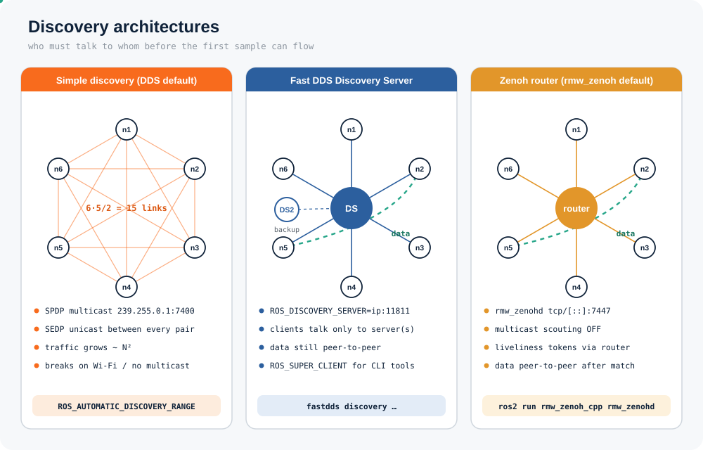
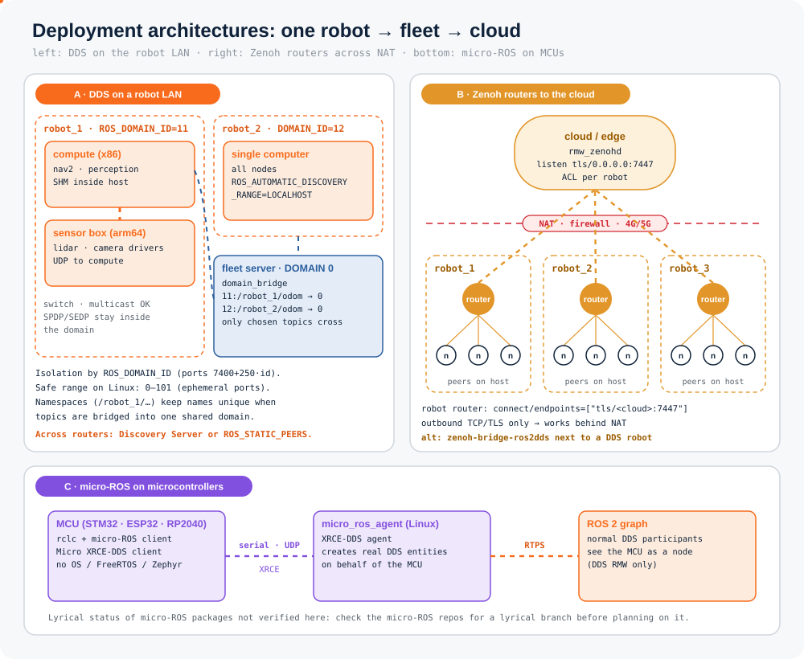
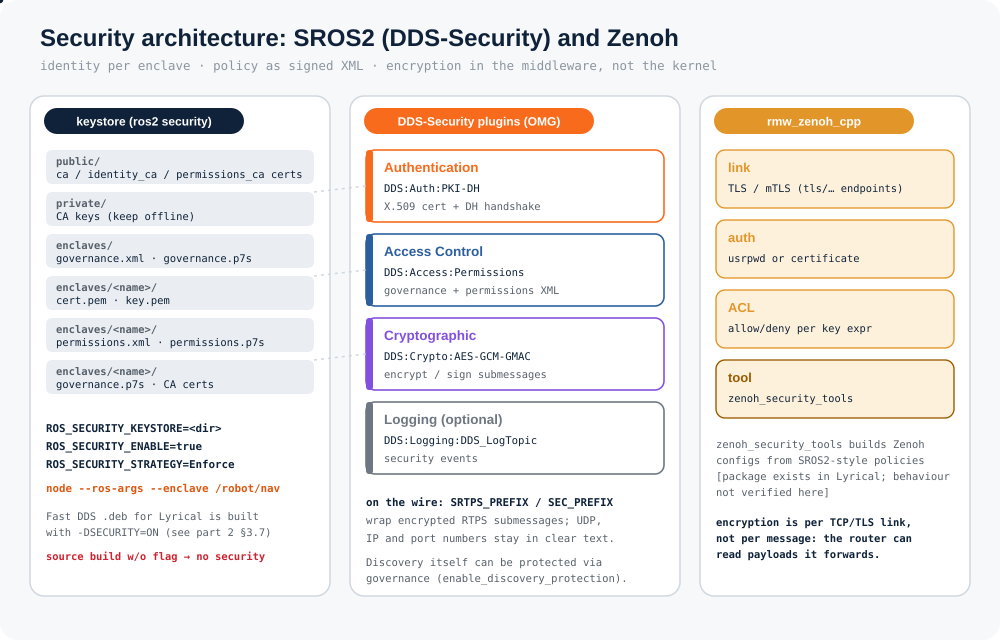

# ROS 2 Lyrical Luth: สถาปัตยกรรมของระบบ (middleware, discovery, data path, deployment, security)

> เอกสารภาค 4 ของชุด Network Stack สถานะ ณ 2026-11-24 · Distro: **Lyrical Luth** (LTS ถึง พ.ค. 2031)
>
> ภาค 1–3 ไล่ packet หนึ่งก้อนจาก `publish()` ลงไปถึงสาย ภาคนี้ถอยออกมามองระดับสถาปัตยกรรม คือเลือกส่วนประกอบแบบไหน วางไว้ตรงไหน และแต่ละแบบแลกอะไรกับอะไร

**สัญลักษณ์ระดับความเชื่อมั่น** (ใช้แบบเดียวกับภาค 1)
- **[V]** ตรวจกับต้นฉบับของ Lyrical แล้ว (ระบุไว้ในภาค 1–3 หรือในหัวข้อนั้น)
- **[K]** ความรู้มาตรฐานของ ROS 2 / DDS / Zenoh ที่ไม่ได้ผูกกับ Lyrical ควรตรวจกับเอกสารของเวอร์ชันที่ใช้จริงก่อนอ้างอิงใน paper

| หัวข้อ | ภาพ |
|---|---|
| 1. rmw เป็น plugin: middleware 4 ตัว | [anim-arch-rmw-plugin.svg](../diagrams/anim-arch-rmw-plugin.svg) |
| 2. Discovery architecture | [anim-arch-discovery.svg](../diagrams/anim-arch-discovery.svg) |
| 3. Topic / Service / Action บน middleware | [anim-arch-comm-patterns.svg](../diagrams/anim-arch-comm-patterns.svg) |
| 4. Data path ภายในเครื่องเดียวกัน | [anim-arch-intrahost-datapaths.svg](../diagrams/anim-arch-intrahost-datapaths.svg) |
| 5. Deployment: หุ่นยนต์ตัวเดียว → fleet → cloud | [anim-arch-deployment.svg](../diagrams/anim-arch-deployment.svg) |
| 6. Security architecture | [anim-arch-security.svg](../diagrams/anim-arch-security.svg) |
| 7. สถาปัตยกรรมสำหรับงาน real-time | (ตาราง) |
| 8. ตารางเลือกสถาปัตยกรรม | (ตาราง) |

---

## 1. rmw เป็น plugin: middleware 4 ตัวหลัง C ABI เดียวกัน



ชั้นบน (rclcpp/rclpy → rcl) เหมือนกันทุกกรณี ส่วนที่เปลี่ยนคือ shared library ของ rmw ที่ `rmw_implementation` โหลดตอน runtime ตาม `RMW_IMPLEMENTATION` [K] ดังนั้นโค้ดของ node ไม่ต้อง build ใหม่เมื่อสลับ middleware แต่พฤติกรรมบนสาย, thread และ daemon ที่ต้องรันเปลี่ยนทั้งหมด

| | Fast DDS 3.6.x | Cyclone DDS 11.0.x | Zenoh (zenoh-c 1.x) | Connext 7.7.0 |
|---|---|---|---|---|
| สถานะใน Lyrical [V] | default, Tier 1 | Tier 1 | Tier 1 | Tier 1 ยกเว้น arm64 |
| หน่วยหลักต่อ context | DomainParticipant 1 ตัว [K] | DomainParticipant 1 ตัว [K] | Zenoh session `mode: peer` [V] | DomainParticipant [K] |
| โปรโตคอลบนสาย | RTPS 2.2/2.3 ตาม build flag [V ภาค 2 §3.7] | RTPS [K] | Zenoh FRAME/PUSH/PUT บน TCP [V ภาค 2 §4] | RTPS [K] |
| Graph ของ ROS | SEDP + `ros_discovery_info` [V] | SEDP + `ros_discovery_info` [K] | liveliness token `@ros2_lv/…` [V] | SEDP + `ros_discovery_info` [K] |
| การส่งข้อมูล default | sync ใน thread ผู้เรียก [V ภาค 2 §3.1] | [K: ขึ้นกับ config] | `put()` ผ่าน session [V] | [K] |
| thread ที่เห็นใน `top -H` | `dds.udp.<port>`, `dds.ev.<id>`, `dds.shm.<port>` [V] | `recv`, `tev`, `dq.builtins`, `gc` [K] | thread ของ runtime ใน zenoh-c [K] | [K] |
| process ภายนอก | ไม่ต้องมี (Discovery Server เป็นทางเลือก) | `iox-roudi` เมื่อเปิด SHM | `rmw_zenohd` (จำเป็นสำหรับ discovery) | ไม่ต้องมี |
| Config หลัก | XML profile + `FASTDDS_BUILTIN_TRANSPORTS` | `CYCLONEDDS_URI` | `ZENOH_*_CONFIG_URI`, `ZENOH_CONFIG_OVERRIDE` | `NDDS_QOS_PROFILES` [K] |

**ข้อสังเกตเชิงสถาปัตยกรรม**
- DDS ทั้งสามตัวเป็น **peer-to-peer แบบไม่มีศูนย์กลาง**: ทุก participant ถือ state ของ peer ทุกตัวที่ match และ reliability อยู่ใน user space (HEARTBEAT/ACKNACK)
- Zenoh แยก **control plane** (discovery ผ่าน router) ออกจาก **data plane** (peer-to-peer หลัง match ภายใน host) และพึ่ง reliability ของ TCP แทน [V ภาค 1 §3.3]
- เพราะ DDS ทั้งสามใช้ RTPS เหมือนกัน node ที่ใช้ RMW ต่างยี่ห้อ**อาจ**คุยกันได้ แต่ ROS 2 ไม่รับประกัน cross-vendor interoperability [K] ส่วน Zenoh กับ DDS คุยกันตรงไม่ได้เลย ต้องผ่าน bridge (หัวข้อ 5)

ตัวอย่างตรวจว่า process ใช้ RMW ตัวไหนอยู่:
```bash
ros2 doctor --report | grep -i middleware
cat /proc/$(pgrep -f talker)/maps | grep -o 'librmw_[a-z_]*\.so' | sort -u
```

---

## 2. Discovery architecture



Discovery คือส่วนที่สถาปัตยกรรมต่างกันมากที่สุด และเป็นต้นเหตุหลักของปัญหาเมื่อระบบใหญ่ขึ้นหรือย้ายไปอยู่บน Wi-Fi

### 2.1 Simple discovery (DDS default) [K]
- SPDP: participant ประกาศตัวเองด้วย multicast `239.255.0.1:7400+250·domain` เป็นระยะ (ราว 3 s สำหรับ Fast DDS) [ภาค 1 §6]
- SEDP: participant ทุกคู่ที่เห็นกันแลก endpoint แบบ reliable unicast
- traffic และ memory โตประมาณ **O(N²)** ตามจำนวน participant และโตตามจำนวน endpoint ด้วย (ภาค 2 §1.5)
- ควบคุมขอบเขตด้วย `ROS_AUTOMATIC_DISCOVERY_RANGE=SUBNET|LOCALHOST|OFF|SYSTEM_DEFAULT` และเพิ่ม peer แบบ unicast ด้วย `ROS_STATIC_PEERS="10.0.0.5;10.0.0.6"`

### 2.2 Fast DDS Discovery Server [K]
- รูปแบบ client/server: client ส่ง SPDP/SEDP ไปที่ server เท่านั้น server เป็นผู้ส่งต่อข้อมูลของ endpoint ที่ match กัน
- **ข้อมูลยังวิ่ง peer-to-peer** เหมือนเดิม server อยู่บน control plane อย่างเดียว
- รัน server: `fastdds discovery …` (option ของ CLI เปลี่ยนไปในซีรีส์ 3.x ให้ตรวจด้วย `fastdds discovery -h` ของเครื่องที่ใช้) port default 11811
- ฝั่ง node: `ROS_DISCOVERY_SERVER="192.168.1.10:11811;192.168.1.11:11811"` ใส่หลาย server เพื่อทำ redundancy
- CLI อย่าง `ros2 topic list` ต้องตั้ง `ROS_SUPER_CLIENT=TRUE` จึงจะเห็น graph ทั้งหมด เพราะ client ปกติรู้เฉพาะ endpoint ที่ตัวเอง match
- ใช้ข้าม subnet และบน Wi-Fi ได้ดีเพราะไม่พึ่ง multicast

### 2.3 Zenoh router (rmw_zenoh default) [V ภาค 1 §3.3]
- multicast scouting ปิดเป็น default node หากันผ่าน router (`rmw_zenohd`, `tcp/[::]:7447`)
- graph แทนด้วย liveliness token การมี node เพิ่มหนึ่งตัวจึงเท่ากับ token ไม่กี่ตัว ไม่ใช่การแลกข้อมูลกับ peer ทุกตัว
- ถ้าไม่มี router node จะหากันไม่เจอ (`ZENOH_ROUTER_CHECK_ATTEMPTS` คุมพฤติกรรมตอนรอ)

### 2.4 เปรียบเทียบ

| | Simple discovery | Discovery Server | Zenoh router |
|---|---|---|---|
| ต้องมี multicast | ใช่ (ยกเว้น static peers) | ไม่ | ไม่ |
| Single point of failure | ไม่มี | server (แก้ด้วยหลาย server) | router (node ที่ match แล้วยังส่งต่อกันได้ภายใน host [K]) |
| traffic ตอนเริ่มระบบ | สูง O(N²) | O(N) ไปที่ server | O(N) ไปที่ router |
| เห็น graph ทั้งหมดจาก node ใดก็ได้ | ใช่ | ไม่ (ต้อง super client) | ใช่ |
| ข้าม NAT | ไม่ได้ในทางปฏิบัติ (IP ฝังใน payload) | ยาก | ได้ (client → router) |

**สมมติฐานที่วัดได้**: เวลาที่ graph นิ่ง (discovery convergence time) และ byte ของ discovery ต่อ node ที่ N = 10, 50, 100, 500 สำหรับทั้งสามแบบ (ต่อยอดหัวข้อวิจัยข้อ 4 ในภาค 1 §7)

---

## 3. Topic / Service / Action บน middleware



ROS 2 มี communication pattern 3 แบบ แต่ middleware รู้จักแค่ pub/sub (DDS) หรือ pub/sub + query (Zenoh) rmw จึงแปลงแต่ละแบบลงไปดังนี้

| ROS | บน DDS [K: rmw_dds_common naming] | บน Zenoh [V: `docs/design.md`] |
|---|---|---|
| Topic `/chatter` | DDS topic `rt/chatter` | key `0/chatter/<type>/<RIHS01 hash>`, publisher + subscriber |
| Service `/add_two_ints` | topic คู่ `rq/add_two_intsRequest` + `rr/add_two_intsReply` และจับคู่ request/reply ด้วย sample identity | queryable ฝั่ง server, `get` ฝั่ง client [K: กลไกในระดับ API] |
| Action `/fibonacci` | 3 service (`_action/send_goal`, `_action/cancel_goal`, `_action/get_result`) + 2 topic (`_action/feedback`, `_action/status`) | แยกแบบเดียวกัน 3 queryable + 2 publisher |

ผลที่ตามมาในเชิงสถาปัตยกรรม
- **Action ไม่ได้เป็น transport ใหม่** การ debug action จึงคือการดู 5 endpoint ด้านบน (`ros2 topic list --include-hidden-topics` จะเห็น `_action/*`)
- **Service บน DDS ไม่มี connection** ถ้า server ยังไม่ match กับ reply reader ของ client request อาจหายได้ จึงควรเรียก `wait_for_service()` ก่อนเสมอ [K]
- Action หนึ่งตัวสร้าง DDS endpoint ฝั่งละ 8 ตัว (service 3 ตัว × writer + reader และ topic 2 ตัว) รวม client กับ server เป็น 16 ตัว SEDP traffic ของระบบที่มี action เยอะจึงโตเร็วกว่าที่คาด

---

## 4. Data path ภายในเครื่องเดียวกัน



เมื่อ publisher และ subscriber อยู่บนเครื่องเดียวกัน มีทางเลือกอย่างน้อย 6 ทาง จำนวน copy ในภาพเป็นค่าประมาณ [K] นับเฉพาะ copy ของ payload ที่ CPU ทำ ไม่นับ DMA และ cache traffic

| เส้นทาง | เงื่อนไข | copy ของ payload | ข้อสังเกต |
|---|---|---|---|
| intra-process (rclcpp) | pub/sub อยู่ใน process เดียวกัน, เปิด `use_intra_process_comms` | 0 (ส่ง `unique_ptr`) | ถ้ามี subscriber หลายตัวที่ต้องการ ownership จะ copy เพิ่ม [K] ไม่ผ่าน rmw จึงไม่มี tracepoint ของ rmw |
| UDP loopback | `FASTDDS_BUILTIN_TRANSPORTS=UDPv4` | ≈ 4 | serialize, `sendmsg`, `recvmsg`, deserialize ผ่าน kernel ทั้งชุด ใช้เป็น baseline ของการวัด |
| Fast DDS SHM | default ของ Fast DDS บนเครื่องเดียวกัน | ≈ 3 | `memcpy` ลง segment ครั้งเดียวไม่ว่ามีผู้รับกี่ตัว [V ภาค 2 §3.4] segment 512 KiB อาจทิ้งเงียบเมื่อเต็ม |
| Zenoh SHM | `transport/shared_memory/enabled=true` ทั้งสองฝั่ง และ ≥ 512 B | ≈ 2 | serialize ลง buffer จาก SHM provider โดยตรง [V ภาค 2 §4.4] |
| Loaned message + data-sharing / iceoryx | type แบบ plain (ขนาดคงที่) | 0 | Fast DDS data-sharing ถูกปิดใน rmw เป็น default [V ภาค 2 §3.5] Cyclone ต้องรัน `iox-roudi` |
| `rosidl::Buffer` backend (เช่น CUDA) | field `uint8[]` + backend ที่ทั้งสองฝั่งรองรับ, rmw_fastrtps / rmw_zenoh | 0 copy ผ่าน host | ส่งเฉพาะ descriptor ≤ 4096 B payload อยู่ใน GPU memory [V ภาค 1 §2.4] |

**แนวทางเลือก**: ข้อความเล็ก (< 1 KB) ความต่างของทุกทางแทบไม่มีนัยเมื่อเทียบกับ overhead ของ executor ส่วนข้อความใหญ่ (ภาพ, point cloud) ทางที่ไม่ copy ให้ผลต่างชัดเจนทั้ง latency และ memory bandwidth (ภาค 2 §6.3) แต่บังคับให้ใช้ type ขนาดคงที่หรือ backend เฉพาะ

**Composition** (รวมหลาย node ไว้ใน container เดียวด้วย `rclcpp_components`) เป็นวิธีเชิงสถาปัตยกรรมที่ทำให้ได้เส้นทาง intra-process โดยไม่ต้องแก้โค้ดของ node [K]
```bash
ros2 run rclcpp_components component_container --ros-args -p use_intra_process_comms:=true
ros2 component load /ComponentManager composition composition::Talker
ros2 component load /ComponentManager composition composition::Listener
```

---

## 5. Deployment: หุ่นยนต์ตัวเดียว → fleet → cloud



### 5.1 หุ่นยนต์หลายเครื่องคอมพิวเตอร์บน LAN เดียว (A ในภาพ)
- เครื่องในหุ่นยนต์ตัวเดียวกันใช้ `ROS_DOMAIN_ID` เดียวกัน คุยด้วย UDP ผ่าน switch ภายใน และใช้ SHM ภายในแต่ละเครื่อง
- หุ่นยนต์คนละตัวใช้คนละ domain เพื่อแยก discovery ออกจากกัน port ของ domain คือ `7400 + 250·id` บน Linux ช่วงที่ปลอดภัยคือ **0–101** เพราะ domain ที่สูงกว่านั้นชนกับ ephemeral port ของ kernel [K: เอกสาร ROS 2 เรื่อง Domain ID]
- หุ่นยนต์ที่มีคอมพิวเตอร์เครื่องเดียวควรตั้ง `ROS_AUTOMATIC_DISCOVERY_RANGE=LOCALHOST` เพื่อไม่ให้ SPDP ออกไปรบกวน network
- **Fleet server** ใช้ `domain_bridge` [K: แพ็กเกจ `ros2/domain_bridge`] เลือกเฉพาะ topic ที่ต้องการให้ข้าม domain และใช้ namespace (`/robot_1/…`) กันชื่อชน
- ข้าม subnet หรือ router ใช้ Discovery Server หรือ `ROS_STATIC_PEERS` (หัวข้อ 2)

ตัวอย่าง config ของ `domain_bridge` [K: รูปแบบ YAML ตาม README ของแพ็กเกจ]
```yaml
name: fleet_bridge
from_domain: 11
to_domain: 0
topics:
  robot_1/odom:
    type: nav_msgs/msg/Odometry
  robot_1/battery_state:
    type: sensor_msgs/msg/BatteryState
```

### 5.2 Zenoh router ต่อไปยัง cloud (B ในภาพ)
- แต่ละหุ่นยนต์รัน `rmw_zenohd` ของตัวเอง node ในหุ่นยนต์คุยกันแบบ peer ภายใน host
- router ของหุ่นยนต์ตั้ง `connect/endpoints=["tls/<cloud-host>:7447"]` การเชื่อมต่อเป็น**ขาออก** TCP/TLS จึงผ่าน NAT และ 4G/5G ได้โดยไม่ต้องเปิด port ฝั่งหุ่นยนต์ [V: กลไก connect endpoint ภาค 1 §3.3 · K: การใช้งานผ่าน NAT]
- ACL บน router กลางกำหนดว่าหุ่นยนต์ตัวไหนเห็น key expression ไหน (หัวข้อ 6)
- ระบบเดิมที่ยังใช้ DDS ภายในหุ่นยนต์ใช้ `zenoh-bridge-ros2dds` [K: `eclipse-zenoh/zenoh-plugin-ros2dds`] วางคู่กับหุ่นยนต์เพื่อแปลง DDS ↔ Zenoh เฉพาะขาที่ออกไปนอกหุ่นยนต์ ไม่ต้องเปลี่ยน RMW ของ node ภายใน

ตัวอย่างตั้งค่า router ของหุ่นยนต์ผ่าน env (ไม่ต้องแก้ไฟล์ config)
```bash
export ZENOH_CONFIG_OVERRIDE='connect/endpoints=["tls/fleet.example.org:7447"]'
ros2 run rmw_zenoh_cpp rmw_zenohd
```
syntax ของค่า array ใน `ZENOH_CONFIG_OVERRIDE` ควรตรวจกับ README ของ `rmw_zenoh` branch `lyrical` ก่อนใช้จริง

### 5.3 micro-ROS บน microcontroller (C ในภาพ) [K]
- MCU รัน micro-ROS client (rclc + Micro XRCE-DDS client) บน bare metal, FreeRTOS หรือ Zephyr
- `micro_ros_agent` บน Linux รับ XRCE ผ่าน serial หรือ UDP แล้ว**สร้าง DDS entity จริงแทน MCU** node บน MCU จึงปรากฏใน ROS graph เหมือน node ปกติ
- สถาปัตยกรรมนี้ผูกกับ RMW ฝั่ง DDS ส่วนการใช้ร่วมกับ `rmw_zenoh_cpp` ต้องผ่าน bridge
- **ยังไม่ได้ตรวจว่า micro-ROS มี branch สำหรับ Lyrical แล้วหรือไม่** ให้ตรวจที่ repo `micro-ROS/micro_ros_setup` ก่อนวางแผน

### 5.4 เทียบรูปแบบ deployment

| รูปแบบ | เหมาะกับ | ข้อจำกัด |
|---|---|---|
| DDS LAN + domain ต่อหุ่นยนต์ | หุ่นยนต์ในโรงงาน/ห้องแล็บบน wired LAN | multicast บน Wi-Fi ไม่เสถียร, ข้าม NAT ไม่ได้ |
| DDS + Discovery Server | หุ่นยนต์จำนวนมากใน subnet เดียวหรือข้าม subnet | ต้องดูแล server, CLI ต้องเป็น super client |
| DDS + `domain_bridge` | fleet ที่ส่งเฉพาะ telemetry ไปศูนย์กลาง | bridge เป็นจุด copy และ deserialize เพิ่ม |
| Zenoh router ต่อหุ่นยนต์ + cloud router | หุ่นยนต์บน 4G/5G, teleoperation, cloud | ต้องรัน router ทุกเครื่อง, TLS ต่อ hop |
| DDS ภายใน + `zenoh-bridge-ros2dds` | ระบบเดิมที่ต้องต่อ cloud โดยไม่เปลี่ยน RMW | เพิ่ม hop และเพิ่ม process ที่ต้องดูแล |
| micro-ROS + agent | sensor/actuator บน MCU | ผูกกับ DDS, bandwidth ของ serial ต่ำ |

---

## 6. Security architecture



### 6.1 SROS2 (DDS-Security) [K: OMG DDS-Security v1.1 + เอกสาร SROS2]
- **Keystore** สร้างด้วย `ros2 security create_keystore` มี CA สำหรับ identity และ permissions, `enclaves/governance.p7s` และ directory ต่อ enclave ที่มี cert, key และ `permissions.p7s`
- **Enclave** คือหน่วยของ identity process หนึ่งเลือก enclave ด้วย `--ros-args --enclave /robot/nav` node ทุกตัวใน context เดียวกันใช้ identity เดียวกัน
- **Plugin 3 ตัวหลัก** ตามสเปก: Authentication (`DDS:Auth:PKI-DH`), Access Control (`DDS:Access:Permissions`), Cryptographic (`DDS:Crypto:AES-GCM-GMAC`) และ Logging เป็นทางเลือก
- **บนสาย**: submessage ถูกห่อด้วย `SEC_PREFIX`/`SEC_POSTFIX` หรือทั้ง message ด้วย `SRTPS_PREFIX`/`SRTPS_POSTFIX` ตาม governance ส่วน IP, UDP port และ GUID prefix ใน header ยังอ่านได้
- เปิดใช้:
  ```bash
  ros2 security create_keystore ~/sros2_ks
  ros2 security create_enclave ~/sros2_ks /robot/nav
  export ROS_SECURITY_KEYSTORE=~/sros2_ks
  export ROS_SECURITY_ENABLE=true
  export ROS_SECURITY_STRATEGY=Enforce
  ros2 run demo_nodes_cpp talker --ros-args --enclave /robot/nav
  ```
- **เฉพาะ Lyrical**: binary `.deb` ของ Fast DDS build ด้วย `-DSECURITY=ON` [V ภาค 2 §3.7] ถ้า build Fast DDS จาก source ด้วย colcon โดยไม่ใส่ flag จะไม่มี security plugin และ protocol version บนสายจะเป็น 2.2 แทน 2.3

### 6.2 Zenoh [K ยกเว้นที่ระบุ]
- ความปลอดภัยอยู่ที่ **link** (TLS/mTLS บน endpoint `tls/…`, QUIC) และการ authenticate ด้วย user/password หรือ certificate
- **ACL** บน router กำหนด allow/deny ต่อ key expression และต่อ interface/subject
- `zenoh_security_tools` มีอยู่ใน Lyrical [V: มีแพ็กเกจ] ใช้สร้าง config ของ Zenoh จาก policy แบบ SROS2 (รายละเอียดพฤติกรรมยังไม่ได้ตรวจ)
- ข้อต่างสำคัญ: TLS เข้ารหัส**ต่อ hop** router ที่อยู่ตรงกลางเห็น payload ที่ส่งต่อ ส่วน DDS-Security เข้ารหัส**ต่อ message ปลายทางถึงปลายทาง** (ยกเว้นผ่าน bridge ที่ต้องถอดรหัส)

| | SROS2 / DDS-Security | Zenoh TLS + ACL |
|---|---|---|
| หน่วยของ identity | enclave (ต่อ process) | session / link |
| ขอบเขตการเข้ารหัส | ต่อ submessage หรือต่อ RTPS message | ต่อ TCP/TLS link |
| สิทธิ์ | permissions XML ต่อ topic (publish/subscribe) | ACL ต่อ key expression บน router |
| ภาระ CPU | crypto ต่อ sample ต่อ reader (แล้วแต่ governance) | crypto ต่อ byte บน link |
| ผ่าน NAT | ไม่ได้ (เป็นข้อจำกัดของ DDS ไม่ใช่ของ security) | ได้ |

---

## 7. สถาปัตยกรรมสำหรับงาน real-time [K]

| ชั้น | ทางเลือก | ผลต่อ latency / jitter |
|---|---|---|
| Executor | `EventsCBGExecutor` (ใหม่ใน Lyrical) [V], `SingleThreadedExecutor` ต่อ callback group ที่ critical | แยก callback ที่ critical ไปไว้ใน executor/thread ของตัวเอง |
| Thread | ตั้ง priority/affinity ให้ executor thread และ thread ของ middleware (Fast DDS `ThreadSettings` [V ภาค 2 §3.2]) | receive thread ของ middleware ต้องได้ priority ไม่น้อยกว่า callback ที่รอข้อมูล |
| Middleware | sync publishing (Fast DDS default), ปิด SHM ถ้าต้องการพฤติกรรมที่วัดได้ชัด, จองหน่วยความจำล่วงหน้า (`PREALLOCATED_WITH_REALLOC` [V]) | ลด allocation ใน hot path |
| Kernel | PREEMPT_RT, `isolcpus`, `nohz_full`, IRQ affinity ของ NIC | ลด jitter จาก scheduler และ softirq (ภาค 2 §5.4) |
| Network | VLAN priority, `mqprio`/`taprio` (TSN 802.1Qbv) ตั้งนอก middleware เพราะ Fast DDS ไม่ตั้ง DSCP [V ภาค 1 §6] | จองช่วงเวลาบนสายให้ traffic ควบคุม |

รูปแบบที่ใช้บ่อย: แยก **control loop** (เช่น `ros2_control` บน host เดียวกัน ใช้ intra-process หรือ SHM) ออกจาก **perception/planning** ที่ยอมรับ jitter ได้มากกว่า และไม่ให้ control loop พึ่ง network ข้ามเครื่อง

---

## 8. ตารางเลือกสถาปัตยกรรม

| สถานการณ์ | RMW | Discovery | Data path | หมายเหตุ |
|---|---|---|---|---|
| หุ่นยนต์ตัวเดียว, คอมพิวเตอร์เครื่องเดียว | Fast DDS (default) | `LOCALHOST` | composition + intra-process, SHM | config น้อยที่สุด |
| หุ่นยนต์ตัวเดียว, หลายเครื่องบน wired LAN | Fast DDS / Cyclone | simple discovery | SHM ในเครื่อง, UDP ข้ามเครื่อง | ปรับ `rmem_max` สำหรับภาพ (ภาค 3 §6) |
| ภาพ/point cloud ปริมาณสูงบนเครื่องเดียว | Fast DDS หรือ Zenoh | ตามเดิม | `rosidl::Buffer` backend หรือ loaned + data-sharing | ต้องเปิด config เพิ่มทุกทาง |
| หุ่นยนต์หลายตัว, Wi-Fi เดียวกัน | Fast DDS + Discovery Server หรือ Zenoh | DS / router | UDP / TCP | หลีกเลี่ยง multicast บน Wi-Fi |
| Fleet + cloud ผ่าน 4G/5G | Zenoh | router ต่อหุ่นยนต์ + cloud router | TCP/TLS | ACL บน cloud router |
| ระบบเดิมใช้ DDS แต่ต้องต่อ cloud | DDS เดิม | เดิม | `zenoh-bridge-ros2dds` | เพิ่ม hop หนึ่งชั้น |
| MCU เป็น sensor/actuator | DDS | agent | XRCE ผ่าน serial/UDP | ตรวจสถานะ micro-ROS บน Lyrical ก่อน |
| ต้องการ security ปลายทางถึงปลายทาง | DDS + SROS2 | ตามเดิม | ตามเดิม | ใช้ `.deb` หรือ build ด้วย `-DSECURITY=ON` |

---

## 9. สิ่งที่ยังไม่ได้ verify ในภาคนี้

1. ชื่อ thread ของ Cyclone DDS 11 (`recv`, `tev`, `dq.builtins`, `gc`) มาจากความรู้ทั่วไปของ Cyclone รุ่นก่อน ควรตรวจด้วย `ps -L` บนเครื่องที่รันจริง
2. จำนวน copy ในหัวข้อ 4 เป็นค่าประมาณ (โดยเฉพาะฝั่งรับของ Fast DDS SHM ว่ามี copy เข้า reader history เพิ่มหรือไม่) วัดได้ด้วย `perf record -e cycles` แล้วนับ `memcpy` ต่อ sample
3. CLI ของ `fastdds discovery` ในซีรีส์ 3.6 และ default port 11811
4. พฤติกรรมของ `zenoh_security_tools` และรูปแบบ config ที่สร้าง
5. micro-ROS กับ Lyrical และ syntax ของ `ZENOH_CONFIG_OVERRIDE` สำหรับค่าแบบ array
6. พฤติกรรมเมื่อ `rmw_zenohd` ตายระหว่างทำงาน (node ที่ match กันแล้วยังส่งข้อมูลได้หรือไม่ และ node ใหม่หากันเจอหรือไม่) เป็นการทดลองที่ทำได้ทันทีด้วยชุด Docker ของภาค 3

## 10. แหล่งอ้างอิง

- เอกสารภาค 1–3 ของชุดนี้ และแหล่งอ้างอิงในภาค 1 §9, ภาค 2 §10
- ROS 2 documentation (branch `lyrical`): Concepts → About different ROS 2 middleware vendors, About Domain ID, Composition, Intra-process communication, ROS 2 Security (SROS2)
- `rmw_zenoh` branch `lyrical`: README และ `docs/design.md`
- Fast DDS documentation: Discovery Server, Transports, Data-sharing, ThreadSettings
- OMG DDS-Security v1.1; OMG DDS-XRCE v1.0 (micro-ROS)
- `ros2/domain_bridge`, `eclipse-zenoh/zenoh-plugin-ros2dds`, `micro-ROS/micro_ros_setup` (README ของแต่ละ repo)
