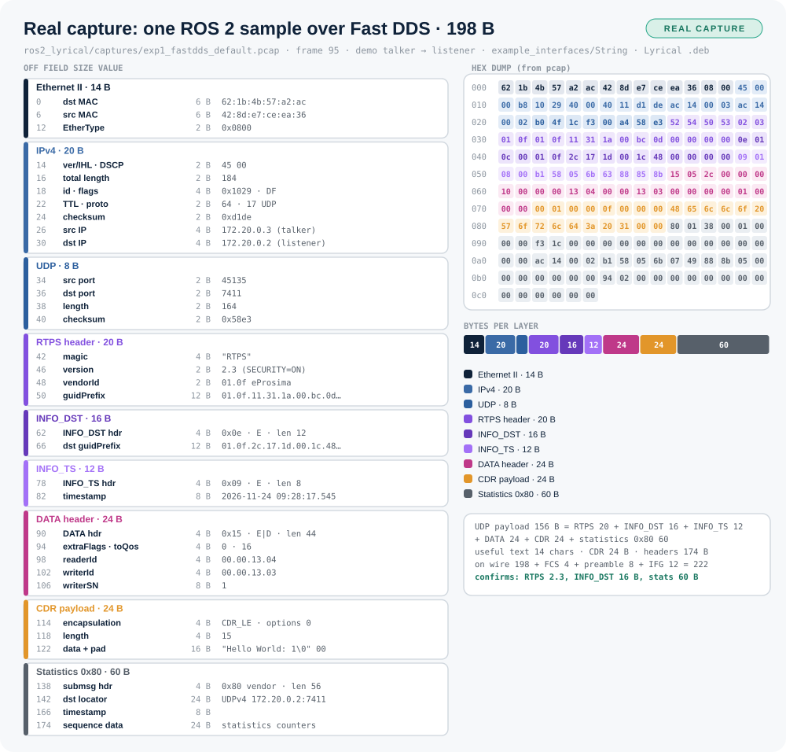
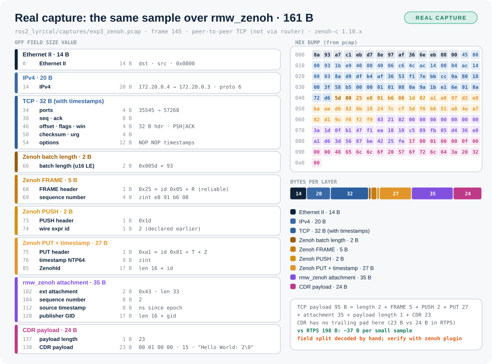

# ROS 2 Lyrical Luth: ผลการทดลองจริงบนสาย (packet capture)

> ภาค 3 ของชุดเอกสาร network stack · ภาค 1: [Deep Dive](ros2_lyrical_network_stack_deep_dive.md) · ภาค 2: [Wire format & kernel accounting](ros2_lyrical_network_stack_deeper.md)
> ดูแบบ 3D: [Lyrical Packet Lab บทที่ 17–20](https://alfaxphoori.github.io/ros2/ros2_lyrical/interactive/lyrical-packet-lab.html#lesson-17) (packet วิ่งตามจำนวนจริงจาก pcap)
> ทดลองเมื่อ 2026-11-24 · ไฟล์ pcap ทั้งหมดอยู่ใน [`captures/`](captures/) · ทำซ้ำได้ด้วย [`captures/scripts/run_experiments.sh`](captures/scripts/run_experiments.sh)

เอกสารภาค 1 และภาค 2 สร้างจากการอ่าน source code ภาคนี้คือการ**รันของจริงแล้ว capture packet** เพื่อตรวจว่าที่วิเคราะห์ไว้ตรงกับสิ่งที่เกิดบนสายหรือไม่ ทุกตัวเลขในเอกสารนี้มาจาก pcap หรือจากตัวนับของ kernel (`/proc/net/snmp`) ในการรันจริง และการทดลองชุดเต็มรันซ้ำแล้ว 2 รอบได้ผลตรงกัน

---

## 1. สภาพแวดล้อมการทดลอง

| รายการ | ค่า |
|---|---|
| Image | `ros:lyrical-ros-base` (Docker Official Image) + `ros-lyrical-demo-nodes-cpp`, `ros-lyrical-rmw-zenoh-cpp`, `tcpdump`, `tshark 4.6.4` ([Dockerfile](captures/scripts/Dockerfile)) |
| package จริงจาก apt | `ros-lyrical-fastdds 3.6.2`, `ros-lyrical-fastcdr 2.3.6`, `ros-lyrical-rmw-fastrtps-cpp 9.4.10`, `ros-lyrical-rclcpp 32.0.3`, `ros-lyrical-rmw-zenoh-cpp 0.10.6` |
| Kernel | Linux 7.0.0-43-generic (Ubuntu 26.04, container ใช้ kernel ของ host) |
| Topology | container แต่ละตัวเป็น "host" แยก network namespace ต่อกันผ่าน Docker bridge (`veth`, MTU 1500, subnet 172.20.0.0/16) multicast ใช้ได้ |
| จุด capture | `tcpdump -i eth0` ภายใน container ฝั่งรับ (Host B) ซึ่งเห็น packet ที่ AF_PACKET tap ก่อนเข้า IP stack |
| ข้อจำกัด | traffic ไม่ผ่าน NIC จริง (ผ่าน `veth`) ผลด้าน driver เช่น r8169 จึงไม่อยู่ในการทดลองนี้ และทุก container ใช้ CPU เครื่องเดียวกัน |

```
 Host A (talker)                 Docker bridge (veth)               Host B (listener + tcpdump)
 172.20.0.3  ───────────────────────────────────────────────────────  172.20.0.2
             SPDP multicast 239.255.0.1:7400 · SEDP unicast :7410 · user data unicast :7411
```

| # | การทดลอง | pcap |
|---|---|---|
| 1 | Fast DDS ค่าเริ่มต้น: `demo_nodes_cpp talker` → `listener` ข้าม container | [`exp1_fastdds_default.pcap`](captures/exp1_fastdds_default.pcap) |
| 2 | `sensor_msgs/Image` 640×480 rgb8 (921 600 B) แบบ RELIABLE 5 ภาพ | [`exp2_image_reliable.pcap.gz`](captures/exp2_image_reliable.pcap.gz) |
| 3 | `rmw_zenoh_cpp` ผ่าน router 1 ตัว | [`exp3_zenoh.pcap`](captures/exp3_zenoh.pcap) |
| 4 | talker + listener ใน container เดียวกัน (SHM) | [`exp4_samehost_shm.pcap`](captures/exp4_samehost_shm.pcap) |
| 5 | Image แบบ BEST_EFFORT 20 ภาพ, receive buffer ค่าเริ่มต้น | [`exp5_image_besteffort.pcap.gz`](captures/exp5_image_besteffort.pcap.gz) |
| 6 | เหมือนข้อ 5 แต่ตั้ง `receiveBufferSize` 4 MiB ผ่าน XML profile | (ผลจากตัวนับของ kernel) |

---

## 2. การทดลองที่ 1: หนึ่ง sample ของ talker บนสายจริง



frame 95 ใน `exp1_fastdds_default.pcap` คือ `"Hello World: 1"` ตัวแรก **ยาว 198 B**

```
0000  62 1b 4b 57 a2 ac 42 8d e7 ce ea 36 08 00 45 00   Ethernet │ IPv4
0010  00 b8 10 29 40 00 40 11 d1 de ac 14 00 03 ac 14   len 184 · DF · TTL 64 · UDP · 172.20.0.3 →
0020  00 02 b0 4f 1c f3 00 a4 58 e3 52 54 50 53 02 03   172.20.0.2 │ UDP 45135→7411 len 164 │ "RTPS" 2.3
0030  01 0f 01 0f 11 31 1a 00 bc 0d 00 00 00 00 0e 01   vendor 01.0f · guidPrefix │ INFO_DST
0040  0c 00 01 0f 2c 17 1d 00 1c 48 00 00 00 00 09 01   dst guidPrefix (listener) │ INFO_TS
0050  08 00 b1 58 05 6b 63 88 85 8b 15 05 2c 00 00 00   timestamp │ DATA E|D len 44
0060  10 00 00 00 13 04 00 00 13 03 00 00 00 00 01 00   readerId 00.00.13.04 · writerId 00.00.13.03 · SN
0070  00 00 00 01 00 00 0f 00 00 00 48 65 6c 6c 6f 20   =1 │ CDR_LE · len 15 · "Hello "
0080  57 6f 72 6c 64 3a 20 31 00 00 80 01 38 00 01 00   "World: 1\0" pad │ 0x80 statistics len 56
0090  00 00 f3 1c 00 00 00 00 00 00 00 00 00 00 00 00   locator UDPv4 port 7411 …
00a0  00 00 ac 14 00 02 b1 58 05 6b 07 49 88 8b 05 00   … 172.20.0.2 │ timestamp │ sequence data
00b0  00 00 00 00 00 00 94 02 00 00 00 00 00 00 00 00
00c0  00 00 00 00 00 00
```

**ตรวจคำทำนายจากภาค 1 และภาค 2 กับของจริง**

| ประเด็น | คำทำนาย | ผลจริง | สรุป |
|---|---|---|---|
| ขนาด frame | ภาค 1: 122 B (แบบน้อยที่สุด) · ภาค 2: 138–198 B | **198 B** | ตรงกับขอบบนของภาค 2 |
| RTPS version | ภาค 2: 2.2 (CMake default) · ตรวจเพิ่ม: 2.3 เพราะ `.deb` ใช้ `-DSECURITY=ON` | **2.3** | ยืนยันว่า `.deb` build ด้วย SECURITY=ON |
| INFO_DST | ภาค 2: 16 B | 16 B (`0e 01 0c 00` + guidPrefix 12 B) | ตรง |
| Statistics submessage | ภาค 2: `0x80` ยาว 60 B ทุก message | `80 01 38 00` + 56 B มีทุก RTPS message ในไฟล์ | ตรง |
| ลำดับ submessage | — | INFO_DST → INFO_TS → DATA → 0x80 | ได้ข้อมูลใหม่ |
| readerId | ภาค 1 (สมมติ): `UNKNOWN` | **`00.00.13.04`** (ระบุ reader ปลายทาง) | ภาค 1 ผิด |
| type ของ demo talker | ภาค 1: `std_msgs/String` | **`example_interfaces::msg::dds_::String_`** | ภาค 1 ผิด (demo ใน Lyrical ใช้ `example_interfaces`) |
| CDR payload | `00 01 00 00` + len 15 + text + pad 1 | ตรงทุก byte | ตรง |
| dst port | 7411 = 7400 + 250·0 + 11 + 2·0 | 7411 | ตรง |
| IP DF / TTL | DF, 64 | DF, 64 | ตรง |

**Discovery และ traffic ทั้งหมดใน 14 วินาที** (137 RTPS frame, 53 434 B)

| ประเภท | frame | byte | สัดส่วน |
|---|---|---|---|
| SPDP `DATA(p)` (610 B/ครั้ง, multicast + unicast) | 32 | 19 520 | 36.5% |
| SEDP `DATA(w)`/`DATA(r)` | 21 | 16 166 | 30.3% |
| HEARTBEAT / ACKNACK | 40 | 6 728 | 12.6% |
| `ros_discovery_info` DATA | 13 | 4 754 | 8.9% |
| อื่นๆ (รวม SEDP แบบ packed, GAP) | 22 | 4 484 | 8.4% |
| **ข้อมูล chatter จริง** (9 sample × 198 B) | 9 | 1 782 | **3.3%** |

ข้อค้นพบจาก discovery
- SPDP ส่งซ้ำ 6 ครั้งห่างกัน 100 ms ตอนเริ่ม (frame 3–10) ตรงกับค่า initial announcements ในภาค 2 §1.2
- `DATA(p)` มี parameter ตามลำดับที่ภาค 2 ทำนายไว้ รวมถึง SHM locator **kind `0x13` (=19)** ซึ่ง Wireshark แสดงว่า "Unknown" และ `USER_DATA` = `enclave=/;\0`
- **ข้อค้นพบใหม่ (privacy):** `PID_PROPERTY_LIST` ส่ง `fastdds.physical_data.host` (hash ของเครื่อง), **`fastdds.physical_data.user` = ชื่อผู้ใช้ (`root`)** และ **`fastdds.physical_data.process` = PID** ผ่าน multicast ให้ทุกเครื่องใน subnet ควรระวังในเครือข่ายที่ใช้ร่วมกับผู้อื่น
- **ข้อค้นพบใหม่:** reader ของ `ros_discovery_info` ประกาศ unicast locator ที่ **UDP port 7000** แยกจาก 7411 (เห็นใน `DATA(r)` frame 29, 69) Wireshark จึงแปลผิดเป็นโปรโตคอล "RX" ส่วนสาเหตุในโค้ดยังไม่ได้ไล่ [K]

---

## 3. การทดลองที่ 2: ภาพ 640×480 rgb8 แบบ RELIABLE

| ค่า | คำทำนาย (ภาค 2 §2.4) | ผลจริง |
|---|---|---|
| sampleSize | 921 652 B | **921 648 B** (ต่างกัน 4 B) |
| fragmentSize | 65 324 B (เมื่อมี statistics) | **65 324 B** |
| DATA_FRAG ต่อภาพ | 15 | **15** (ครบทั้ง 5 ภาพ) |
| IP fragment ต่อ datagram | 45 | **45** (reassembled 65 476 B) |
| ชื่อ topic บนสาย | `rt/img` | **`rt/img/_buf_cpu`** (ข้อค้นพบใหม่ ดูด้านล่าง) |

ผลการส่ง: ได้รับครบ 5/5 ภาพ แต่ตัวนับ kernel ของ Host B แสดง **`RcvbufErrors = 23`**, `ReasmOKs = 97` (75 datagram ที่ควรมี + ส่งซ้ำ) และเห็น `NACK_FRAG` 4 ครั้ง จำนวน DATA_FRAG ต่อ sequence number คือ 17, 21, 15, 15, 28 แปลว่าภาพที่ 1, 2 และ 5 ต้องส่ง fragment ซ้ำ 2, 6 และ 13 ชิ้น กลไก RELIABLE ของ RTPS กู้ข้อมูลที่ kernel ทิ้งไปได้ แต่ทำให้ traffic เพิ่มขึ้นราว 28%

ตัวอย่าง `NACK_FRAG` (frame 749): `writerSN 1, bitmapBase 4, numBits 3, bitmap 11` คือ reader ขอ fragment 4 และ 5 ของภาพแรกใหม่

**ข้อค้นพบใหม่: topic `/_buf_cpu`** [V capture + source]
ใน Lyrical ถ้า message มีฟิลด์ `uint8[]` (ซึ่งตอนนี้เป็น `rosidl::Buffer`) และไม่ได้ใช้ QoS แบบ transient-local `rmw_fastrtps_cpp` จะสร้าง DDS topic เพิ่มชื่อ `<topic>/_buf_cpu` เป็นช่องทางร่วมของ subscriber ที่ใช้ CPU backend ทั้งหมด (`rmw_fastrtps_cpp/src/publisher.cpp` บรรทัด 385–395) ส่วน subscriber ที่ใช้ backend อื่น เช่น CUDA จะได้ช่องทาง `/_buf/<gid>` ของตัวเอง ตาม `rmw_zenoh/docs/design.md` ผลที่ตามมาคือเครื่องมือที่ filter ตามชื่อ topic DDS (Wireshark, firewall, bridge) จะไม่เห็นภาพบน `rt/img` แต่จะเห็นบน `rt/img/_buf_cpu` แทน

---

## 4. การทดลองที่ 3: sample เดียวกันผ่าน rmw_zenoh



- หลังจาก router gossip ส่งข้อมูลให้แล้ว session ของ talker (172.20.0.4) **เปิด TCP ตรงไปหา listener** (172.20.0.3:57268) ข้อมูลจึงไม่ผ่าน router (172.20.0.2:7447) ตรงตาม README ของ rmw_zenoh
- หนึ่ง sample = **161 B** (Ethernet 14 + IP 20 + TCP 32 + Zenoh 95) **สั้นกว่า RTPS 37 B**
- TCP payload ขึ้นต้นด้วย `5d 00` คือ batch length แบบ u16 little-endian (=93) ตรงตามภาค 2 §4.2
- attachment ของ rmw_zenoh ยาว 33 B ตรงตามภาค 2: sequence number (8) + source timestamp (8) + ความยาว GID (1) + GID (16)
- CDR payload ยาว 23 B ไม่มี padding ท้าย ส่วน RTPS pad เป็น 24 B
- การแยก field `FRAME 0x25`, `PUSH 0x1d`, `PUT 0xa1` และ timestamp ถอดด้วยมือตามลำดับ codec ของ Zenoh 1.10.1 ยังไม่ได้ตรวจด้วย Zenoh dissector [K]

---

## 5. การทดลองที่ 4: เครื่องเดียวกัน (Fast DDS SHM)

- ใน pcap ที่ capture ทุก interface (`-i any`) **ไม่มี user DATA ของ `rt/chatter` เลย** มีแค่ discovery (`DATA(p)` 40, `DATA(w)` 21, `DATA(r)` 17, HEARTBEAT/ACKNACK 28) แต่ listener ได้รับครบทุกข้อความ จึงยืนยันว่าข้อมูลวิ่งผ่าน shared memory
- `/dev/shm` ระหว่างรัน:

```
fastdds_1f31487e5015077c      549 408 B   segment ของ participant (ภาค 2: 512 KiB + header)
fastdds_55f2d4e72058e46e      549 408 B
fastdds_port7000 / 7001 / 7411 / 7413   52 400 B   port (ring buffer) ของแต่ละ locator
sem.fastdds_port7000_mutex …             named semaphore
```

- thread ของ Fast DDS (`ps -eLo comm`): `dds.udp.<port>`, `dds.shm.<port>`, `dds.ev.0`, `dds.asyn.0.*`, `dds.shm.wdog` ตรงกับภาค 2 §3.2 และพบเพิ่ม `dds.tls.request`, `dds.tls.replies` (type lookup service) ซึ่งภาค 2 ไม่ได้ระบุ

---

## 6. การทดลองที่ 5–6: receive buffer ตัดสินว่าภาพจะรอดหรือไม่



| | ค่าเริ่มต้น | XML `receiveBufferSize` 4 MiB |
|---|---|---|
| `SO_RCVBUF` จริง (`ss -uam`) | `rb212992` (= `net.core.rmem_default`) | `rb8388608` (kernel คูณสองค่าที่ขอ) |
| ภาพที่ได้รับ (BEST_EFFORT) | **13/20 (หาย 35%)** | **20/20** |
| `Udp RcvbufErrors` | **45** | **0** |
| DATA_FRAG ที่เห็นใน capture | 15/15 ครบทุกภาพ | — |

- capture เห็น fragment ครบทุกภาพ แปลว่า**ข้อมูลมาถึงเครื่องครบ แต่ kernel ทิ้งตอนนำเข้า socket queue** (`__udp_enqueue_schedule_skb`) ซึ่งอยู่หลังจุดที่ tcpdump มองเห็น
- เมื่อเพิ่ม buffer อย่างเดียวโดยไม่เปลี่ยนอย่างอื่น การสูญหายหายไปทั้งหมด จึงสรุปได้ว่าสาเหตุคือ receive buffer ไม่ใช่ network
- ผลนี้สอดคล้องกับการวิเคราะห์ของภาค 2 §5.3 ว่าค่าเริ่มต้น 212 992 B รับ datagram เต็มขนาด 65 KB ได้เพียง 1–2 ก้อน (เพราะคิดตาม `truesize`)
- รันซ้ำ 2 รอบได้ตัวเลขเดิมทุกตัว (13/20, 45 และ 20/20, 0)

วิธีแก้ในงานจริงมี 2 ระดับ
1. ระดับ OS: เพิ่ม `net.core.rmem_max` (และ `rmem_default` ถ้าไม่ใช้ XML)
2. ระดับ middleware: ตั้ง `receiveBufferSize` ใน XML profile ตาม [`bigbuf.xml`](captures/scripts/bigbuf.xml) (ค่าที่ได้จะถูกจำกัดด้วย `rmem_max`)

---

## 7. สรุปสิ่งที่แก้หรือเพิ่มในเอกสารภาค 1–2 จากผลการทดลอง

| เรื่อง | ผลจากการทดลอง |
|---|---|
| frame ตัวอย่างในภาค 1 (122 B) | frame จริงยาว 198 B (เพิ่ม INFO_DST 16 + statistics 60) readerId เป็น reader จริง ไม่ใช่ UNKNOWN |
| type ของ demo talker | `example_interfaces/msg/String` ไม่ใช่ `std_msgs/msg/String` |
| RTPS version | 2.3 ใน `.deb` ของ Lyrical |
| `sampleSize` ของภาพ 640×480 | 921 648 B (ภาค 2 คำนวณได้ 921 652 B) |
| topic ของ message ที่มี `uint8[]` | มี topic `/_buf_cpu` เพิ่มเข้ามา |
| `ros_discovery_info` | reader ใช้ UDP port 7000 |
| ข้อมูลที่ SPDP เปิดเผย | ชื่อผู้ใช้และ PID ของ process |
| rcvbuf | ยืนยันเชิงสาเหตุแล้ว: ค่าเริ่มต้นทำให้ภาพ best-effort หาย 35% ใน setup นี้ |

## 8. วิธีทำซ้ำ

```bash
cd ros2_lyrical/captures/scripts
./run_experiments.sh            # ใช้ Docker, ประมาณ 2 นาที, ผลอยู่ใน ./out/
# เปิดผล
tshark -r out/exp1_fastdds_default.pcap -Y 'rtps && frame.len==198' -O rtps | less
tshark -r out/exp2_image_reliable.pcap -Y 'rtps.sm.id==0x16' -T fields -e rtps.sm.seqNumber | sort | uniq -c
```

ไฟล์ `.pcap.gz` ต้อง `gunzip` ก่อนเปิดด้วย Wireshark

**หมายเหตุเรื่องข้อมูลใน pcap:** ไฟล์ใน repo ผ่านการกรองแล้วให้เหลือเฉพาะ traffic ระหว่าง container (ตัด mDNS, IPv6 และ packet จาก gateway ของ Docker bridge ซึ่งมีชื่อเครื่อง host) เลข frame ในเอกสารนี้อ้างอิงไฟล์ที่กรองแล้ว ส่วน `run_experiments.sh` ไม่ได้กรอง ถ้าจะเผยแพร่ pcap ที่ capture เอง ควรกรองแบบเดียวกัน: `tshark -r in.pcap -Y '(ip && !(udp.port==5353) && !(ip.addr==172.20.0.1))' -F pcap -w out.pcap`
