# [Legacy] แผนการจัดการเรียนรู้เชิงลึก: Robotics & Autonomous Systems with ROS 2

> [!WARNING]
> **เอกสารฉบับเก่า (Legacy draft) — ไม่ใช่แผนการสอนที่ใช้จริง**
> ไฟล์นี้เป็นร่างแผน 16 สัปดาห์ฉบับแรก (Humble/Jazzy, Ubuntu 22.04/24.04, มี C++/Composition, robot_localization EKF,
> Cartographer) ซึ่ง **ไม่ตรงกับโค้ดและแล็บใน repo** เก็บไว้เป็นแหล่งไอเดียสำหรับหัวข้อเสริมเท่านั้น
> แผนการสอนที่ใช้จริงและมีแล็บ/ผลรันจริงครบคือ
> [`course_syllabus_01_essential_ros2.md`](course_syllabus_01_essential_ros2.md) (Essential_ROS, Week 01–16) และ
> [`course_syllabus_02_advanced_ros2.md`](course_syllabus_02_advanced_ros2.md) (Advanced_ROS, โมดูล 01–06)

**รหัสหลักสูตร:** ROS2-AMR-MASTER  
**ระดับ:** Beginner -> Intermediate -> Advanced (16-Week Intensive Roadmap)  
**เป้าหมาย:** พัฒนาวิศวกรหุ่นยนต์และระบบอัตโนมัติให้มีความเชี่ยวชาญในการออกแบบ พัฒนา และใช้งานระบบ Autonomous Mobile Robot (AMR) ด้วย ROS 2 (Humble / Jazzy)

---

## สารบัญโครงสร้างหลักสูตร (Curriculum Overview)

```mermaid
flowchart TD
    subgraph Phase1 ["Phase 1: Foundations & ROS 2 Architecture (W1-W3)"]
        W1["Week 1: Linux, Dev Tools, Docker & ROS 2 Architecture (DDS)"]
        W2["Week 2: Core Communication (Topics, Services, Parameters & CLI)"]
        W3["Week 3: Asynchronous Actions, Composition & Python/C++ Nodes"]
    end

    subgraph Phase2 ["Phase 2: Robot Modeling, Kinematics & Transforms (W4-W6)"]
        W4["Week 4: Standards (REP 103/105), Kinematics & Odometry"]
        W5["Week 5: Robot Modeling (URDF, Xacro, Materials & Visual/Collision)"]
        W6["Week 6: Coordinate Frames & TF2 (Static, Dynamic, Buffer & Listeners)"]
    end

    subgraph Phase3 ["Phase 3: Simulation & Sensor Pipeline (W7-W9)"]
        W7["Week 7: Physics Simulation (Gazebo Sim (Gazebo Harmonic) Full Integration)"]
        W8["Week 8: Sensor Pipeline (LiDAR, Depth Camera, IMU, Encoders)"]
        W9["Week 9: Sensor Fusion & State Estimation (robot_localization EKF)"]
    end

    subgraph Phase4 ["Phase 4: Autonomous Navigation & Decision Systems (W10-W13)"]
        W10["Week 10: Mapping & SLAM (SLAM Toolbox, Cartographer)"]
        W11["Week 11: Navigation 2 (Nav2) Stack Architecture & Costmaps"]
        W12["Week 12: Planners, Controllers (DWB/RPP) & AMCL Localization"]
        W13["Week 13: Nav2 Behavior Trees & Autonomous Waypoint Patrol"]
    end

    subgraph Phase5 ["Phase 5: Capstone Project & Production Deployment (W14-W16)"]
        W14["Week 14: Capstone AMR Architecture & Custom Hardware Interface"]
        W15["Week 15: Edge Deployment, Lifecycle Nodes, Security & Optimization"]
        W16["Week 16: Project Demonstration, Code Review & Evaluation"]
    end

    Phase1 --> Phase2
    Phase2 --> Phase3
    Phase3 --> Phase4
    Phase4 --> Phase5
```



---

## Phase 1: Foundations & ROS 2 Architecture (สัปดาห์ที่ 1 - 3)

### สัปดาห์ที่ 1: สภาพแวดล้อม สถาปัตยกรรม และพื้นฐานเครือข่าย DDS
- **วัตถุประสงค์การเรียนรู้:**
  - เข้าใจความแตกต่างเชิงสถาปัตยกรรมระหว่าง ROS 1 (Master-based) กับ ROS 2 (DDS-based decentralized architecture)
  - ตั้งค่าสภาพแวดล้อมการพัฒนามาตรฐานด้วย Ubuntu 22.04 / 24.04, Docker Containerization และ VS Code Remote Containers
  - เข้าใจโครงสร้าง Workspaces (`src/`, `build/`, `install/`, `log/`), การใช้ `colcon build`, Overlay / Underlay workspaces
  - เข้าใจหลักการ Data Distribution Service (DDS) และบทบาทของ RMW (ROS Middleware Implementations: CycloneDDS, FastDDS)

- **เนื้อหาทฤษฎี (Theory):**
  - **ROS 2 Layered Architecture:** RMW -> RCL (ROS Client Libraries) -> RCLPY / RCLCPP -> Application Nodes
  - **DDS Specification:** Discovery mechanism (Simple Participant Discovery Protocol - SPDP), `ROS_DOMAIN_ID`, Subnet isolation, Multicast vs Unicast
  - **Quality of Service (QoS) Profiles:**
    - Reliability (`RELIABLE` vs `BEST_EFFORT`)
    - Durability (`TRANSIENT_LOCAL` vs `VOLATILE`)
    - History (`KEEP_LAST` with depth vs `KEEP_ALL`)
    - Liveliness & Deadline policies

- **แนวทางปฏิบัติการ (Hands-on Lab 1):**
  1. สร้าง Dockerfile สำหรับ ROS 2 Development สภาพแวดล้อมที่มี GUI forwarding (X11 / Wayland)
  2. สร้าง colcon workspace: `mkdir -p ~/ros2_ws/src && cd ~/ros2_ws && colcon build`
  3. ตรวจสอบสภาพแวดล้อมและค้นหาปัญหาเครือข่ายด้วยคำสั่ง:
     ```bash
     ros2 doctor --report
     ros2 daemon status
     export ROS_DOMAIN_ID=42
     ```
  4. ทดสอบ QoS Incompatibility: รัน Talker ด้วย `BEST_EFFORT` และ Listener ด้วย `RELIABLE` เพื่อวิเคราะห์สาเหตุที่ Node ไม่สามารถสื่อสารกันได้

---

### สัปดาห์ที่ 2: กลไกการสื่อสารหลัก (Topics, Services, Parameters & CLI)
- **วัตถุประสงค์การเรียนรู้:**
  - พัฒนา ROS 2 Node ด้วย Python (`rclpy`) และ C++ (`rclcpp`) ตาม Object-Oriented best practices (Inheritance จาก `rclpy.node.Node`)
  - ใช้งานระบบ Topic Pub/Sub และ Service Client/Server สำหรับ Synchronous Request-Response
  - การจัดการ Parameters และ Parameter Callbacks เพื่อปรับแต่ง Configuration ขณะรันไทม์
  - ใช้งานเครื่องมือ CLI และ GUI สำหรับการดีบั๊ก (`ros2 topic`, `ros2 service`, `ros2 param`, `rqt_graph`, `rqt_plot`)

- **เนื้อหาทฤษฎี (Theory):**
  - Publish-Subscribe pattern vs Request-Response RPC pattern
  - Single-threaded vs Multi-threaded Executors และ Callback Groups (`MutuallyExclusiveCallbackGroup`, `ReentrantCallbackGroup`) เพื่อหลีกเลี่ยง Deadlock
  - Custom Interface Definition (`.msg`, `.srv`) ใน package แยกต่างหาก

- **แนวทางปฏิบัติการ (Hands-on Lab 2):**
  1. สร้าง package ภาษา Python: `ros2 pkg create --build-type ament_python my_robot_controller --dependencies rclpy geometry_msgs sensor_msgs`
  2. พัฒนา Node ควบคุมจังหวะความเร็ว (Velocity Ramp Generator) ที่ Subscribe ข้อมูล Target Velocity และ Publish `geometry_msgs/msg/Twist`
  3. สร้าง Custom Service `TriggerEmergencyStop.srv` สำหรับคำสั่งหยุดฉุกเฉิน
  4. ใช้ Parameter Dynamic Reconfigure ในการปรับค่า `max_linear_velocity` และ `acceleration_limit` โดยไม่ต้อง Restart Node

---

### สัปดาห์ที่ 3: ระบบ Action, Launch Architecture และ Component Composition
- **วัตถุประสงค์การเรียนรู้:**
  - เข้าใจระบบ Action สำหรับงานที่ใช้เวลานาน (Long-running, Non-blocking, Preemptable tasks พร้อม Goal, Feedback, Result)
  - พัฒนาโครงสร้างการรันระบบด้วย Python Launch Files (`launch`, `launch_ros`)
  - เข้าใจ Component Composition เพื่อลด IPC Overhead (Zero-copy transfer ด้วย Intra-process Communication)

- **เนื้อหาทฤษฎี (Theory):**
  - โครงสร้าง Action Protocol ภายใน ROS 2 (3 Services + 2 Topics เบื้องหลัง)
  - Goal rejection, Preemption, Cancellation flows
  - Advanced Launch System: `OpaqueFunction`, `DeclareLaunchArgument`, `Node`, `ExecuteProcess`, Grouping, Event Handlers (`OnProcessExit`)

- **แนวทางปฏิบัติการ (Hands-on Lab 3):**
  1. สร้าง Action Definition `NavigateDistance.action` (Goal: distance, Feedback: current_distance, Result: success)
  2. พัฒนา Action Server สำหรับสั่งการเคลื่อนที่ระยะทางตรง พร้อม Action Client ที่มีความสามารถในการกดยกเลิกกลางคัน (Cancel Goal)
  3. สร้าง Modular Launch File ที่รวมหลาย Node เข้าด้วยกัน พร้อมส่งต่อ Arguments และโหลด YAML config files อย่างเป็นระบบ

---

## Phase 2: Robot Modeling, Kinematics & Transforms (สัปดาห์ที่ 4 - 6)

### สัปดาห์ที่ 4: มาตรฐานจลนศาสตร์และโครงสร้างพิกัดหุ่นยนต์ (Kinematics & REP 103/105)
- **วัตถุประสงค์การเรียนรู้:**
  - เข้าใจมาตรฐานพิกัดทางวิศวกรรมหุ่นยนต์ของ ROS:
    - **REP 103:** Standard Units (m, rad, s) and Coordinate Conventions (Right-Hand Rule, X-Forward, Y-Left, Z-Up)
    - **REP 105:** Coordinate Frames for Mobile Platforms (`earth` -> `map` -> `odom` -> `base_footprint` -> `base_link`)
  - จลนศาสตร์หุ่นยนต์แบบ Differential Drive Kinematics (Forward & Inverse Kinematics)
  - การคำนวณ Odometry จากข้อมูล Wheel Encoders (Dead Reckoning)

- **เนื้อหาทฤษฎี (Theory):**
  - Rigid body kinematics ใน 2D Plane ($v, \omega \to v_L, v_R$)
  - Runge-Kutta vs Euler integration สำหรับ Odometry calculation
  - แหล่งที่มาของ Odometry Drift (ล้อลื่น, เส้นผ่านศูนย์กลางไม่เท่ากัน, ความคลาดเคลื่อนของ Wheelbase)

- **แนวทางปฏิบัติการ (Hands-on Lab 4):**
  1. เขียนโปรแกรม Python คำนวณ Differential Drive Forward/Inverse Kinematics
  2. รับค่า Encoder ticks แล้วแปลงเป็นตำแหน่ง $(x, y, \theta)$ พร้อม Publish `nav_msgs/msg/Odometry` และ Publish TF จาก `odom` -> `base_link`
  3. ตรวจสอบความถูกต้องของ Covariance matrix ของ Odometry

---

### สัปดาห์ที่ 5: การสร้างแบบจำลองหุ่นยนต์ (URDF, Xacro & Robot State Publisher)
- **วัตถุประสงค์การเรียนรู้:**
  - สร้างโมเดล 3D หุ่นยนต์แบบสมบูรณ์ด้วย Unified Robot Description Format (URDF)
  - ลดความซ้ำซ้อนของโค้ดและสร้าง Parametric Models ด้วย **Xacro** (XML Macros)
  - กำหนดคุณสมบัติทางกายภาพ: Inertial tensors, Visual geometry, Collision geometry
  - เชื่อมโยงโมเดลเข้ากับ `robot_state_publisher` และ `joint_state_publisher` เพื่อจำลองการเคลื่อนไหวใน RViz2

- **เนื้อหาทฤษฎี (Theory):**
  - โครงสร้าง Link และ Joint ประเภทต่างๆ (`fixed`, `continuous`, `revolute`, `prismatic`)
  - การคำนวณ Moment of Inertia สำหรับรูปทรงมาตรฐาน (Cylinder, Box, Sphere) เพื่อป้องกันการระเบิดของ Physics Engine
  - Meshes integration (DAE, STL) และการแยก Visual Mesh (ความละเอียดสูง) ออกจาก Collision Mesh (ทรงเรขาคณิตแบบ Low-poly)

- **แนวทางปฏิบัติการ (Hands-on Lab 5):**
  1. ออกแบบโมเดล Differential Drive AMR 2 ล้อหลัก + 1 Caster wheel โดยใช้ Xacro
  2. เขียน Macro สำหรับสร้างชุดล้อและเพลาขับซ้ำอัตโนมัติ
  3. เขียน Launch file เปิด `robot_state_publisher` คู่กับ RViz2 และใช้ `joint_state_publisher_gui` เลื่อนดูการหมุนของล้อ

---

### สัปดาห์ที่ 6: การจัดการระบบพิกัดและทรานส์ฟอร์ม (TF2 Transformation System)
- **วัตถุประสงค์การเรียนรู้:**
  - เข้าใจโครงสร้าง Transform Tree และกฎเกณฑ์ความต่อเนื่อง (No loops in TF tree)
  - สร้างและใช้งาน **Static Transform Broadcaster** สำหรับเซนเซอร์ที่ยึดติดแน่น
  - สร้างและใช้งาน **Dynamic Transform Broadcaster** สำหรับ Link ที่เคลื่อนที่
  - พัฒนา **TF2 Buffer** และ **TF2 Listener** สำหรับการแปลงพิกัดจุดเป้าหมายจาก Sensor Frame ไปยัง Map/Odom Frame
  - ใช้เครื่องมือวิเคราะห์: `tf2_echo`, `tf2_monitor`, `view_frames`

- **เนื้อหาทฤษฎี (Theory):**
  - Quaternions vs Euler Angles (หลีกเลี่ยง Gimbal Lock)
  - Time-traveling transform queries: การ lookup transform ณ เวลาที่เซนเซอร์จับภาพ (`ros2::Time(0)` vs Specific Timestamp)
  - สาเหตุและการแก้ปัญหา TF Extrapolation Exceptions (`LookupException`, `ConnectivityException`, `ExtrapolationException`)

- **แนวทางปฏิบัติการ (Hands-on Lab 6):**
  1. ตรวจสอบ TF Tree ของระบบด้วยคำสั่ง:
     ```bash
     ros2 run tf2_tools view_frames
     ros2 run tf2_ros tf2_echo odom base_link
     ```
  2. เขียน Node Static Broadcaster เพื่อกำหนดตำแหน่งติดตั้ง LiDAR และ กล้อง Depth Camera สัมพันธ์กับ `base_link`
  3. เขียน Node TF Listener รับจุดเป้าหมายจาก Sensor Frame แล้วแปลงเป็น `base_link` เพื่อส่งต่อให้ระบบควบคุมการหลบหลีก

---

## Phase 3: Simulation & Sensor Pipeline (สัปดาห์ที่ 7 - 9)

### สัปดาห์ที่ 7: การจำลองสภาพแวดล้อมเสมือน (Gazebo Sim (Gazebo Harmonic) Full Integration)
- **วัตถุประสงค์การเรียนรู้:**
  - จำลองหุ่นยนต์ในโลกฟิสิกส์ 3D ด้วย Gazebo Sim (Gazebo Harmonic / Gz Sim) เต็มรูปแบบ
  - เชื่อมต่อตัวจำลองเข้ากับ ROS 2 ผ่าน `ros_gz_bridge` หรือ `webots_ros2`
  - เพิ่ม Actuator Plugins: `diff_drive_controller` สำหรับการขับเคลื่อนล้อ
  - ปรับแต่งสภาพแวดล้อม (Worlds, Lights, Obstacles, Friction coefficients)

- **เนื้อหาทฤษฎี (Theory):**
  - ODE/Bullet/DART Physics engines, Timesteps, Real-time update rate, Physics damping
  - Bridge architecture ระหว่าง Gazebo Transport Layer กับ ROS 2 Middleware

- **แนวทางปฏิบัติการ (Hands-on Lab 7):**
  1. แปลง Xacro Model เข้าสู่ Gazebo World โดยเพิ่มแท็ก `<gazebo>` (mu1, mu2, kp, kd)
  2. ตั้งค่า Differential Drive Plugin ให้รับ topic `/cmd_vel` และ publish `/odom`
  3. ใช้คีย์บอร์ด `teleop_twist_keyboard` ขับขี่หุ่นยนต์ในโลกจำลองเพื่อสังเกตพฤติกรรมฟิสิกส์และการลื่นไถล

---

### สัปดาห์ที่ 8: การต่อเชื่อมและประมวลผลข้อมูลเซนเซอร์ (Sensors Integration Pipeline)
- **วัตถุประสงค์การเรียนรู้:**
  - ติดตั้งและตั้งค่า Sensor Plugins ในระบบจำลองและต่อเชื่อมกับ Hardware จริง:
    - **2D/3D LiDAR:** การประมวลผล `sensor_msgs/msg/LaserScan` และ `PointCloud2`
    - **IMU:** การอ่านค่า Angular Velocity และ Linear Acceleration (`sensor_msgs/msg/Imu`)
    - **Depth Camera:** การจำลอง RGB-D Sensor (Depth image & Camera info)
  - การกรองข้อมูลเซนเซอร์ด้วย Laser Filters (`laser_filters` package: Shadow filter, Median filter, Range filter)

- **แนวทางปฏิบัติการ (Hands-on Lab 8):**
  1. เพิ่ม 2D LiDAR Ray Sensor Plugin ลงใน URDF/Xacro
  2. เขียน Launch file เปิด Gazebo พร้อมแสดงผลข้อมูล LaserScan ใน RViz2
  3. เขียน Python Node สกัดข้อมูลสิ่งกีดขวางด้านหน้าจาก Array ใน LaserScan และสั่งหยุดหุ่นยนต์อัตโนมัติหากมีวัตถุเข้าใกล้ต่ำกว่า 0.3 เมตร (Safety Shield Stop)

---

### สัปดาห์ที่ 9: การผสานข้อมูลเซนเซอร์และการประเมินสถานะหุ่นยนต์ (Sensor Fusion with EKF)
- **วัตถุประสงค์การเรียนรู้:**
  - แก้ไขปัญหา Odometry Drift สะสมด้วยการใช้ Extended Kalman Filter (EKF)
  - ใช้งานแพ็กเกจมาตรฐานอุตสาหกรรม `robot_localization`
  - ผสานข้อมูล Wheel Odometry เข้ากับ IMU Orientation และ Angular Velocity
  - เข้าใจโครงสร้างการเชื่อมโยงสองระดับ: Local EKF (`odom` frame) และ Global EKF (รวม GPS หรือ Global SLAM)

- **เนื้อหาทฤษฎี (Theory):**
  - ทฤษฎี Kalman Filter, State Vectors $[x, y, z, roll, pitch, yaw, \dot{x}, \dot{y}, \dot{z}, ...]$
  - การตั้งค่า Covariance Matrix และการเลือกตัด Noise จากเซนเซอร์แต่ละตัว
  - สภาวะ Singularities และการใช้ Orientation แบบ Quaternion ใน EKF

- **แนวทางปฏิบัติการ (Hands-on Lab 9):**
  1. สร้างไฟล์คอนฟิก `ekf.yaml` สำหรับ `robot_localization` กำหนด 15-state vector
  2. นำข้อมูล Odometry และ IMU มา Fusion รวมกัน เพื่อ Publish `odometry/filtered`
  3. เปรียบเทียบกราฟเส้นทาง (Trajectory) ระหว่าง Raw Wheel Odometry กับ EKF Filtered Odometry ขณะหุ่นยนต์หมุนตัวต่อเนื่อง

---

## Phase 4: Autonomous Navigation & Decision Systems (สัปดาห์ที่ 10 - 13)

### สัปดาห์ที่ 10: การสร้างแผนที่ด้วย SLAM (Mapping & SLAM Toolbox)
- **วัตถุประสงค์การเรียนรู้:**
  - เข้าใจหลักการของ Simultaneous Localization and Mapping (SLAM)
  - ใช้งาน **SLAM Toolbox** (Lifelong Mapping, Synchronous & Asynchronous Mode)
  - ปรับแต่งพารามิเตอร์ Graph-based SLAM, Scan Matching, Loop Closure Detection
  - บันทึกและจัดการไฟล์แผนที่ (`.yaml`, `.pgm`) ผ่าน `nav2_map_server`

- **เนื้อหาทฤษฎี (Theory):**
  - Occupancy Grid Mapping (ค่า Probability 0 - 100 และ -1 สำหรับ Unknown)
  - Pose Graph Optimization และ Ceres Solver ภายใน SLAM Toolbox
  - การแก้ปัญหา Map Distortion เมื่อหมุนตัวเร็ว หรือการสแกนในทางเดินยาว (Long corridor problem)

- **แนวทางปฏิบัติการ (Hands-on Lab 10):**
  1. รันโหนด `async_slam_toolbox_node` ร่วมกับ Launch file ของหุ่นยนต์ในโลกจำลอง
  2. ขับหุ่นยนต์สำรวจสภาพแวดล้อมให้ทั่วทั้งพื้นที่ ตรวจสอบการทำ Loop Closure
  3. บันทึกแผนที่ด้วย Map Server CLI:
     ```bash
     ros2 run nav2_map_server map_saver_cli -f ~/my_warehouse_map
     ```

---

### สัปดาห์ที่ 11: สถาปัตยกรรม Nav2 Stack และระบบ Costmap 2D
- **วัตถุประสงค์การเรียนรู้:**
  - สถาปัตยกรรมภาพรวมของ Navigation 2 (Nav2): Planner, Controller, Smoother, Recoveries
  - การทำงานของ **Costmap 2D**: Local Costmap และ Global Costmap
  - การซ้อนทับของเลเยอร์ต่างๆ: Static Layer, Obstacle/Voxel Layer, Inflation Layer
  - การคำนวณ Inflation Radius และ Cost Decay Formula

- **เนื้อหาทฤษฎี (Theory):**
  - เซลล์สถานะใน Costmap: `NO_INFORMATION`, `FREE_SPACE`, `INSCRIBED_INFLATED_OBSTACLE`, `LETHAL_OBSTACLE`
  - Robot Footprint Specification (Circular vs Polygon Footprint)
  - การป้องกันหุ่นยนต์เดินชนมุมเสาหรือขอบประตูด้วย Cost Tuning

- **แนวทางปฏิบัติการ (Hands-on Lab 11):**
  1. สร้างและปรับแต่งไฟล์ `nav2_params.yaml` สำหรับ Global & Local Costmaps
  2. ทดสอบเปลี่ยนค่า `inflation_radius` และ `cost_scaling_factor` แล้วสังเกต Gradient บน RViz2
  3. เพิ่ม Keep-out Zones หรือ Speed Restricted Zones ผ่าน Nav2 Costmap Filter Mask

---

### สัปดาห์ที่ 12: การวางแผนเส้นทาง, การควบคุมการเคลื่อนที่ และ AMCL Localization
- **วัตถุประสงค์การเรียนรู้:**
  - **Global Path Planners:** NavFn (Dijkstra / A*), Smac Planner (Hybrid A* สำหรับ Ackermann / Diff-drive)
  - **Local Path Controllers:** DWB (Dynamic Window Approach), Regulated Pure Pursuit (RPP), MPPI Controller
  - **AMCL (Adaptive Monte Carlo Localization):** Particle Filter localization, Particle cloud convergence, Recovery distribution
  - การกำหนด Initial Pose และการประเมินความแม่นยำในการระบุตำแหน่ง

- **เนื้อหาทฤษฎี (Theory):**
  - Trajectory rollout และ Scoring functions ใน DWB Controller
  - Kinematic Constraints: Min/Max velocity, Accel/Decel limits, Holonomic vs Non-holonomic robots
  - KLD-Sampling (Kullback-Leibler Divergence) ใน AMCL เพื่อปรับจำนวน Particle แปรผันตามความน่าจะเป็น

- **แนวทางปฏิบัติการ (Hands-on Lab 12):**
  1. เปิดใช้งาน Nav2 Stack เต็มรูปแบบคู่กับแผนที่ที่บันทึกไว้
  2. กำหนดจุด 2D Pose Estimate ใน RViz2 และสั่ง 2D Goal Pose ไปยังปลายทาง
  3. ทดลองเปรียบเทียบระหว่าง DWB Controller และ Regulated Pure Pursuit Controller ในเส้นทางที่มีส่วนโค้งแคบ

---

### สัปดาห์ที่ 13: Behavior Trees และระบบลาดตระเวนอัตโนมัติ (Nav2 Behavior Trees & Waypoints)
- **วัตถุประสงค์การเรียนรู้:**
  - เข้าใจโครงสร้าง Behavior Trees (BT) ใน Nav2 (Control Nodes, Action Nodes, Condition Nodes, Decorators)
  - การปรับแต่ง `behavior_trees.xml` สำหรับขั้นตอน Recovery (Clear Costmap, Spin, Back Up, Wait)
  - พัฒนาโปรแกรม Python ควบคุมการเดินลาดตระเวนอัตโนมัติผ่าน `nav2_simple_commander` API
  - ระบบ Task Queuing, Waypoint Following และตรวจจับความล้มเหลวในการนำทาง

- **เนื้อหาทฤษฎี (Theory):**
  - ข้อดีของ Behavior Tree เมื่อเทียบกับ Finite State Machine (FSM): Modular, Reactive, Hierarchical
  - Tick Rate, Status (`SUCCESS`, `FAILURE`, `RUNNING`)
  - Pipeline Execution Sequence: ComputePath -> FollowPath -> Recovery loop

- **แนวทางปฏิบัติการ (Hands-on Lab 13):**
  1. ออกแบบไฟล์ Custom Behavior Tree XML ที่เพิ่มขั้นตอนการหมุนตรวจสอบมุมมอง 360 องศาเมื่อไปถึง Waypoint
  2. เขียน Python Script โดยใช้ `BasicNavigator` จาก Nav2 API สำหรับส่งหุ่นยนต์ไปตรวจจุดตรวจ A -> B -> C -> A วนซ้ำต่อเนื่อง
  3. จัดการกรณีมีสิ่งกีดขวางบล็อกทาง: สั่ง Cancel Goal และย้ายไปยังจุดถัดไปอย่างปลอดภัย

---

## Phase 5: Capstone Project & Production Deployment (สัปดาห์ที่ 14 - 16)

### สัปดาห์ที่ 14: โครงงานบูรณาการ AMR (Warehouse Autonomous Mobile Robot)
- **โจทย์โครงงาน (Project Brief):**
  - พัฒนาระบบหุ่นยนต์ขนส่งพัสดุอัตโนมัติในคลังสินค้าจำลอง (Autonomous Warehouse Cargo Carrier)
  - หุ่นยนต์ต้องสามารถ:
    1. รับคำสั่งงาน (Order Dispatch) ผ่าน ROS 2 Action หรือ Service
    2. เคลื่อนที่ไปยังชั้นวางสินค้าตามพิกัด (Pickup Waypoint) โดยหลบสิ่งกีดขวางแบบ Dynamic ได้
    3. จำลองการบรรทุกน้ำหนัก (Payload Status)
    4. นำส่งสินค้าไปยังจุด Drop-off Zone อย่างแม่นยำ
    5. เดินทางกลับแท่นชาร์จอัตโนมัติเมื่อแบตเตอรี่ต่ำ (Simulated Battery Level)

- **สถาปัตยกรรมระบบ (System Architecture):**
  ```mermaid
  flowchart LR
      MissionCtrl["Mission Dispatcher Node"] -->|"Action Goal"| Nav2["Nav2 Stack (BT Navigator)"]
      Nav2 -->|"cmd_vel"| BaseController["Robot Base Controller"]
      BaseController -->|"TF / Odom"| EKF["robot_localization (EKF)"]
      Sensors["Sensors: LiDAR, IMU, Encoders"] --> EKF
      Sensors --> Nav2
      SafetyMonitor["Safety & Battery Monitor"] -->|"Preempt / Cancel"| MissionCtrl
  ```

---

### สัปดาห์ที่ 15: การปรับปรุงระบบเพื่อการใช้งานจริง (Production, Lifecycle & Security)
- **วัตถุประสงค์การเรียนรู้:**
  - การใช้งาน **Managed Nodes (Lifecycle Nodes):** States (`Unconfigured`, `Inactive`, `Active`, `Finalized`)
  - การตั้งค่า **SROS 2 (Secure ROS 2):** DDS Security, Authentication, Access Control, Encryption
  - การปรับแต่งประสิทธิภาพ (Performance Tuning): Multithreaded Executors, Shared Memory Transport (Iceoryx)
  - การจัดทำ Containerization สำหรับ Edge Computer (NVIDIA Jetson / Raspberry Pi 5) ด้วย Docker และ Compose

- **แนวทางปฏิบัติการ (Hands-on Lab 15):**
  1. แปลง Sensor Driver Node ให้เป็น `rclcpp_lifecycle::LifecycleNode`
  2. สร้าง Keystore และ Certificates ผ่านเครื่องมือ `sros2` เพื่อเปิดใช้งาน Enclave Security
  3. รันระบบผ่าน Docker Compose ที่แยก Service เป็น: `robot_driver`, `localization`, `navigation`

---

### สัปดาห์ที่ 16: การนำเสนอผลงาน, Code Review และการประเมินผล (Final Evaluation)
- การทดสอบการปฏิบัติงานจริงในแบบจำลอง (Stress Testing & Edge Case Scenarios)
- การประเมินผลตาม Rubric ข้อกำหนดเชิงวิศวกรรม
- การทำ Peer Code Review และส่งมอบ Source Code พร้อมเอกสารคู่มือ (README, Architecture Diagram, Launch Guide)

---

## เกณฑ์การประเมินผลและการวัดผลสัมฤทธิ์ (Assessment & Rubric)

| หมวดหมู่การประเมิน | สัดส่วนคะแนน | เกณฑ์การพิจารณา |
| :--- | :---: | :--- |
| **1. Weekly Hands-on Labs & Quizzes** | 30% | ความถูกต้องของโค้ด, ความเข้าใจในคำสั่ง CLI, การแก้ปัญหา TF และ QoS, ความสม่ำเสมอในการส่งงาน |
| **2. Robot Modeling & Simulation Pipeline** | 20% | ความสมบูรณ์ของ URDF/Xacro, ความถูกต้องตามมาตรฐาน REP 103/105, การจำลองฟิสิกส์และการรับข้อมูลเซนเซอร์ใน Gazebo Sim |
| **3. Navigation & Autonomy Integration** | 20% | คุณภาพของ SLAM Map, ความถูกต้องของ AMCL, การจูน Costmaps & Local Planner ให้หลบสิ่งกีดขวางได้อย่างนุ่มนวลและไม่ติดขัด |
| **4. Capstone AMR Project Delivery** | 20% | ความสมบูรณ์ของระบบ Autonomous Dispatch, การรับมือกับ Edge Cases (ทางตัน, สิ่งกีดขวางตัดหน้า, ยกเลิกภารกิจ), ความเสถียร |
| **5. Code Quality, Standards & Architecture** | 10% | โครงสร้าง Launch files, การใช้ Lifecycle/Action/QoS, การคอมเมนต์, Clean Code, Git commits และเอกสารคู่มือ |

### ระดับเกรดการประเมิน:
- **Distinction (85 - 100%):** ระบบทำงานอัตโนมัติได้อย่างเสถียร 100%, มีการประยุกต์ใช้ Lifecycle Nodes และ Security, ควบคุมและแก้ไขสภาวะผิดพลาด (Fail-safe) ได้อย่างดีเยี่ยม
- **Proficient (70 - 84%):** ระบบสามารถทำภารกิจหลักได้ครบถ้วน, Navigation เดินทางถึงเป้าหมายได้ส่วนใหญ่, โค้ดถูกต้องตามหลักการ
- **Developing (50 - 69%):** ระบบทำงานได้บางส่วน, ยังมีปัญหาเรื่อง TF Drift หรือ Local Planner ติดขัดบ่อยครั้ง
- **Unsatisfactory (< 50%):** ไม่สามารถรันระบบหรือเชื่อมต่อโหนดหลักได้

---

## เครื่องมือและซอฟต์แวร์ที่ใช้ในหลักสูตร (Hardware & Software Stack)
1. **OS:** Ubuntu 22.04 LTS (Jammy) หรือ 24.04 LTS (Noble)
2. **ROS 2 Distribution:** ROS 2 Humble Hawksbill (LTS) หรือ ROS 2 Jazzy Jalisco (LTS)
3. **Simulation:** Gazebo Sim (LTS Gazebo Harmonic / ros_gz Stack)
4. **Middleware:** Eclipse CycloneDDS หรือ eProsima FastDDS
5. **Languages:** C++ (C++17 standard) และ Python 3.10+
6. **Hardware Options (สำหรับการทดสอบจริง):** TurtleBot3 / JetBot / Custom 2WD-4WD Diff Drive AMR พร้อม RPLiDAR A1/A2, MPU6050/BNO055 IMU, Raspberry Pi 4/5 หรือ NVIDIA Jetson Orin Nano
